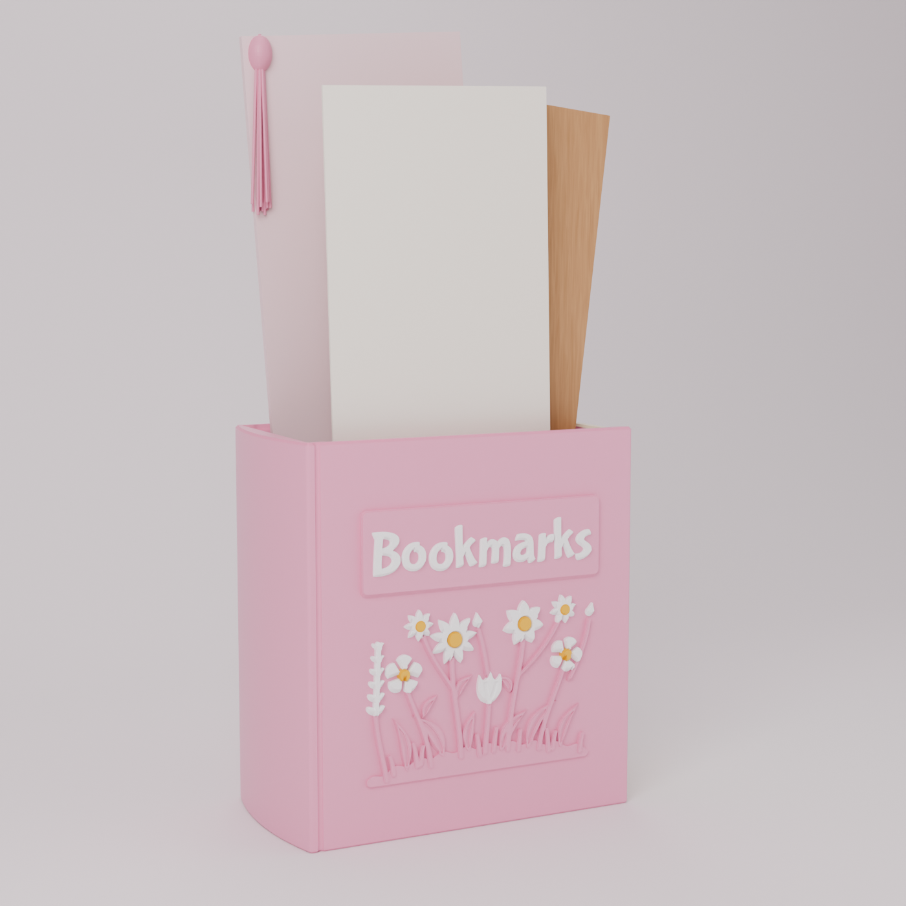

# BK-01 Bookmarks: book-shaped bookmark holder

[](renders/)

A customer commission: a faithful, printable recreation of the pink "Bookmarks" book
holder in the reference photo. It is a miniature hardcover standing upright with an open
top. It has a rounded spine, cover boards with hinge grooves, a page block with page lines
on the fore-edge and at the head, a raised nameplate with white "Bookmarks" lettering, and
a meadow of flowers in relief below it.

| | |
|---|---|
| Envelope | **79.0 × 44.5 × 84.3 mm** (3.11 × 1.75 × 3.32 in), measured on the solid, decoration included |
| Compartment | 69.45 × 38.7 mm, 81.9 mm deep (2.73 × 1.52 × 3.22 in), about 220 ml. The opening is 70.45 × 39.7 mm. |
| Walls / floor | 2.0 mm (4.2–6.0 mm on the spine side) / 2.4 mm. Rounded R2.5 inside corners and floor fillet. |
| Printing | Upright, no supports, one piece. 6 colour regions: 4-, 3- and 2-colour plans for the Bambu H2C. |
| Mass | About 74 g PETG |
| Status | **CAD-validated (13 / 13 checks). Not yet printed.** |

## Files

| File | What it is |
|---|---|
| [`bookmarks.py`](bookmarks.py) + [`bk/`](bk) | The generator: geometry, validation, export, drawing, Blender project, renders. Every dimension is in [`bk/params.py`](bk/params.py). |
| [`models/3mf/BK01_Bookmarks_4colour.3mf`](models/3mf) | Multicolour project as briefed: pink, white, yellow, ivory |
| [`models/3mf/BK01_Bookmarks_3colour.3mf`](models/3mf) | Pink, white and yellow (page edges white). About 4× fewer flushes. |
| [`models/3mf/BK01_Bookmarks_2colour.3mf`](models/3mf) | Pink and white. **No flushing on the two-nozzle H2C.** |
| [`models/stl/BK01_Bookmarks_single_colour.stl`](models/stl) | The whole part as one solid, for any FDM printer |
| `models/stl/BK01_region1..6_*.stl` | The six colour regions as separate solids. They touch but never overlap, and together they make up the whole part. |
| [`models/BK01_Bookmarks.blend`](models) | Blender project: the part, a prop bookmark set, studio, 8 cameras, and the generator scripts embedded as text blocks |
| [`docs/BK01_drawing.pdf`](docs/BK01_drawing.pdf) / [`.png`](docs/BK01_drawing.png) | Dimensioned engineering drawing: front, top and right views, sections A-A and B-B, title block |
| [`docs/BK01_colour_plans.png`](docs/BK01_colour_plans.png) | The three colour plans side by side |
| [`models/BK01_validation_report.md`](models/BK01_validation_report.md) | Every check and every measured number. Also as [`BK01_validation.json`](models/BK01_validation.json). |
| [`PRINT_SETTINGS.md`](PRINT_SETTINGS.md) | Orientation, Bambu Studio settings, colour plans and nozzle grouping, first-print checklist |
| [`renders/`](renders) | Hero, front, three-quarter, back, left (spine), right (pages), top, front detail |
| [`fonts/`](fonts) | Bubblegum Sans (SIL Open Font License 1.1, licence included) |

## Stage A: reading the reference

**Which dimension is which.** The listing gives 3.11 × 1.75 × 3.32 in. In the photo the
front cover is clearly wider than the book is thick. The page edges and the spine are
narrow faces seen at an angle. The bookmarks stand face-on to the cover, and a standard
2-inch (50.8 mm) bookmark only fits that way if the 79 mm runs across the front. So:
**front width = 79.0 mm, depth (spine thickness) = 44.5 mm, height = 84.3 mm.** The
reverse (a 44.5 mm-wide front) would leave a 40 mm-wide slot that a 2-inch bookmark could
not enter flat.

**What makes it read as a book, and how each feature is built:**

| Reference feature | Model |
|---|---|
| Rounded spine on the left | A 3.0 mm-sagitta arc spanning the full depth, with a raised headcap at the top |
| Cover boards with a hinge line | Two 2.0 mm boards. A 1.2 mm round-bottomed hinge groove runs 5.2 mm in from the spine on both covers. |
| Page block, slightly smaller than the covers | Recessed 1.2 mm at the fore-edge ("squares") and 0.8 mm at the head, with 29 page grooves (0.5 mm wide, 1.3 mm pitch) up the fore-edge |
| Open top | A cavity with R2.5 corners and floor fillet, and a 0.5 mm × 45° lead-in at the rim. It is built from exact rounded-rectangle extrusions, with the fillet and lead-in in 0.1 mm sub-layer steps. |
| Raised rectangular nameplate | 56.0 × 18.0 mm, R1.4 corners, +1.0 mm, with bevelled top and sides |
| Raised white "Bookmarks" | Bubblegum Sans, the closest open-licence match to the reference's tall, bouncy hand lettering. Slight per-letter tilt and bounce. 51.6 mm wide, +0.8 mm above the plate, minimum stroke 1.25 mm. |
| Floral relief below | A meadow: two daisies, a broad-petalled cosmos, two five-petal blossoms, two small daisies, a tulip, a lavender spike and buds. Stems, lance leaves with midribs, grass and a scalloped mound below them. |

## Design decisions that affect appearance or function

1. **Decoration stays inside the 44.5 mm.** The deepest relief (the lettering) is 1.8 mm,
   so the front cover plane sits 1.8 mm behind the envelope face and the stated
   dimensions hold with the decoration included.
2. **The spine-side wall is 4.2–6.0 mm, not 2.0 mm.** It carries the spine curve and the hinge
   groove without thinning anywhere. The compartment is still 69.45 mm wide, so a 2-inch
   bookmark has 18 mm to spare. Front, back and fore-edge walls are 2.0 mm, measured to
   the bottom of every groove.
3. **The relief is built for an upright print.** Every raised feature is made in 0.2 mm
   slices, and each slice may reach at most one step lower than the one behind it. So
   every underside, including letters, petals and the nameplate's lower edge, is a
   self-supporting 45° chamfer. Seen from the front this is invisible. It is why the part
   needs no supports.
4. **White lettering is 1.4 mm deep.** It is 0.8 mm proud of the plate plus a 0.6 mm inlay
   into it, so the pink behind doesn't tint the white.
5. **The meadow is drawn for this product in the reference's style, not traced.** The
   reference's flower arrangement isn't legible enough in the photo to copy one-for-one.
   This is a deliberate composition with the same structure (a low mound, tall stems,
   open flower heads, long leaves) and the same placement under the nameplate. Every
   stroke is at least 1.0 mm, gaps are at least 0.7 mm, and colour islands are at least
   3 mm³.
6. **Six separately colourable regions.** The reference has white lettering and pink
   flowers. The brief asked for white petals, contrasting centres and light page edges,
   so all of these are independent parts. The 2-colour plan prints centres pink and page
   edges white, which is the closest to the reference and wastes nothing on an H2C.
7. **Files a slicer reads cleanly.** Boolean modelling leaves zero-length and zero-area
   triangles where faces met. Slicers weld STL vertices by position, and that can turn
   them into non-manifold edges. The exporter welds vertices closer than
   0.05 µm, drops the needles and fins, and flips the slivers away. Volumes change by less
   than 0.02 mm³. The relief is stacked as nested slabs and
   grown 2 µm within its own colour, so no two pieces of relief meet along a bare line. The
   validator then re-reads every file from disk and welds it the way a slicer would.
8. **The book faces −Y.** In the files the front cover faces the viewer in Bambu Studio's
   default view, the spine is on the left and the lettering reads correctly.

## Stage D: engineering validation (summary)

All values are measured on the exported solids. The full numbers are in the
[validation report](models/BK01_validation_report.md).

| Check | Result |
|---|---|
| Envelope | 79.000 × 44.500 × 84.300 mm, error 0.000 |
| Manifold | All 6 regions and the full part are closed 2-manifolds. The full part is **one body**. |
| Colour separation | The regions overlap by at most 0.0002 mm³ and add up to the full volume to within 0.0001 % |
| Islands | Every colour island is at least 3.2 mm³ and joined to the part. None float. |
| Compartment | Hollow from z = 2.4 mm up. 69.45 × 38.7 mm at every height. A 50.8 × 3 × 178 mm gauge and the 4-bookmark prop set show zero interference. |
| Opening | No ledge overhangs the cavity anywhere (0.000 mm² hidden) |
| Walls | At least 2.00 mm everywhere below the rim lead-in |
| Overhangs | Worst unsupported area in any 0.2 mm layer: 0.10 mm². No supports needed. |
| Detail | Under 0.5 % of the lettering and centre area is narrower than 0.5 mm (tapering tips only) |
| Lettering | Minimum stroke 1.25 mm, 51.6 × 9.7 mm, inside the plate with 1.5 mm margin |
| Stability | 3,179 mm² footprint, tipping angle 28° |
| Exported files | Every STL and every 3MF part, re-read from disk and welded by position as a slicer does, is watertight with consistent winding and matching volume, and has the right filament slot |

## Regenerating

```bash
pip install manifold3d shapely numpy matplotlib fonttools trimesh bpy
python bookmarks.py                                   # geometry, validation, STL/3MF, report (~1 min)
python bookmarks.py --docs --blend --render           # ...plus drawing, .blend and renders
```

The geometry is built with manifold3d (exact booleans, guaranteed manifold output) and
shapely (2D artwork), and Blender (bpy 5.x) builds the project file and the renders. Blender's own mesh
booleans aren't used for the printable geometry because they can't guarantee a
watertight result on this much fine relief.
