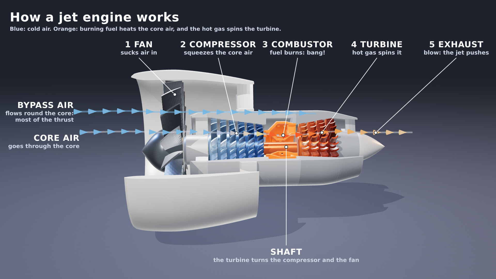
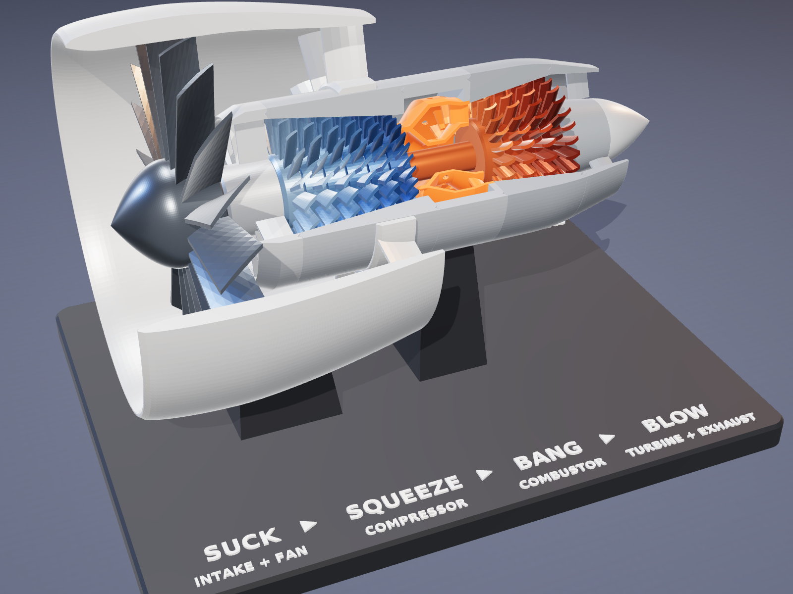
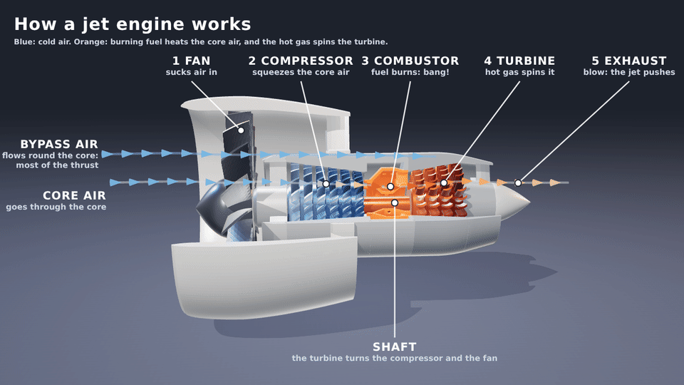
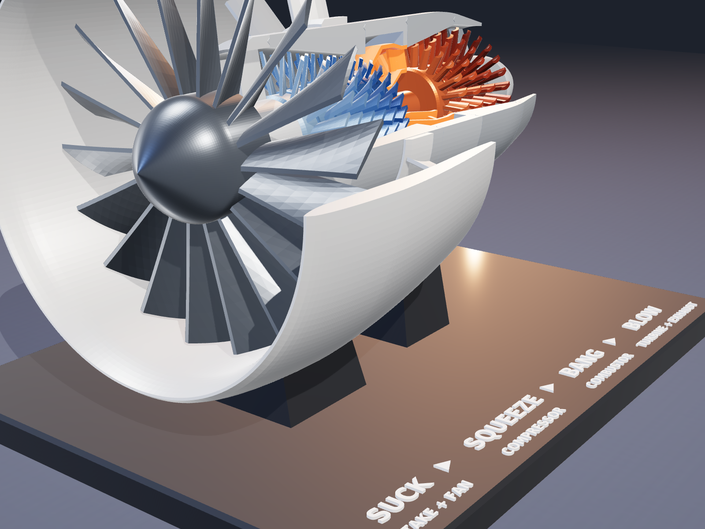
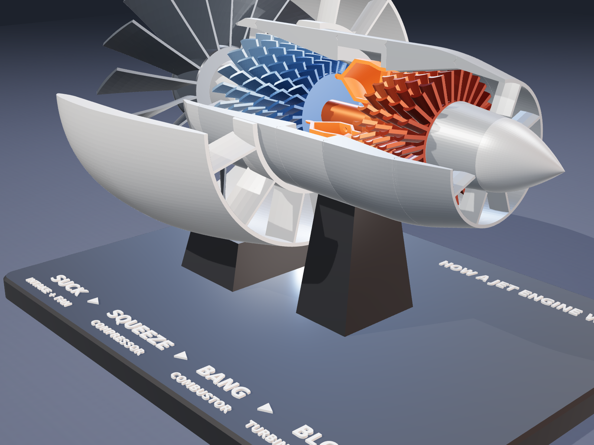

# Cutaway Turbofan: a printable model that shows how a jet engine works



A display model of a high-bypass turbofan, the engine type used on most modern airliners, at
roughly 1:10 scale. A quarter of every static casing is cut away so you can see inside. The
rotor is whole: **turn the spinner and the fan, all six compressor stages and all four turbine
stages turn together on one shaft**, just as they do in the real engine. The stand spells out
the four steps: **SUCK · SQUEEZE · BANG · BLOW**.



| | |
|---|---|
| Size on the stand | 280 × 212 × 188 mm (engine 252 mm long, fan Ø 139 mm) |
| Parts | 20 printed parts on 4 plates, plus 3 short pieces of 1.75 mm filament |
| Filament* | ~720 g PETG (stand 285 g, nacelle 145 g, everything else ~290 g) |
| Supports | none, on any part |
| Printer | any bed of 290 × 220 mm or larger (made for a Bambu Lab H2C) |
| Hardware | none: no screws, no bearings. Glue (CA / superglue) for the casing joints |

\*Estimates from the solid volume (2 walls, 15 % infill), not slicer output. Slice the plates
for real filament and time numbers.

---

## How a jet engine works (and where to see it on the model)



1. **SUCK: the fan.** The big fan at the front pulls in a huge mass of air. On the model it is
   the grey 18-blade rotor behind the spinner.
2. **Most of that air never enters the engine core.** It goes round the core through the
   **bypass duct** (between the white nacelle and the core) and straight out of the back. In
   a modern airliner engine this cold bypass air makes most of the thrust. The vanes at the
   back of the nacelle straighten it out. The sharp ring that splits the flow is the
   **splitter**: outside it is bypass air, inside it is core air.
3. **SQUEEZE: the compressor.** The core air goes through six rows of small blades (blue,
   getting darker towards the back). Look at the casing: the passage gets **narrower** at
   every stage. That is the air being squeezed to many times its starting pressure, which
   also heats it.
4. **BANG: the combustor.** The squeezed air goes into the ring-shaped **combustion chamber**
   (orange). Fuel sprays out of the twelve nozzles on its front dome and burns continuously.
   The rows of holes in the liner let cooler air in to keep the flame in the middle. The
   vanes at its exit aim the hot gas at the turbine.
5. **The turbine.** The hot, fast gas blows through four rows of turbine blades (red) and
   spins them. Now the passage gets **wider** at every stage, because the gas is expanding
   and giving up its energy.
6. **The shaft.** Through the cut-away you can see the orange tube running through the middle
   of the combustor. It joins the turbine to the compressor and the fan, so **the turbine
   drives the compressor and the fan**. That is the loop that keeps a jet engine running.
7. **BLOW: the exhaust.** What is left of the hot gas leaves through the core nozzle around
   the tail cone. Together with the bypass air, it pushes the aircraft forwards.

### What is simplified

This is a teaching model, not an engineering one:

- **One shaft.** Real turbofans have two or three shafts turning at different speeds (the
  fan on a slow inner shaft, the compressor on a fast outer one). Here one shaft drives
  everything, so one turn of the spinner shows the whole idea.
- **No stator vanes between the compressor and turbine rows.** A real compressor has a fixed
  vane row after every rotor row. The gaps between the rows are where those vanes would be.
  The fixed vanes that are modelled are the inlet guide vanes, the combustor exit (nozzle)
  vanes, the bypass vanes and the rear frame struts.
- **Blade angles are limited to 45°** from the engine axis, so every blade prints without
  supports. Real fan tips are flatter than this.

---

## Printing

Open the four plate files in `models/` in Bambu Studio (or Orca / PrusaSlicer). Every part is
already in its print orientation:

| Plate | File | Parts |
|---|---|---|
| 1 | `CutawayTurbofan_plate1_nacelle.3mf` | S1 nacelle (Ø 160 × 118 mm) |
| 2 | `CutawayTurbofan_plate2_stand.3mf` | B1 stand, plus its labels as a second part |
| 3 | `CutawayTurbofan_plate3_core.3mf` | S2–S7 casings, R1 fan |
| 4 | `CutawayTurbofan_plate4_rotor.3mf` | R0 shaft, C1–C6 compressor, T1–T4 turbine |

The STLs for single parts are in `models/stl/`.

**Settings:** PETG (PLA also works), 0.4 mm nozzle, 0.2 mm layers, 2–3 walls, 15 % infill,
**supports off**, part cooling on. Every blade is at least 1.2 mm thick, so it slices as at
least three perimeters.

**Colours.** Every part is its own print, so colour is just filament choice. The renders use
this scheme:

| Parts | Colour |
|---|---|
| Nacelle, casings, tail cone | white / light grey |
| Fan (R1) | dark grey or silver |
| Compressor C1 → C6 | light blue → dark blue (cold air getting squeezed) |
| Combustor liner (S4) | orange. S4 is two bodies (grey case and orange liner) in one object: give each its own filament on a multi-colour printer |
| Turbine T1 → T4 | orange → dark red (hot gas cooling as it expands) |
| Stand and labels | black base, white labels. The labels are a separate part: assign them a second filament, or pause at 12.0 mm to swap |

---

## Assembly (about 30 minutes)

No screws. You need CA glue (superglue), three 6 mm pieces of 1.75 mm filament, and a paper
shim (a sheet of printer paper folded once, about 0.2 mm).

Each module slides along the shaft. The order matters, because the compressor narrows towards
the back and the turbine widens.

1. **Shaft into the fan.** Press the shaft (R0) into the fan's hex bore until it bottoms out.
   The crush ribs make it a firm press fit.
2. **Front frame.** Slide the front frame (S2) onto the shaft from the back, up to the fan.
3. **Compressor stage 1.** Press C1 on from the back (it also has crush ribs). Put the paper
   shim between C1 and the front frame, and press C1 until it just nips the
   shim. Pull the shim out. This sets the running play.
4. **Stages 2–6.** Slide C2, C3, C4, C5 and C6 on in that order. They slide freely and are
   driven by the hex.
5. **Compressor case.** Slide the compressor case (S3) on **from the back** over the stages,
   wide end first. Its V tongue goes into the front frame's groove. Line up the cut-away
   edges and glue the joint.
6. **Combustor.** Slide the combustor (S4) on from the back and glue it to the compressor
   case.
7. **Turbine case.** Slide the turbine case (S5) on from the back and glue it to the
   combustor.
8. **Turbine stages.** Slide T1 (the one with the long tube) in from the back. Its tube goes
   through the middle of the combustor. Then add T2, T3 and T4.
9. **Rear frame.** Slide the rear frame (S6) on from the back over the end of the shaft and
   glue it to the turbine case.
10. **Tail cone.** Push the three filament dowels into the holes in the rear frame's hub,
    add a drop of glue, and press on the tail cone (S7).
11. **Nacelle.** Slide the nacelle (S1) on from the back, over the core, until its inner
    sleeve sits on the compressor case behind the splitter. Line up the cut-aways and glue
    the sleeve.
12. **Stand.** Set the engine in the stand: the two pegs on the rear pylon go into the two
    holes under the combustor, and the front cradle carries the nacelle.

Turn the spinner. The whole rotor should turn with a light, even drag. If it rubs, find the
spot by turning slowly and sand it lightly. The tightest designed gaps are the thrust faces
(0.3 mm), where the rotor rides against the two bearing hubs.

---

## How the design works

- **Rotor.** A printed 8 mm hex shaft carries 11 rotor discs (fan, 6 compressor stages and 4
  turbine stages). The hex drives every disc. The fan and stage 1 are press fits and clamp the
  front bearing hub between them, which holds the rotor in place along its axis. The other
  stages float between stage 1 and the rear bearing hub. The shaft runs in two plain round
  bearings, Ø 10 mm against the hex's 9.24 mm corners.
- **Casings.** They are split into modules at the frames, like a real engine. Every module
  prints standing on its rear face, so every vane row starts on the bed. The modules join
  with 45° V tongues in V grooves, which centre the parts and give the glue a large surface.
- **Printable blades.** Each blade is a twisted, cambered plate with flat ends. Its camber
  line stays within 45° of the print axis, and its thickness is offset sideways, so the end
  on the bed is flat. Each disc prints with its blades standing on the bed.
- **Combustor.** The dome is a 45° double cone, so its underside prints without support. The
  dilution holes and the stand's peg holes are teardrops with 45° pointed roofs.

### What the script checks before it exports

`cutaway_turbofan.py` builds everything from the numbers at the top of the file, checks it, and
then writes the files. The latest results are in `models/CutawayTurbofan_report.txt`:

- **Every part:** one closed solid, fits the bed, no surface steeper than 45° off the bed.
  The widest flat ceiling is 11.2 mm (the tail cone's shaft pocket), a short bridge.
- **Assembly:** no static parts overlap. No rotor discs overlap, except the two crush-rib
  press fits, which overlap on purpose. The engine fits the stand.
- **Running clearance:** the script works out the space the turning rotor sweeps through
  (including every blade tip) and measures the gap to every static part:

  | Static part | Smallest gap to the turning rotor |
  |---|---|
  | Nacelle (fan tips) | 1.68 mm |
  | Compressor case (blade tips) | 0.96 mm |
  | Combustor | 0.95 mm |
  | Turbine case (blade tips) | 0.96 mm |
  | Front and rear bearing hubs (thrust faces) | 0.25–0.30 mm, by design |

**Not checked, because it needs a real print:** how the press fits and the plain bearings feel
in your filament, and how freely the rotor turns. If your printer runs tight, raise `BORE_AF`
or `TIP_GAP` at the top of the script and rebuild.

---

## Regenerating

```bash
pip install -r requirements.txt            # manifold3d, numpy, trimesh, scipy, networkx, fonttools
python cutaway_turbofan.py --out models    # build, check, write plates/STLs/report (~10 s)

cd render && npm install                   # three.js + playwright-core (uses the local Chromium)
node render.mjs ../models/CutawayTurbofan_assembly.glb ../renders/01_hero.png --view hero
node render.mjs ../models/CutawayTurbofan_assembly.glb ../renders/02_flow.png --view flow --w 1920 --h 1080
node render.mjs ../models/CutawayTurbofan_assembly.glb ../renders/10_how_it_works.gif --view flow \
    --w 1280 --h 720 --frames 48 --turn 360 --cycles 4 --fps 16
```

Views: `hero`, `side`, `front`, `rear`, `top`, `flow` (air paths and labels). The GLB and the
parts list for the renderer are written to `models/` but not committed.

| | |
|---|---|
|  |  |
