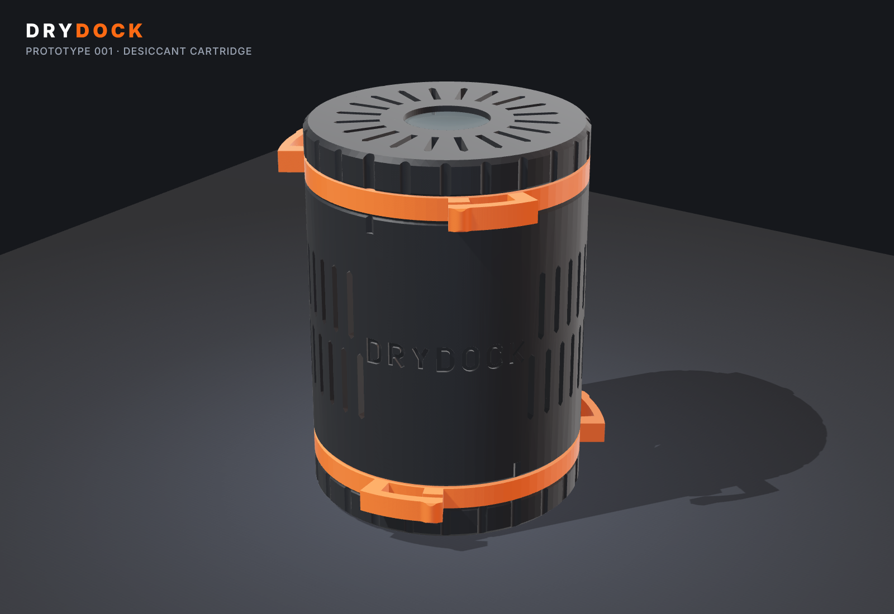
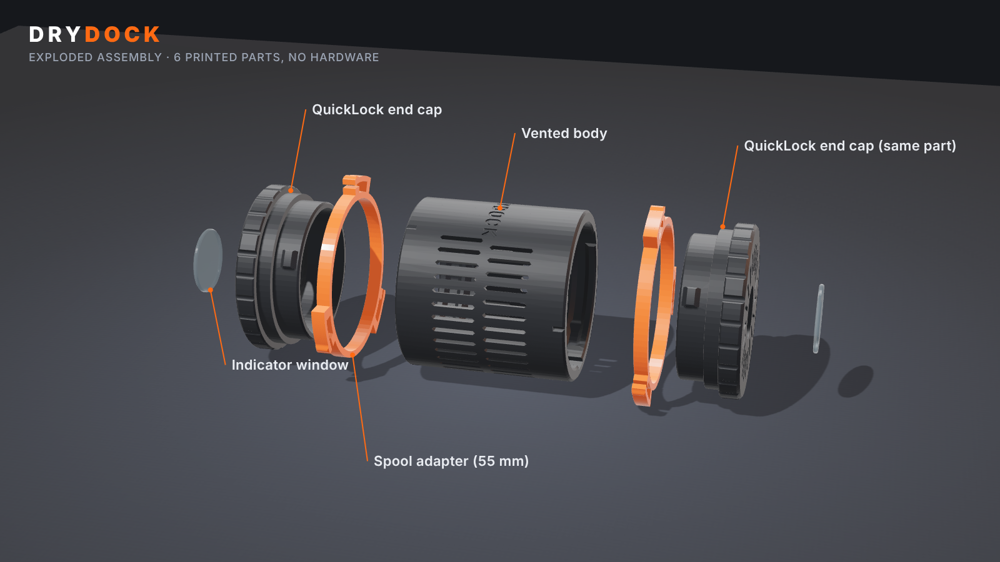
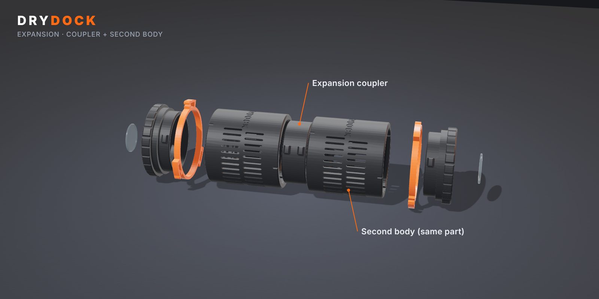
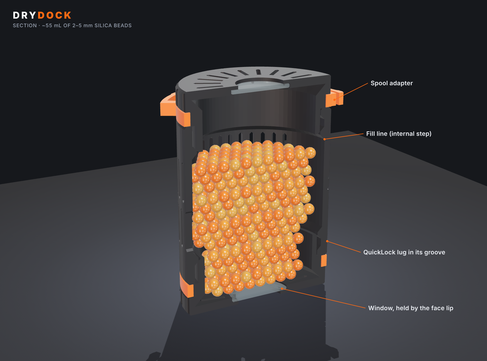
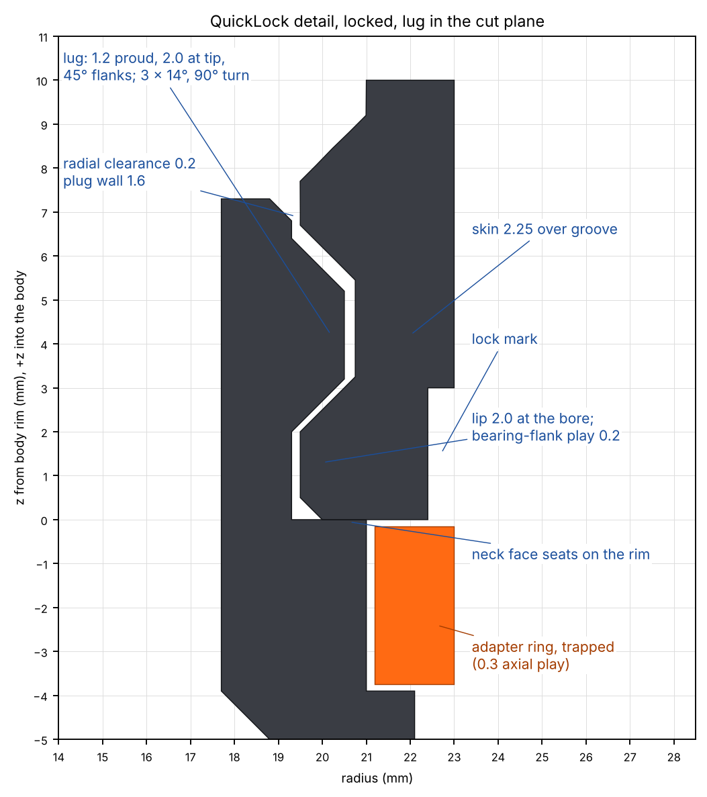
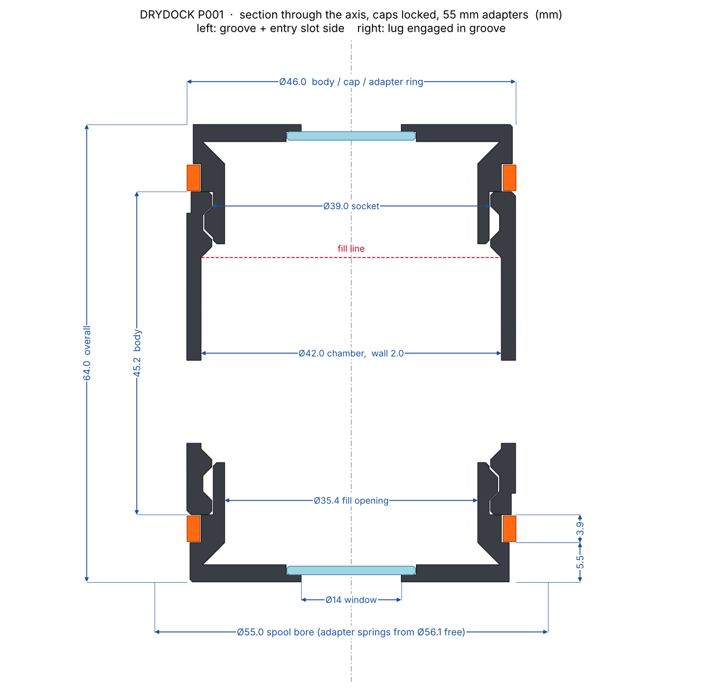
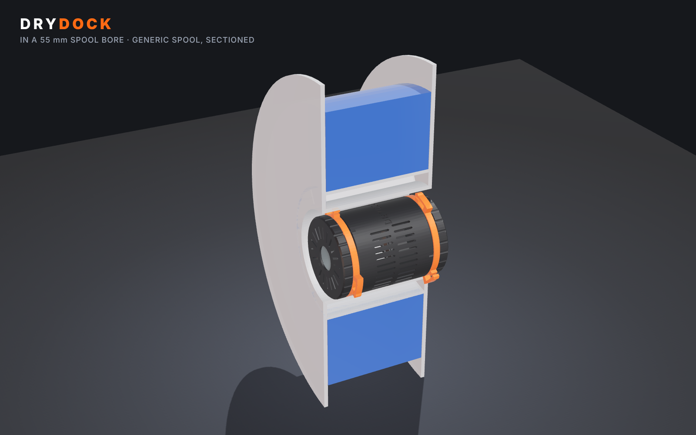
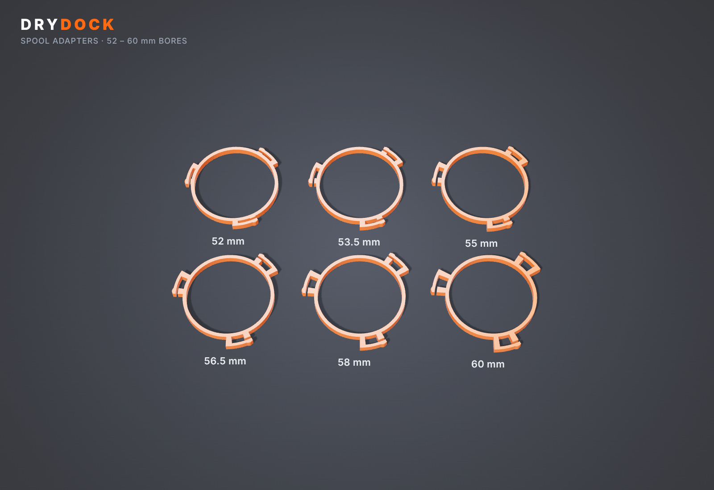
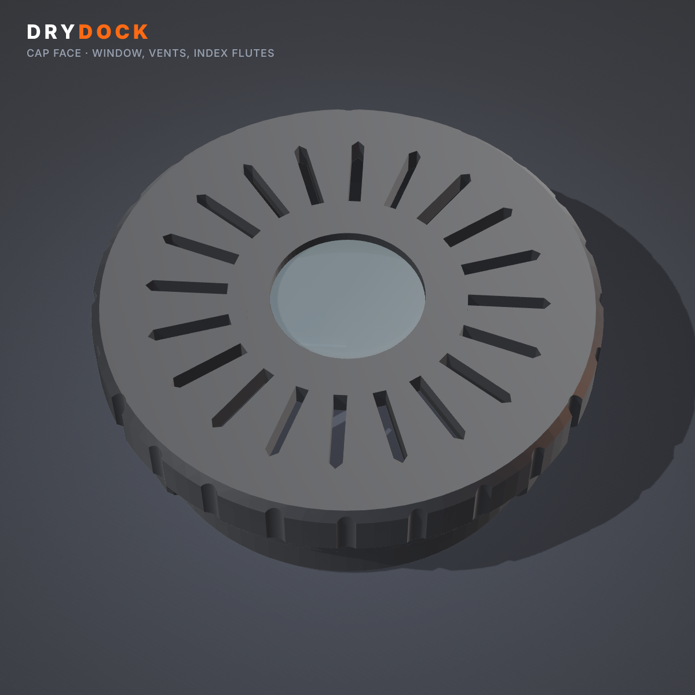

# DRYDOCK Prototype 001: refillable desiccant cartridge for the spool hub



DRYDOCK P001 is a vented, refillable cartridge of silica gel beads that sits in the empty
centre (hub bore) of a filament spool. It has six printed parts and no hardware:

- one **vented body**
- two identical **QuickLock end caps**: a quarter-turn bayonet with a detent click and a hard stop
- two replaceable **indicator windows**
- a pair of interchangeable **spool adapters** that spring-centre it in bores from 51 to 61 mm

An optional **coupler** joins two bodies into one longer cartridge.

Everything is generated by one parametric script, [`drydock.py`](drydock.py) (build123d /
OpenCascade). The same script checks the fits with boolean geometry and exports STEP, STL and
3MF.

> **Status: designed and checked in CAD only. No part of DRYDOCK has been printed or fitted
> to a spool yet.** All fit results below come from geometry. Force numbers are hand
> calculations. The spool dimensions are the brief's preliminary values, not measurements.
> The first physical step is the fit-test plate (see [Test plan](#remaining-tests-in-order)).

| | |
|---|---|
| Overall size | Ø46.0 × 64.0 mm. The adapters' spring arms reach Ø56.1 free and Ø55.0 installed |
| Fits | spool bores of 51–61 mm (six adapter sizes) and spool widths of 67 mm or more (all parametric) |
| Desiccant | 54.8 mL usable, ≈ 38–44 g of 2–5 mm beads; ≈ 4 g of water at 20 % RH, ≈ 8 g at 40 % RH |
| Vents | 65 body slots + 40 face slots, all 1.2 mm wide; 1199 mm² open |
| Plastic | ≈ 41 g PETG for a full set (36 g charcoal, 3.4 g orange, 0.8 g clear) |
| Supports | none, on any part |
| Printer | made for a Bambu Lab H2C; fits any bed (largest plate is 166 × 46 mm) |

---

## Contents

1. [Stage 1: Engineering analysis](#stage-1-engineering-analysis)
2. [Stage 2 & 3: CAD architecture and implementation](#stage-2--3-cad-architecture-and-implementation)
3. [Stage 4: Validation](#stage-4-validation)
4. [Stage 5: Deliverables](#stage-5-deliverables), with assembly, dimensions, print settings, estimates and limitations

---

## Stage 1: Engineering analysis

### The problem, stated as constraints

| Constraint | Value used | Source / confidence |
|---|---|---|
| Spool hub bore | Ø55 mm (Bambu reusable spool), third-party spools 52–60 mm | brief, **unmeasured** |
| Spool width | 67 mm | brief, **unmeasured** |
| Cartridge must not protrude past the flanges | total length = width − 3 mm = 64 mm | design margin |
| Cartridge OD | 46 mm (the brief allowed 46–48) | chosen: see below |
| Material | PETG (Tg ≈ 80 °C), ASA later | brief |
| Desiccant | indicating silica gel beads, 2–5 mm | assumption |

**Why 46 mm and not 48.** The space between the body and the bore is where the adapter
springs work. At 46 mm, a 55 mm bore leaves 4.5 mm per side. That is enough for a spring arm
(1.5 mm), the gap it deflects into (≥ 1 mm) and its contact bump. It still leaves room for
bores down to 51 mm. At 48 mm, bores under about 54 mm would get no spring at all. Going to
48 would buy 9 % more volume. Fitting more spools mattered more.

### Main mechanical challenges

1. **A bayonet that prints without supports in both ends of an upright tube.** A bayonet
   joint takes its load on a flat lip. That lip faces down on one end of an upright body
   and on every cap printed face-down: an unsupported ledge. **Decision:** every lug and
   groove flank is 45°, so any orientation prints. The cost is a wedge: an axial pull on a
   45° flank pushes the lugs inward. The cap could only come off by squeezing the whole plug
   ring 1 mm inward at all three lugs at once. That needs roughly 250 N or more, against a
   cartridge that weighs under 1 N.
2. **"Secure" and "no fragile snap tabs" pull against each other.** **Decision:** no tabs
   at all. The detent is a low bump (0.25 mm) on the groove floor just before the locked
   position. The whole plug ring flexes slightly (ovalises) to pass it. A ring is the
   stiffest, least fragile spring there is, and it is already part of the cap.
3. **Bores vary from spool to spool, and spools are not round to 0.1 mm.** Rigid adapter rings
   would be either loose or jammed. **Decision:** each adapter has three cantilever spring
   arms that take up ±0.85 mm. They come in 1.5 mm steps, so the ranges overlap. Each arm
   has an overload stop, so forcing the wrong size into a bore cannot over-strain it.
4. **Bead containment vs. airflow.** Every gap must be smaller than a bead, but the vent
   area must stay large. **Decision:** all vents are 1.2 mm slots. A sphere cannot pass a
   slot narrower than itself, however long the slot is. Every joint gap is ≤ 0.2 mm.
5. **Adapters retained without hardware.** **Decision:** the adapter ring sits on a neck of
   the cap, trapped between the cap head and the body rim. It cannot come off while the
   cap is locked. It changes whenever the cap is off, which is anyway when you refill.

### Architecture



- The **body is an open tube with an identical bayonet socket at each end.** The second end
  is the first turned 180° about a cross axis (a rotation, not a mirror). Both ends therefore
  have the same handedness, and one cap design fits both. The tube prints upright in a
  single piece with no floor. Either end opens for refilling.
- The two **caps are the same STL printed twice.** Each holds a window and carries an
  adapter.
- **Expansion reuses the same socket.** The coupler is just two cap plugs back-to-back. Two
  bodies lock to it rim-to-rim and form one continuous chamber. The first cartridge's
  architecture is unchanged, and expansion adds one small part.



Considered and rejected:

- **A closed-bottom body with one cap.** One joint fewer, but an expansion section would
  then need a male plug under a 46 mm tube. That is a 3 mm downward ledge when printed.
- **A threaded cap.** It does not meet "quarter turn", and coarse printed threads bind when
  silica dust gets in.
- **A side-wall window.** It is invisible once the cartridge is in the bore. The window
  is in the cap face, which is the only surface you can see on a spool sitting in an AMS.

### Internal volume and desiccant capacity (computed from the solid model)



- The cavity with both caps on is **72.5 mL**.
- The **usable fill is 54.8 mL**: fill up to the internal step at the top socket, with
  one cap on. The rest is the space the second cap's plug sweeps through. Beads there
  could fall into the open grooves and jam the bayonet.
- Bead bulk density is 0.70–0.80 g/mL, so that is **≈ 38–44 g of silica gel**.
- Equilibrium uptake for Type A gel is about 10 % of its own mass at 20 % RH and about 20 %
  at 40 % RH. The cartridge can therefore hold **≈ 4 g of water at 20 % RH and ≈ 8 g at
  40 % RH** before it is spent.
- For scale: a 1 kg spool of PETG takes up roughly 2–4 g of water at saturation, and nylon
  10–30 g. A sealed 30 L box at 50 % RH holds only ≈ 0.35 g of water vapour in its air.
- **Conclusion:** one cartridge is enough to *keep dry filament dry* in a closed AMS, box or
  bag for a long time. It cannot *dry wet filament*, because that needs heat. Say this
  plainly in any product copy.

### Airflow and containment

Moisture moves into the cartridge by diffusion, not by airflow. A closed AMS or box has no
forced flow through the cartridge, so open area and path length are what matter.

- **Open area:** body slots 858 mm², cap faces 341 mm².
- **Through-wall path:** 2 mm. Inside the bead bed, vapour spreads to the centre in under
  about a minute (D_eff ≈ 7 × 10⁻⁶ m²/s over 20 mm), so the bed itself is not the limit.
- **The real bottleneck is the outside.** The body vents face the narrow gap between the
  cartridge and the spool bore, which is open only at the two ends between the adapter
  arms. Adding up those resistances gives an overall conductance of about 2 × 10⁻⁶ m³/s.
- With 50 % RH outside and dry gel inside, that is **≈ 0.07 g/h**. A sealed 30 L box at
  50 % RH would be pulled down in a few hours, and the gel would take days to saturate.
- This is fine for storage. It is an order-of-magnitude estimate, not a measurement:
  see test T6.
- **This is why the adapters are open arms, not solid rings.** A solid ring would seal the
  bore gap and cut the body vents off from the box air.

Containment: the largest gap on every path from the chamber to the outside.

| Path | Gap |
|---|---|
| Body vent slots / cap face slots | 1.2 mm wide |
| Plug to socket bore (radial) | 0.20 mm |
| Cap lift when locked (axial play) | 0.20 mm |
| Bayonet entry slot at the rim | covered by the cap neck face (≤ 0.2 mm gap) |
| Window to its recess | 0.10 mm |
| Body-to-body joint on the coupler | ≤ 0.4 mm |

Beads of **≥ 1.5 mm** cannot escape (1.2 mm slot plus print variation). Use 2–5 mm beads.
Avoid "fine" 0.5–2 mm grades.

### Bayonet (QuickLock) geometry



| Feature | Value |
|---|---|
| Lugs | 3 × 14° wide, 1.2 mm proud, 2.0 mm at the tip, 45° flanks |
| Turn | 90° clockwise seen from the cap face, like a jar lid |
| Radial clearance, plug to bore | 0.20 mm |
| Lug tip to groove floor | 0.25 mm |
| Bearing-flank play | 0.20 mm |
| Inner-flank play | 0.50 mm |
| Detent | cosine bump, 0.25 mm interference, ±6° wide, ramp ≈ 20°, just before the locked position |
| Hard stop | end of each groove, 0.84° past locked; web between grooves 14.3° (5.2 mm) |
| Retaining lip | 2.0 mm at the bore |
| Skin over the groove | 2.25 mm |

The cap is located axially by its neck face seating on the body rim, not by the lugs. The
lugs only resist pull-off. Index marks: the three deeper flutes on each cap head sit over
the lugs. They line up with the V-marks on the body rim when locked.

### Likely failure points

| # | Failure | Mechanism | Mitigation in P001 | Residual risk |
|---|---|---|---|---|
| F1 | Detent too stiff, or no click | Real clearance differs from CAD by ±0.1 mm (extrusion width, elephant's foot, shrinkage) | 10-minute fit gauge; `detent_interference` and `fit_radial` parameters | **High until tested**: this is the most tolerance-sensitive feature |
| F2 | Cap will not enter or turn | Tight plug fit: first-layer squish on the face-down cap, seam blobs | 0.2 mm radial clearance, plug tip chamfer, elephant-foot compensation | Medium |
| F3 | Beads jam the bayonet | Beads sitting in the open groove when the second cap goes on | Fill line at the internal step, below the top socket; instruction to tip loose beads out | Medium (user-dependent) |
| F4 | Cartridge loose in the spool | Bore larger than expected, or the adapter arms creep | 1.5 mm size steps, overlapping ranges; arm strain ≤ 0.82 % nominal | Medium: creep at ~16 MPa needs a 2–4 week test |
| F5 | Adapter arms snag | The spool bore has internal ribs, clips or a stepped mouth | Arms are only 3.6 mm tall, at 3 points, near the cartridge ends | **Unknown: measure a real Bambu spool** |
| F6 | Cartridge softens | A PETG cartridge left in a filament dryer or an AMS drying cycle above ~65 °C | Documented limit; ASA for production | Medium |
| F7 | Window unreadable | Translucent PETG too cloudy at 1.2 mm | Film-window option (clear PET/PC sheet + retainer ring) | Low |
| F8 | Silica dust on the filament | Beads abrade each other | Dust-free beads; shake the beads before filling | Low |
| F9 | Vent ribs crack if squeezed | 2.4 × 2.0 mm ribs, 11.6 mm long | Two staggered rows with a solid hoop band between them; 2 mm wall | Low |

### Assumptions that need physical validation

1. The Bambu reusable spool's bore: diameter at both mouths and at mid-depth, roundness,
   any internal ribs or clips, and the usable depth.
2. The detent torque and feel on your printer and filament. The calculated torque is a
   *lower bound* (free-ring model).
3. Adapter arm hold and centring in real bores, and whether the hold survives weeks under
   load.
4. Whether 1.2 mm translucent PETG shows orange vs. green clearly through a Ø14 mm window.
5. The size distribution of the beads you actually buy (anything under 1.5 mm will leak).
6. Moisture performance: RH in a sealed box with vs. without the cartridge, logged.
7. Whether the spool holder you use leaves the bore empty. The cartridge works where the
   spool rides on rollers (AMS / AMS 2 Pro / AMS HT style), in dry boxes and in bags. It
   cannot be used where a spindle passes through the bore.

---

## Stage 2 & 3: CAD architecture and implementation

**Tool choice.** Fusion 360 isn't available in this environment. The model is written in
**build123d**, an open-source Python CAD library on the OpenCascade kernel (the kernel
behind FreeCAD). It produces exact B-rep solids, so the STEP files are true CAD geometry,
not meshes. Fusion 360, SolidWorks, Onshape and FreeCAD all import them as editable solid
bodies.

### Script layout ([`drydock.py`](drydock.py))

| Section | What it does |
|---|---|
| `Params` | **every** dimension, in one dataclass, plus `d()` for derived values (radii, lug centre, groove ends, body length…) and `check()` for parameter sanity rules |
| `lug()`, `socket_cutter()` | the bayonet, male and female, built once in a "socket frame" and reused by the body, the caps, the coupler and the fit gauge |
| `make_body / make_cap / make_window / make_film_retainer / make_coupler / make_adapter / make_fit_gauge` | one function per part |
| `wordmark_cutters()` | the DRYDOCK wordmark, drawn from a built-in stroke alphabet so it comes out the same on every machine (no font files) and wrapped letter by letter onto the body |
| `validate()` | boolean fit checks: insertion path, rotation sweep, pull tests, adapter, window, coupler; plus spring and detent calculations |
| `mesh_checks()` | watertight / single body, overhangs > 45° in print orientation, wall thickness by ray casting |
| `capacity()` | cavity and fill volume by subtracting the parts from the envelope |
| `export_all()` | STL + STEP per part in print orientation, an assembly STEP, plate 3MFs |

### Running it

```bash
cd drydock
pip install -r requirements.txt
python drydock.py                       # ~40 s: builds, validates, exports to ./models
python drydock.py --quick               # skip the rotation sweep
python drydock.py --set spool_bore=56.5 --set spool_width=70
python drydock.py --set fit_radial=0.25 --set detent_interference=0.2   # after the fit test
python drydock.py --params my_printer.json
```

Changing a parameter regenerates every dependent feature. For example, the socket bore and
the cap neck follow `body_od` unless set explicitly, the body length follows `spool_width`,
and the vent rows re-space. Adapter sizes that no longer fit are skipped with a warning.
Tested: with `body_od=47, spool_bore=57, spool_width=70, vent_width=1.0` it rebuilt and
passed all 16 checks.

Renders and drawings: `python render/scenes.py && (cd render && npm install && node render.mjs)`,
and `python render/drawing.py`.

**Importing into Fusion 360:** Insert → Insert Mesh is the wrong route. Use **File →
Open → `models/step/DD001_assembly_locked.step`** (or any single-part STEP). You get solid
bodies you can edit with direct-modelling tools. The parametric history lives in
`drydock.py`, not in Fusion.

---

## Stage 4: Validation

The full generated report is [`models/DD001_validation_report.md`](models/DD001_validation_report.md),
with raw numbers in `models/DD001_report.json`. **All 16 checks pass.** Each one is a boolean
intersection of the real solids, reported as overlap volume in mm³.

| Check | Result |
|---|---|
| Cap enters straight in (7 positions along the path) | 0 overlap |
| Rotation 0–65° | 0 overlap (free turning) |
| Rotation 70–85° | 0.75–2.2 mm³ overlap: the deliberate detent bump (0.25 mm plug flex) |
| Rotation 87.5–90° (locked pocket) | 0 overlap |
| Rotation 91.8° / 94° | 2.5 / 9.2 mm³: the hard stop works |
| Locked cap lifted 0.15 mm | 0 (within play) |
| Locked cap lifted 0.35 / 0.8 mm | 2.1 / 8.4 mm³: the lugs bear on the lip |
| Unlocked cap pulled 0.8 mm | 0: comes straight out |
| Same cap on the second (rotated) end, locked / pulled | 0 / 2.8 mm³ |
| Adapter vs cap and body | 0 / 0 |
| Window vs cap | 0.30 mm³: only the six crush ribs, as designed |
| Coupler locked into body A and body B | 0 / 0 |
| All 13 STLs watertight, one body each | yes |
| Largest unsupported overhang patch (> 45°) | 1.08 mm² (ceilings of the 0.45 mm-deep letters) |

**What is not validated** (and cannot be in CAD):

- real print tolerances
- detent feel
- adapter hold in a real spool
- creep
- window clarity
- moisture performance
- spool dimensions

These are the [remaining tests](#remaining-tests-in-order).



---

## Stage 5: Deliverables

| Deliverable | Where |
|---|---|
| Parametric CAD source | [`drydock.py`](drydock.py) |
| STL per printable part (print orientation) | [`models/stl/`](models/stl/) |
| STEP per part + locked assembly | [`models/step/`](models/step/) |
| Plate 3MFs (colours set; choose printer/filament profiles on import) | [`models/3mf/`](models/3mf/) |
| Validation report | [`models/DD001_validation_report.md`](models/DD001_validation_report.md) |
| Exploded view, section, in-spool view, adapter set, drawings | [`renders/`](renders/) |

### Parts list

| ID | File | Qty | Colour | Notes |
|---|---|---|---|---|
| A | `DD001_A_body` | 1 | charcoal | print upright, either end down |
| B | `DD001_B_cap_x2` | 2 | charcoal | print face-down on a textured plate |
| C | `DD001_C_window_x2_clear` | 2 | clear / translucent PETG | flat |
| C2 | `DD001_C2_film_window_retainer_x2_optional` | 2 | any | only with cut-film windows (see below) |
| D | `DD001_D_adapter_<size>mm_x2` | 2 | orange | pick the size for your spool; flat |
| D0 | `DD001_D_adapter_flush_x2` | 2 | orange | plain trim ring for use outside a spool, or bores < 51 mm (no grip) |
| E | `DD001_E_coupler_expansion` | 1 | charcoal | expansion only, plus a second body (A) |
| T | `DD001_T_fit_gauge_socket` | 1 | any | fit test: print this with one cap first |

**Choosing an adapter.** Measure the spool bore with calipers at both ends. Use the size
whose range contains your measurement:

| Adapter | Fits bores |
|---|---|
| 52 | 51.1–52.8 |
| 53.5 | 52.6–54.3 |
| **55 (Bambu default)** | **54.1–55.8** |
| 56.5 | 55.6–57.3 |
| 58 | 57.1–58.8 |
| 60 | 59.1–60.8 |

For anything else: `--set spool_bore=<your size>` makes a matching adapter.

### Dimensions

**Overall (assembled, locked):** Ø46.0 × 64.0 mm. The adapter contact is Ø56.1 free and
Ø55.0 installed.

| Part | Envelope | Key dimensions |
|---|---|---|
| Body | Ø46.0 × 45.2 | wall 2.0; chamber Ø42.0; socket bore Ø39.0; collars 9.2 long; 65 vent slots 1.2 × 11.6 in two staggered rows; groove floor Ø41.5; skin over groove 2.25; wordmark 4.2 tall, 0.45 deep |
| Cap | Ø46.0 × 16.7 | head 5.5 (face 2.4); neck Ø42.0 × 3.9; plug Ø38.6 × 7.3, wall 1.6, bore Ø35.4; lug tips Ø41.0; 24 grip flutes (3 deep index flutes); 20 face slots 1.2 × 7.4; window aperture Ø14, seat Ø18.2 × 1.4 |
| Window | Ø18.0 × 1.2 | 0.3 mm edge chamfers; held by 6 crush ribs (0.15 mm) |
| Film retainer | Ø18.0 / Ø14.0 × 0.85 | for 0.5 mm film |
| Adapter | ring Ø42.4 / Ø46.0 × 3.6; arms to Ø(bore + 1.1) | 3 arms 1.5 thick × 10.5 long; bumps 0.7 high with 0.45 mm lead-ins; overload stop 1.0 mm |
| Coupler | Ø41.0 (lugs) × 14.6 | same plug and lugs as the cap, both ends |
| Fit gauge | Ø46.0 × 9.2 | one body socket |

### Assembly

1. **Fit-test first** (`DD001_plate4_fit_test.3mf`: gauge + one cap, about 45 minutes).
   Push the cap into the gauge, turn it clockwise, and feel for:
   - a firm spot in the last ~20°
   - then a click into the locked position
   - then a hard stop

   It should not pull out when locked, and it should come straight out when turned back.
   - Too tight to enter: `--set fit_radial=0.25`
   - Too hard to turn over the click: `--set detent_interference=0.2`
   - No click: `--set detent_interference=0.3`

   Re-export only after a test. Log what you changed.
2. **Windows:** from the inside of each cap, press a window into its recess until it sits on
   the lip. The crush ribs hold it. To replace one, push it out from the outside with a
   finger through the aperture.
3. **Adapters:** slide one adapter ring over each cap's neck (either face up).
4. **First cap:** line the cap's three deep flutes roughly up with the three entry slots
   inside the body rim. Rotate gently until the cap drops in. Turn it **clockwise** (looking
   at the cap face) until it clicks. The deep flute now lines up with the V-mark on the body.
5. **Fill:** stand the body on that cap. Pour beads through the 35 mm opening up to the
   **internal step** (the taper below the open socket): about 55 mL, or 38–44 g. Tap to
   settle the beads. **Tip out any beads sitting in the top socket's grooves.**
6. **Second cap:** fit and lock it the same way.
7. **Into the spool:** push the cartridge into the bore. The spring arms centre it. To
   remove it, pull it out by the cap heads.
8. **Expansion (optional):**
   - Lock the coupler into body 1 by turning the coupler.
   - Lock body 2 onto the coupler by turning body 2. The rims meet flush.
   - Cap both ends.
   - Twisting the two bodies one way releases only the second joint. Twisting them the
     other way releases only the first.

**Recharging.** When the windows turn from orange to green:

- Remove one cap and pour the beads out.
- Regenerate **the beads only**, following the supplier's instructions. That is typically
  2–3 h at 100–120 °C in an oven, on a tray.
- **Never heat the PETG cartridge above ~65 °C.** PETG softens at about 80 °C, and an
  ASA cartridge is good to about 90 °C.
- Cool the beads in a sealed jar, then refill.

### Suggested Bambu Lab H2C print settings

Settings for the system **Bambu PETG HF / PETG Basic** profile, 0.4 mm nozzle:

| | Body + caps (plate 1) | Adapters (plate 2/5) | Windows (plate 3) | Fit test (plate 4) |
|---|---|---|---|---|
| Filament | PETG, black / charcoal | PETG, orange | PETG translucent / clear | PETG (same spool as plate 1) |
| Layer height | 0.20 mm | 0.20 mm | 0.20 mm (6 layers) | 0.20 mm |
| Wall loops | 4 | 4 (springs become solid perimeters) | — | 4 |
| Top / bottom shells | 5 / 5 | 5 / 5 | 100 % solid, monotonic | 5 / 5 |
| Sparse infill | 20 % gyroid (only the cap heads have any) | — | — | 20 % |
| Supports | **off** | off | off | off |
| Plate | **Textured PEI** (matte cap faces, no glue) | Textured PEI | **Smooth PEI + glue stick** (glossy, clearer face) | Textured PEI |
| Nozzle / bed | 250–255 °C / 70 °C | same | 255 °C / 70 °C, slow outer wall | same |
| Elephant-foot compensation | **0.15 mm** (protects the face slots and the plug fit) | 0.1 mm | 0 | 0.15 mm |
| Seam | aligned | aligned | — | aligned |

Notes:

- Don't pre-scale for shrinkage; the slicer profile handles PETG.
- For ASA, test the fit gauge first and expect to add about 0.05 mm to `fit_radial`.
- PLA is fine for a quick shape check. Tune the detent in the production material, though:
  PLA is about 1.7× stiffer than PETG, so the click will feel much firmer.
- The H2C's two nozzles let you print plate 1 and the orange adapters as one two-colour
  plate if you prefer.
- **Window without clear filament:**
  - Cut an 18 mm disc from clear PET or polycarbonate sheet about 0.5 mm thick (blister
    packaging works).
  - Drop it into the seat and press a printed film retainer (C2) on top.
  - For other sheet thicknesses: `--set film_thickness=<t>`.

### Filament and time estimates

These are **estimates from solid volume, not slicer output.** Slice the 3MFs for real
numbers.

| Plate | Contents | ≈ Filament | ≈ Time on H2C |
|---|---|---|---|
| 4: fit test | gauge + 1 cap | 15 g | 40–50 min |
| 1: main | body + 2 caps | 36 g charcoal | 1 h 30 – 2 h |
| 2: adapters | 2 × 55 mm | 3.4 g orange | 15–20 min |
| 3: windows | 2 windows | 0.8 g clear | ~10 min |
| **Full cartridge** | plates 1–3 | **≈ 41 g** | **≈ 2–2.5 h** |
| Expansion | coupler + second body | 20.5 g | ~1 h |
| Adapter set | all six sizes, ×1 each | 10.3 g | ~40 min |

The silica gel is extra: 38–44 g per cartridge.

### Known limitations

- **No physical test yet.** Everything above is CAD validation and hand calculation.
- **Spool dimensions are assumptions.** The Bambu bore's internal features are unknown
  (risk F5).
- **The detent force is uncertain** by perhaps 2–3×. It depends on your printer's real
  clearances. The fit gauge exists for this reason.
- **Not usable** on spool holders that put a spindle through the bore.
- **PETG cannot go through a hot drying cycle.** It may also creep at 50–60 °C over long
  periods. Move to ASA for production, and for any dryer use.
- Each **adapter size covers a ±0.85 mm range.** Out-of-round spools at the edge of a range
  may need the next size.
- **The window shows the beads nearest the cap face.** Those saturate first, so it is a
  conservative (early) indicator, not an average.
- **Detents can wear.** The detent bump and lugs are PETG on PETG. Wear over hundreds of
  cycles is untested.
- **It keeps filament dry; it does not dry wet filament.**

### Remaining tests, in order

| # | Test | Pass criterion |
|---|---|---|
| T1 | Measure 3 Bambu reusable spools and 3 third-party spools: bore at both mouths and mid-depth, depth, internal features | Data recorded; adapter sizes confirmed or re-parameterised |
| T2 | Fit gauge + cap in PETG on the H2C | Enters freely; firm spot, then a click; hard stop; no pull-out when locked; 20 lock/unlock cycles without whitening |
| T3 | Full print; fill with 2–5 mm beads; shake hard for 60 s over white paper | No beads escape; less than a trace of dust |
| T4 | Install in the spool; cycle the spool in an AMS for 24 h | Cartridge stays centred and in place; nothing rubs |
| T5 | Leave installed for 2–4 weeks, then re-measure the push-out force | Retention ≥ 2 N (weight is about 0.8 N) |
| T6 | Sealed 30 L box at ambient RH, with a hygrometer; log RH with and without the cartridge | RH drops to < 20 % within 24 h; the window stays orange until the gel is near capacity |
| T7 | Window readability: compare beads under the window with loose beads at 0 %, 50 % and 100 % saturation | Colour change obvious at arm's length |
| T8 | Drop the filled cartridge from 1 m onto a hard floor, 3 times | Caps stay locked; no cracks |
| T9 | (ASA) 8 h at 65 °C and at 85 °C | No deformation; fit unchanged |




