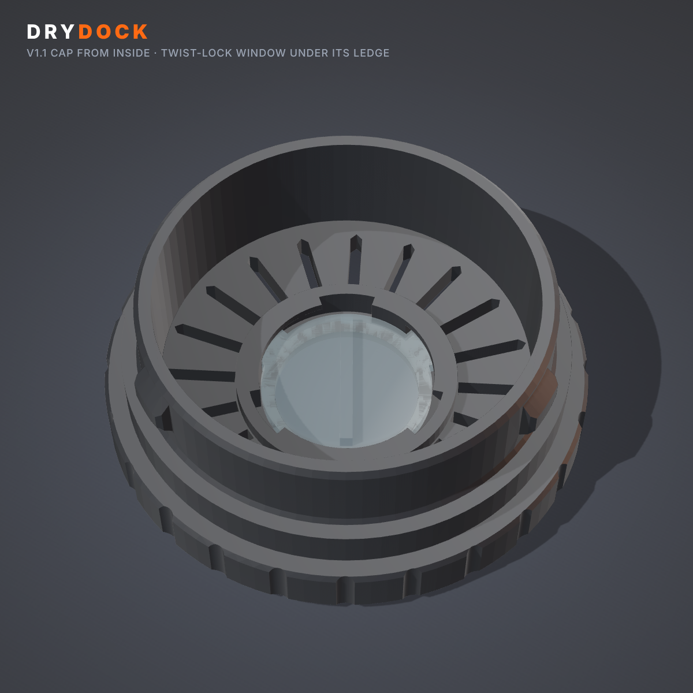
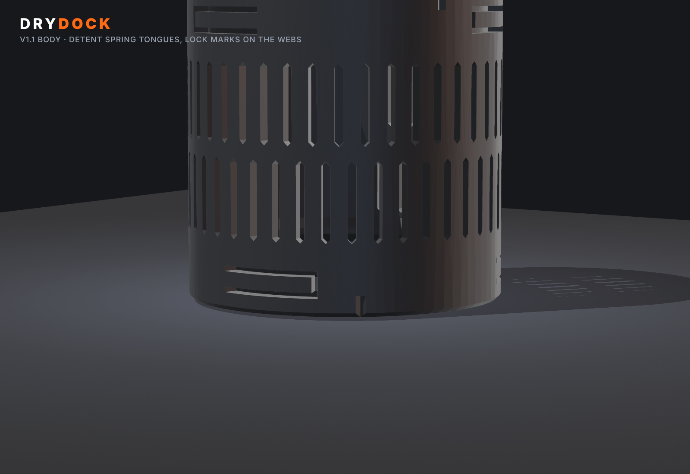

# DRYDOCK V1.1 (development)

Prototype 001 with the corrections from the mechanical design review. **Start with
[DESIGN_REVIEW.md](DESIGN_REVIEW.md).** Prototype 001 stays unchanged in the parent folder.

```bash
cd drydock/v1.1
python drydock_v11.py                 # build, validate (21 checks), export to ./models (~1 min)
python drydock_v11.py --set detent_interference=0.4     # after the fit test, e.g.
python analysis/tolerance_stack.py 13 # clearance and detent Monte Carlo (P001 vs V1.1)
python analysis/containment.py v11    # largest bead that can escape (add 'sealed' for joints only)
python analysis/plug_fea.py           # plug stiffness FEA (~20 min)
python render_v11.py && node render_v11.mjs   # review renders (needs ../render/node_modules)
```

**Print the fit-test plate first:** `models/3mf/DD011_plate4_fit_test.3mf`. It contains the
double-ended gauge, two detent tuning rings, a cap, a window and a 55 mm adapter. Use the
decision table in the review to set the parameters, then print plates 1–3.

| What changed | Where |
|---|---|
| R1 clearances (fit 0.30, tip 0.35, flank play 0.40, slot 0.40), lug 1.3 tall | `Params` |
| R2 detent on a spring tongue in the collar (0.30 mm) | `socket_cutter` |
| R3 lead-in ramp on each lug's leading bearing flank | `lug` |
| R4 lock marks and index flutes on the stop webs | `socket_cutter`, `make_cap` |
| R5 head wall 2.4, deep flutes 0.6, plug-root chamfer 0.4, mouth chamfer 0.8 | `Params`, `make_cap` |
| R6 twist-lock window, plus a film carrier for clear sheet | `make_cap`, `make_window`, `make_film_retainer` |
| R7 adapter lead-in 1.15 mm at 35° | `make_adapter` |
| R8 fit-test plate | `make_fit_gauge_double`, `make_fit_gauge` |



