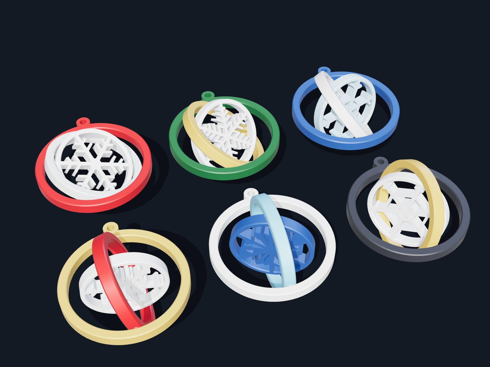
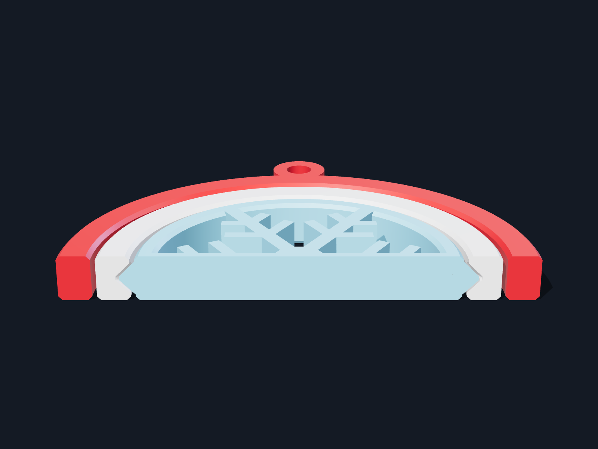

# Odd Layer FL-05 FLURRY


**Print-in-place gyro snowflake ornaments.** Three nested bodies print flat in one piece: an
outer ring with a hanging eyelet, a middle gimbal ring and a snowflake core. Pop it off the
bed, give each ring a twist to free it, and both stages spin. Six different flakes share the
same frame, so they make a matching set.

| | |
|---|---|
| Size | 70.8 × 77.4 × 7.0 mm |
| Material | about 20 cm³ each (roughly 25 g of PLA at 100 % fill; less with infill) |
| Supports | none |
| Hardware | none (thread or a hook through the 4.2 mm eyelet) |
| Colours | 1, or up to 3: each body is a separate part in the 3MF |
| Status | **CAD-validated only: not yet printed** |




## How the joint works



Each inner body carries two 45° cone pivots that print inside matching cone sockets in the
ring around it. The socket is the same cone pushed 0.5 mm outward, which leaves 0.35 mm of
clearance square to the surface. The rings themselves are 0.7 mm apart. Every down-facing
surface is 45° or steeper, so nothing needs support. The core turns about the horizontal
axis, the middle ring about the vertical (hanging) axis.

## Files

- `models/3mf/FL05_Flurry_<flake>.3mf`: one ornament, three parts (outer, middle, core) so
  each can take its own filament. Flakes: classic, fern, stellar, plate, star, crystal.
- `models/3mf/FL05_Flurry_full_set_of_6.3mf`: all six on one 256 mm plate (228 × 161 mm).
- `models/stl/`: the same ornaments as single STLs.
- `models/FL05_validation.json`: the check results below.

## Print settings

- 0.4 mm nozzle, 0.2 mm layers (0.16 for crisper flake edges), 3 walls, 15 % infill.
- PLA or PETG. Silk and matte PLA both suit it.
- No supports, no brim. Keep elephant-foot compensation on (the default 0.15 mm is fine).
- If the rings come out fused, your printer is over-extruding: calibrate flow, or print
  at 101–102 % scale.
- Freeing it: flex each ring gently out of plane until it clicks loose, then spin.

## Checks the script runs (19 per flake, all passing)

- Each body is one closed solid sitting on the bed, with no overhang past 45°.
- No two bodies overlap as printed; smallest printed gap 0.353 mm.
- The core turns a full 360° in the middle ring and the middle ring a full 360° in the outer
  ring with zero overlap (10° steps), and the core never touches the outer ring in 144
  combined poses.
- Each inner body is captive: a 1 mm push in any of six directions is blocked by the pivots.

These are geometry checks. They do not replace a test print: the 0.35 mm pivot clearance
is the number to adjust first if a real printer fuses or rattles (`SOCKET_SHIFT` in
`flurry.py`).

## Regenerate

```
pip install -r requirements.txt
python flurry.py                       # models + validation + render scenes
cd render && npm install && node render.mjs
```

Add a flake by writing another branch in `flake()` and adding its name to `FLAKES`.
