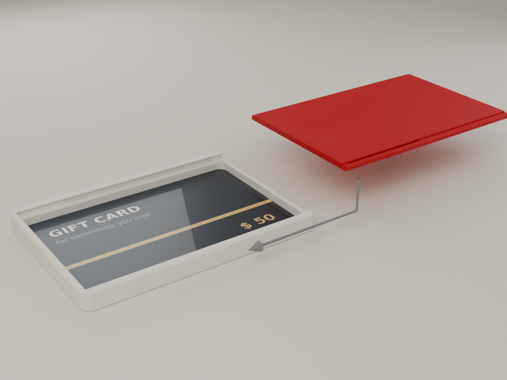
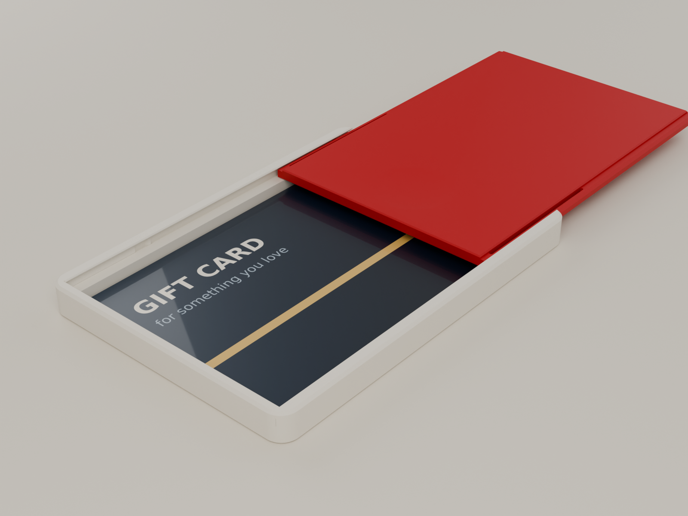

# GS-05 GIFT SLIDE: assembly and use

Two printed parts: the **tray** and the **lid**. No tools, glue or hardware.

## 1. Before the first use: pick your lid (once per printer)

Print the **fit coupon** (`models/3mf/GS05_fit_coupon_first.3mf`, about 28 min). It contains a short tray and three short lids marked **STD**, **LOOSE** and **SNUG** on their front strip. Slide each lid into the coupon tray from its open end (see step 2) and work it back and forth a few times.

| What you feel with the coupon | Print this lid |
|---|---|
| STD slides smoothly, clicks clearly at the closed end, and stops firmly at the open end | **Standard** (`GS05_B_Lid.stl`) |
| STD is stiff to slide, or the click needs a hard shove | **Loose** (`GS05_B_Lid_Loose_alt.stl`) |
| STD rattles, the click is faint, or it pulls off with almost no force | **Snug** (`GS05_B_Lid_Snug_alt.stl`) |

Keep the coupon. It is also a nice little fidget.

## 2. Fit the lid (10 seconds)

1. Hold the tray with its **open end** (the end with no wall above the pocket) facing away from you, pocket up.
2. Take the lid, thumb dish up, and point its **dish end** at the tray's open end.
3. Line the lid's edges up with the two grooves under the tray's rims and push it in level. About a quarter of the way in (≈ 25 mm), you feel a light snap as the two hidden bumps pass the entry. That snap makes the lid captive.
4. Keep pushing. The lid glides, then clicks shut against the far wall.

If it won't start, check that the lid is the right way up (dish on top) and not tilted. Nothing needs forcing; the snap takes about as much effort as a pen click.

## 3. Load the gift

1. Push the lid open with your thumb in the dish. It clicks, glides and stops.
2. Lay the card face up in the pocket, sliding its far end under the lid.
3. **Cash:** fold each note in half and then in half again (in quarters: a US bill ends up about 78 × 33 mm, a €20 about 67 × 36 mm). Up to four quartered notes fit under a card, or about six on their own.
4. Push the lid back until it clicks shut.

**Prefer the lid off?** Pull it firmly past the open stop (a deliberate tug of about 1 kg). It comes off undamaged. Load the card and push the lid back in as in step 2.

## 4. Giving it

The box is held shut by the click: about 20 times the lid's weight. It survives a pocket, a stocking or being shaken. The recipient needs one instruction, or none: **push the dish.**

## 5. Opening it

1. Thumb in the dish, push toward the open end: *click, glide, stop.*
2. Most of the card is now uncovered. Push a finger up through the **round hole under the box**. The card tips up so you can pick it out.
3. Under the card: **FOR YOU**.

## 6. Care

* PLA softens at about 55 °C. Don't leave it on a car dashboard.
* If the flexure slots beside the lid's edges ever fill with fluff, run a card edge through them.
* If the slide gets stiff after months in a drawer, open and close it a few times; that is all it needs.
