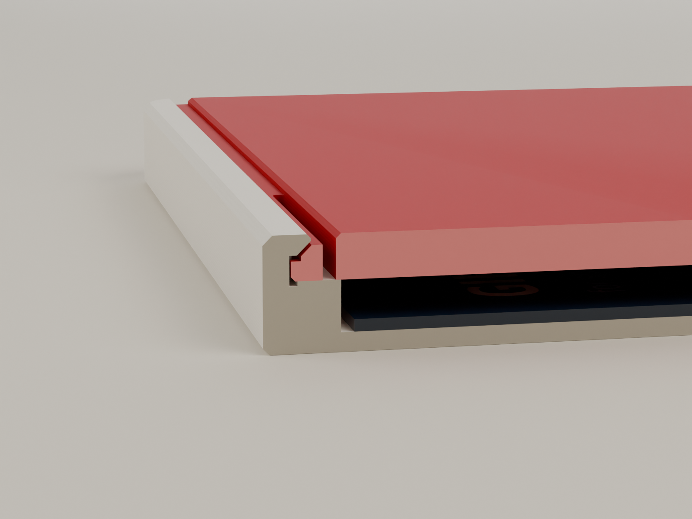
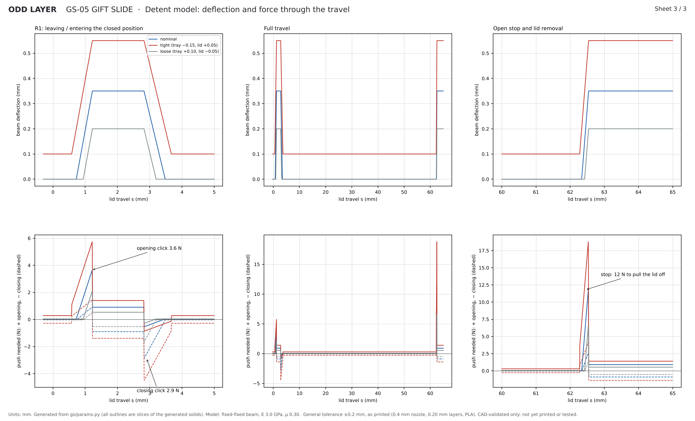

# GS-05 GIFT SLIDE: engineering report

> **Status: designed and checked in CAD only. Nothing has been printed or physically tested.**
> Every number below comes from the generated solids (manifold3d booleans and slices) or from
> hand calculations in `gs/detent.py` with stated assumptions. The automated report with every
> check is [`models/GS05_validation_report.md`](models/GS05_validation_report.md). What a real
> print has to prove is in [`TEST_PLAN.md`](TEST_PLAN.md).

## 1. The design in one paragraph

A slim two-piece box, **91.6 × 65.0 × 7.2 mm**, that holds a standard gift card plus a few folded notes. The lid slides along the long axis in 45° dovetail grooves and sits flush with the rim. A 1.5 mm shadow gap runs along both long edges between lid and rim. To open it, put a thumb in the dish and push. The lid releases with a click (≈ 3.6 N), glides freely for 62 mm and stops firmly (≈ 12 N to go further). At that point 72 % of the card face is uncovered. A finger pushed through the hole in the floor tips the card up so you can take it out. Under the card, the pocket floor says **FOR YOU**. The feel comes from two hidden PLA flexure beams, one along each lid edge. Each carries a 0.6 mm bump that runs in a shallow relief track cut into the tray's groove face. No screws, springs, magnets or glue. Two parts, one push to assemble, no supports.

## 2. Architecture

| | Tray (A) | Lid (B) |
|---|---|---|
| Print orientation | floor down | underside down |
| Size | 91.6 × 65.0 × 7.2 mm | 89.2 × 61.6 × 2.8 mm |
| Key features | card pocket 87.2 × 55.58 × 3.2; 45° dovetail lip on both long walls; groove face with relief track (parking pocket, R1, travel track, open stop, entry zone, lead-in); Ø16 push hole; debossed message and logo | dovetail edges with a 1.5 mm land; 0.65 mm shadow-gap rebate; two 36 mm flexure slots; two detent bumps; Ø20 thumb dish; optional star inlay |
| Filament (estimate) | 12.5 g | 12.0 g |
| Print time (estimate) | 17 min | 12 min |

Coordinates used everywhere: X along the slide (0 = closed end, lid opens toward +X), Y across, Z up from the bottom of the tray. All dimensions are in `gs/params.py`.

## 3. The section (Detail C on drawing sheet 1)

| Feature | Value | Why |
|---|---|---|
| Lid land height | 1.5 mm | vertical guide face and the band the detent bump lives in |
| Land-to-groove clearance | 0.25 mm per side | sliding fit for parts printed separately. On the tight printer corner it is still 0.05 mm. |
| Dovetail | 45°, lip underside 0.30 mm above the lid bevel (0.21 mm normal gap) | holds the lid down; 45° is the steepest overhang the tray's lip can print unsupported |
| Dovetail overlap | 0.60 mm per side | the lid would have to shrink or the walls spread by 1.2 mm in total before it could lift out |
| Shadow gap | 1.5 mm wide, 0.65 mm deep | a deliberate reveal line. It hides the flexure slots and the lid's position error. |
| Flexure beam | 36 × 1.3 mm (trapezoidal, 2.15 → 1.5 mm tall), fixed at both ends | three extrusion lines wide, printed flat with beads along its length |
| Flexure slot | 0.8 mm | prints open with a 0.4 mm nozzle. Leaves ≥ 0.25 mm of room at the largest deflection. |
| Bump | 0.6 mm proud × 1.2 mm high, crest 1.0 mm, flanks 65° front / 45° rear | the only part of the lid that feels the track |
| Relief track | 0.45 mm deep, ceiling 0.35 mm above the bump | its ceiling is a 0.45 mm unsupported overhang: short enough to print clean |
| Wall behind the track | 1.6 mm | ≥ 3 extrusion lines |
| Ledge the lid rides on | 2.66 mm per side | the lid's whole underside edge carries load, not the bump |

## 4. How the detent works

Each beam is a fixed-fixed beam with the bump at mid-span. Its bending stiffness comes from the real cross-section (`gs/detent.py: section_props`): I = 0.334 mm⁴. With E = 3.0 GPa that gives

  k = 192 E I / L³ = **4.1 N/mm per side**, and strain = 24 δ c / L² = **1.28 % per mm** of deflection.

At every point of travel the deflection the bump needs, δ(s), is the largest overlap between the bump outline and the relief-track outline. Both sides are identical, so the lid stays centred and each beam takes δ. The axial force is then

  F = 2 k δ (t + μ) / (1 − μ t), with t = dδ/ds,

plus the lid's own sliding drag (μ m g ≈ 0.04 N). Where δ is falling, t < 0 and the springs push the lid along: that is the snap you feel after a click.

**Cross-check against the solids.** At ten lid positions, `validate.py` bisects for the smallest inward shift of the real 3-D bump that clears the real tray. It agrees with the 1-D model to within 0.023 mm everywhere, including on the flanks.

| Event | Nominal | Over the print-variation corners |
|---|---|---|
| Opening click (break-away) | **3.6 N** | 2.0 – 5.7 N |
| Closing click | 2.9 N | 1.6 – 4.5 N |
| Glide (between the clicks) | 0.04 N | up to 0.28 N on a tight print (bump lightly brushing the track) |
| Open stop (force to pull the lid off) | **11.8 N** | 6.3 – 18.5 N |
| Fitting the lid (snap-in) | 2.3 N | 1.3 – 3.7 N |
| Beam deflection at R1 / stop | 0.35 mm | 0.20 – 0.55 mm |
| Peak beam strain | 0.45 % | ≤ 0.71 % |

Material spread at nominal geometry (E 2.5–3.5 GPa, μ 0.20–0.45) gives an opening click of 2.5–5.6 N. Retention is 20× the lid's own weight, so being shaken in a pocket or bag will not open it.

**Feel, in order:** a firm *tick* as the bump climbs R1. A short drag over the crest (0.9 N) that tells the hand it has started. The springs then push the lid forward on R1's far flank. The lid glides 59 mm almost without resistance and meets the 60° stop: more than three times the click, so it clearly reads as the end. Closing is the mirror image: glide, *tick*, and the lid lands on the end wall with the bump parked.

## 5. Tolerance plan

Lateral errors are what matter here. Offsets are per side; + means a slot prints wider or the lid prints wider.

| Feature | Nominal | Works between | Effect of error | Covered by |
|---|---|---|---|---|
| Land clearance c | 0.25 | 0.05 – 0.40 | every 0.1 mm of c changes the click by ≈ 1.0 N and the stop by ≈ 3 N | Standard lid; Loose lid (−0.10/side) below 0.05; Snug lid (+0.10/side) above 0.40 |
| Bump protrusion | 0.60 | 0.50 – 0.70 | same as c (interference = protrusion − c) | coupon |
| Relief depth | 0.45 | 0.35 – 0.60 | running clearance c + D − protrusion ≥ −0.1 (light drag is fine) | coupon |
| Flexure slot | 0.80 | ≥ 0.6 | a slot that prints shut locks the beam: click 3–5× stiffer | clear it with a knife blade |
| Lip normal gap | 0.21 | ≥ 0.05 | too small makes the lid tight in Z | the as-sliced check shows a 0.25 mm in-layer gap |
| Elephant's foot | ≤ 0.2 | — | widens first layers | 0.25 mm lid-land chamfer and 0.4 mm tray-base chamfer |
| Lid flatness | — | ≤ 0.3 mm bow | binds in the dovetail | flat print, textured PEI, no brim needed |
| Card in pocket | 0.8 per side | — | insensitive | — |

Vertical (Z) features sit on whole 0.2 mm layers wherever it matters: ledge 4.4, lid 2.8, lip tip 6.8, bump top 1.2 above the lid underside. The checks slice both parts at every layer mid-plane, as a slicer does, and confirm the parts never share a region of the same layer. The smallest gap between them within any layer is 0.25 mm.

The variation corners checked in 3-D and in the detent model are: nominal; tight (tray −0.15, lid +0.05); tight lid (tray −0.05, lid +0.10); loose (tray +0.10, lid −0.05); very tight + Loose lid; very loose + Snug lid. All pass. With the Standard lid alone, the two extreme corners give a 6.7 N click with a jammed fit (c = −0.05) and a 1.0 N click. That is why the Loose and Snug lids exist, and why the coupon comes first.

## 6. Print orientation and layer strength

* **Lid:** printed flat. The beams bend in the plane of the layers, with their beads running along the beam. That is the strongest possible case for a PLA flexure; no interlayer bond carries bending stress.
* **Tray lip:** a 45° supported overhang growing inward from the wall. A lid pried upward loads the lip as a short horizontal cantilever. Its bending stress runs in the layer plane; only shear crosses the layer interfaces.
* **Lid hanging open:** the lid sticks out 62 mm with 27.2 mm still engaged. A 5 N press on the overhanging tip gives 3.9 MPa of bending in the lid and about 6 N of lift on each lip. The lip overlap is 0.60 mm and the walls deflect about 0.01 mm. A 30 N press gives 23 MPa of in-plane bending, well under PLA's ≈ 60 MPa.
* **Drawer jamming:** a drawer jams when it is pushed off-centre by more than L / (2μ). With 27.2 mm still engaged at the open stop and μ = 0.3 that is 45 mm, wider than the lid's half-width (31 mm). It cannot jam unless μ exceeds 0.44.

## 7. Wear, fatigue, creep and heat

* **Wear:** the bump only touches the tray while crossing R1 (≈ 1.6 mm, twice a cycle) and the stop. The rest of the travel is in free air. Even with a pessimistic wear rate for PLA on PLA, a thousand cycles wear off well under 0.01 mm.
* **Fatigue:** the beam peaks at 13 MPa (0.45 %) nominal and 21 MPa (0.71 %) worst case, once per click. Published fatigue data for printed PLA puts that at 10⁴ – 10⁶ cycles. A gift box sees tens to hundreds. The slot ends are fully rounded to avoid stress raisers.
* **Creep:** at rest, both closed and open, the bump sits in a pocket and the beam is unloaded. PLA's worst habit, relaxing under constant load, never comes into play. On a tight print a light 0.1 mm preload can exist while the lid is part-way open; that is 0.13 % strain, which is negligible.
* **Heat:** PLA softens at about 55 °C. A car dashboard in summer can warp the lid and relax the beams. PETG works with the same files (clearances are lateral), but PETG has not been checked for friction and its stiffness is about 30 % lower, which lowers the forces by roughly that much.

## 8. Print time and filament

No slicer could run in the build environment (downloading and running one was blocked). `gs/estimate.py` therefore does a slicer's arithmetic on the real solids. It slices every 0.2 mm layer and lays out 2 walls, 5 top / 3 bottom layers and 15 % grid infill. Every move is timed with Bambu's A1 mini speeds and a trapezoidal acceleration model.

| Plate | Print | + start | Filament |
|---|---|---|---|
| Tray + lid (one plate) | ≈ 28 min | ≈ 32 min | ≈ 24.5 g |
| Fit coupon: tray + Standard, Loose and Snug lids | ≈ 24 min | ≈ 28 min | ≈ 15 g |

Treat these as ±20 %. The Bambu Studio figure is the one to quote on MakerWorld. Even +50 % stays inside the 90 min / 35 g budget.

## 9. Unresolved risks

Ranked by likelihood × consequence. Each has a test in `TEST_PLAN.md`.

1. **Real friction and stiffness.** The forces are model values. If printed PLA on PLA is stickier than μ = 0.45, the stop gets close to self-locking (60° flank, limit μ ≈ 0.58) and the click firms up. *Test:* force measurement (T2). *Fix:* a 55° stop flank and a 32° R1 opening flank, both single parameters.
2. **Printer-to-printer fit.** Covered on paper by the variants. Needs proof on at least three printers (T7).
3. **Relief-track ceiling droop.** A 0.45 mm unsupported overhang with 0.35 mm of clearance above the bump. *Test:* section the coupon tray with a knife and look at it (T1).
4. **Slot bridging or stringing.** The slot is 0.8 mm wide in a 2.8 mm part, so stringing across it is possible. *Fix:* run a blade through it once.
5. **Rattle.** 0.25 mm of lateral play and 2.44 mm of headroom over the card. The lid is quiet when parked, but a shaken box makes a soft card noise. This is accepted: the headroom is what lets folded notes fit.
6. **Users pulling the lid off at the stop.** This is by design (≈ 12 N) and harmless. The instructions say so.
7. **Heat** (section 7).

## 10. Files

See [`README.md`](README.md). The generator (`giftslide.py` + `gs/`) rebuilds every part, check, export, drawing and render from `gs/params.py`.
