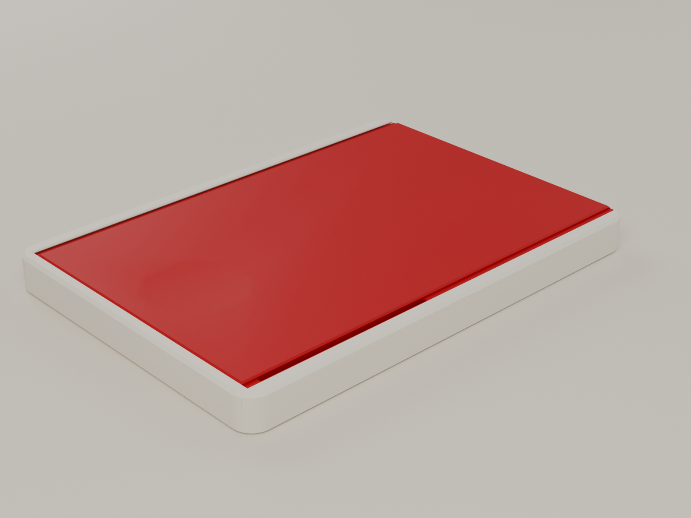
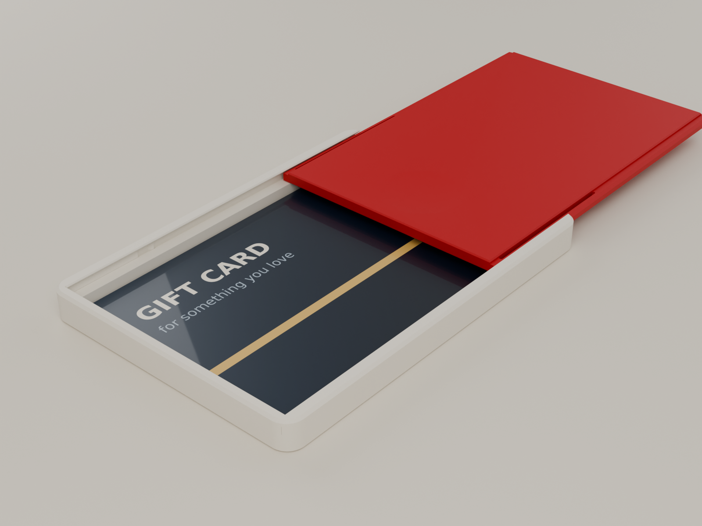
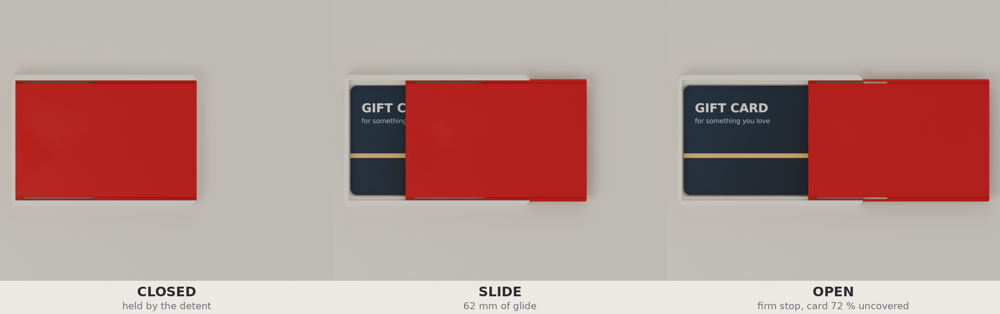
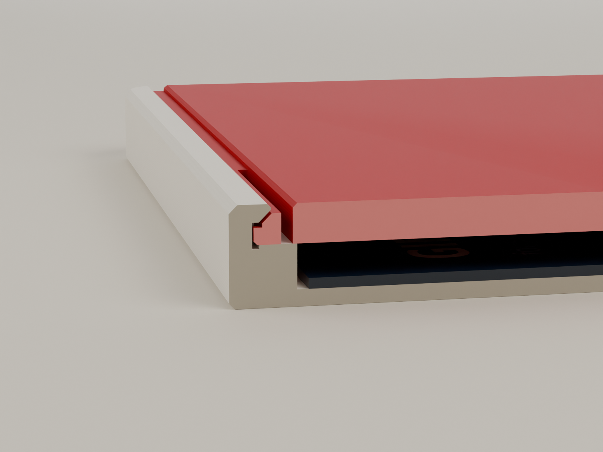
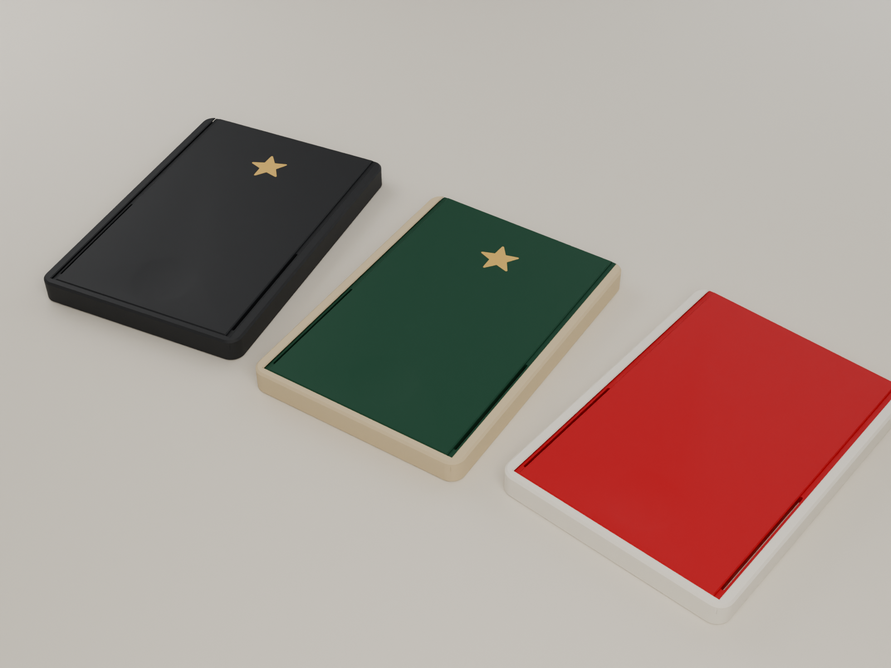

# ODD LAYER GS-05 · GIFT SLIDE



**A two-piece gift-card box with a lid that clicks, glides and stops.** Push the thumb dish: the lid releases with a click, glides 62 mm and stops firmly with most of the card uncovered. A finger through the hole underneath tips the card up, and the pocket floor says **FOR YOU**. It holds a standard gift card plus a few folded notes. No screws, springs, magnets or glue. Two flat parts, no supports, about 30 minutes on an A1 mini.

The feel comes from two hidden PLA flexure beams, one along each lid edge, inside the shadow gap. Each carries a 0.6 mm bump that runs in a shallow relief track cut into the tray's groove. The bump is free (and the spring unloaded) everywhere except at the click and the stop, so the box doesn't creep while it waits under the tree.

> **Status: designed and checked in CAD only. Nothing has been printed or physically tested.**
> All 120 automated checks pass: collisions through the whole travel; six printer-variation corners in 3-D and in the detent model; an as-sliced layer check; a 3-D cross-check of the detent model; overhangs; budget; and every exported file re-read from disk. Forces are model predictions. What a prototype must show before publication: [`TEST_PLAN.md`](TEST_PLAN.md).

| | |
|---|---|
| Holds | ID-1 card 85.6 × 54 mm + up to 4 notes folded in quarters (2.44 mm headroom) |
| Size | 91.6 × 65.0 × 7.2 mm |
| Parts | Tray + Lid. Lid variants: Star (optional gold inlay), Loose, Snug. Fit coupon. |
| Feel (model) | opening click ≈ 3.6 N · glide ≈ 0 · open stop ≈ 12 N · closing click ≈ 2.9 N |
| Hardware | none |
| Plastic | ≈ 24.5 g PLA (estimate) |
| Print | ≈ 28 min + start, both parts on one 180 mm plate, 0.20 mm layers, no supports (estimate) |





## Documents

| | |
|---|---|
| [`CONCEPT_STUDY.md`](CONCEPT_STUDY.md) | Seven mechanisms scored, where the spring should live, why the relief-track detent, and what validation changed |
| [`ENGINEERING_REPORT.md`](ENGINEERING_REPORT.md) | The section, the detent model and forces, tolerance plan, orientation and layer strength, wear, fatigue, creep, print estimate, unresolved risks |
| [`ASSEMBLY.md`](ASSEMBLY.md) | Choosing the lid with the coupon, fitting the lid, loading card and cash, opening |
| [`PRINT_SETTINGS.md`](PRINT_SETTINGS.md) | Bambu Studio settings, orientation, colourways, the two-colour star |
| [`TEST_PLAN.md`](TEST_PLAN.md) | The physical tests, with pass criteria, parameters to change and a publication gate |
| [`models/GS05_validation_report.md`](models/GS05_validation_report.md) | Auto-generated validation report (the numbers behind every claim) |
| [`docs/`](docs/) | Dimensioned drawings (assembly, parts, detent track) and the detent force model, as PNG and PDF |
| [`MAKERWORLD_LISTING.md`](MAKERWORLD_LISTING.md) | Draft listing (held until the publication gate is passed) |



*Cut across the lid edge at the parked bump: dovetail lip, shadow gap, flexure slot, beam, bump in its pocket in the relief track.*

## Files

| Path | What |
|---|---|
| `models/3mf/GS05_fit_coupon_first.3mf` | **Print first.** Coupon tray + Standard / Loose / Snug coupon lids (≈ 28 min) |
| `models/3mf/GS05_gift_slide_plate.3mf` | Tray + Standard lid on one A1 mini plate |
| `models/3mf/GS05_star_lid_two_colour.3mf` | Tray + Star lid with its gold inlay as a second part (AMS) |
| `models/3mf/GS05_lid_fit_variants.3mf` | Loose and Snug lids |
| `models/stl/GS05_A_Tray.stl` · `_Tray_Plain_alt` | Tray with or without the FOR YOU message |
| `models/stl/GS05_B_Lid.stl` · `_Lid_Star_alt` · `_Lid_Loose_alt` · `_Lid_Snug_alt` | Lids |
| `models/stl/GS05_C_Star_Inlay_multicolour.stl` | Star inlay (only for two-colour prints) |
| `models/stl/GS05_T_Coupon_*.stl` | Fit coupon parts |
| `models/GS05_Assembly_closed.stl` | Assembled box, for viewing only |
| `models/GS05_GiftSlide.blend` | Blender project: states, exploded, cutaways, print plate, colourways, studio and cameras, with the generator embedded |
| `models/GS05_validation.json` · `GS05_validation_report.md` | Validation data and report |
| `renders/` | 01 hero · 02 reveal · 03 sequence · 04 exploded · 05 section · 06 detent cutaway · 07 message · 08 print plate · 09 colourways · 10 underside |
| `giftslide.py`, `gs/`, `tools/make_docs.py` | The parametric generator |



## Regenerating

Every part, check, export, drawing and render comes from one parametric source, `gs/params.py`:

```bash
pip install manifold3d shapely numpy matplotlib pillow   # geometry, checks, estimates, drawings
pip install bpy                                          # Blender as a Python module (5.x), for --blend / --render
python giftslide.py                    # build, run all checks, export STL / 3MF, write the report
python giftslide.py --blend --render   # ...plus the .blend and the renders (Cycles, CPU)
python tools/make_docs.py              # dimensioned drawings and detent charts in docs/
```

| Module | Role |
|---|---|
| `gs/params.py` | every dimension, the detent track profile, material assumptions |
| `gs/geom.py` | tray, lids, inlay, coupon, card (manifold3d, all 2.5-D extrusions) |
| `gs/detent.py` | beam stiffness from the real section; deflection and force along the travel |
| `gs/validate.py` | the checks |
| `gs/estimate.py` | layer-by-layer print time and filament estimate |
| `gs/export.py` · `gs/report.py` · `gs/scene.py` | STL/3MF I/O, report, Blender scene and renders |
