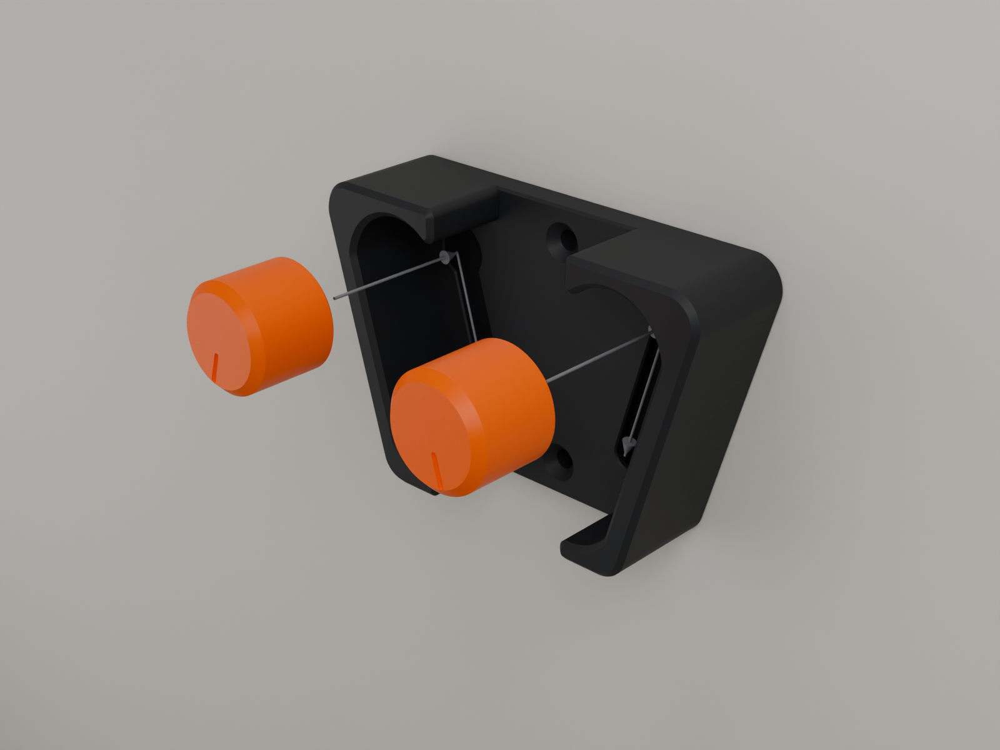
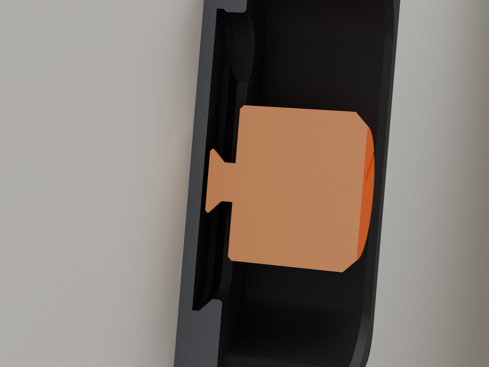
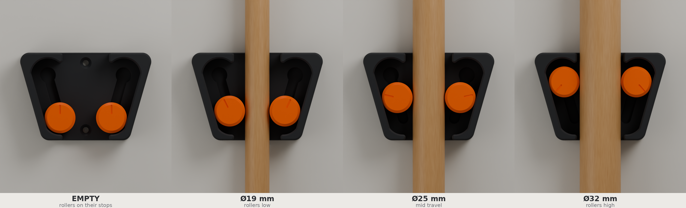

# HF-04 HOLDFAST: assembly and use

**Parts per holder:** 1 × Base · 2 × Roller (Standard, or one of the alternatives below) ·
2 × countersunk wood screw, Ø3.5–4 mm (#6–#8), ≥ 30 mm long, plus wall plugs if needed.
No glue and no other hardware.

## 0. Before you print the base: the 10-minute fit test

Print `models/3mf/HF04_fit_test_first.3mf`: the fit coupon and one Standard roller.

1. Line up the roller's stub (the mushroom on its back) with the **round keyhole** at one end of
   the coupon's slot. Push it straight in until the roller's back face sits on the coupon.
2. Slide the roller along the slot. It should move with no force at all, end to end.
3. Away from the keyhole, pull the roller straight off the coupon. It must not come out.
   You should feel only about half a millimetre of play.

| Result | Use |
|---|---|
| Drops in, slides freely, is held | **Standard rollers** (`HF04_B_Roller_x2.stl`) |
| Head will not enter the keyhole, or the slide feels gritty or tight | **Loose rollers** (`HF04_B_Roller_Loose_x2_alt.stl`): stub 0.3 mm smaller, 0.3 mm more axial play |
| Comes off the coupon away from the keyhole | Your printer is printing holes oversize. Check flow / XY compensation before going on (no printer in the validation corners does this) |

## 1. Fit the rollers (on the bench or on the wall)

1. Hold the base with the open pockets facing you.
2. Push a roller to the **top** of its pocket, where the keyhole is (the round hole at the top
   end of the slot in the pocket floor).
3. Line up the stub with the keyhole and push the roller **straight in** until it sits flat on the
   pocket floor.
4. Let go. The roller rolls down the ramp to its bottom stop. It is now captive: it can only come
   out the way it went in.
5. Do the same on the other side. The rollers are identical, and either one goes in either pocket.

**Check:** with the base upright, each roller rolls freely from top to bottom under its own
weight and stops with a soft clack. When resting, the index line on its face points straight up.
Pulled forward at the bottom, it does not come out.

## 2. Mount it

1. **Height.** Put the holder where the tool hangs with its head just off the floor (brooms and
   mops: usually 1.1–1.4 m to the holder centre). Long-handled garden tools can hang higher.
2. **Spacing between holders.** ≥ 120 mm centre to centre for mops and narrow tools. Use 150 mm
   or more for brooms whose heads hang flat to the wall.
3. **Mark.** Hold the base level against the wall and mark through the two screw holes. They sit
   on the centre line, 52.1 mm apart vertically.
4. **Drill and plug** to suit the wall. Use a stud, timber or masonry with plugs. Use proper
   cavity fixings in plasterboard.
5. **Screw** with countersunk screws until the heads sit flush. **Do not over-tighten:**
   stop when the plate is snug against the wall. The screw heads end up behind the handle.

You can fit the rollers before or after mounting: the keyholes are reached from the front.

## 3. Use

- **Hang:** hold the tool by its handle and push the handle into the channel **while lifting it
  slightly** (2–5 mm). Let go. The handle drops a millimetre or two and locks.
- **Take down:** **lift** the handle a few millimetres and pull it straight out. The rollers roll
  back to their stops.

Pushing straight in without the small lift will not open the rollers. The ramp is steep enough
to self-lock against a sideways push too. That is the same property that makes it hold.

## 4. Taking it apart

Push a roller up to the top of its pocket until it stops (the stub is now over the keyhole)
and pull it straight out. Nothing is stressed or bent at any point, so you can take it apart
and put it back together as often as you like.

## Alternatives

| File | When |
|---|---|
| `HF04_B_Roller_Grip_x2_alt.stl` | Slippery handles: chrome, gloss-painted steel, polypropylene. 36 shallow ridges on the rim |
| `HF04_B_Roller_Loose_x2_alt.stl` | The fit test was tight, or the rollers feel gritty in the slots |
| `HF04_T_Fit_Coupon.stl` | Fit test (print once) |
