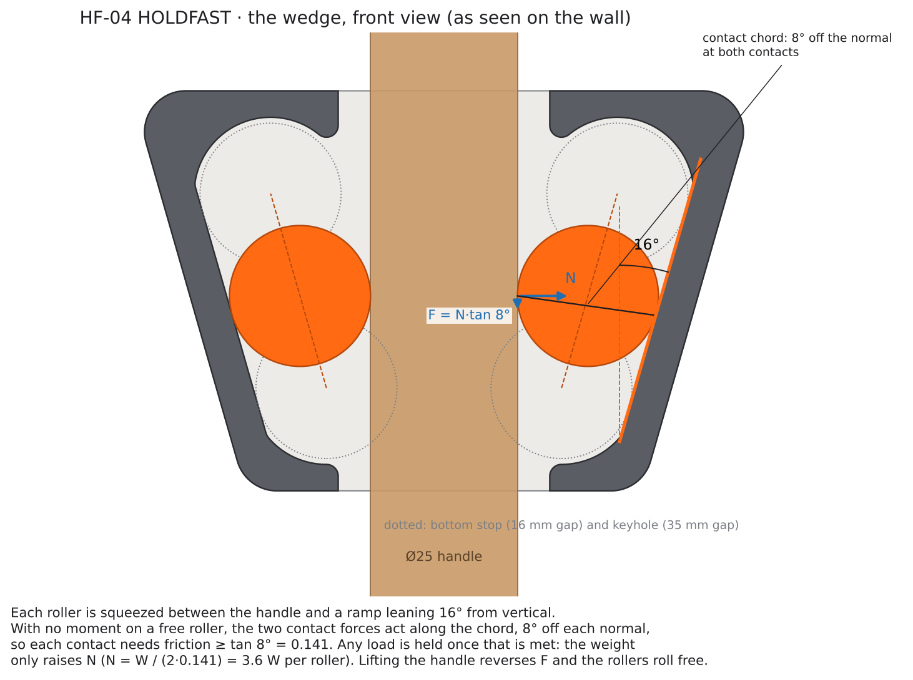
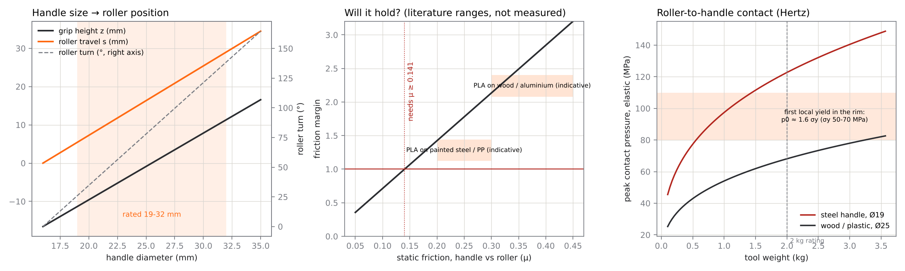
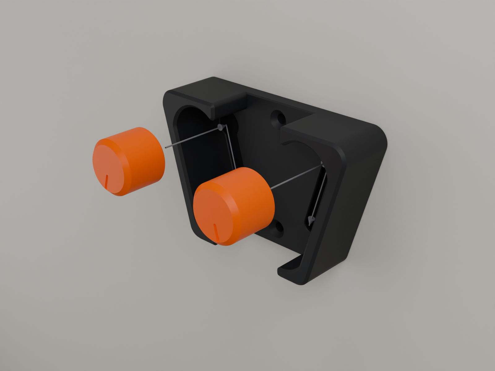
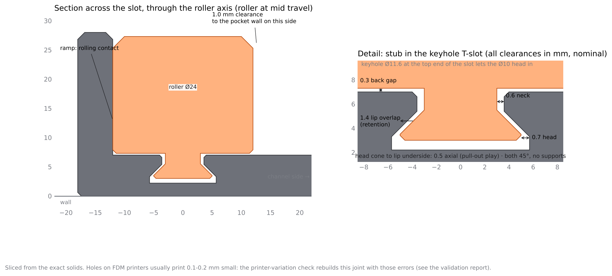

# HF-04 HOLDFAST: engineering report

> **Status: CAD-validated only. Nothing has been printed or physically tested.**
> "Validated" in this document always means *checked on the exact CAD solids or by hand
> calculation*. Every force, friction, strength and life figure is a prediction. What still
> needs a real print is listed in [`PHYSICAL_TESTING.md`](PHYSICAL_TESTING.md).

## 1. Specification

| | |
|---|---|
| Function | Wall grip for brooms, mops and long tools. Self-locking under the tool's own weight; released by lifting |
| Handles | **19–32 mm** rated (16 mm is the closed limit; up to 35 mm still fits) |
| Rated load | **2 kg per holder** (prediction; see §6). Typical brooms and mops weigh 0.3–1 kg |
| Parts | Base ×1, Roller ×2 (identical). Alternatives: Grip roller, Loose roller. Fit coupon |
| Hardware | 2 countersunk wood screws, Ø3.5–4 mm (#6–#8). Nothing else |
| Base | 101.9 × 68.1 × 28.0 mm (64.0 cm³ solid), ≈ 40–45 g PLA |
| Roller | Ø24 × 20 mm plus a 4.3 mm stub, ≈ 7.5 g PLA |
| Friction needed | **μ ≥ tan 8° = 0.141** at the roller contacts |
| Supports | none, on any part |

## 2. How it works

Each roller sits in a pocket against a ramp that leans **16° from vertical**. The gap between
the ramp and the handle narrows downward. The roller is free: there is no axle, so it can roll
and nothing applies a moment to it. A free roller touching two surfaces is a two-force member:
both contact forces act along the chord between the two contact points. That chord sits half the
wedge angle, **8°**, off each contact normal. So each contact must supply friction equal to
**tan 8° = 0.141** times its normal force. That is the whole self-locking condition:

- If the handle–roller friction is ≥ 0.141 N, the handle cannot slide past the roller.
  The handle drags the roller down, the gap narrows and N grows until the weight is carried.
  **N = W / (2 · 0.141) ≈ 3.6 W** per roller. The load does not change whether it holds,
  only how hard it squeezes.
- The roller–ramp contact (PLA on PLA, μ ≈ 0.3–0.5) needs the same 0.141, so the roller rolls
  rather than slides.
- **Lifting** reverses the friction, the roller rolls up the ramp, and the handle comes free.
- **Gravity resets it.** With nothing in the channel each roller rolls down the ramp onto its
  bottom stop. The pull along the ramp is m·g·cos 16° ≈ **70 mN** for a 7.5 g roller, about 10×
  the sliding resistance. There is no pivot whose friction it has to beat.

**Range.** Each roller covers half the diameter range. A 1 mm larger handle moves each roller
0.5 / sin 16° = **1.81 mm** up its ramp. Travel from the bottom stop (16 mm gap) to the keyhole
(35 mm gap) is 34.5 mm along the ramp, 33.1 mm vertically. Grip height moves from z = −11.3 mm
(Ø19) to +11.4 mm (Ø32), and each roller turns 26° to 139°. The engraved index line shows it.

**Why the angle is 16°.** A smaller angle needs less friction but more travel, so a taller
holder. 16° gives a friction margin of **1.4–2.1** on painted steel / PP (indicative μ 0.2–0.3)
and **2.1–3.2** on wood / aluminium (μ 0.3–0.45), in a 68 mm tall body. 18° would save 5 mm of
height and drop the margin on slippery handles to about 1.25. It is one parameter
(`DELTA_DEG`).

## 3. Architecture

- **Base.** A V-shaped wall plate. Its outer edges are parallel to the ramps, so the shape shows
  the wedge. It has a 7 mm back plate, two housings each holding a pocket with a 16° ramp, a
  36 mm vertical channel between them, two countersunk screw holes on the channel centre line
  (52.1 mm apart, behind the handle), and two keyhole T-slots in the pocket floors.
- **Rollers.** A 24 mm disc, 20 mm thick, with a 2 mm lead-in chamfer on the front rim and a
  short mushroom stub on its axis. The stub runs in the undercut T-slot. It **does not carry any
  load in use**: the roller is positioned by the ramp and the handle, and the stub floats with
  ≥ 0.34 mm all round between the two stops. Its jobs are to keep the roller in the pocket and
  to set the two travel stops (bottom stop = 16 mm gap, top stop = over the keyhole).
- **Retention.** The stub's Ø10 head can pass only through the Ø11.6 keyhole at the very top of
  the travel, 5.4 mm above where a 32 mm handle puts it. Anywhere else, 1.4 mm of lip covers the
  head all round. Gravity keeps the rollers away from the keyhole in use.

## 4. Every interface, its clearance, and what printer error does to it

The governing rule, learnt from MotionLoop: **no fit in this product depends on how small a
hole prints.** There are no press fits, no snap fits, no flexures, and nothing is printed in
place. Every functional gap is ≥ 0.3 mm. Every gap that is set by XY accuracy is ≥ 0.6 mm.

| # | Interface | Nominal | Set by | Function | Tight printer (holes −0.2, bosses +0.1) |
|---|---|---:|---|---|---|
| 1 | Roller rim ↔ ramp | contact | gravity | rolling contact; positions the roller | none: the roller always rests on it |
| 2 | Roller rim ↔ handle | contact | the wedge | grip; self-adjusts across 19 mm of diameter | a 0.1 mm size error moves the roller 0.36 mm along the ramp |
| 3 | Roller ↔ other pocket walls | **1.0** (0.94 measured) | XY | free running | 0.85 |
| 4 | Roller back face ↔ back plate | **0.30** | Z (layer-exact) | free running | unchanged (Z); 0.2 at ±0.1 Z error |
| 5 | Stub neck ↔ lip slot | **0.6** radial | XY | stub floats | 0.45 |
| 6 | Stub head ↔ undercut | **0.7** radial | XY | stub floats | 0.55 |
| 7 | Head cone ↔ lip underside (45°/45°) | **0.5** axial | Z | pull-out play (0.48 measured) | 0.23 measured |
| 8 | Head ↔ keyhole | **0.8** radial | XY | head passes in assembly | 0.65 |
| 9 | Head end ↔ undercut floor | **0.8** | Z | clearance | 0.7 |
| 10 | Head over lip (retention) | **1.4** overlap | XY | captive | 1.55 (tight printers retain better) |
| 11 | Handle ↔ housings, Ø32 | **2.0** per side | XY | insertion | 1.9 |
| 12 | Screw ↔ hole | Ø4.6 for Ø3.5–4.2 | XY | mounting | fine |

**Printer-variation corners.** The validation rebuilds the slot and stub with each corner's
errors applied, then re-runs the assembly path, the full travel and the pull-out test
(`models/HF04_validation_report.md` §7):

| Corner | Standard roller | Loose roller |
|---|---|---|
| nominal | min stub gap 0.34, pull-out play 0.48 | 0.50 / 1.08 |
| tight (holes −0.2 Ø, bosses +0.1 Ø, lip 0.1 thicker) | 0.16 / 0.23 | 0.40 / 0.83 |
| very tight (holes −0.4, bosses +0.2, Z ±0.15) | **0.02 / 0.03: marginal** | 0.35 / 0.63 |
| loose (holes +0.2, bosses −0.1) | 0.45 / 0.63, still retained | 0.50 / 1.23, still retained |

Every corner assembles with no collision and stays captive. On the very-tight corner the
Standard roller keeps almost no gap, so it would feel gritty: that is what the **Loose roller**
is for. The **fit coupon** (10 min) tells the user which one to print before they commit 2 h
to the base. Retention survives the loose corner with 1.25 mm of lip overlap left.

**Things tolerances cannot change.** The ramp angle is drawn in XY. A 0.1 mm dimensional
error over the 35 mm ramp changes it by at most 0.16°, which moves μ_req by 0.0014. The handle
range shifts by twice the roller-radius error (±0.2 mm on 19–32 mm).

## 5. Designed for the printer

| Feature | Print orientation | Why it prints well |
|---|---|---|
| Ramps, pocket walls | vertical walls, profile in XY | perimeters trace the 16° line exactly; layer lines run along the rolling direction, so the roller rolls *along* them, not across them |
| Roller rim | vertical cylinder, profile in XY | perfectly round, smooth perimeter |
| Slot lips / undercut | 45° underside | the steepest overhang anywhere in the product |
| Stub head | 45° cone on top of the roller | prints in air without support |
| Bed edges | 0.6 mm (base) and 2.0 mm (roller) chamfers | absorb elephant's foot; the roller chamfer doubles as the lead-in for the handle |
| Marks | engraved into bed faces (back-plate text, roller index line) | bridge 0.5–1.2 mm; invisible when mounted, or useful (index) |

Measured on the meshes: 0.00 mm² steeper than 45°, 0.02 mm² of true bridge (a sliver),
and a 1st-percentile wall thickness of 2.2 mm (base) and 1.65 mm (roller).

## 6. Loads and strength (hand calculations: not tested)

Load path: weight → friction at the two handle contacts → rollers → line contact on the
ramps → housings → back plate → screws. The two housings are pushed apart by N each. That
pair of forces closes through the back plate behind the channel (internal and self-balanced).
Only the weight W reaches the screws.

| Tool | N per roller | Back-plate prying | Ramp contact p₀ | Handle contact p₀: steel Ø19 / wood Ø32 | Stub pull if yanked out without lifting (μ 0.4) | Top screw pull-out |
|---|---:|---:|---:|---:|---:|---:|
| 0.5 kg | 18 N | 1.0 MPa | 7 MPa | 78 / 40 MPa | 7 N | 1.9 N |
| 1 kg | 36 N | 2.0 MPa | 10 MPa | 98 / 50 MPa | 14 N | 3.8 N |
| **2 kg (rating)** | 71 N | 4.1 MPa | 15 MPa | 123 / 63 MPa | 28 N | 7.5 N |
| 3 kg | 107 N | 6.1 MPa | 18 MPa | 141 / 72 MPa | 43 N | 11 N |

- **Structure** has big margins. Printed PLA/PETG in-plane strength is ≈ 35–50 MPa, so 4 MPa of
  prying at 2 kg is a safety factor of ~9.
- **Stub.** The neck sees < 1.5 MPa across layers even when yanked at 3 kg.
- **Screws.** Loads are trivial. Mount strength depends on the wall fixing, not the part.
- **The handle contact is the limiting stress.** It is a crossed-cylinder point contact.
  Elastic p₀ passes the onset of local yield in the roller rim (p₀ ≈ 1.6 σy ≈ 80–110 MPa) at
  about 1 kg on a hard steel handle, and stays below it on wood and plastic up to the rating.
  Above onset a small, contained contact mark forms. It does not change the wedge angle, so it
  does not change whether it holds: the roller settles slightly lower. The 2 kg rating and the
  steel-handle caveat stay until test P4 has been run.
- **Creep.** A hanging broom loads the contact permanently. Creep relaxes the contact, the roller
  rolls slightly lower and the load is picked up again: the wedge compensates for its own creep
  within the ≥ 5 mm of travel left below every rated handle. PETG is recommended where the wall
  can get warm (PLA creeps fast above ~45 °C).

## 7. Mechanical validation summary (CAD)

All 32 automated checks pass (`python holdfast.py`; full report in
[`models/HF04_validation_report.md`](models/HF04_validation_report.md)):

| What was checked | How | Result |
|---|---|---|
| Parts are single closed solids | manifold status, shell count | 5 / 5 |
| Moving-part interference, full travel | roller on its ramp at every 0.5 mm of 34.5 mm, both sides, boolean overlap + min-gap per region | 0 collisions (70 × 2 poses); grip roller 36 × 2 |
| Roller clearances | min-gap: walls, back plate, stub | 0.94 / 0.30 / 0.34 mm |
| Assembly reach | stub aligned 40 mm out, moved straight in through the keyhole (161 poses), then rolled from top to bottom (138 poses) | 0 collisions, closest 0.78 mm |
| Retention | pulled straight out from 10 positions | held, 0.48 mm play, everywhere except the keyhole (free) |
| Handle range | Ø19, 22, 25, 28, 32, 35 seated with both rollers | 0 overlaps; grip on the rim flat with ≥ 2.3 mm to the chamfer |
| Insertion | handle swept in from 60 mm out | clear; 2.0 mm per side at Ø32 |
| Printer variation | 4 corners × 2 rollers rebuilt and re-checked | all assemble and retain; Standard on very-tight marginal (→ Loose) |
| Printability | face-normal scan in print orientation; ray-cast wall thickness | 0 mm² over 45°; walls ≥ 2.2 / 1.65 mm (1st pct) |
| Exported files | every STL read back from disk, vertices welded at float32, edges counted, bodies counted (independent of the CAD kernel) | 0 open or non-manifold edges; 1 body per part, 3 in the assembly; no zero-volume slivers |

**A defect this caught.** An earlier build unioned the housings onto the back plate. Their
outer walls almost coincided, and the kernel kept 13 zero-volume sliver "pillows" along that
seam. The in-memory solid still reported one valid shell, but the STL had 26 non-manifold
edges, which a slicer would flag. The base is now built as one chamfered prism minus one
lofted cutter, so no two faces can coincide, and the read-back check stays in the suite.
This is the kind of thing that only shows up in the files the user actually downloads.

**What CAD cannot tell us:** real friction coefficients, contact denting and creep on real
handles, how the seam and surface finish feel when rolling, long-term behaviour in a hot
garage, and the strength of the user's wall fixing. Those are in `PHYSICAL_TESTING.md`.

## 8. MotionLoop lessons, applied

| MotionLoop | HF-04 |
|---|---|
| Line-to-line press fits that relied on holes printing ≈ 0.1 mm small | **No press fits.** Nothing has to be forced together, and nothing depends on hole shrinkage |
| Many fits in series (hex, D-spigot 0.1/side, pins, bores) | Two kinds of part; the only fit is one clearance joint (stub/T-slot) per roller, with ≥ 0.3 mm everywhere |
| Horizontal teardrop bearing bores (oval, stair-stepped) | Every functional surface is profiled in XY |
| Nominal-only checks | Fits re-checked with printer-error corners; a fallback roller for tight printers |
| 13 parts printed before anything could be checked | A 10-minute coupon checks the only fit first |

## 9. Risks

| Risk | Likelihood | Effect | Mitigation |
|---|---|---|---|
| Slippery handle (μ < 0.15: chrome, waxed, silicone sleeve) | low–medium | handle slides down slowly | Grip roller; rubber band or tape round the handle; test P2 |
| Contact mark on steel handles at heavy loads | medium above 1 kg | cosmetic; roller settles lower | 2 kg rating; PETG; test P4 |
| User pushes straight in without lifting | high at first | "won't go in" | Instructions and listing copy: *push in and up*. It is the same lock that holds |
| Hot environment (car garage, sun) with PLA | medium | creep, softening | PETG recommended for garages; test P6 |
| Wall fixing too weak | depends on wall | holder pulls out | Fixing guidance; loads are small (< 12 N pull-out at 3 kg) |
| Seam blob on a ramp | low | tick when rolling | Seam = Rear; scrape flush |
| Roller lost when handling the base upside down | low | roller falls out at the keyhole | Only possible at the very top of travel. Gravity keeps it away in use |

## 10. Changing the design

Everything lives in `hf/params.py`. The validation and the drawings regenerate from it:
`python holdfast.py` (geometry, checks, STL/3MF, report), `python holdfast.py --blend --render`
(Blender project and renders), `python tools/make_docs.py` (diagrams).

- Bigger handles (rakes to 40 mm): raise `D_TOP` and `D_RATED`. The pocket and the base grow.
- More friction margin: lower `DELTA_DEG` to 14°. The holder gets about 5 mm taller.
- Tighter or looser stub fit: `LIP_SLOT_HALF`, `CAV_HALF`, `KEY_R`, or `NECK_R` / `HEAD_R`.
