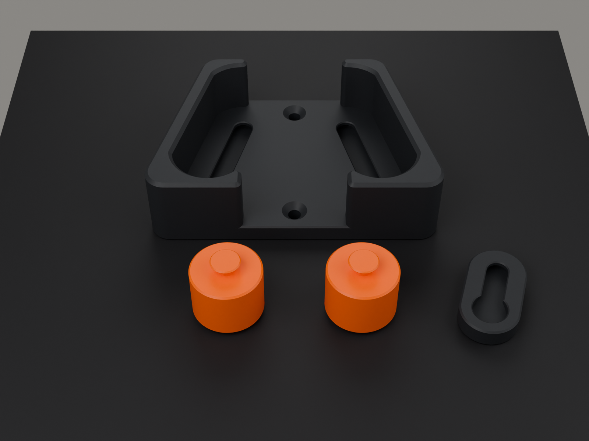

# HF-04 HOLDFAST: print settings and orientation

Every STL is exported **already in its print orientation**. Drop it on the plate and do not
rotate it onto another face. Nothing needs supports.

## Universal settings (any FDM printer, 0.4 mm nozzle)

| Setting | Value | Why |
|---|---|---|
| Nozzle | 0.4 mm | All gaps and walls are sized for it |
| Layer height | **0.2 mm** (0.16–0.24 fine) | Every Z feature of the slot (5.4, 7.0, 2.2 mm) lands on a 0.2 mm layer. Coarser layers round the 0.3 / 0.5 mm axial gaps by up to half a layer |
| Material | **PLA** indoors · **PETG** for garages, sheds, sunny or warm rooms | PLA softens from about 55 °C: a hot garage or sunlit wall can creep it |
| Supports | **Off** | The only overhangs are 45° by design (slot lips, stub-head cone) |
| Brim | Not needed | Base has ≈ 5600 mm² on the bed; rollers stand on their 20 mm front face (squat: 24 mm tall, 24 mm wide) |
| XY hole / contour compensation | **0** (default) | The fits allow for holes printing 0.1–0.2 mm small. If your printer needs it, the fit test will tell you; adjust there, not here |
| Elephant-foot compensation | Default / off | Chamfers on every bed edge (0.6 mm base, 2.0 mm roller) absorb it |

## Per part

| Part | Qty | Orientation (as exported) | Walls | Infill | Top / bottom | Notes |
|---|:-:|---|:-:|---|:-:|---|
| **A. Base** | 1 | wall side down, pockets open upward | **4** | 25 % gyroid or grid | 5 / 4 | The ramps carry the roller load: 4 walls keep them solid. **Seam: Rear / Back** (see below) |
| **B. Roller** | 2 | front face down, stub up | 3 | 25–40 % | 4 / 4 | More infill = heavier roller = livelier drop; not required |
| **T. Fit coupon** | 1 | wall side down | 3 | 20 % | 4 / 4 | Print first, with one roller |

**Seam on the base.** Seam "Rear" (Bambu Studio: *Back*; PrusaSlicer/Orca: *Rear*) puts each
pocket's seam on the bottom curve of the pocket, which the roller never touches. Avoid a seam
on the sloping ramp faces. A seam blob there gives a small tick each time the roller rolls
over it. It is harmless, but you don't need it. If your slicer puts it there anyway, scrape the
blob flush.

**Seam on the rollers.** Each roller's rim gets one seam line. It is harmless: the roller just
ticks once per turn. Use scarf seam if your slicer has it.

## Plates

| File | Contents | Plate needed |
|---|---|---|
| `models/3mf/HF04_fit_test_first.3mf` | Fit coupon + 1 roller | any |
| `models/3mf/HF04_full_set.3mf` | Base + 2 rollers | 110 × 120 mm (fits 180 × 180 beds and up) |

The 3MF files hold geometry only (no printer profile), so they open in Bambu Studio,
PrusaSlicer, OrcaSlicer, Cura and others without printer-specific dependencies.

## Material and time (estimates: check your slicer)

| Part | Solid volume | PLA, at the settings above | Typical time, 0.2 mm |
|---|---:|---:|---:|
| Base | 64.0 cm³ | ≈ 40–45 g | ≈ 1 h 45 – 2 h 30 |
| Roller (each) | 9.1 cm³ | ≈ 7–8 g | ≈ 25–35 min |
| Fit coupon | 3.2 cm³ | ≈ 3 g | ≈ 10 min |
| **One holder** | | **≈ 55–60 g** | **≈ 3 h** |

## Colours

The house look is a **graphite base with orange rollers**: the moving parts show in the accent
colour, so you can see the mechanism working. The index line on each roller's face (engraved
into the bed side) shows it turning. It points straight up when the holder is empty.

## What not to do

- Do not scale the parts. The 0.3–0.7 mm gaps do not scale with them. To fit bigger handles,
  change `D_TOP` / `D_RATED` in `hf/params.py` and regenerate.
- Do not print the base on its edge or face down. The pockets would need supports, and the
  ramps would come out stair-stepped.
- Do not use silk, wood-fill or CF-filled filament for the rollers. Silk is slippery (friction is
  what makes it hold), and filled filaments are brittle and abrasive on handles.
