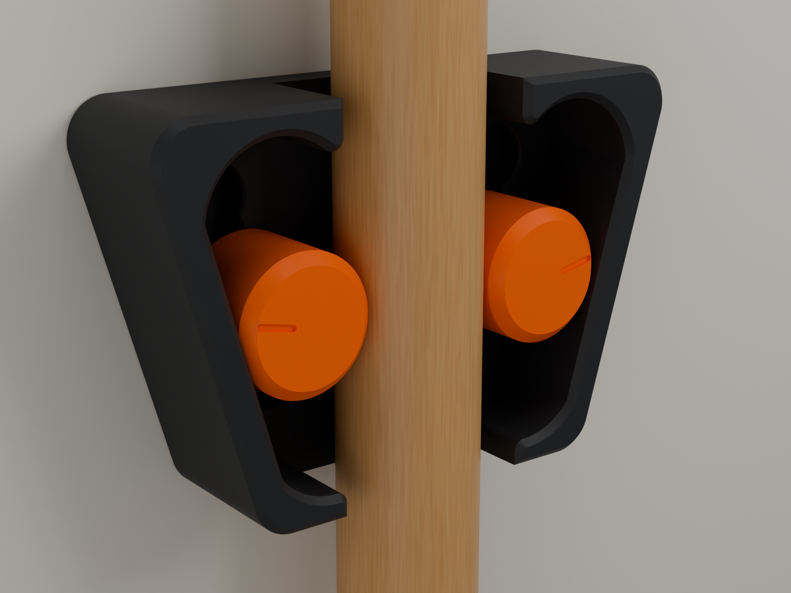
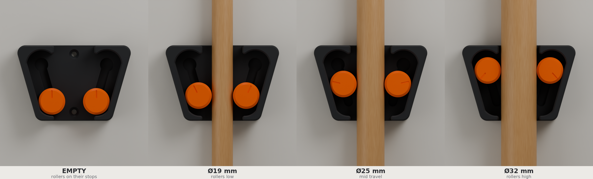
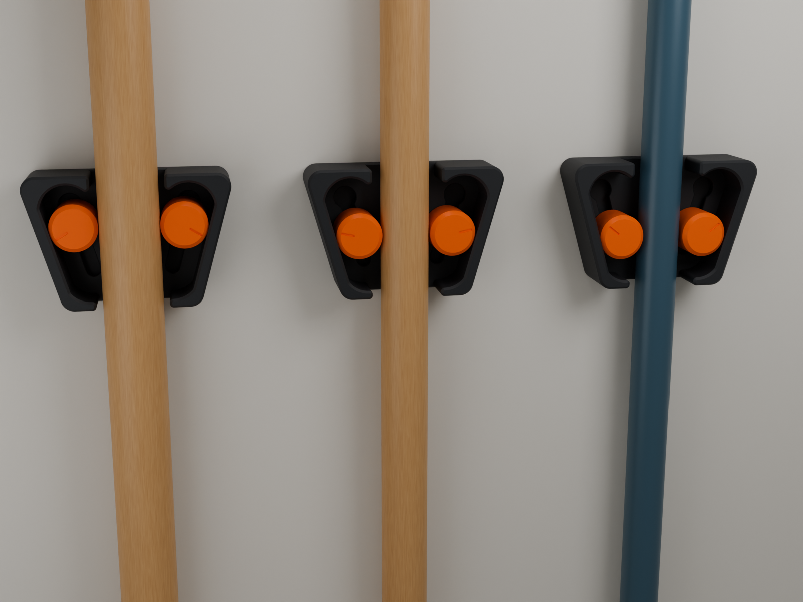
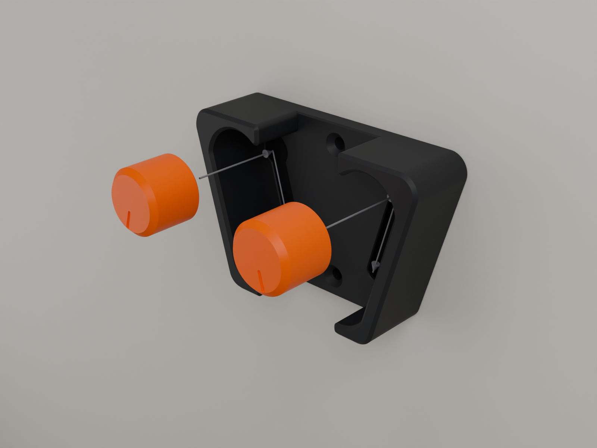

# ODD LAYER HF-04 · HOLDFAST



**A wall grip for brooms, mops and long tools that locks by itself.** Push the handle in and
up, then let go: it drops a millimetre and locks. Lift it and it lets go. One size takes
handles from 19 to 32 mm.

Inside are two orange rollers sitting on 16° ramps. The tool's weight drags them down into a
narrowing wedge, so the heavier the tool, the harder it is held. There are no springs, magnets
or flexures, and nothing is press-fitted. Each roller is captive on a short stub that runs in
a keyhole T-slot, so the holder is one assembled unit before it goes on the wall, and it
comes apart again without tools.

> **Status: designed and checked in CAD only. Nothing has been printed or physically tested.**
> All 32 automated checks pass (interference over the full travel, assembly path, retention,
> handle range, four printer-variation corners, overhangs, and every exported file re-read from disk). Friction, contact and
> strength figures are hand-calculation predictions. What a prototype must show before
> publication: [`PHYSICAL_TESTING.md`](PHYSICAL_TESTING.md).

| | |
|---|---|
| Handles | 19–32 mm rated (fits 16–35 mm) |
| Rated load | 2 kg per holder (prediction) |
| Parts | Base + 2 identical rollers · alternatives: Grip roller, Loose roller · 10-minute fit coupon |
| Hardware | 2 countersunk wood screws, Ø3.5–4 mm (#6–#8) |
| Size | 101.9 × 68.1 × 28 mm |
| Plastic | ≈ 55–60 g PLA or PETG per holder |
| Supports | none |
| Printer | any FDM printer, 0.4 mm nozzle, 0.2 mm layers, a 110 × 110 mm plate |



*The same holder empty and with 19, 25 and 32 mm handles. The rollers climb their ramps
1.8 mm for every millimetre of handle diameter, and the index line on each roller shows it
turning.*



## Documents

| | |
|---|---|
| [`CONCEPT_STUDY.md`](CONCEPT_STUDY.md) | Phase 1: three concepts, scoring, why this one, and the mechanism alternatives that were rejected |
| [`ENGINEERING_REPORT.md`](ENGINEERING_REPORT.md) | How the wedge works, every interface and its clearance, printer-error corners, loads, MotionLoop lessons, risks |
| [`ASSEMBLY.md`](ASSEMBLY.md) | Fit test, fitting the rollers, mounting, use, taking it apart |
| [`PRINT_SETTINGS.md`](PRINT_SETTINGS.md) | Orientation, per-part settings, seam placement, material and time |
| [`PHYSICAL_TESTING.md`](PHYSICAL_TESTING.md) | Everything still to be proven on a real print, with pass criteria and a publication gate |
| [`models/HF04_validation_report.md`](models/HF04_validation_report.md) | Auto-generated CAD validation report (numbers behind every claim) |
| [`MAKERWORLD_LISTING.md`](MAKERWORLD_LISTING.md) | Draft listing copy (held until the publication gate is passed) |

## Files

| Path | What |
|---|---|
| `models/stl/HF04_A_Base.stl` | Base (print as exported: wall side down) |
| `models/stl/HF04_B_Roller_x2.stl` | Roller, print 2 (front face down, stub up) |
| `models/stl/HF04_B_Roller_Grip_x2_alt.stl` | Alternative: 36 shallow ridges for slippery handles |
| `models/stl/HF04_B_Roller_Loose_x2_alt.stl` | Alternative: smaller stub for printers that print holes tight |
| `models/stl/HF04_T_Fit_Coupon.stl` | Fit test: print first with one roller |
| `models/HF04_Assembly.stl` | Assembled holder, as it hangs (rollers on their stops) |
| `models/3mf/HF04_full_set.3mf` · `HF04_fit_test_first.3mf` | Ready plates (geometry only, any slicer) |
| `models/HF04_Holdfast.blend` | Blender project: assembly, states, exploded view, section, print plate, variants, studio and cameras, with the generator scripts embedded |
| `models/HF04_validation.json` · `HF04_validation_report.md` | Validation data and report |
| `renders/` | 01 hero · 02 exploded · 03 range · 04 empty · 05 section · 06 print plate · 07 variants · 08 row of three |
| `docs/` | Wedge diagram, fit section, charts, dimensioned drawing |
| `holdfast.py`, `hf/`, `tools/make_docs.py` | The generator |



## Regenerating

Every part, check, export, render and drawing comes from one parametric source (`hf/params.py`):

```bash
pip install manifold3d shapely numpy matplotlib   # geometry, validation, drawings
pip install bpy                                   # Blender as a Python module (5.x), for --blend / --render
python holdfast.py                     # build, validate (32 checks), export STL / 3MF, write the report
python holdfast.py --blend --render    # ...plus the .blend and the renders (Cycles, CPU)
python tools/make_docs.py              # engineering diagrams in docs/
```

Geometry is built as exact manifold solids (manifold3d), so every exported part is a closed,
single-shell mesh. Blender is used for the project file and the renders.
