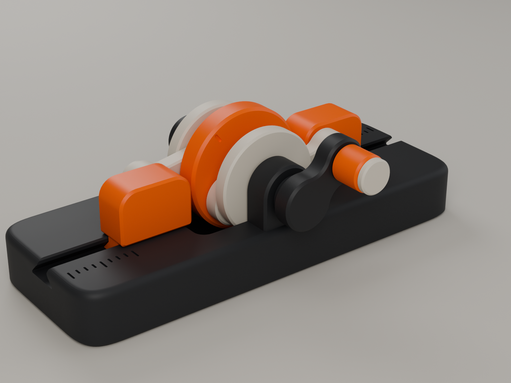
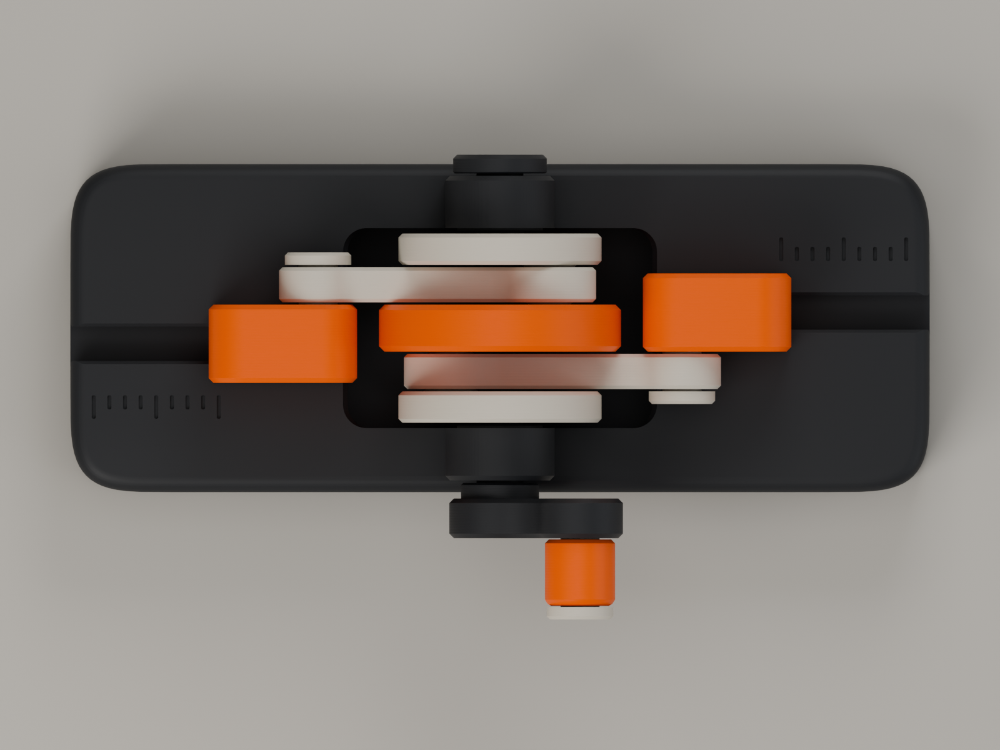
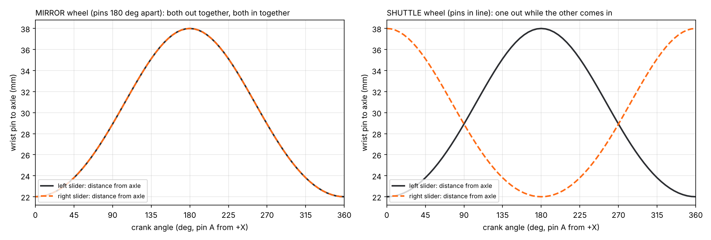
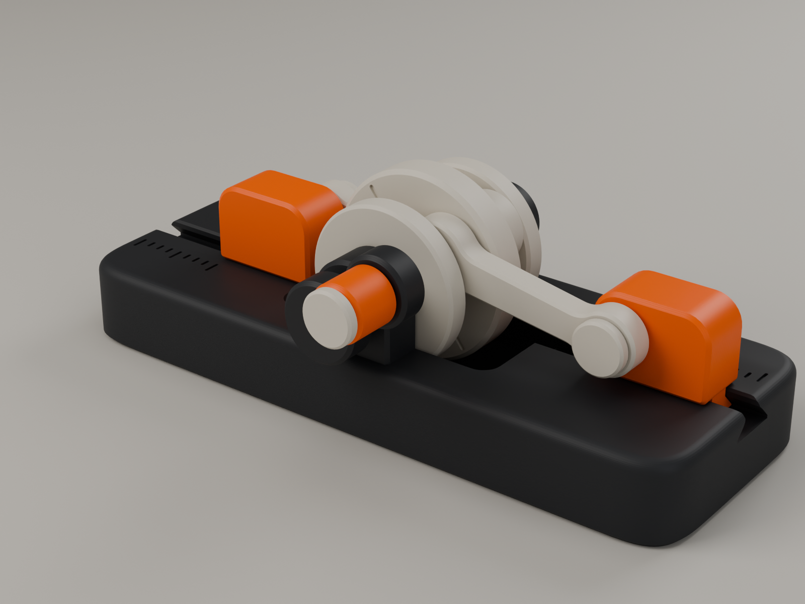
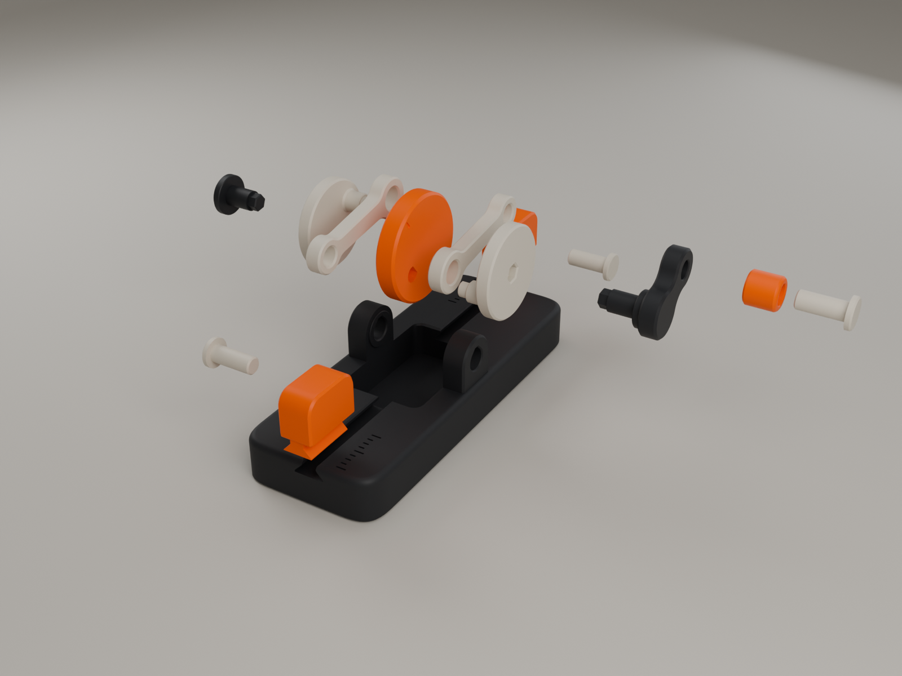
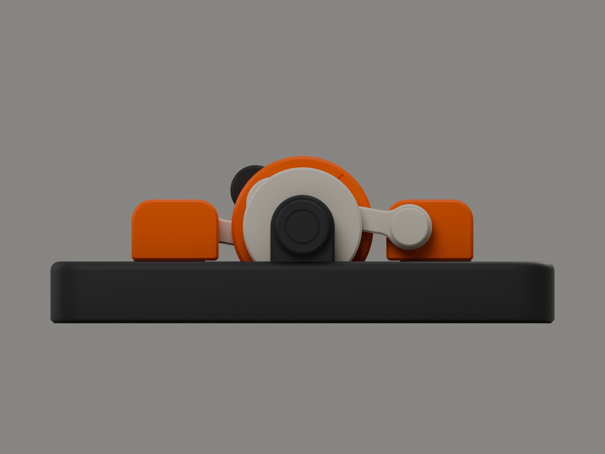
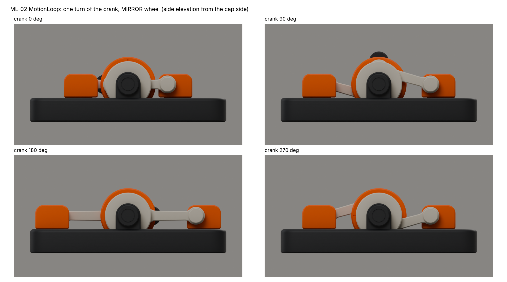
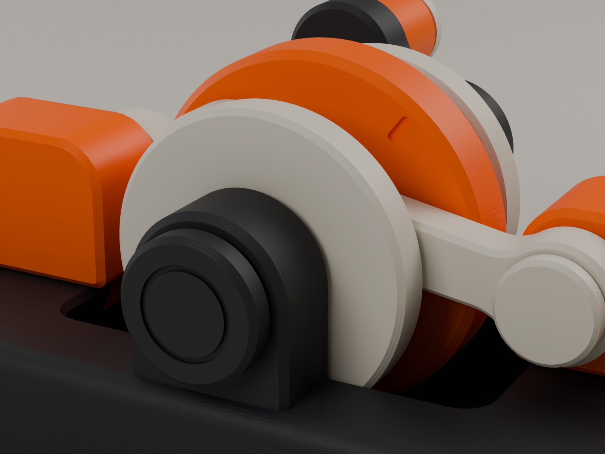
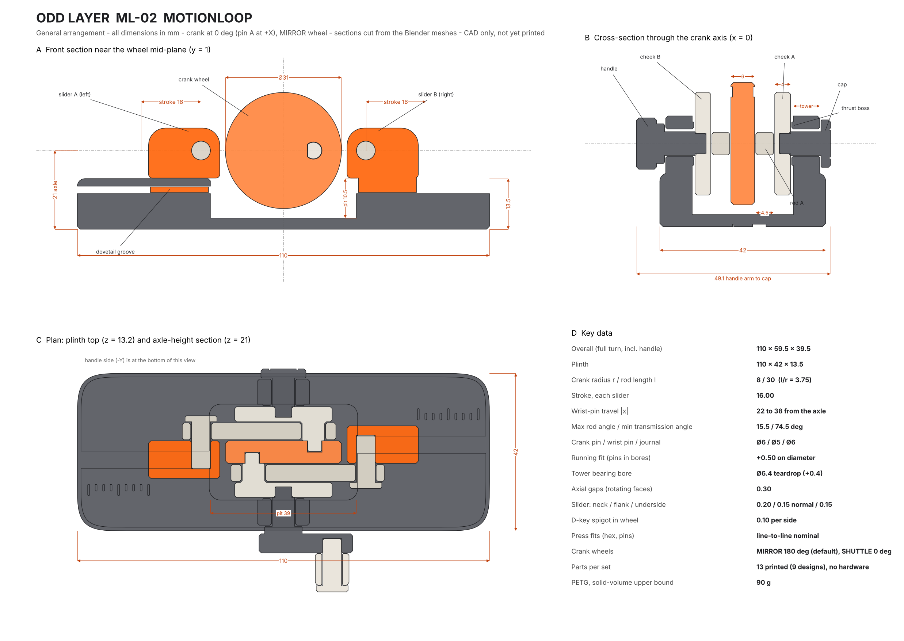
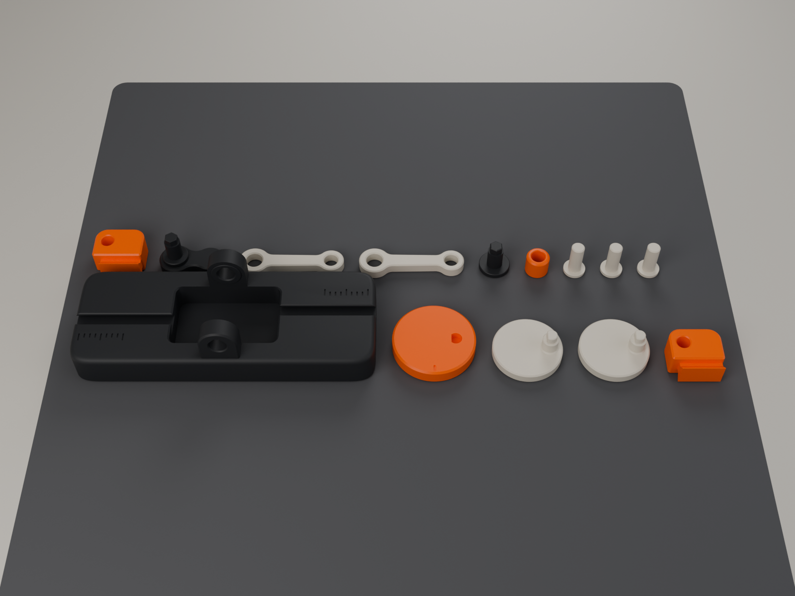

# ODD LAYER ML-02 · MotionLoop



**A hand-cranked desk mechanism.** One crank drives two opposed sliders through two
connecting rods. Turn the handle and the two orange carriages glide in and out along a
graphite plinth, reverse, and come back. Everything that moves is in plain view.

It is 13 printed parts (9 designs). There are no screws, magnets, springs or electronics,
and no part needs supports. All of it is generated by one parametric Blender script, which
also checks the mechanism over a full turn and exports the STL, 3MF, .blend and renders.

> **Status: designed and checked in CAD only. Nothing has been printed or physically tested.**
> Every fit, force and strength figure below is a model prediction. The physical test plan is
> in [section 10](#10-what-still-needs-physical-testing).

| | |
|---|---|
| Size | Plinth 110 × 42 × 13.5 mm. Overall 110 × 59.5 × 39.5 mm over a full turn, handle included |
| Mechanism | Opposed in-line slider-crank. Crank radius 8, rod 30 (l/r = 3.75), stroke 16 mm per slider |
| Crank | Built-up two-throw crankshaft: cheek · centre wheel · cheek. Pins 180° apart, keyed by D-spigots |
| Choreography | **MIRROR** wheel (pins 180° apart, default): the sliders breathe out and in together. **SHUTTLE** wheel (pins in line, optional): the left slider moves out while the right one moves in |
| Guidance | 45° dovetail grooves in the plinth; the crankshaft runs in two towers |
| Parts | Frame · wheel · 2 cheeks · 2 rods · 2 sliders · 3 pins · cap · handle · knob |
| Plastic | ≈ 90 g PETG (solid-volume upper bound; slice for the real figure) |
| Supports / hardware | none / none |
| Printer | any FDM printer with a 0.4 mm nozzle; everything fits one 256 × 256 plate |

---

## Contents

1. [Product concept](#1-product-concept)
2. [Mechanism study](#2-mechanism-study)
3. [How it works](#3-how-it-works)
4. [Mechanical dimensions and tolerances](#4-mechanical-dimensions-and-tolerances)
5. [Engineering validation](#5-engineering-validation)
6. [Deliverables and files](#6-deliverables-and-files)
7. [Bambu Studio settings](#7-bambu-studio-settings)
8. [Assembly instructions](#8-assembly-instructions)
9. [Weak points and engineering compromises](#9-weak-points-and-engineering-compromises)
10. [What still needs physical testing](#10-what-still-needs-physical-testing)
11. [Changing the design](#11-changing-the-design)

---

## 1. Product concept

MotionLoop is meant to be watched and turned, not puzzled over. The handle sits on the side
like a watch crown. Turning it spins an orange crank wheel between two light-coloured
cheeks, and the two sliders run in and out on dovetail tracks. An engraved scale beside each
track measures the 16 mm stroke in 2 mm steps, so you can read the motion as well as see it.

**Design language.** A low graphite plinth with soft superellipse corners, a 2 mm top radius
and a 45° foot chamfer. Two "ear" towers rise from it and carry the crank. The crank sits in
a pit cut into the plinth, so the wheel reads as half sunk into the block. There is one hero
colour, orange: the wheel, the two sliders and the knob, which are the parts you watch and
touch. The rods, cheeks and pins are a quiet sand colour. The parts are printed in their own
best orientation, so the visible faces are either bed texture or clean perimeters. Nothing is
there for decoration: the only marks are the travel scale and the underside engraving.



## 2. Mechanism study

### 2.1 A contradiction in the brief, and how it was resolved

The brief asks for two crank pins **about 180° apart**, and also says that when the crank
turns, **the left slider moves outward while the right slider moves inward**. With two
sliders on opposite sides of one crank, those two requirements cannot both hold:

- Each slider follows the X position of its own crank pin: x = r·cos(θ + φ) ± √(l² − r²·sin²(θ + φ)).
- Pins 180° apart always have **opposite** X positions. So the two sliders always move in
  opposite world directions, which means both go outward together and both come inward
  together (a "boxer" motion). This is true whichever rod goes to which side.
- "Left out while right in" means both sliders move the **same** world direction. That needs
  the pins **in line (0°)**.

The design keeps the specified 180° mechanism as the default and makes the phase a
**one-part swap**. The pins sit in D-shaped holes in the centre wheel, so the wheel alone
sets the phase:

| Wheel | Pins | Motion | Notes |
|---|---|---|---|
| **MIRROR** (orange, default) | 180° | Both sliders out, then both in: symmetric breathing | As specified. The slider inertia forces cancel, so it runs smoothly when spun fast |
| **SHUTTLE** (optional) | 0° | Left out while right in, then reverse | The motion described in the brief. Same cheeks, rods and frame; the second cheek is simply turned over |





### 2.2 Why a built-up crankshaft

The obvious layout is one disc with a pin on each face and an axle through the middle. It
does not work, and the reason sets the whole architecture:

> **The rod-plane rule.** Look at the mechanism from the rod's own point of view. Its big
> end sits on the crank pin. As the crank turns a full 360°, every other point fixed to the
> crank (the axle, the other pin, a handle) circles around that big end at a fixed radius, a
> full 360° *relative to the rod*. The rod has to cross that circle to reach its slider, so
> it must hit it. **So a rod's plane may contain no crank-fixed material except its own
> pin.**

Consequences, and the options this ruled out:

| Option | Verdict | Reason |
|---|---|---|
| One disc, a pin on each face, a through-axle | ✗ | The axle passes through both rod planes. |
| Both rods on one side of the disc, stacked | ✗ | Pin B passes through rod A's plane. |
| Disc held at its rim in a ring bearing, no axle | ✗ | It works kinematically, but there is nowhere to put a crank handle (any handle on a face crosses a rod plane), and rim friction is high. |
| Vertical crank axis with a top handle | ✗ | It needs a bearing bridge across the top, which hides the mechanism. |
| Print-in-place | ✗ | It needs ≥ 0.4 mm gaps everywhere, which gives a rattly feel, and the pins would print across their layers. |
| Open-top slider rails | ✗ | The sliders fall out when the toy is picked up. |
| **Two-throw built-up crankshaft:** cheek · wheel · cheek, journals outboard in two towers, rods in the gaps | **✓** | Each rod plane holds only its own pin. The journals are outboard of everything. The handle hangs off the outer journal. |

So the Y stack, from the handle side, is:
`handle | tower | cheek B | rod B | WHEEL | rod A | cheek A | tower | cap`.

### 2.3 Geometry

- **Crank radius r = 8 mm**, so the stroke is 16 mm. That is big enough to read across a desk.
- **Rod l = 30 mm, l/r = 3.75.** The rod angle peaks at **15.5°**, so the minimum
  transmission angle is **74.5°**, well clear of the ≈ 45° where slider-cranks start to
  bind. The side load on each slider is at most 0.28 × the rod force. A longer rod would
  make the product longer than the 110 mm target.
- **In-line** (the slider pin is at axle height, z = 21): the two half-strokes are
  symmetric, and both sliders and both rods are identical parts.
- **Axle height 21 mm** comes from the handle. The knob passes 2.5 mm above the table at
  the bottom of its circle. The wheel (Ø31) sits in a pit with 2.5 mm under it.
- **Pit length ±19.5 mm** comes from the rod sweep. The rods dip below the plinth top only
  within |x| < 18.0 (computed). Further out they clear the top by ≥ 1.5 mm.

## 3. How it works



| Part | Qty | Colour | What it does | Printed |
|---|---:|---|---|---|
| **Frame** | 1 | graphite | Plinth with the crank pit, two dovetail grooves, two bearing towers with thrust bosses, travel scales and the underside engraving | bottom on the bed |
| **Wheel (MIRROR)** | 1 | orange | Centre web of the crankshaft. Its two blind D-holes key the crank pins at 180° | flat |
| Wheel (SHUTTLE) | opt. | sand | Same, with the D-holes in line | flat |
| **Cheek** | 2 | sand | Outer crank web: integral Ø6 crank pin with a D-spigot, and a hex socket for the shaft | socket face on the bed, pin up |
| **Rod** | 2 | sand | 30 mm link, 4.5 thick. Ø6.5 big end, Ø5.5 small end, filleted shank | flat (loads run along the extrusion lines) |
| **Slider** | 2 | orange | Carriage with a dovetail key and a blind press bore for the wrist pin (the bore depth sets the pin's depth) | on its outer side (bore vertical, round) |
| **Pin** | 3 | sand | Ø5 shoulder pin: two wrist pins plus the knob axle | head on the bed |
| **Cap** | 1 | graphite | Journal + hex on the plain side, with a decorative head | head on the bed |
| **Handle** | 1 | graphite | Crank arm (13 mm throw), Ø10 spacer hub, journal + hex, blind hole for the knob pin | outer face on the bed, shaft up |
| **Knob** | 1 | orange | Sleeve that spins freely on the knob pin | standing on its inner end |

**Load paths.** Handle → hex → cheek B → crank pin B → rod B → right slider. Pin B's
D-spigot keys cheek B to the wheel, so the wheel turns too, and drives pin A (keyed into the
wheel), rod A, the left slider and cheek A. The rods are two-force members, so they only
carry load along their length. The sliders take the side load (≤ 0.28 × rod force) on the
dovetail. The towers carry the crankshaft on two Ø6 journals, and the thrust bosses on their
inner faces set the crank's axial position.

**Why the pins key with a D.** If both pins were plain round spigots, the crankshaft would
be a linkage with a singular position exactly at 180°: the two cheeks could twist several
degrees relative to each other with almost no resistance. A D-flat makes each cheek rigid
with the wheel and also makes it impossible to assemble a cheek the wrong way round.







## 4. Mechanical dimensions and tolerances



*Every outline in the drawing is a real section cut from the Blender meshes.*

### 4.1 Main dimensions (mm)

| | |
|---|---|
| Plinth | 110 × 42 × 13.5, corner size 13 (superellipse n = 4), top radius 2, foot chamfer 0.8 |
| Crank axis | z = 21, towers 14 wide with a radius-7 top (z = 28), bearing length 6.7 |
| Crank pit | 39 × 25.6, floor at z = 3 |
| Wheel / cheeks | Ø31 × 6 / Ø26 × 4 |
| Crank pin | Ø6 × 5.1 bearing length, D-spigot Ø4.4 (flat at 1.5) × 2.8 |
| Rod | 30 c-c, 4.5 thick, bosses R6 / R5, shank 6.0 → 5.0 wide |
| Slider | 19 long × 10 wide × 13.35 tall, wrist pin at 5 from its inner end |
| Dovetail groove | neck 4.4 wide × 1.2, flare 45° to 9.0, floor 4.0 below the plinth top |
| Wrist-pin travel | 22 … 38 mm from the axle on each side |
| Handle | 13 mm throw, arm 5.1 thick; knob Ø9 × 8.5 |
| Y stack (from y = 0) | wheel ±3.0 · rod 3.3–7.8 · cheek 8.1–12.1 · boss face 12.4 · tower 12.8–19.5 · cap / spacer from 19.8 · handle arm 21.8–26.9 |

### 4.2 Fits for a 0.4 mm nozzle (design values; each one measured on the meshes)

| Interface | Gap | Type | Reasoning |
|---|---|---|---|
| Crank pin Ø6.0 in rod big end Ø6.5 | 0.25 radial | running | A separate-part rotating fit. FDM holes print 0.05–0.15 small, so this lands at ≈ 0.15–0.2 |
| Wrist pin Ø5.0 in rod small end Ø5.5 | 0.25 radial | running | as above |
| Knob sleeve Ø5.5 on pin Ø5.0 | 0.25 radial, 0.15 axial each end | running | |
| Journal Ø6.0 in tower bore Ø6.4 | 0.20 radial | running | The bore is printed horizontally with a teardrop roof. The journal bears on the side walls (rod loads are horizontal), not on the roof |
| Rod faces to wheel / cheek / slider / pin head | 0.30 | axial | Faces that slide past each other: 0.3 allows for first-layer squish and warp |
| Cheek outer face to tower thrust boss | 0.30 | axial | Sets the crank's end float (0.6 total) |
| Cap / handle spacer to tower outer face | 0.30 | axial | |
| Slider underside above the plinth top | 0.15 | sliding | Modelled mid-play. Total vertical play ≈ 0.36 |
| Dovetail key neck to groove neck | 0.20 per side | sliding | Lateral guidance |
| Dovetail key flank to groove flank | 0.15 normal | sliding | Holds the slider down: it cannot lift out |
| D-spigot in D-hole | 0.10 per side | locating | Axially captured by the towers, so it needs no press. A snug slip fit |
| Hex shaft (4.5 AF) in cheek socket | 0 nominal | press | FDM holes print small, so this becomes ≈ 0.1 interference |
| Wrist / knob pin Ø5.0 in slider / handle bore | 0 nominal | press | as above |
| Rods to plinth | ≥ 1.53 | clearance | sweep minimum |
| Slider inner end to wheel at inner dead centre | 1.50 | clearance | |
| Knob to table, bottom of its circle | 2.50 | clearance | |

## 5. Engineering validation

`motionloop.py` checks the geometry on every run. The full output is in
[`models/ML02_validation_report.md`](models/ML02_validation_report.md), and the raw data in
`models/ML02_validation.json`.

| Check | Result |
|---|---|
| Every part is one closed, manifold shell | **10 / 10 designs**, 0 non-manifold edges |
| Crank-slider geometry: posed rod bore centres vs the crank pin and wrist pin centres, 72 angles × 2 rods × 2 wheels | error < 1 × 10⁻⁵ mm (the rod length holds) |
| Stroke (both sliders, both wheels) | 16.000 mm |
| Max rod angle / min transmission angle | 15.47° / 74.53° |
| **Collision sweep:** every body pair, triangle-level intersection test, every 2° over a full turn, MIRROR and SHUTTLE | **0 intersections** in 2 × 180 poses × 15 pairs |
| Minimum gaps over the turn (sampled every 10°) | journal/bore 0.19 · slider/frame 0.15 · crank pin/rod 0.24 · wrist pin/rod 0.24 · rods/frame 1.53 · slider/wheel 1.50 · rod/other slider 3.0 · rod/rod and slider/slider > 6 |
| Designed contacts | cheek shoulders seated on the wheel (0.000, and 0 overlaps at a 0.01 mm lift), D-spigot side gap 0.097, hex and pin press fits line-to-line, knob sleeve 0.15 |
| Overhangs in print orientation (45° limit) | Only bridges: blind-hole ceilings (≤ Ø5), the engraved-text ceilings, the 1.5 mm dovetail undercut on the slider, the teardrop-bore caps, the 0.4 mm thrust-boss lips. No part needs supports |
| Wall thickness (ray-cast from every face) | The only walls under 1.2 mm are the ribs between engraved letters on the frame underside. Smallest structural walls: hex-socket floor 1.2, knob-hole floor 1.3, pin heads 1.6, slider 2.5, rod 2.25 |
| Handle / knob above the table over a full turn | 2.50 mm |

**Strength (hand calculation, abuse case).** 10 N on the knob with one slider jammed gives
130 N·mm of torque and 16 N in one rod. Conservative printed-PETG layer strengths are 20 MPa
in tension and 15 MPa in shear.

| Link | Stress | Safety factor |
|---|---:|---:|
| Hex drive in torsion (shear on the layer planes) | 7.3 MPa | **2.1**, the weakest link |
| Journal in torsion | 3.1 MPa | 4.9 |
| D-spigot root bending | 3.6 MPa | 5.5 |
| Wrist pin bending (cantilever) | 3.4 MPa | 5.9 |
| Crank pin root bending | 2.2 MPa | 9.2 |
| Rod small end, net section | 0.8 MPa | 25 |
| Rod buckling | 833 N Euler load | ≫ 10 |

Normal turning takes well under 1 N at the knob, so every link sees ≲ 1/10 of these figures.

## 6. Deliverables and files

| # | Deliverable | Where |
|---|---|---|
| 1 | Editable Blender project | [`models/ML02_MotionLoop.blend`](models/ML02_MotionLoop.blend). Collections: `ML02_Parts` (the source meshes, one per design, with print notes as custom properties), `ML02_Assembly`, `ML02_Exploded`, `ML02_Shuttle`, `ML02_Motion`, `ML02_PrintPlate`, `ML02_Cameras`, `ML02_Lights`, `ML02_Studio`. Every assembly object is a linked instance of its part mesh. All the Python sources are embedded as text blocks |
| 2 | Individual STL files (print orientation, mm) | [`models/stl/`](models/stl): Frame, Wheel_Mirror, Wheel_Shuttle, Cheek, Rod, Slider, Pin, Cap, Handle, Knob |
| 2b | 3MF | [`models/3mf/ML02_MotionLoop_full_set.3mf`](models/3mf) (all 13 parts on one 256 mm plate, coloured) and `ML02_Wheel_Shuttle.3mf` |
| 3 | Complete assembly | `ML02_Assembly` in the .blend; [`renders/01_hero.png`](renders/01_hero.png) |
| 4 | Exploded render | [`renders/02_exploded.png`](renders/02_exploded.png) |
| 5 | Three-quarter render | [`renders/01_hero.png`](renders/01_hero.png), [`renders/06_shuttle.png`](renders/06_shuttle.png) |
| 6 | Side view of the mechanism | [`renders/03_side_mechanism.png`](renders/03_side_mechanism.png), plus the four-position [`renders/08_motion_strip.png`](renders/08_motion_strip.png) |
| 7 | Mechanical dimensions | §4, [`docs/ML02_drawing.png`](docs/ML02_drawing.png) |
| 8 | Assembly instructions | §8 |
| 9 | Bambu Studio settings | §7 |
| + | Validation report, kinematics chart, top view, crank detail, print plate | [`models/ML02_validation_report.md`](models/ML02_validation_report.md), [`docs/`](docs), [`renders/`](renders) |

**Scripts** (reusable; every dimension is a named parameter):

| File | Role |
|---|---|
| [`motionloop.py`](motionloop.py) | Entry point: build → validate → export → scene → save → render |
| [`ml/params.py`](ml/params.py) | Every dimension and clearance, the derived Y stack, and the slider-crank equations |
| [`ml/geom.py`](ml/geom.py) | 2D outlines (filleted links, teardrops, D-shapes, superellipse, convex offset), lofts, exact booleans, measurement |
| [`ml/parts.py`](ml/parts.py) | One builder per part, plus the pose matrices for any crank angle |
| [`ml/validate.py`](ml/validate.py) | Kinematics, collision sweep, clearances, fits, print checks, strength |
| [`ml/export.py`](ml/export.py) | STL / 3MF writers and plate packing |
| [`ml/scene.py`](ml/scene.py) | Materials (with FDM layer lines), collections, studio, cameras, shots |
| [`tools/make_docs.py`](tools/make_docs.py) | Drawing, kinematics chart, motion strip, validation report (matplotlib only) |



## 7. Bambu Studio settings

Open `models/3mf/ML02_MotionLoop_full_set.3mf` (if Bambu Studio asks, import the geometry
only; the file carries no printer profile). Then select your printer and the
**Bambu PETG Basic** (or HF) filament profile and apply the settings below. The parts are
already in print orientation.

| Setting | Value | Why |
|---|---|---|
| Printer / nozzle | any Bambu (A1, P1, X1, H2) with a **0.4 mm** nozzle | All fits are sized for 0.4 |
| Material | **PETG** (Bambu PETG Basic / HF). PLA works for everything except that it is stiffer and more brittle, so the press fits will be tighter | PETG's toughness suits the pins and press fits. Avoid silk or CF-filled filament for the pins and rods |
| Process | **0.20 mm Standard** | The key heights (plinth top 13.5, rod 4.5, wheel 6, cheek 4) are multiples of 0.1 and close to multiples of 0.2 |
| Wall generator | **Arachne** | Thin features (pin shanks, hex) print as clean perimeters |
| Wall loops | **4** for every part. The pins, hex shafts and crank pins are then solid perimeters | Strength and roundness of the pins |
| Top / bottom shells | 5 / 4 | |
| Sparse infill | Frame 15 % gyroid; everything else 40 % gyroid (per-object setting) | The frame's weight helps it sit still; the small parts are mostly walls anyway |
| **Elephant-foot compensation** | **0.15 mm** | The slider underside runs 0.15 above the plinth top, and the cheek, cap and handle bed faces are rubbing faces |
| X-Y hole compensation | 0 to start. If the pins feel tight in the rod bores, set **+0.05** and reprint only the rods | The running fits assume holes print ≈ 0.1 small |
| Seam | **Aligned**, painted to the rear (−X end) of the sliders and the outer end of the rods | Keeps seam bumps off the sliding faces and bores |
| **Ironing** | **Frame only**, top surfaces, 10 % flow | Gives a smooth plinth top for the sliders to glide on. It also smooths the floor between the groove lips |
| Supports | **off** | Validated: no part needs them |
| Brim | **off** (optional 3 mm on the pins if your bed adhesion is marginal) | The pins stand 14 mm tall on an 8.5 mm head |
| Plate | **Textured PEI** | Matte bed texture on the plinth underside, the handle's outer face, the cap head and the slider sides. On smooth PEI, use glue stick with PETG |
| Speeds / cooling | profile defaults. If the dovetail lips or the bore roofs droop, slow overhangs or raise the fan | |
| Colours | Frame, cap, handle: graphite. Wheel, sliders, knob: orange. Cheeks, rods, pins: sand / white | Set per object; the 3MF carries the colours |
| Optional Odd Layer stripe | Frame only: change to orange at **z = 4.0 mm** and back at **z = 4.6 mm** (3 layers) | The house mark: one odd layer |

Print time has not been sliced. Filament is ≈ 90 g as a solid-volume upper bound; expect
roughly half that at these infill settings.

## 8. Assembly instructions

**You need:** the 13 parts and a flat table. Optionally a smooth hard surface to press the
pins on (a table edge works), and a drop of CA glue *only if* a press fit turns out loose.

1. **Check the prints.** Clear any elephant's-foot lip from the slider undersides and from
   the dovetail groove lips with a deburring tool or a fingernail. The sliders should slide
   along the grooves freely. Push a pin through each rod bore: it should spin with
   no binding.
2. **Fit the sliders.** Slide one slider into each dovetail groove **from the outer end of
   the plinth**. The slider's open bore faces the side where the rod will be: for the
   left-hand slider (−X) that is the cap side (+Y), and for the right-hand slider it is the
   handle side. Leave both sliders at the outer ends for now.
3. **Build the crank.** Lay the wheel flat. Hold a rod over one face so its big end is over
   that face's D-hole. Push a cheek's crank pin through the rod's big end and into the
   D-hole. The D only goes in one way. The rod must spin freely between the cheek and the
   wheel. Turn the assembly over and do the same with the second cheek and rod on the
   other face. With the MIRROR wheel, the two crank pins end up on opposite sides of the
   wheel centre.
4. **Drop the crank in.** Hold the crank by its cheeks and lower it into the pit between
   the two towers, with each rod pointing toward its own slider (each rod sits on the same
   side as its slider's open bore). The cheeks slip between the towers' thrust bosses.
5. **Fit the cap and the handle.** Line up the cheek sockets with the tower bores. From the
   cap side (+Y), push the **cap** through the tower bore into cheek A, turning it slightly
   until the hex engages, then press it home. From the other side, do the same with the
   **handle's** shaft into cheek B. Turn the handle: the crank should spin with the rods
   swinging and no rubbing.
6. **Connect the sliders.** Slide each slider inward until its bore lines up with its rod's
   small end. Push a **pin** through the rod's small end and press it into the slider until
   it bottoms out. The bore depth is the stop: the head then sits 0.3 mm clear of the rod, so
   the rod swings freely. Repeat on the other side.
7. **Fit the knob.** Slip the knob sleeve onto the third pin and press the pin into the hole
   at the tip of the handle until it bottoms out. The sleeve is then left with 0.3 mm of end
   play and spins freely.
8. **Run it in.** Turn the handle slowly for a minute in both directions. Both sliders
   should travel the full scale (16 mm) and reverse smoothly.

**Changing to the SHUTTLE wheel.** Pull the cap and the handle straight out, rocking them
gently. Lift the crank out (the rods stay pinned to the sliders, so take the wrist pins out
first or lift the sliders out with it). Take the cheeks off the wheel and repeat steps 3–6
with the SHUTTLE wheel. Its two D-holes are back to back, so the second crank pin lines up
behind the first. Each rod still goes to its own slider.

**Taking it apart.** Every pin and shaft is a straight press fit with a head to pull on. Grip
the head and pull while rocking it slightly. The press fits are meant to survive a few
cycles, not dozens.

## 9. Weak points and engineering compromises

### Weak points (ranked)

| # | Weak point | Why | Mitigation in the design | If it fails |
|---|---|---|---|---|
| 1 | **Press fits** (hex shafts in the cheeks, pins in the sliders and handle) | Interference on a printed press fit depends on the printer: ±0.1 mm swings it from loose to "won't go in" | Line-to-line nominal, so it relies on FDM holes printing small. All press parts are cheap and quick to reprint | Too tight: ream the hole with a 4.5 mm (hex: file) or set hole compensation +0.05. Too loose: one drop of CA, or reprint with `PRESS` / `HEX_PRESS = −0.05` |
| 2 | **Hex drive in torsion**, SF 2.1 in the abuse case | The shaft is printed vertically, so torsion shears the layer planes | Hex enlarged from 4.0 to 4.5 AF; 4 walls make it solid perimeters | Reprint the handle. If it recurs, print the handle in PETG at 0.12 mm layers or raise `HEX_AF` |
| 3 | **Teardrop bearing bores** | Horizontal holes print slightly oval, and the roof has a flat cap | The rod loads are horizontal, so the journal bears on the side walls; 0.2 radial clearance | A drop of dry PTFE lubricant; ream with a 6.4 mm drill |
| 4 | **Crank pins and wrist pins are printed across their layers** | They bend across the layer lines | Short spans (≈ 2.5 mm moment arm), Ø6 / Ø5, root fillets; SF 6–9 in the abuse case | Reprint the cheek or pin; print at 0.12 mm |
| 5 | **Dovetail friction and binding** | 45° flanks wedge, and first-layer squish narrows the groove lips | Normal loads go to the flat plinth top, the flanks only hold the slider down; the anti-jam ratio (key length 15.5 / rod offset 7.5) is far above 2μ | Ironing, and a light rub with fine abrasive paper on the key |
| 6 | **Crank end float** 0.6 mm | Two 0.3 gaps at the thrust bosses | Cheek faces run on small bosses, not whole faces | It is meant to be there; it only becomes a problem if it rattles |
| 7 | **Handle pulled off** | The handle is held by its hex press fit only | — | Re-press; CA if needed |

### Compromises made

- **180° vs the described motion.** As explained in §2.1, the brief asks for something the
  specified mechanism cannot do. MIRROR is the default; SHUTTLE costs one extra 6 mm disc.
- **More parts than the bare minimum (13 parts, 9 designs).** Print-in-place was rejected
  for slop and pin strength (§2.2). The rod-plane rule forces outboard journals, so the crank
  has to be built up from three webs. Separate pins also let every bore be printed
  vertically, so it comes out round.
- **The handle sticks out about 16 mm beyond the 42 mm plinth.** It has to be outside the plinth to
  swing past it at a usable 13 mm throw. The alternative was a taller axle (a bigger, taller
  product) or a tiny throw.
- **The product is 39.5 mm tall,** set by the handle circle and the wheel. It is taller than
  a slab-type desk toy, but that height is what lets you see the mechanism.
- **Staggered sliders.** Each rod runs beside its slider, not over it, so the wrist pin can
  be pressed in from outside and the rod plane stays clear of the slider. That puts each
  slider 2 mm off the centreline, on the side away from its rod. The whole product has
  two-fold rotational symmetry (about the vertical axis), not mirror symmetry. It reads as
  deliberate, like the staggered cylinders of a boxer engine.
- **Press fits instead of snaps or screws.** These are simpler and smaller, but they depend
  on how the printer prints holes (weak point 1).
- **No detents, no sound features.** The brief asks for smooth, synchronised motion, so
  there is no click mechanism. Sound comes only from plastic-on-plastic sliding.

## 10. What still needs physical testing

None of the following can be settled in CAD. Print one set at the §7 settings and then:

| Test | Question | Method | Pass |
|---|---|---|---|
| T1 Fits | Do the running fits run and the press fits press? | Assemble per §8. Note any part that needs force, filing or glue. Feeler-gauge the rod faces to the wheel | Assembles by hand; rods spin freely on the pins; pins press with thumb pressure |
| T2 Free turning | Is the friction low and even? | Turn the handle slowly, then fast; feel for tight spots once per turn. Remove the rods and repeat to separate bearing from slider friction | No tight spot; the handle turns with < ≈ 0.5 N at the knob |
| T3 Sliders | Do the dovetails bind, rattle or stick-slip? | Push each slider along its groove by hand; tilt the plinth 30° and see whether the slider slides on its own | Smooth both ways; no lift-out when the toy is held upside down |
| T4 Synchronisation | Does it look right? | Film the side at 60 fps over 10 turns; compare slider positions with the kinematics chart | Matches within ≈ 0.5 mm |
| T5 Abuse | Where does it break? | Jam a slider and turn the handle until something gives (on a sacrificial set) | The hex shaft or a pin is the first to go (as predicted), not the frame |
| T6 Endurance | Does it wear in or wear out? | 10,000 turns (a drill on the handle hex, ≈ 1 h at 3 rev/s) | No new play > 0.2 mm; still smooth |
| T7 Drop | Does it survive a desk drop? | 0.8 m onto a hard floor, 5 times on different faces | No cracked towers or pins; press fits hold |
| T8 SHUTTLE | Does the swap work in practice? | Swap the wheel per §8 | Done in < 5 min, no damage to the press fits |

**Assumptions to confirm or correct** (each is a parameter in `ml/params.py`): holes print
0.05–0.15 mm small (`RUN_DIA`, `PRESS`, `HEX_PRESS`); 0.3 mm is enough for faces that rub
(`AXIAL`); the dovetail's 0.15 / 0.2 gaps survive first-layer squish (`DOVE`, `SLIDE`);
printed PETG reaches the 15–20 MPa layer strengths used in §5.

## 11. Changing the design

```bash
# Blender 4.2+ (or: pip install "bpy==4.2.*" on Python 3.11 and run with python)
blender -b -P motionloop.py -- --out .                    # build, validate, export, .blend (~75 s)
blender -b -P motionloop.py -- --out . --render           # ...plus all renders (~25 min, 4 CPU cores)
blender -b -P motionloop.py -- --out . --quick            # skip the full-turn sweeps (~3 s)
python tools/make_docs.py                                  # drawing, chart, motion strip, report
```

Every dimension lives in `class P` in [`ml/params.py`](ml/params.py), grouped as
kinematics, fits, Y stack, crank, shafts, rod, plinth, slider and handle. Derived values
(the Y stack, the plinth top, the wrist-pin travel) are computed in `derived()`, so for
example raising `CRANK_R` moves the travel scale and the slider travel with it. The
validator then tells you whether the change still clears: the pit has to cover the new rod
sweep, and the slider must clear the wheel at inner dead centre. Examples:

- **Longer stroke:** `CRANK_R = 9` → 18 mm stroke. Check the pit (`PIT_X`) and the slider
  clearance to the wheel in the report; the wheel may need to be larger.
- **Looser fits for a different printer:** `RUN_DIA = 0.6`, `PRESS = -0.05`.
- **Different phase:** `PHASE_DEG` is used by the kinematics. The physical phase is set by
  the wheel's D-holes in `build_wheel`.

The script has been run with the `bpy` 4.2 module, headless. It should also run inside the
Blender 4.2+ application (Scripting tab → open `motionloop.py` → Run Script), but that route
was not tested here.
