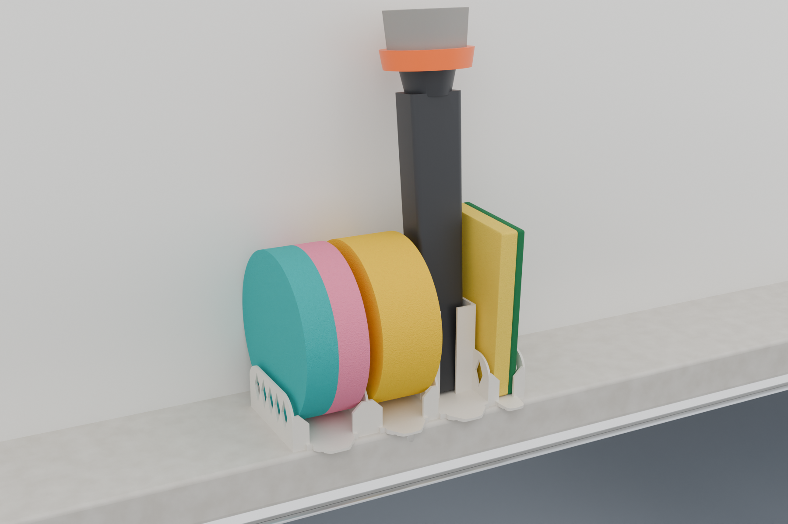
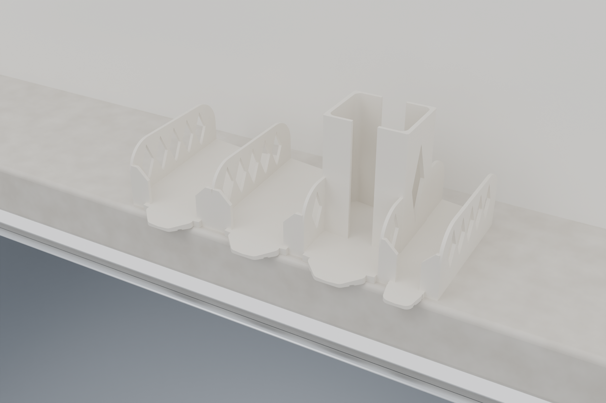
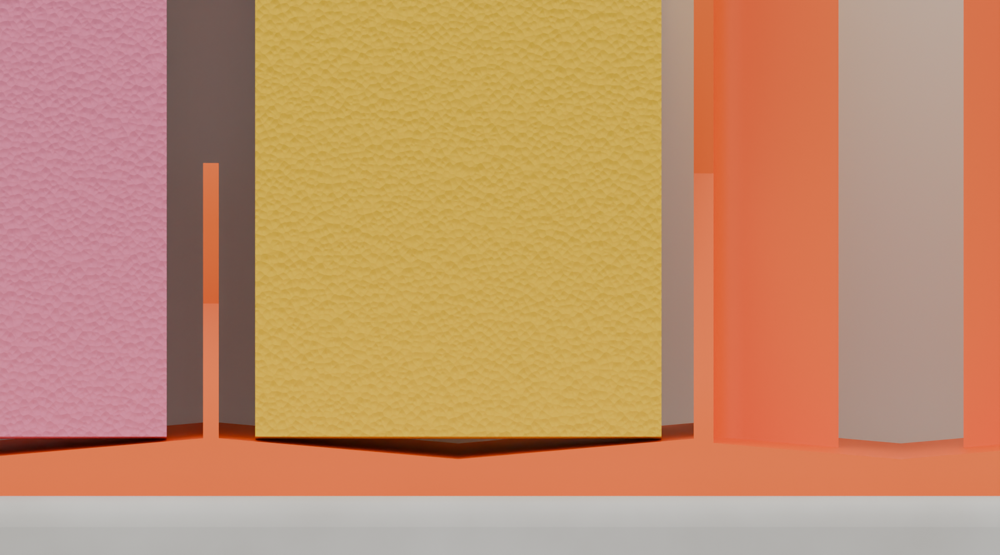
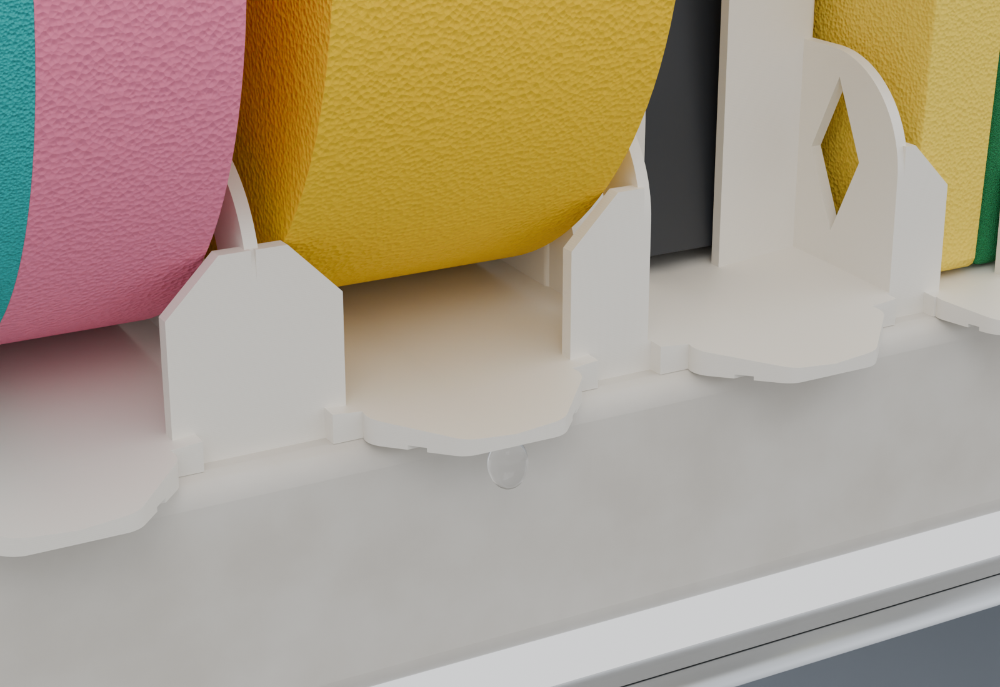
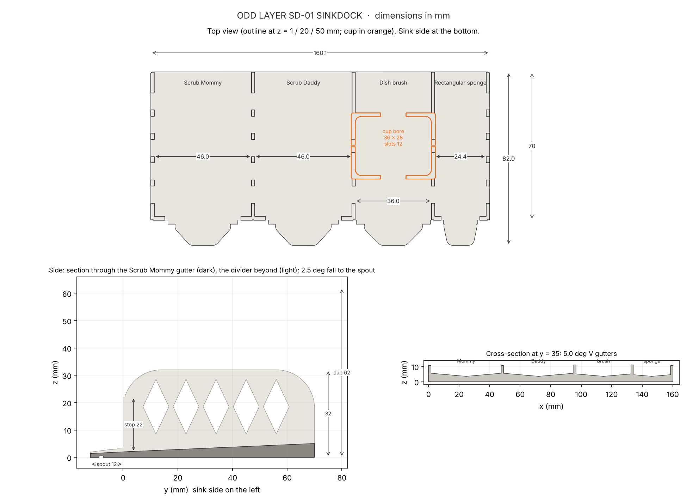
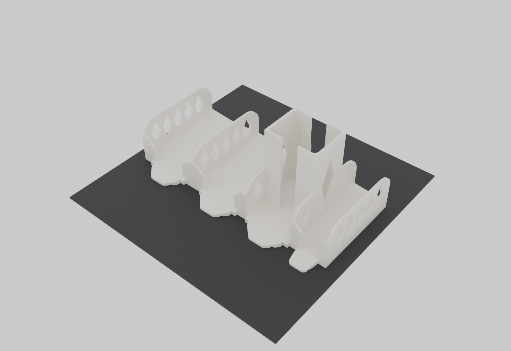
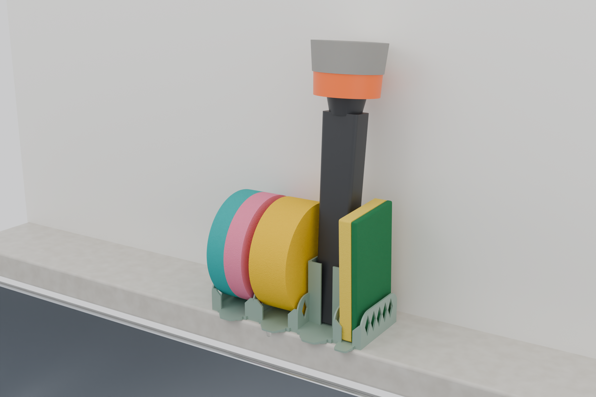

# ODD LAYER SD-01 · SINKDOCK



**A one-piece sink dock for a Scrub Daddy, a Scrub Mommy, a flat sponge and a dish brush. It
drains into the sink, so there's no drip tray.**

Each sponge stands on edge in its own bay. The bay floor is a shallow **V**, so the sponge rests
on its two rim edges with an open gutter underneath. Every gutter falls 2.5° to the front, where a
tapered **spout** carries the water over the counter edge into the sink. A small groove under each
spout makes drops fall off instead of creeping back under the dock. The brush stands handle-down in
a slotted cup that is tight front to back, so a heavy brush can't lean far enough to tip the dock.

> **Status: designed and checked in CAD only. Nothing has been printed or physically tested.**
> All 12 automated checks pass. Grams and minutes come from an in-repo slice-based estimator,
> not a slicer, because no slicer could be installed here. What a prototype must show before
> publishing: [`PHYSICAL_TESTING.md`](PHYSICAL_TESTING.md).

| | |
|---|---|
| Holds | Scrub Daddy · Scrub Mommy (either goes in either 46 mm bay) · flat sponge on end · dish brush, handle down |
| Size | **160.1 × 82.0 × 62.0 mm** (W × D × H with spouts; the body is 70 mm deep) |
| Plastic (estimate) | **≈ 55 g PLA / ≈ 57 g PETG** (range 51–62 g) |
| Print time (estimate, A1 mini, 0.20 mm) | **≈ 1 h 35 min PLA** (range 76–118 min) · ≈ 2 h 06 min PETG Basic (range 101–158 min) |
| Parts / hardware / supports | 1 / none / none |
| Printers | Fits the A1 mini (180 × 180 mm) with 5 mm to spare on each side; any FDM printer with a 0.4 mm nozzle |



## Why this one (vs. what's on MakerWorld)

Full research with links: [`RESEARCH.md`](RESEARCH.md). Summary:

- **Sponges don't sit in water.** Pooled water under the sponge is the most common complaint about
  sponge holders. Here the sponge touches only two rim edges and the gutter under it is open: 1.7 mm
  deep under a round sponge.
- **Drains into the sink without a tray.** A water-routing simulation on the real top surface
  sends 100 % of the floor area to the spouts, with no puddles and nothing onto the counter
  (`docs/SD01_drainage_map.png`).
- **All four things in one quick print.** Competing combo caddies take tens of hours over several
  plates, and single-sponge holders take hours for one sponge. SinkDock is one ≈ 55 g part that
  takes about 1.5 h in PLA (estimate).
- **Sized from measurements, not guesses.** Researched dimensions show the Scrub Mommy is *not*
  bigger than the Scrub Daddy (both are about Ø 100–105 × 38–41 mm), so the two bays are identical
  and interchangeable. The largest sponges, plus 1.5 mm of assumed swelling, clear the walls by
  1.25–1.75 mm a side.
- **Stays upright.** The dock survives a 10° tilt in every direction, empty or loaded, with a heavy
  brush leaning as far as the cup lets it (worst case 12.8°). 10° is the tilt-test angle
  IEC 60335-1 uses for freestanding appliances.
- **Easy to clean.** Every bay is open front and back, the cup is slotted front and back, and there
  are no enclosed pockets. The drainage check found one at the cup corner, and it was redesigned.



*Section at mid-depth (cut faces in orange). Each sponge rests on its two rim edges, and the open
gutter under it (dark wedge) falls to the spout.*



## Dimensions



| Feature | Value |
|---|---|
| Bays, left to right (inner) | Scrub Mommy 46.0 · Scrub Daddy 46.0 · brush cup 36.0 · flat sponge 24.4 mm |
| Dividers | 32 mm tall, 1.5 mm thick (outer walls 1.6), five diamond vents each (25° from vertical: self-supporting) |
| Floor | 2.0 mm at each gutter mouth; 2.5° fall to the front; 5° V cross-fall to a centre gutter in every bay |
| Front stops | 22 mm tall; openings 28 mm (round-sponge bays, sponge ≥ 38 mm) and 11 mm (flat-sponge bay, sponge ≥ 15 mm) |
| Spouts | 12 mm long, tapered to 12 mm wide at the tip; 3° fall; 1.6 × 0.5 mm drip-break groove underneath |
| Brush cup | 36 × 28 mm bore, 62 mm tall, 1.6 mm walls; 12 mm slots front and back; a tall diamond vent each side; stands 0.4 mm proud of the walls it meets |
| Takes | Round sponges up to Ø 106.5 × 42.5 mm · flat sponges up to 69.5 × 21.5 mm on end · brush handles up to about 32 × 26 mm |

## Printing

| Setting | Value |
|---|---|
| Orientation | As exported: floor on the bed, spouts toward you. Nothing to rotate. |
| Material | **PETG** recommended (warm water, detergent). PLA works, but don't rinse it with near-boiling water. |
| Process | Bambu Studio "0.20 mm Standard", 0.4 mm nozzle: 2 walls, 5 top / 3 bottom layers, 15 % infill |
| Supports | Off. There are no unsupported overhangs; the only downward-facing surfaces are 1.6 mm drip-groove bridges. |
| Brim | Not needed in CAD terms. Add a 3 mm brim if PETG corners lift on your plate. |
| Seam | Aligned, back |
| Plate | `models/3mf/SD01_SinkDock_A1mini_plate.3mf` is already centred on a 180 × 180 plate |



**Grams and time.** These are estimates from `sd/printest.py`. It slices the part layer by layer,
applies Bambu's standard process speeds capped by each filament's maximum volumetric flow (PLA 21,
PETG 13 mm³/s), and adds per-layer overhead. It is not a slicer: **check the numbers in Bambu Studio
before quoting them.** The PLA estimate meets both budgets. The PETG Basic estimate meets the
60 g budget but not the 2 h one (≈ 126 min), because PETG Basic is limited by how fast it can be
extruded. PETG HF or PLA brings it under 2 h.

## Placing it

- Put the dock with its front edge at the edge of the counter, so the **spouts overhang the sink by
  8–12 mm**. Water leaves at the spout tips.
- It suits undermount and flush sinks, or the flat deck of a drop-in sink. If your sink has a raised
  rim and the spouts rest on it, the dock tilts back and loses its fall: move it so the rim sits
  under the spouts' tips, or put it on the sink deck.
- Rinse it under the tap now and then. Every bay is open front and back.



## Files

| Path | What |
|---|---|
| `models/stl/SD01_SinkDock.stl` | The part, in print orientation |
| `models/3mf/SD01_SinkDock_A1mini_plate.3mf` | The same part centred on an A1 mini plate (geometry only, any slicer) |
| `models/SD01_SinkDock.blend` | Blender project: dock, generic stand-in sponges and brush, kitchen, plate, studio and cameras, with the generator scripts embedded |
| `models/SD01_validation_report.md` · `SD01_validation.json` | Validation report and data |
| `docs/SD01_drawing.png` · `docs/SD01_drainage_map.png` | Dimensioned drawing; water-routing map |
| `renders/` | 01 hero · 02 empty · 03 section (sponges on the V gutters) · 04 spout drip · 05 print plate · 06 sage colourway |
| `sinkdock.py`, `sd/` | The generator: `params.py` (every dimension), `geom.py`, `validate.py`, `printest.py`, `report.py`, `scene.py`, `export.py` |
| `RESEARCH.md` · `PHYSICAL_TESTING.md` | Competitor research and market case; the prototype test plan |

The sponges and brush in the renders are generic stand-ins built to the researched sizes. They
carry no logos or faces. Scrub Daddy and Scrub Mommy are trademarks of Scrub Daddy, Inc.; Odd Layer
is not affiliated with them.

## Regenerating

```bash
pip install manifold3d shapely trimesh rtree numpy scipy matplotlib   # geometry, checks, drawings
pip install bpy                                                     # Blender as a Python module, for --render
python sinkdock.py            # build, export STL + 3MF, run the 12 checks, write the report and drawings
python sinkdock.py --render   # ...plus the renders and the .blend (Cycles, CPU)
```

### The 12 checks

1. Fits the A1 mini build volume with a 5 mm margin.
2. One closed, manifold, consistently wound body.
3. The exported STL and 3MF re-read from disk as watertight single bodies with the same size and volume.
4. No overhang over 45°, except bridges no wider than 6 mm.
5. No feature thinner than 1.2 mm on any layer.
6. The largest researched sponges and brush handle fit with clearance and no interference.
7. The front openings retain the thinnest sponges.
8. There is an open gutter under every sponge.
9. The drain openings are clear at floor level.
10. Water routing on the ray-cast surface: every wet cell reaches a spout.
11. Tilt stability at 10°, empty and loaded, with the brush at its worst lean.
12. Filament and time budget.

Results: [`models/SD01_validation_report.md`](models/SD01_validation_report.md).
