# ODD LAYER SL-01 · SlideLock

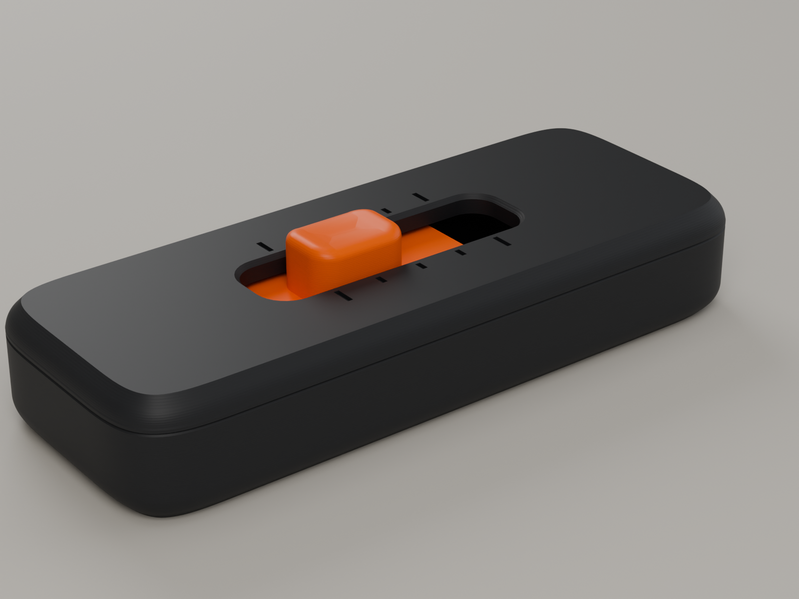

**A pocket slider fidget built around one interaction: _tick · tick · tick · LOCK_.**
An orange thumb knob runs 20 mm along a graphite body. At each of three middle positions it
gives a light, crisp tick. At each end it lands on a hard stop with a firmer click and stays
there, held against the stop by its own spring with no rattle. You can feel it all without
looking.

It is three printed parts, with no magnets, screws, springs or glue. All the detent geometry
lies in the plane where an FDM printer is most accurate, and the springs flex within their
own layers rather than across them.

> **Status: designed and checked in CAD only. Nothing has been printed or tested.** Every
> force, fit and life figure below is a model prediction, labelled as such. The first
> physical step is the prototype plan at the end of this document.

| | |
|---|---|
| Size | 76 × 30 × 13 mm body; the knob stands 3.2 mm proud (16.2 mm overall) |
| Parts | Tray · Carriage (Soft / Standard / Firm) · Lid |
| Mechanism | twin in-plane cantilever leaf springs with V-notch tracks; 5 positions at 5 mm; hard stops at both ends |
| Predicted feel (Standard, PETG) | tick 2.6 N · lock 4.5 N · 0.75 N drag between positions (model) |
| Plastic | ≈ 25 g PETG for a set (solid-volume upper bound) |
| Supports | none, on any part |
| Hardware | none |
| Printer | any FDM printer with a 0.4 mm nozzle; the largest part is 76 × 30 mm |

---

## Contents

1. [Product concept](#1-product-concept)
2. [Mechanism exploration and selection](#2-mechanism-exploration-and-selection)
3. [How it works](#3-how-it-works)
4. [Engineering](#4-engineering)
5. [Validation](#5-validation)
6. [Deliverables and files](#6-deliverables-and-files)
7. [Print settings](#7-print-settings)
8. [Assembly (and taking it apart)](#8-assembly-and-taking-it-apart)
9. [Known engineering risks](#9-known-engineering-risks)
10. [First physical prototype: plan](#10-first-physical-prototype-plan)
11. [Changing the design](#11-changing-the-design)

---

## 1. Product concept

The interaction is the product, so the design starts from how it should feel:

- **Two kinds of position.** A light *tick* in the middle of the travel and a firm *lock*
  at each end. The lock should take noticeably more force to leave than a tick (the model
  gives 1.7×), so your thumb can tell where it is.
- **A lock that is actually solid.** At each end the carriage hits a rigid stop. The end
  notch is placed 0.25 mm *past* that stop, so the spring is still climbing the notch flank
  when the carriage arrives. It therefore keeps pushing the carriage onto the stop. Locked
  means zero play.
- **Controlled between clicks.** A small, constant drag between positions (≈ 0.75 N) stops
  the knob feeling loose or slippy. The two springs face each other and centre the carriage,
  so it never rubs one wall harder than the other.
- **No rattle anywhere.** In every middle position the spring is still preloaded 0.2 mm into
  its notch.

**Design language.** A soft-cornered slab (straight sides, continuous-curvature
superellipse corners) in graphite. The top and bottom edges have a 3 mm radius with a
printable 45° start. One orange element, the knob, sits on top. Through the slot you see the
orange carriage beneath, so the slot itself reads as a track. Engraved position marks sit
beside the slot, long ones at the two lock positions. The lid and tray meet at a deliberate
0.35 mm V-groove on the tangent line of the top radius. Nothing is there for decoration.

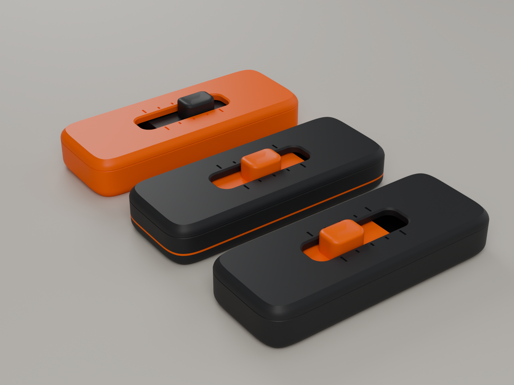

Colourways (all from the same files): **core** graphite / orange, **signature** with a
three-layer orange stripe made by a filament swap (see [print settings](#7-print-settings)),
and **inverse** orange / graphite. The stripe is meant as the Odd Layer house mark: one odd
layer.

---

## 2. Mechanism exploration and selection

Seven candidates were scored against reliability, feel, printability and durability.

| # | Mechanism | Verdict | Why |
|---|---|---|---|
| A | **Print-in-place captive slider** with flexure detents | rejected | Needs ≥ 0.35–0.4 mm gaps to avoid fusing, especially the Z gaps over the carriage. That slop is exactly what makes cheap fidgets feel cheap. You cannot tune or replace the spring. Bridged ceilings sag onto the carriage. |
| B | **Ratchet** (pawl and saw teeth) | rejected | One-way by nature, so back-and-forth needs a reset or a second pawl. The pawl tip wears to a rounded nub. |
| C | **Bistable snap-through** (compliant buckled beam) | rejected for v1 | A great snap, but buckled beams run at 2–3 % strain. That means fatigue in PLA/PETG within thousands of cycles. It only gives two positions. Worth revisiting for a later product. |
| D | **Ball detent** | rejected | Needs a steel ball and coil spring (hardware). A printed coil spring creeps. |
| E | **Vertical leaf spring** pressing a notched floor | rejected | The spring bends across layer lines (weak in fatigue). Notch flanks in Z are stair-stepped at the layer height, so it would feel gritty. |
| F | **Single cantilever detent** on one side | rejected | Pushes the carriage against the opposite wall, which adds friction and wobble. Cantilever friction also makes the feel differ by direction. |
| **G** | **Twin in-plane cantilever springs on a captured carriage, V-notch tracks in the side walls, rigid end stops** | **selected** | Below. |

**Why G.**

- **Precision where it matters.** Every detent surface (notch flanks, crest radii, tooth
  nose) is drawn in the XY plane and extruded straight up. FDM holds about ±0.1 mm in XY
  and draws those profiles as smooth perimeter paths, with no layer steps.
- **The spring flexes within its layers.** Each spring is a vertical plate made only of
  perimeters. Bending stress runs along the extruded lines, the strongest direction a
  printed part has, so fatigue is governed by bulk plastic, not layer adhesion.
- **Balanced and symmetric.** The two springs sit on opposite walls, and the whole carriage
  looks the same after a 180° turn. Side loads cancel, and the friction asymmetry of one
  cantilever is mirrored by the other, so the feel is the same in both directions.
- **The wear part is the cheap part.** The springs are on the 6.6 g carriage. If the feel
  fades, or you want it firmer, you reprint the carriage and keep the body.
- **Assembly beats print-in-place here.** Three parts printed separately can run 0.15–0.2 mm
  fits, with no fusing risk and no supports. The lid snaps on, and it comes off again to
  change carriages.

**Architecture: why the lid is on top.** An earlier layout had a one-piece body with a
snap-in base plate. It failed on paper: thumb pressure goes knob → carriage → base, and a
50 mm base plate held only at its ends bows about 0.7 mm under 10 N. So the structure was
inverted. The **tray** (floor, walls, notches, stops) takes all of the load directly. The
**lid** only resists the knob being pulled upward, which almost never happens.

---

## 3. How it works

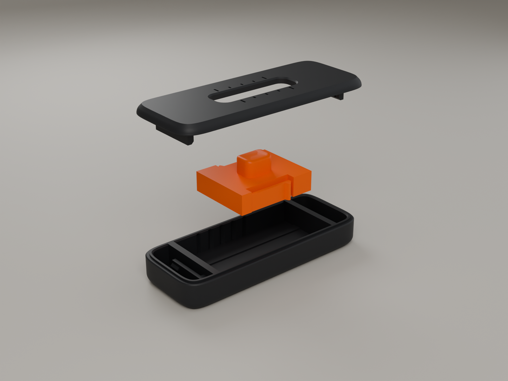

**Tray** (graphite, printed floor-down): the chassis. Its side walls carry the two notch
tracks. Two internal walls are the hard stops. Two floor rails carry the carriage. Beyond
each stop wall is a **latch flag**: a 1.4 mm plate standing on the bed inside a slot through
the floor, which bends sideways to grab the lid.

**Carriage** (orange, printed bottom-down with the knob up): a rigid frame with the knob on
top and a **cantilever spring** along each side. Each spring is 1.2 × 6.0 mm, 15.5 mm from
root to tooth, with a rounded **tooth** (R0.6 nose) at its free end. Behind each spring is a
1.6 mm slot: room to flex, and a hard **overtravel stop** so the spring cannot be bent past
1.2 % strain, even by forcing.

**Lid** (graphite, printed top-face-down on textured PEI): the top plate with the slot and
position marks, two ceiling rails, and two **latch hangers** with pockets for the flag hooks.
It is the same either way round.

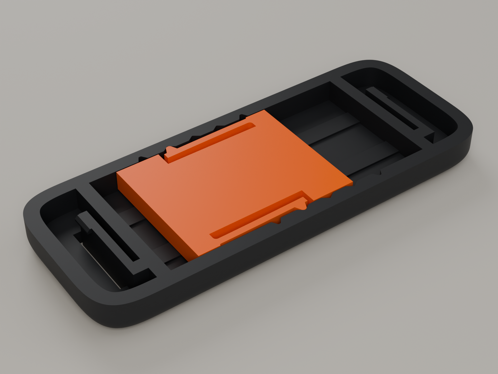

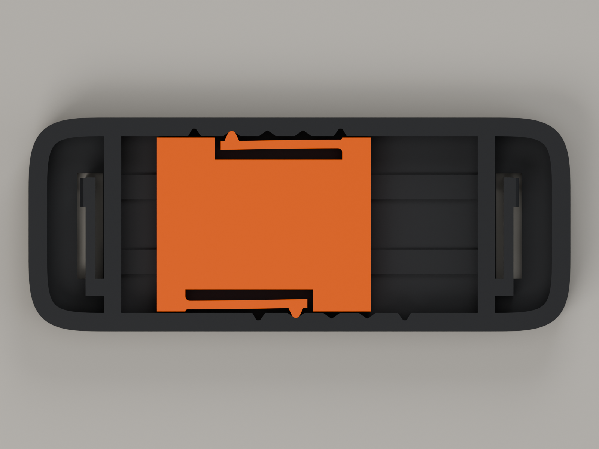

*Cutaway at z = 6.6 mm, carriage at the −5 position. The springs are bent to the deflection
the detent model predicts there.*

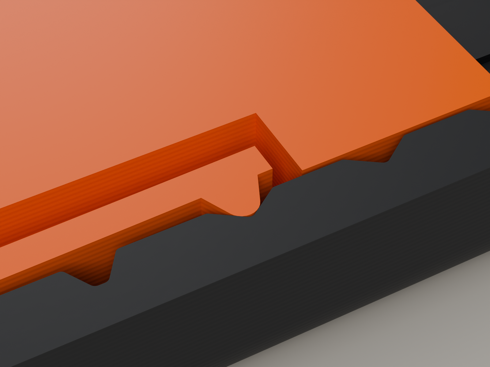

**The detent.** Each wall has five notches at 5 mm pitch, one for each knob position. The
right wall's track is offset by 9 mm, because the right tooth sits at the opposite end of the
carriage (the 180° symmetry).

- **Tick notches:** 35° flanks. The tooth seats 0.70 mm deep with 0.20 mm of spring preload.
- **Lock notches:** a steeper 55° exit flank, seated 0.90 mm deep. The seat is 0.25 mm beyond
  the hard stop, so on the stop the spring is still deflected 0.36 mm and pushes the carriage
  onto it.
- **Notch bottoms** are flat-truncated just below the deepest point the tooth can reach. That
  keeps at least 1.55 mm of wall behind every notch.
- **Notch tops** close with a 45° roof, so the walls print with no flat overhang and the lid
  tongue above stays full thickness.

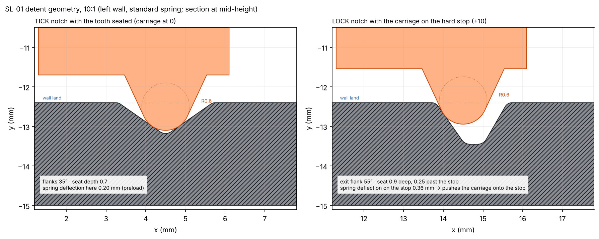

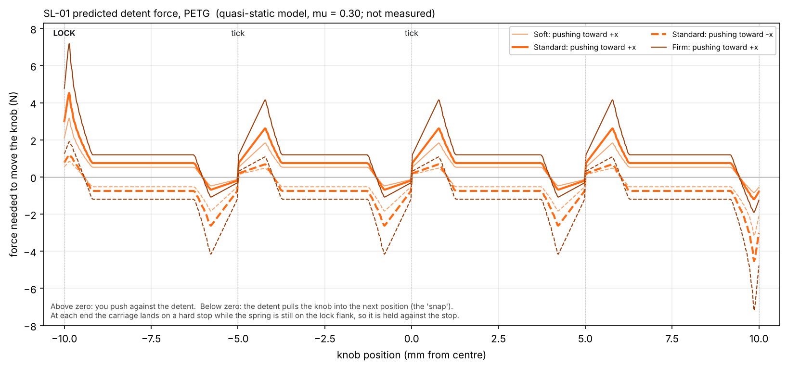

*Predicted knob force along the travel, from the quasi-static model (circle nose on the real
wall profile, cantilever stiffness, Coulomb friction μ = 0.30 on the flanks, both springs
summed). Positive means you push. Negative means the detent pulls the knob into the next
position (the snap). Not measured.*

---

## 4. Engineering

### Dimensions

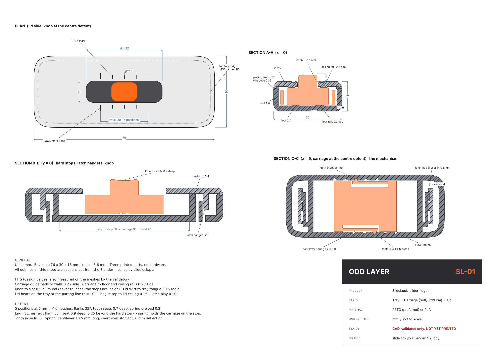

Every outline on the drawing is a real section cut from the Blender meshes.

### Key fits (design values; the validator measured each one on the meshes)

| Interface | Gap | Reasoning |
|---|---|---|
| Carriage guide pads ↔ walls | 0.20 / side | Sliding fit between two separately printed parts. The springs centre the carriage, so the pads only touch under side load. |
| Carriage ↔ floor and ceiling rails | 0.20 / side | Narrow rails, not full faces: less friction and less sensitivity to bed texture and first-layer squish. Thumb load goes to the floor rails. |
| Knob ↔ slot | 0.50 all round | The knob never touches the lid. The stops are internal, so the visible slot edges never wear. |
| Lid skirt ↔ tray tongue | 0.15 radial | Locating fit. The lid bears on the tray at the parting line. |
| Tongue top ↔ lid ceiling | 0.15 | So the lid always seats on the outer step. |
| Latch hook ↔ pocket | 0.10 vertical, 0.20 at the tip | A small amount of play so the latch always engages despite Z tolerance. |
| Spring ↔ wall (free state) | 0.50 | Only the tooth touches the wall. |
| Spring ↔ frame (slot behind) | 1.60 | Working deflection 0.90, so 0.70 of overtravel before the hard stop. |
| Spring end ↔ guide pad | 0.80 | |
| Latch-flag floor slot | 1.0 / 0.6 / 1.2 | Room for the flag to flex; at least 0.6 mm everywhere so the first layer cannot fuse it; 1.2 mm on the outer side for a 1 mm release pin. |

### Springs: strain and fatigue

Cantilever with a tip load: strain ε = 1.5 · t · δ / L².

| Carriage | t × h | k, PETG (model) | ε at full working deflection (0.90 mm) | ε at the overtravel stop |
|---|---|---|---|---|
| Soft | 1.2 × 4.2 | 0.97 N/mm | 0.67 % | 1.20 % |
| **Standard** | 1.2 × 6.0 | 1.39 N/mm | 0.67 % | 1.20 % |
| Firm | 1.4 × 6.0 | 2.21 N/mm | 0.79 % | 1.22 % |

- **Working strain under 0.8 %** was the design rule. For printed PETG that is a conservative
  fraction of yield (≈ 2.5–3 %). Strain at this level is the regime where unfilled plastics
  usually survive on the order of 10⁶ cycles. That target is a judgement, not a datum for
  this exact material and print.
- **The springs rest almost unloaded:** 0.20 mm in a tick, 0.36 mm on a stop. So they sit
  at 0.15–0.26 % strain while parked, which keeps creep (permanent set) low.
- **Varying stiffness by spring height, not thickness,** keeps strain identical for Soft and
  Standard, so they have the same fatigue margin. The Firm carriage changes thickness instead
  (1.4 mm), which is why its strain is higher.

### Detent model (both springs, μ = 0.30)

| Carriage | PETG tick / lock | PLA tick / lock |
|---|---|---|
| Soft | 1.8 / 3.2 N | 2.8 / 4.8 N |
| **Standard** | **2.6 / 4.5 N** | 3.9 / 6.8 N |
| Firm | 4.2 / 7.2 N | 6.2 / 10.8 N |

PLA is stiffer than PETG (≈ 3.0 vs 2.0 GPa), so **printing in PLA, start with the Soft
carriage**: it predicts the same feel as Standard in PETG.

### Lid latches

Each flag is 1.4 mm thick and 12.1 mm from root to hook, and it flexes **in-plane**: it bends
within its layers because it stands on the bed through a slot. Snapping in deflects it
0.6 mm, which is 0.86 % strain and about 2.6 N per flag in PETG. The hook and pocket faces
that carry the load are flat (90°), so the lid cannot be pulled off without releasing the
flags. The lid is rotationally symmetric: hangers and pockets on both sides, so it cannot
go on the wrong way round.

### Print orientation (each part designed for exactly one)

| Part | On the bed | Why |
|---|---|---|
| Tray | floor | Walls, notches and stops rise straight up. The notch profiles become smooth perimeter paths. The bottom face gets the bed texture and the engraving. |
| Lid | top face | The visible top is the bed surface (textured PEI). The slot chamfer, rails and hangers all build upward. The pocket ceilings are short bridges. |
| Carriage | bottom | The springs and teeth are vertical plates made of perimeters. The knob's thumb saddle is the last layers. |

Edges that touch the bed use a 3 mm radius that starts as a 45° chamfer, so there is no
curling first-layer overhang. That is why the top and bottom edges show a hairline facet
before the curve.

---

## 5. Validation

`slidelock.py` checks the geometry on every run. The full output is in
[`models/SL01_validation_report.md`](models/SL01_validation_report.md), and the raw data in
`models/SL01_validation.json`. **28 of 28 checks pass.**

| Check | Result |
|---|---|
| Every part is one closed, manifold shell (nothing disconnected) | 5 / 5 parts |
| Tray and lid do not intersect (the designed seam contact is excluded by a 0.01 mm lift) | 0 intersecting triangle pairs |
| Lid fits turned 180° | 0 |
| **Full-travel sweep:** 201 carriage positions every 0.1 mm, springs bent to the model deflection | 0 rigid intersections, 0 spring-wall intersections |
| Every designed clearance measured on the meshes (pads, rails, knob/slot at centre and end, skirt, tongue, latch) | all equal to the design value ± 0.01 |
| Designed contacts actually touch (carriage on the stop at full travel, lid on the seam step) | 0.000 mm |
| Spring strain under 0.8 % (all three carriages) | 0.67 / 0.67 / 0.79 % |
| No unsupported overhang steeper than 45°, in print orientation | 0.00 mm² on every part |

**Wall thickness** was ray-cast from every face. The only readings under 1.2 mm are:

- floor ribs between engraved letters;
- a 1.12 mm diagonal across the top of the notch roofs (1.55 mm measured horizontally);
- the zone where the lid's 1.2 mm skirt meets the rounded edge;
- the 1.2 mm springs themselves, by design.

**Flat down-facing areas** are only the ceilings of engraved letters and marks (≤ 1 mm
spans), the 0.8 mm ledges under the latch hooks, and the latch pocket ceilings in the lid
(5 mm bridges between solid walls). The validator's 2D pre-check also confirms that every
offset of the plan outline stays convex, so no wall self-intersects in the corners.

What the software **cannot** check, and the prototype must: real clearances after shrink
and elephant's foot, the actual forces, feel and sound, spring fatigue and creep, and latch
retention.

---

## 6. Deliverables and files

| # | Deliverable | Where |
|---|---|---|
| 1 | Product concept and mechanism explanation | this README, §1–3 |
| 2 | Final Blender model | [`models/SL01_SlideLock.blend`](models/SL01_SlideLock.blend). Collections: Assembly, CarriageVariants, Exploded, Cutaway, BottomView, Colourways, PrintPlate, Cameras, Lights, Studio. The generating script is embedded as a text block. |
| 3 | Blender Python source | [`slidelock.py`](slidelock.py) (parameters at the top) and [`tools/make_docs.py`](tools/make_docs.py) (drawings, charts, report) |
| 4 | STL exports (print orientation, mm) | [`models/stl/`](models/stl): `SL01_Tray`, `SL01_Lid`, `SL01_Carriage_Standard`, `_Soft`, `_Firm` |
| 4b | 3MF plates | [`models/3mf/SL01_starter_plate.3mf`](models/3mf) (tray, lid, Standard carriage) and `SL01_full_set.3mf` (all five parts) |
| 5 | Renders from multiple angles | [`renders/`](renders): hero, top, front, bottom, cutaways, macro, colourways, print plate |
| 6 | Exploded assembly view | [`renders/05_exploded.png`](renders/05_exploded.png) |
| 7 | Print settings | §7 |
| 8 | Assembly instructions | §8 |
| 9 | Known engineering risks | §9 |
| 10 | First prototype recommendations | §10 |
| + | Dimensioned drawing, detent force chart, detent detail, validation report | [`docs/`](docs), [`models/SL01_validation_report.md`](models/SL01_validation_report.md) |

| | | |
|---|---|---|
| 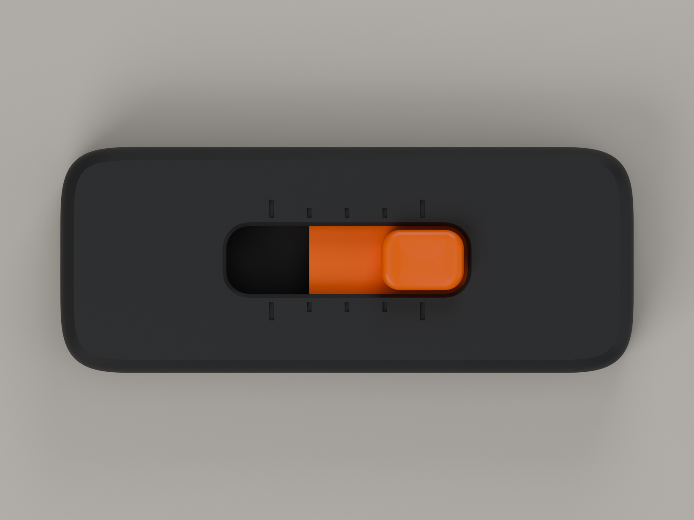 | 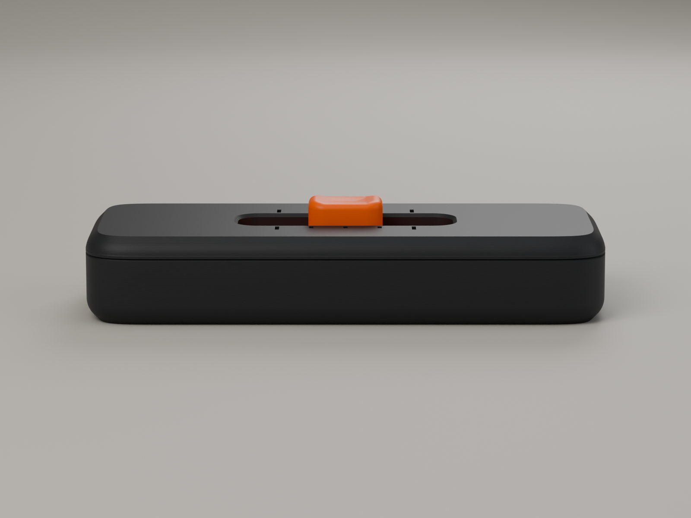 | 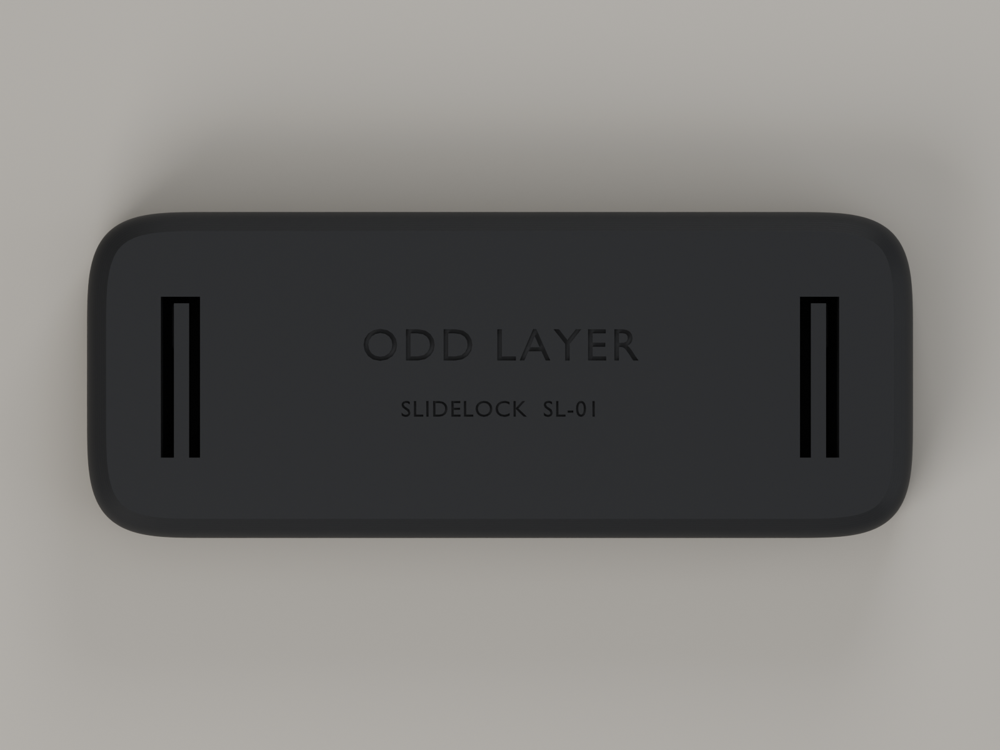 |
| Top: knob on the +10 lock | Front: the V-groove parting line | Bottom: engraving and the two latch-release ports |

---

## 7. Print settings

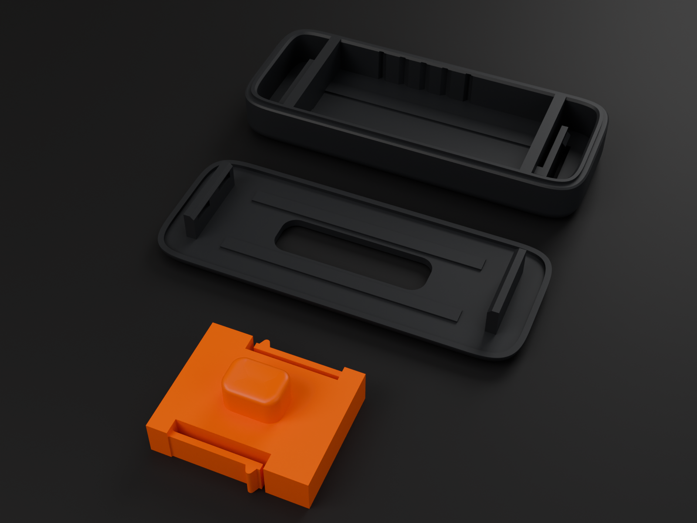

| Setting | Value | Why |
|---|---|---|
| Material | **PETG** preferred (Bambu PETG Basic / HF, Prusament PETG). PLA works with the **Soft** carriage. | PETG's toughness and fatigue behaviour suit the springs and latches. Avoid silk PLA and CF-filled filaments for the carriage: they are brittle and the springs will crack. |
| Nozzle | 0.4 mm | The springs are 1.2 mm = 3 perimeter lines. |
| Layer height | 0.20 mm (first layer 0.20) | The main heights (floor 2.4, rails 0.4, carriage 7.2, parting line 10.0) are multiples of 0.2. |
| Walls | **3 perimeters**, Arachne | The springs and flags must be solid perimeters, with no infill inside. |
| Top / bottom shells | 5 / 4 | |
| Infill | 25 % gyroid | The parts are mostly walls anyway. |
| Seam | Aligned. Check the preview: there should be **no seam on the flat lands between notches** inside the tray. | A seam bump on a land reads as a phantom click. Seams inside notches are harmless, because the tooth bears on the flanks, not the bottom. Paint the seam into an end chamber if needed. |
| Elephant's-foot compensation | **on, 0.15 mm** | The carriage pads run at 0.2 mm from the walls. |
| Supports / brim | none / none | A brim would fill the latch-flag floor slots. |
| Plate | Textured PEI | Gives the lid top and tray bottom their matte finish. On smooth PEI, use glue stick with PETG. |
| Orientation | As exported: tray floor-down, lid top-down, carriage knob-up | |
| Colours | Tray and lid graphite, carriage orange | |
| Signature stripe (optional) | Tray only: swap to orange at layer **z = 4.2 mm** and back to graphite at **z = 4.8 mm** (3 layers) | Bambu Studio: add a filament change at those heights on the layer slider (with an AMS, change the filament for that layer range). |

Filament ≈ 25 g PETG for a set (an upper bound from solid volume; slice for the real
figure). Print time has not been sliced. All three parts fit one plate.

---

## 8. Assembly (and taking it apart)

**You need:** the three parts. For disassembly only: a 1 mm pin (paperclip, SIM tool).

1. **Clean the latch flags.** Each end of the tray has a flag standing in a slot through the
   floor. Check that both flags flick freely. If the first layer fused one to the slot edge,
   free it with a craft knife from below.
2. **Check the springs.** On the carriage, push each tooth inward. The spring should flex
   easily until it meets the frame behind it.
3. **Drop the carriage in.** Hold it knob up and line the knob up with the centre position.
   Press it straight down into the tray. The teeth squeeze past the lead-in at the top of the
   walls and click into the notch tracks.
4. **Slide it end to end.** You should feel three ticks and a firmer lock at each end, with
   no binding. *(If it binds, see the prototype plan, T2.)*
5. **Fit the lid.** Put the slot over the knob (either way round) and press the lid down at
   both ends until both latches click. The parting-line groove should look even all the way
   round.

**Taking it apart** (to change carriages): from underneath, push a 1 mm pin into the
**outer** side of one release port and press the flag toward the middle of the part while
lifting that end of the lid. Repeat at the other end.

---

## 9. Known engineering risks

Ranked by how likely each one is to show up on the first print.

| # | Risk | Likelihood | Effect | Mitigation already in the design | What to do if it happens |
|---|---|---|---|---|---|
| 1 | **Detent too weak or too strong.** Force goes with E·t³: a 0.05 mm thickness error is ±13 %, and PETG vs PLA is 1.5×. | High | Feel off | Three carriage variants; the force is set by spring height so strain stays fixed | Pick another variant, or change `SPRING_H` and reprint the carriage only (≈ 20 min). |
| 2 | **Seam bumps or blobs on the notch lands** | Medium | Phantom clicks, gritty feel | Notch bottoms are clear of the tooth | Set the seam to an end chamber; wipe or retract tuning. |
| 3 | **Elephant's foot** on the carriage pads or the tray walls' first layer | Medium | Drag near the bottom of the stroke | Floor rails lift the carriage 0.6 mm above the floor | Turn on EFC 0.15 or chamfer the pads (parameter). |
| 4 | **First-layer fusing of the latch flags** to their slots | Medium (low with EFC) | Lid will not latch | 0.6 mm minimum slot gap | Free with a knife; raise `FLAG_SLOT_OUT`. |
| 5 | **Latch retention.** The hooks are only 0.8 mm deep, and the hook overhang is printed across layers. | Low–medium | Lid pops off when dropped | Flat 90° retaining faces; 0.86 % strain on the flags | Raise `HOOK` to 1.0 and `POCKET_DEPTH` to 1.0. |
| 6 | **Spring fatigue** (crack at the root) | Low in PETG, medium in PLA | Loss of detent on one side | ≤ 0.8 % working strain, root fillets, overtravel stop | Reprint the carriage. Lifecycle test T5 says how soon. |
| 7 | **Notch and tooth wear** (tooth nose flattens) | Medium over months | Softer clicks | Large nose radius vs contact force; the wear sits on the cheap part | Reprint the carriage. |
| 8 | **Lid / tray mismatch** at the seam | Low | Visible step | 0.35 mm V-groove hides up to ≈ 0.3 mm of mismatch | — |
| 9 | **Carriage binds in Z** if a part warps or the slicer rounds heights badly | Low | Stiff sliding | 0.2 mm each side above and below; narrow rails | Sand the rails lightly, or raise `CLEAR_Z`. |
| 10 | **Sound.** Plastic-on-plastic may be quieter than hoped. | Unknown | Less satisfying | Hollow body acts as a small resonator; the hard stop is a rigid wall | Try PLA for the tray (stiffer, louder) with the Soft carriage. |
| 11 | **Pocket lint / grit** in the notch tracks | Medium over time | Gritty feel | — | Lid off, blow out. |

---

## 10. First physical prototype: plan

Print the starter plate (tray, lid, Standard carriage) **plus the Soft and Firm carriages**
in PETG, at the settings in §7. Then run these tests in order. Each one answers a question
the CAD cannot.

| Test | Question | How | Pass |
|---|---|---|---|
| T1 Fit | Do the parts go together as designed? | Assemble per §8. Measure the gaps with feeler gauges: carriage pad to wall, knob to slot. | Assembles by hand; lid seats on both latches; pad gap 0.1–0.3 mm |
| T2 Free travel | Is the sliding friction low before the springs add load? | Test-fit a carriage with both springs snipped off. Tilt the tray. | Slides under its own weight at ≤ 30° |
| T3 Feel | Is tick vs lock distinct, and is the Standard spring right? | Blind A/B/C of the three carriages with 5+ people. Note the favourite and words used. | Majority can name the position without looking; favourite variant chosen |
| T4 Force | Does the model hold? | Push the knob with a kitchen scale or a cheap force gauge at each detent, 5 times. | Within ±30 % of the model (tick 2.6 N, lock 4.5 N for Standard PETG). If not, correct `E_MODULUS` / `MU` in the script so the model matches. |
| T5 Life | Does it survive? | 10,000 full end-to-end strokes (about 3 h at one stroke per second with a small crank or servo jig, or a week of pocket use). Re-measure T4. | No cracks; forces within 15 % of the start values |
| T6 Latch | Does the lid stay on? | Drop from 1 m onto a hard floor, 10 times, on different faces. Then remove and refit the lid 20 times. | Lid stays on; flags undamaged |
| T7 Material swap | What does PLA do? | Repeat T3/T4 with a PLA tray and the Soft carriage. | Record it; choose the listed default material |
| T8 Sound | Is it satisfying? | Phone recording next to the ear, PETG vs PLA tray. | Subjective; pick the best combination |

**Values to adjust after T1–T4** (all one-line parameter changes in `slidelock.py`):
`CLEAR_SIDE`, `CLEAR_Z`, `FIT_LID`, `PRELOAD`, `SPRING_H` / `SPRING_T`, `MID_FLANK`,
`END_FLANK_IN`, `HOOK`.

**Assumptions to confirm or correct** (each one appears in the model):

- Printed PETG E ≈ 2.0 GPa and PLA ≈ 3.0 GPa, in-plane.
- μ ≈ 0.30 tooth on wall.
- Springs print at their nominal 1.2 mm thickness.
- XY accuracy about ±0.1 mm.
- Elephant's foot under 0.15 mm with compensation on.
- 0.8 % working strain gives a long fatigue life in printed PETG.
- The 0.10 mm latch play is not audible.

---

## 11. Changing the design

```bash
# Blender 4.2+ (or: pip install "bpy==4.2.*" on Python 3.11 and run it with python)
blender -b -P slidelock.py -- --out .                # build, validate, export, save the .blend (~10 s)
blender -b -P slidelock.py -- --out . --render       # ...plus the ten renders (~25 min on 4 CPU cores)
python tools/make_docs.py                             # drawing, force chart, detail, validation report
```

Every dimension sits in `class P` at the top of `slidelock.py`, grouped by function:
envelope, shells, guidance, travel and detents, carriage, variants, latches, marks. Values
that depend on others (cavity width, stop positions, slot length, notch depths) are computed
in `derived()`, so changing `TRAVEL`, `PITCH` or `CARR_L` moves the stops, slot, marks and
notch tracks together. The validator then tells you whether the change still fits.
Examples:

- More positions: `TRAVEL = 24`, `PITCH = 4` → 7 positions. The body may need a longer `L`.
  Watch the stop and latch spacing in the report.
- Firmer clicks without more strain: increase `SPRING_H` (up to 6.2) or `MID_FLANK`.
- A deeper lock: increase `END_FLANK_IN` (keep it under 60° to stay clear of jamming).

The script has been run with the `bpy` 4.2 module, headless. It should also run inside the
Blender 4.2+ application (Scripting tab → Run Script), but that route was not tested here.
