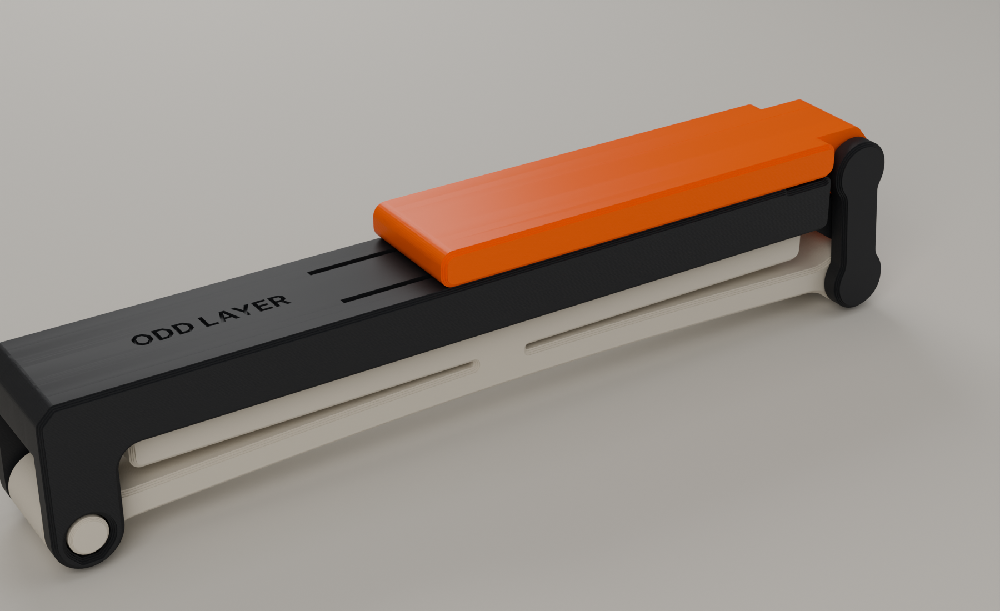
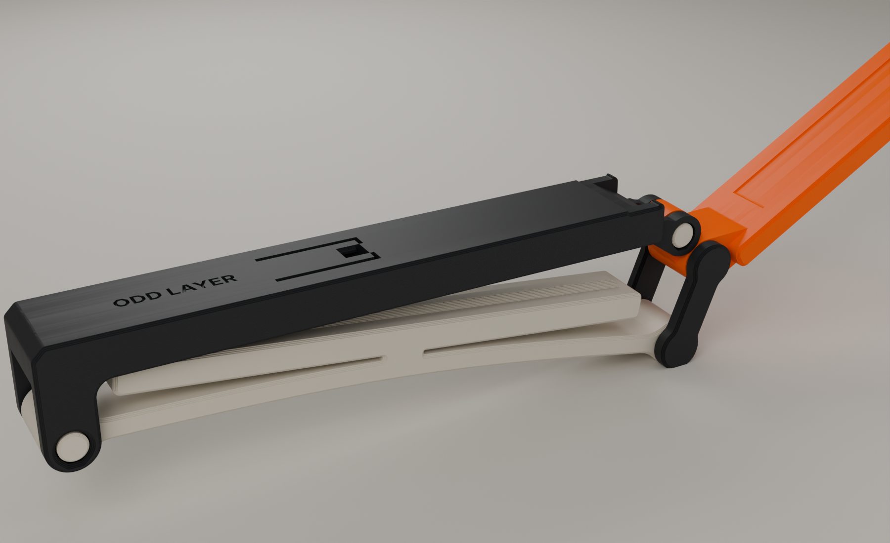
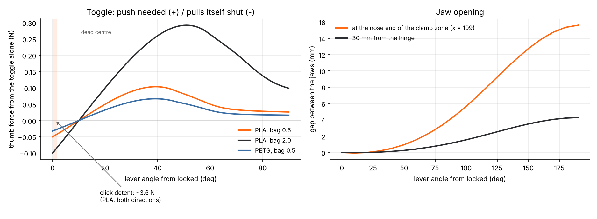
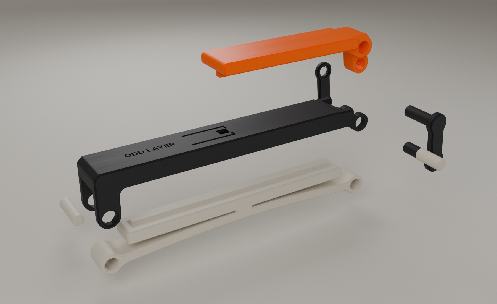
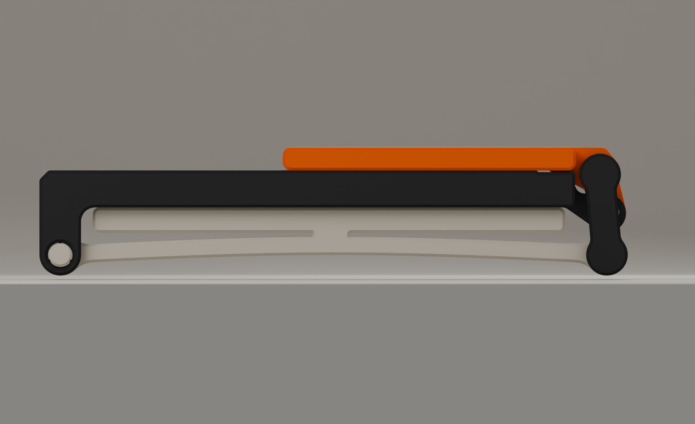
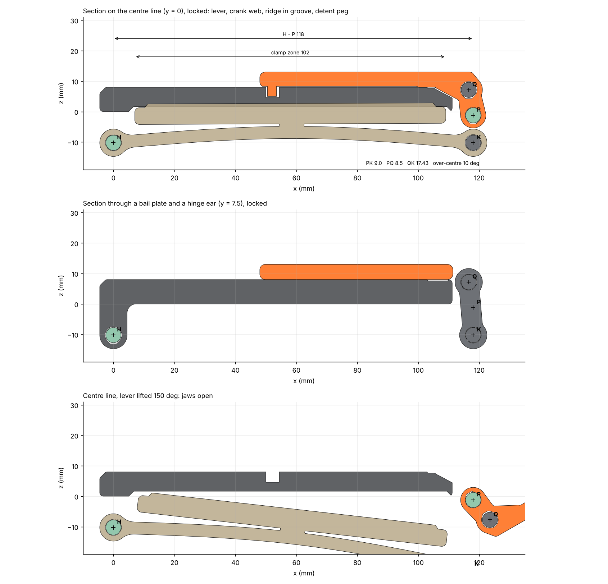
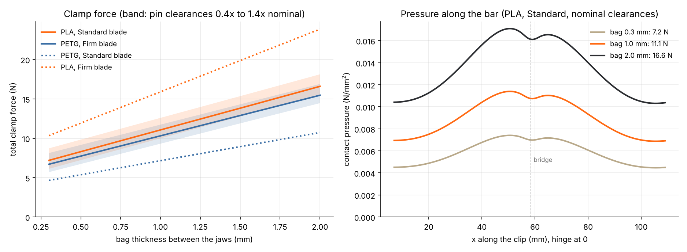
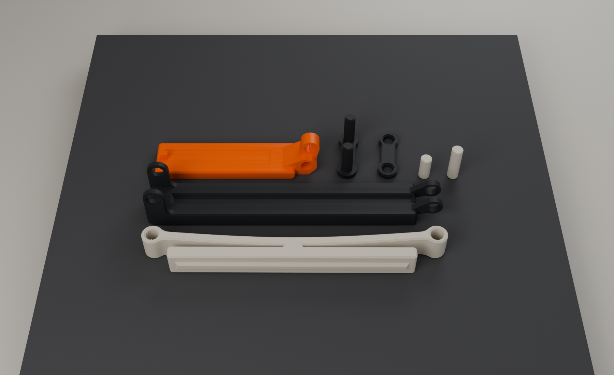

# ODD LAYER TC-03 · ToggleClip



**A bag clip with a real over-centre lock.** Slide the open clip over the folded top of a bag
and press the orange lever down. The lever pulls the nose of the lower jaw up through a bail link.
The link goes 10° past dead centre, and the lever lands flat on the clip with a click. It stays
locked until you lift the lever. The lower jaw is a pressure bar that floats on an arched bow
spring. That keeps the clamp force moderate and spreads it along the clip, whether the bag is a
thin bread bag or a 2 mm stack of coffee-bag foil.

It is 7 printed parts. There are no springs, screws, magnets or other hardware, and no part needs
supports. Everything is generated by one parametric Python script. The same script sweeps the
mechanism through its full travel, checks every fit, models the spring and the lever forces,
and exports STL, 3MF and an editable Blender project with renders.

> **Status: designed and checked in CAD only. Nothing has been printed or physically tested.**
> Every force, fit and strength figure below is a model prediction. Before you call it
> finished, print one and work through the test plan in [§10](#10-what-still-needs-physical-testing).

| | |
|---|---|
| Size | 127 × 18 mm footprint; 22 mm tall in the middle, 28 mm at the two pin bosses |
| Clamp zone | 102 mm long, 12 mm wide, with a ridge-and-groove seal. Bags up to ≈ 100 mm wide (fold wider bags first; see [§9](#9-weak-points-limitations-and-compromises)) |
| Mechanism | Four-bar draw toggle: lever crank PQ 8.5 mm, link QK 16.94 mm, 10° over centre at the stop |
| Spring | Floating pressure bar on one central bridge, carried by a 4 mm arched bow pinned at both ends |
| Clamp force (model) | PLA, Standard blade: 7 N with a 0.3 mm bag, 11 N at 1 mm, 17 N at 2 mm |
| Lever | ≈ 3.5 N click to lock and to release (PLA). The toggle itself needs < 0.3 N |
| Opening | 12.7 mm at the nose end of the clamp zone with the lever lifted 150°; 15.6 mm at most |
| Parts | upper jaw · blade · lever · 2 bail plates · 2 pins (7 parts; plus an optional Firm blade for PETG) |
| Plastic | ≈ 49 g (solid-volume upper bound; slice for the real figure) |
| Supports / hardware / tools | none / none / none (a table edge to press the pins in) |
| Printer | any FDM printer with a 0.4 mm nozzle and a 220 × 220 mm bed or larger; PLA or PETG |

---

## Contents

1. [Product concept](#1-product-concept)
2. [Mechanism study](#2-mechanism-study)
3. [How it works](#3-how-it-works)
4. [Dimensions, fits and tolerances](#4-dimensions-fits-and-tolerances)
5. [Engineering validation](#5-engineering-validation)
6. [Deliverables and files](#6-deliverables-and-files)
7. [Print orientation and settings (PLA and PETG)](#7-print-orientation-and-settings-pla-and-petg)
8. [Assembly instructions](#8-assembly-instructions)
9. [Weak points, limitations and compromises](#9-weak-points-limitations-and-compromises)
10. [What still needs physical testing](#10-what-still-needs-physical-testing)
11. [Changing the design](#11-changing-the-design)

---

## 1. Product concept

Most printed bag clips either rely on the plastic's own springiness, which creeps and goes slack,
or use a snap hook that you have to line up. TC-03 locks the way a toolbox latch does. You
press the lever down, it goes over centre and stays there, and only lifting the lever opens it.

**Design language.** A slim graphite upper jaw with a soft rear corner and a debossed ODD LAYER
wordmark on its top deck. A sand-coloured blade underneath, whose arched bow and lens-shaped slot
show at a glance that it is a spring. The orange lever is the one part you touch; it lies flush
on the jaw and ends in a rounded head over the nose. Two dark bail plates at the nose show where
the lock is. There is no decoration: every visible feature is there to do a job.



## 2. Mechanism study

### 2.1 Locking mechanisms considered

| # | Mechanism | How it locks | Reliability in printed plastic | Printability | Parts | Ease of use | Verdict |
|---|---|---|---|---|---|---|---|
| A | **Over-centre draw toggle** (lever + link at the nose) | Link passes dead centre; the clamp's own tension holds it shut | High: pure pin joints, the lock is geometric, so it holds even if the spring relaxes | Good: every part is a flat stack of layers | 4 + pins | One motion: lift to open, press to lock. Lifting also pushes the jaws open | **Selected** |
| B | Eccentric cam lever (quick-release-skewer style) | Cam passes its peak radius, then backs off onto a stop | Medium: the lock relies on sliding friction on a printed cam, which wears, and the over-centre dwell is only ≈ 0.3 mm of radius | Good | 3 + pin | One motion | Rejected: friction-dependent and wears |
| C | Cantilever snap hook at the tip (the classic sealing-clip latch) | Hook flexes over a lip | Medium-low: the hook carries the clamp load in bending and creeps open; PLA hooks fatigue | Very good | 1–2 | Have to line up the hook | Rejected: no lever, and the lock is the weak point |
| D | Sliding collar / wedge ring | Friction wedge | Low: holding force depends on friction and print tolerance | Good | 2 | Fiddly | Rejected: not a lock |
| E | Quarter-turn cam knob | Detent on a cam | Medium | Overhangs on the knob | 3 + | Two hands | Rejected: awkward on a bag |
| F | Hinge-end toggle (locking-pliers style) | Toggle near the hinge | Medium: high toggle forces (≈ 7× the clamp) and 7× tolerance amplification at the jaw | Good | 4 + pins | Wide opening | Rejected: too sensitive to print error |

**Why A.** It is the only option where the lock is pure geometry. Once the link is past centre,
pulling on the bag only pushes the lever harder onto its stop. All of its joints are pins, so
nothing depends on friction or on a printed surface wearing in. It also opens the jaws: lifting
the lever drives the link the other way and pushes the jaws about 13–16 mm apart.

### 2.2 The spring, and why it is a floating bar

A toggle only works with something elastic in the loop: it has to stretch slightly as it passes
dead centre. In printed plastic, the size of that stretch decides everything. It sets how hard
the clip grips a thin bag compared with a thick one, how much printer-to-printer variation
changes the grip, and how much the parts creep. I modelled three options as Euler-Bernoulli beams
with unilateral contact (`tc/mech.py`), with the pin clearances included:

| Spring option | Result in the model | Verdict |
|---|---|---|
| Straight rigid jaws | The toggle fixes the tip gap, so any bag at the tip must be crushed. Force rises by hundreds of newtons per mm of bag | Rejected |
| One cambered (crowned) jaw pinned at both ends | Contact only at the crown: 3–5 mm of contact in a 102 mm zone, with gaps of 0.2–0.6 mm towards the ends. A thick bag near the pins is crushed (a 2 mm bag gives 300+ N) | Rejected: poor seal, bag-dependent |
| Bar on **two** bridges over a bow | The bow's slope at the bridges tilts the bar's ends up: the pressure goes to the bar ends and the middle lifts off | Rejected |
| **Bar on one central bridge** over an arched bow | The bow is pinned at H and K and loaded at mid-span, where its slope is zero, so the bar stays straight. The whole 102 mm zone stays in contact for 0.3–2 mm bags; the ends get ≈ 60–65 % of the peak pressure | **Selected** |

The bow gives 5.6 N/mm at the bridge (PLA), so a 0.3 → 2 mm change in bag thickness moves the
clamp force only from 7 to 17 N. The bow is arched downwards by 3.4 mm, so the slot between bar
and bow stays open over the full 3.3 mm of travel (≥ 0.7 mm left at the bar ends, checked).

### 2.3 Is the toggle reliable in printed plastic? Yes, with one honest caveat

The over-centre lock itself is robust. It is geometric, it gets tighter when the bag pulls, and
its joints are pins with 0.20–0.25 mm running clearances. **The caveat is feel.** At bag-clip
forces (link tension 3–8 N), a toggle multiplies force so well that the lever needs only
0.1–0.3 N at the thumb. The snap over centre is real but too light to feel. The holding torque
at the stop is 3–6 N·mm, the equivalent of 0.05–0.1 N at the lever's tip. A stiffer spring cannot
fix this: you would need ≈ 50 N of clamp force to feel 2–3 N at the lever, which overstresses the
bow and crushes bags.

So the lock has a **click detent** at the thumb end. A peg under the lever passes between two
flexure fingers cut into the upper jaw. They are 18 mm long and flex sideways, in the plane of
the printed layers. That gives about 3.5 N to press shut and about the same to lift (PLA; 2.3 N in
PETG), plus an audible click. It also keeps the lever from being knocked open, because the lever
cannot rise without passing the fingers. The toggle does the clamping and the over-centre lock;
the detent gives the deliberate feel and the protection against snags.



## 3. How it works



| Part | Qty | Colour | What it does | Prints |
|---|---:|---|---|---|
| **Upper jaw** | 1 | graphite | The stiff member (18 × 8 mm). Flat clamp face with a 45° groove; two hinge ears that reach down to the hinge pin H; two nose cheeks that carry the lever pin P; the two detent fingers; the wordmark | upside down, top face on the bed |
| **Blade** (Standard) | 1 | sand | The lower jaw and the spring. Pressure bar (5.5 mm) with a 45° ridge, joined by one 8 mm bridge to an arched 4 mm bow that carries the hinge pin (pressed in) and the K peg bore | on its side |
| Blade (Firm) | opt. | sand | Same, bow 4.6 mm: gives PETG the same clamp force as PLA with the Standard blade | on its side |
| **Lever** | 1 | orange | Arm (18 × 5 mm) lying on the jaw; head carrying Q; crank web round P (pin pressed in); detent peg with two barbs | upside down, top face on the bed |
| **Bail A** | 1 | graphite | Link plate with two integral Ø5 pegs: Q (runs in the lever) and K (runs in the blade) | flat, pegs up |
| **Bail B** | 1 | graphite | Link plate with two crush-rib holes, pressed onto the peg tips: makes the bail a rigid frame | flat |
| **Lever pin** | 1 | sand | Ø5 × 12; pressed into the lever, runs in the nose cheeks; its ends sit behind the bail plates | standing |
| **Hinge pin** | 1 | sand | Ø5 × 18; pressed into the blade, runs in the hinge ears | standing |

**The four-bar.** Ground is the upper jaw, which carries H (hinge) and P (lever pivot). The lever
turns about P. The bail joins Q, on the lever 8.5 mm from P, to K, on the blade's nose. The blade
turns about H. At lock, P lies between Q and K, and Q is 10° past the P–K line. The link tension
then pushes the lever onto its stop, the lever arm lying flat on the jaw. Lifting the lever turns
Q back through dead centre (at 10° of lift, where the jaws squeeze 0.06 mm tighter) and then
forward and down. The link pushes K down and the blade swings open about H.

**Load path, locked.** The bag pushes the bar down. The bridge carries that to the middle of the
bow, which bends between its pins H and K. H pulls on the hinge ears. K pulls on the bail, the bail
pulls Q, the lever presses P up into the nose cheeks and its arm onto the jaw's top face. The upper
jaw closes the loop.

**Seal.** The bar's ridge (1.2 mm high, 45° flanks) sits in the jaw's groove with 0.45 mm normal
clearance. The bag is pressed flat on the lands either side and folded over the ridge, so the
seal does not depend on high pressure.



## 4. Dimensions, fits and tolerances



*Every outline in the drawing is a real section through the generated parts.*

### 4.1 Key geometry (mm, use frame: hinge pin H at x = 0, clamp face z = 0)

| | |
|---|---|
| Pins | H (0, −10.23), P (118, −1.23), K (118, −10.23) at lock; Q (116.52, 7.14) at lock |
| Toggle | PQ 8.5, QK 16.94, PK 9.0 at lock, over-centre 10°, dead centre at 10° of lever lift |
| Upper jaw | 18 wide × 8 tall, x −4.5 … 111; groove 5.7 wide at the face, 1.65 deep |
| Blade | 12 wide; bar 5.5 × 102 (x 7 … 109); bridge 8 wide at x 58.5; bow 4.0 (Firm 4.6) arched 3.4; slot 0.8 at the bridge growing to 3.4 at the bar ends |
| Lever | arm 18 × 5 × 63 (x 48 … 111.3), head round Q, crank web 6 wide round P |
| Bail plates | 2.65 thick, bosses R4.5, pegs Ø5 |
| Detent | peg 3 × 2.6 with 0.5 barbs; fingers 1.8 × 3 × 18; barb/bump overlap 0.4 per side |
| y stack (half widths) | blade ±6.0 · lever web ±3.0 · nose cheeks 3.35–6.0 · bail plates and hinge ears 6.35–9.0 · upper jaw and lever arm ±9.0 |

### 4.2 Fits (designed for a 0.4 mm nozzle, checked on the geometry)

| Interface | Design | Type | Notes |
|---|---|---|---|
| K peg Ø5 in blade (round, vertical hole) | 0.20 radial | running | Vertical holes print round; they usually come out 0.05–0.15 small, so expect ≈ 0.12–0.18 |
| Q peg in lever, lever pin in cheeks, hinge pin in ears (teardrop holes) | 0.25 radial | running | Horizontal holes have a 45° roof (no supports). The roof is never the bearing side |
| Hinge pin in blade, lever pin in lever, pegs in Bail B | 0.15 clearance + 3 crush ribs reaching 0.12 inside the pin | press | The ribs deform on assembly, so the fit tolerates ±0.1 mm of printer variation |
| Faces sliding past each other (y stack) | 0.35 per side | axial | |
| Ridge in groove | 0.45 normal | clearance | room for the bag |
| Lever on its stop | 0 (contact) on the outer strips; 0.3 relief over the fingers | stop | |
| Detent barb/bump | 0.4 overlap per side, 0.29 clear when locked | snap | |

### 4.3 Clearance guidance and alternatives for other printers

Holes on FDM printers usually come out slightly small. The design assumes they do, but stays
usable if they don't:

| Symptom after printing | Fix (one change at a time) |
|---|---|
| A running joint is stiff (pin or peg won't turn freely) | Run a 5 mm drill bit through the hole by hand, or set **XY hole compensation +0.05 mm** in your slicer and reprint that part. Or regenerate with `RUN_V = 0.25`, `RUN_T = 0.30` |
| A press fit won't go in | The crush ribs are meant to be tight: press against a table edge. If it really won't go, scrape the three ribs with a knife or regenerate with `RIB = 0.05` |
| A press fit is loose | A drop of CA glue on the pin end, or regenerate with `RIB = 0.20` |
| The click is too weak or too strong | Regenerate with `BUMP = 0.3` (softer) or `0.5` (firmer); the fingers stay below 13 MPa up to 0.5 |
| Grip too light (PETG, or a soft filament) | Print the **Firm blade**; or regenerate with `PRELOAD = 1.3` |
| Grip too strong (lever hard to close on thick bags) | Regenerate with `PRELOAD = 0.7` |
| Lever rattles side to side | Normal with 0.35 mm axial gaps; it does not affect the lock |

## 5. Engineering validation

`toggleclip.py` runs all of this on every build. The full output is in
[`models/TC03_validation_report.md`](models/TC03_validation_report.md), and the raw data in
`models/TC03_validation.json`.

| Check | Result |
|---|---|
| Every part is one closed manifold shell (manifold3d) | **8 / 8 designs**, 1 shell each |
| **Clearance sweep:** every part pair, every overlapping y-band, lever 0 → 190° in 2° steps (96 poses), exact 2D distances | **No collisions.** Smallest body gaps: blade/lever 0.29 (at dead centre), blade/upper jaw 0.35, bails/upper jaw 0.92, bails/lever 1.19. Running fits 0.20–0.25 as designed |
| Same sweep with the Firm blade fitted | No collisions (same smallest gaps) |
| Locked pose, bar pressed flush (3D boolean of the whole assembly) | Only the three crush-rib press fits overlap (0.35–1.1 mm³); the lever touches its stop (a 6 µm polygon-chord contact). Ridge in groove 0.45 mm all round; lands in contact |
| Detent | Releases within the first ≈ 1.7° of lever lift; 0.29 mm clear when locked |
| Toggle geometry | Dead centre at 10.0° of lift; Q passes centre by 10° at the stop; jaws squeeze 0.06 mm tighter at dead centre than at the stop |
| Overhangs (each part sliced every 0.2 mm in its print orientation, unsupported if not carried by the layer below grown 45°) | Blade, bail plates, pins: **none**. Upper jaw: the ceiling over the detent pocket and fingers (a 9.2 mm bridge), a 0.5 mm-deep clearance recess under the lever head (6.2 mm bridge) and the flat caps of the teardrop holes (≤ 2.3 mm). Lever: the teardrop caps only (≤ 1.7 mm). **No part needs supports** |
| Thin features (< 1.2 mm in a profile) | Only the detent barbs and bumps, which are meant to be small; every structural wall ≥ 1.2 mm (the thinnest is 1.25 mm, below the lever-pin hole in each nose cheek); bail and cheek plates 2.65 |
| Bed fit | Whole set on one 220 × 220 plate (largest part 127 × 18) |

### 5.1 Clamp force (beam model with contact, pin clearances included)



| Bag thickness | PLA · Standard | PETG · Standard | PETG · **Firm** | PLA · Firm |
|---:|---:|---:|---:|---:|
| 0 (empty) | 5.4 N | 3.4 N | 5.0 N | 7.8 N |
| 0.3 mm | **7.2 N** | 4.7 N | **6.7 N** | 10.3 N |
| 1.0 mm | **11.1 N** | 7.2 N | **10.3 N** | 15.9 N |
| 2.0 mm | **16.6 N** | 10.7 N | **15.5 N** | 23.9 N |
| Bow stress at 2 mm | 14.3 MPa | 9.3 MPa | 10.1 MPa | 15.6 MPa |

Pin clearances from 0.4× to 1.4× nominal change the 0.3 mm-bag force by about ±20 % (PLA
Standard: 6.2–8.8 N). Assumptions: effective in-plane modulus 3.0 GPa (PLA) and 1.9 GPa (PETG);
the bag treated as a compliant layer of 3 N/mm per mm of length. **The bag stiffness is a guess.**
It changes how evenly the pressure spreads, but hardly changes the total force. With these
assumptions the pressure is highest either side of the bridge and falls to ≈ 60–65 % of that at
the ends of the zone (right-hand chart); nowhere does the bar lift off.

### 5.2 Strength (hand calculations, abuse loads)

| Item | Load | Stress | Safety factor |
|---|---|---:|---:|
| Pins and pegs, double shear | 60 N in the link (≈ 4× the 2 mm-bag case) | 1.5 MPa | 9.8 |
| Integral pegs, bending across layers | 60 N | 1.8 MPa | 8.2 |
| Nose cheeks, bending | 30 N each | 6.4 MPa | 3.1 |
| Bail plate net section | 30 N per plate | 3.1 MPa | 6.5 |
| Lever arm root | **25 N** pushed on the thumb pad with the lever jammed | 18.3 MPa | **1.4** (the weakest link) |
| Bow (spring) | 2 mm bag, PLA Standard | 14.3 MPa | 1.7 short-term (see creep, §9) |
| Detent fingers | each snap | 10 MPa (PLA) / 6.3 MPa (PETG) | fatigue: see §10 |

## 6. Deliverables and files

| # | Deliverable | Where |
|---|---|---|
| 1 | Complete Blender project | [`models/TC03_ToggleClip.blend`](models/TC03_ToggleClip.blend). Collections: `TC03_Parts` (one source mesh per printed part, with print notes as custom properties), `TC03_Assembly` (locked, blade shown pressed flush), `TC03_Open` (lever at 150°), `TC03_Exploded`, `TC03_PrintPlate` (220 mm plate), `TC03_Cameras`, `TC03_Lights`, `TC03_Studio`. All the Python sources are embedded as text blocks |
| 2 | One STL per printed part, already in print orientation (mm) | [`models/stl/`](models/stl): `TC03_UpperJaw`, `TC03_Blade_Standard`, `TC03_Blade_Firm` (optional), `TC03_Lever`, `TC03_BailA_Pegs`, `TC03_BailB`, `TC03_Pin_Lever_12mm`, `TC03_Pin_Hinge_18mm` |
| 3 | Complete assembly STL | [`models/stl/TC03_Assembly_locked.stl`](models/stl/TC03_Assembly_locked.stl) (locked, for viewing; not for printing) |
| 3b | 3MF | [`models/3mf/TC03_ToggleClip_full_set.3mf`](models/3mf) (all 7 parts on one 220 × 220 plate, coloured) and `TC03_Blade_Firm.3mf` |
| 4 | Exploded render | [`renders/02_exploded.png`](renders/02_exploded.png) |
| 5 | Product renders | [`renders/01_hero.png`](renders/01_hero.png), [`renders/04_open.png`](renders/04_open.png), [`renders/05_nose_detail.png`](renders/05_nose_detail.png), side views [`03_side_locked`](renders/03_side_locked.png) and [`06_side_open`](renders/06_side_open.png), print plate [`07_print_plate`](renders/07_print_plate.png) |
| 6 | Assembly instructions | [§8](#8-assembly-instructions) |
| 7 | Print orientation and settings | [§7](#7-print-orientation-and-settings-pla-and-petg) |
| 8 | Engineering report | §2–5 and §9 of this file; [`models/TC03_validation_report.md`](models/TC03_validation_report.md); charts and drawing in [`docs/`](docs) |

**Scripts** (every dimension is a named parameter):

| File | Role |
|---|---|
| [`toggleclip.py`](toggleclip.py) | Entry point: build → validate → export → mechanics → report data |
| [`tc/params.py`](tc/params.py) | Every dimension and fit, the toggle geometry, the bar-face and bow shapes |
| [`tc/mech.py`](tc/mech.py) | Four-bar kinematics, the three-beam contact model of the clamp, lever torque |
| [`tc/geo.py`](tc/geo.py) | 2D profile helpers (teardrops, crush-rib holes), band stacks → solids, text |
| [`tc/parts.py`](tc/parts.py) | One builder per part; poses; the swept clearance cuts in the upper jaw |
| [`tc/validate.py`](tc/validate.py) | Clearance sweep, locked fit, detent check |
| [`tc/export.py`](tc/export.py) | Print orientations, STL / 3MF, plate packing, the deformed (locked) blade |
| [`tc/scene.py`](tc/scene.py) | Blender scene, materials (with 0.2 mm layer lines), cameras, renders |
| [`tools/make_docs.py`](tools/make_docs.py) | Charts, drawing and validation report |



## 7. Print orientation and settings (PLA and PETG)

Nothing in the design depends on a particular printer, slicer, build plate or filament brand.
Load the STLs (or the 3MF, which places all seven parts on a 220 × 220 plate in their print
orientations) and choose your printer's own 0.4 mm / 0.20 mm profile for PLA or PETG.

### 7.1 Orientation (already set in the files)

| Part | Orientation | Why |
|---|---|---|
| Upper jaw | Upside down: top face on the bed | Forks, ears and groove all build upwards; the clamp face prints as a smooth top surface; bending runs along the layers |
| Blade | On its side | The spring bends in the plane of the layers (the strongest, most repeatable direction); the slot, bridge and camber print as clean outlines; pin holes are round |
| Lever | Upside down: top face on the bed | Flat, bed-textured thumb surface; the arm's bending runs along the layers |
| Bail A | Flat, pegs pointing up | Plates loaded in their own plane; pegs round |
| Bail B | Flat | |
| Pins | Standing on one end | Round; loads are tiny (SF ≈ 10) |

### 7.2 Settings

| Setting | PLA | PETG | Why |
|---|---|---|---|
| Nozzle / layer | 0.4 mm / 0.20 mm | 0.4 mm / 0.20 mm | All fits are sized for this |
| Walls (perimeters) | **4** | **4** | The bow, fingers, pegs and pins should be mostly or entirely perimeters |
| Top / bottom layers | 5 / 4 | 5 / 4 | |
| Infill | 25 % gyroid (blade: **40 %**) | 25 % gyroid (blade: **40 %**) | The blade's bow is ≈ 4 mm thick and is almost all walls anyway |
| Nozzle / bed temperature | Filament maker's values (typ. 210 °C / 60 °C) | Filament maker's values (typ. 240 °C / 75 °C) | |
| Part cooling | 100 % | 40–60 % (more for the bridges if they droop) | |
| Supports | **Off** | **Off** | Checked: nothing needs them |
| Brim | Off. Optional 3 mm on the pins | Off. Optional 3 mm on the pins, or on everything if your PETG lifts | The pins stand on a 5 mm base |
| Elephant-foot compensation | **0.15 mm** | **0.15 mm** | The upper jaw's top deck and the bail plates' outer faces are sliding or stop faces |
| XY hole compensation | 0 to start (see §4.3) | 0 to start | The fits assume holes print slightly small |
| Seam | Rear / aligned | Rear / aligned | Keeps seam bumps out of the pin holes |
| Ironing | Optional, upper jaw clamp face | Off | |
| Blade to use | **Standard** | **Firm** (Standard works, with ≈ 35 % less grip) | Same grip in both materials |

### 7.3 Material notes and limitations

- **PLA:** stiffest and the most accurate. Its **creep** is the main limitation (§9): a clip left
  locked on a thick bag for weeks will lose part of its grip. It does not unlock, because the lock
  is geometric. Keep PLA clips out of hot cars and away from dishwashers (PLA softens from ≈ 55 °C).
- **PETG:** tougher, more heat-tolerant (≈ 70 °C), and a better choice for the detent fingers and
  press fits. It is less stiff, so use the Firm blade. It strings more, so clear any strings out
  of the pin holes before assembly.
- **Not recommended:** silk PLA (weak layer bonding), CF-filled filaments (the fingers become
  brittle), TPU (far too soft for this spring).
- **Food contact:** the clip touches the outside of the bag only. Do not use it directly on food:
  FDM parts are porous and hard to clean.

## 8. Assembly instructions

**You need:** the 7 printed parts and a firm table edge. No tools, glue or hardware.


1. **Clean the prints.** Trim any elephant's foot or stringing from the pin holes, the groove and
   the detent pocket. The two fingers must spring freely: flick each one sideways with a fingernail.
2. **Hinge.** Slide the blade's rear boss between the upper jaw's two hinge ears, clamp face to
   clamp face (the ridge goes into the groove). Line up the holes. Push the **18 mm hinge pin**
   through from either side and press it home against the table until both ends are flush with
   the ears. It is a press fit in the blade (crush ribs) and turns freely in the ears.
3. **Lever.** Set the lever's narrow crank web between the two nose cheeks at the front of the
   upper jaw. The arm lies along the top, with the peg over the detent pocket. Push the **12 mm
   lever pin** through cheek → lever → cheek and press it until it is flush with both cheeks. It is
   a press fit in the lever and turns in the cheeks.
4. **Bail.** Lift the lever to about 90°. From the side, push **Bail A**'s two pegs through: the
   upper peg through the hole in the lever's head (Q), the lower peg through the hole in the
   blade's nose (K). Move the lever a little until both pegs go in.
5. **Close the bail.** From the other side, press **Bail B** onto the two peg tips until the pegs
   are flush with its outer face. Press against the table edge, pegs first, one at a time. The
   bail is now a rigid frame and holds the lever pin in.
6. **Check.** Lift the lever all the way (it swings over to the front at about 190°): the jaws open
   ≈ 15 mm at the nose. Press it back down: you feel light resistance, then the click as it lands
   flat. With nothing in the jaws, the bar should lie flat against the upper jaw.

**Using it.** Fold the top of the bag (two folds are best) so it fits inside the 100 mm clamp
zone. Lift the lever, slide the clip over the fold from the side, and press the lever down until
it clicks. To open, push the lever's rear end up with a thumbnail: its 5 mm rear edge stands
clear above the jaw. It needs about the same 3.5 N as closing, then swings freely.

**Taking it apart.** Pull Bail B off the pegs (lever at 90°) with your fingernails, then push the
pins out with a pen. The press fits are meant for a few cycles, not dozens.

## 9. Weak points, limitations and compromises

| # | Weak point | Why | Mitigation in the design | If it shows up |
|---|---|---|---|---|
| 1 | **Creep of the bow (PLA)** | The bow carries 5–14 MPa for as long as the clip is locked. PLA creeps noticeably at that stress over weeks, and more when warm | The lock is geometric, so a relaxed bow means less grip, not an open clip. The bow is an in-plane, perimeter-only beam | Print in PETG with the Firm blade; reprint the blade (it is one part) |
| 2 | **Detent finger fatigue** | Each click bends two 1.8 mm fingers to 10 MPa (PLA). Thousands of cycles are expected, but this has not been tested | In-plane flexure, generous length (18 mm), 4 walls | Print the upper jaw in PETG (6 MPa); or regenerate with `BUMP = 0.3` |
| 3 | **Lever arm under abuse** | 25 N on a jammed lever gives SF 1.4 | Lever 5 mm thick, printed with bending along the layers | Don't use the lever as a pry bar; reprint the lever |
| 4 | **Press fits depend on the printer** | Crush ribs tolerate ±0.1 mm, but not every printer is within that | Ribs, chamfered lead-ins, all press parts are small and quick to reprint | §4.3 |
| 5 | **Bag width** | The clip is closed at both ends (the hinge ears and the bail), so the bag must fit inside 100 mm | Same as the familiar end-latch sealing clips. Folding wider bags lengthwise first works, but makes them thicker (the spring allows up to ≈ 2 mm) | Regenerate longer: `XP`, `BAR_X` (the spring stiffness drops with length cubed: also raise `BOW_T`) |
| 6 | **Opening is modest** | The toggle drives the opening, so it is ≈ 2 × PQ at the nose (15.6 mm max) and tapers towards the hinge (≈ 3.5 mm at 30 mm from the hinge) | Enough for a folded bag to slide in from the side | — |
| 7 | **Light toggle feel** | Explained in §2.3: the clamp forces are small, so the toggle needs < 0.3 N | The detent supplies the feel | — |
| 8 | **Pressure model uncertainty** | The bag's stiffness was assumed | The single-bridge bar is insensitive to it by design | Test T3 |
| 9 | **Teardrop holes** are not perfectly round | No supports in horizontal holes | Bearing loads never sit on the roof; 0.25 mm clearance | Run a 5 mm drill through by hand |

**Compromises made**

- **Seven parts instead of fewer.** Print-in-place joints were rejected. They need 0.4–0.5 mm gaps,
  which would leave the toggle sloppy, and they cannot be stacked in y without large overhangs.
  Integral pegs on Bail A and a press-on Bail B replaced two separate pins. The two remaining
  pins run in round or teardrop bores and are pressed in where the bore is best.
- **A detent added to a toggle.** It adds no parts, only two slots in the upper jaw, and it is the
  honest answer to "satisfying" at these forces.
- **Height.** 22–28 mm is taller than a flat clip. The arched bow needs room to travel 3.3 mm, and
  the lever sits on top of a stiff jaw.

## 10. What still needs physical testing

| Test | Question | Method | Pass |
|---|---|---|---|
| T1 Fits | Do the press fits press and the running fits run? | Assemble per §8; note any part needing force or trimming | Assembles by hand; lever and blade swing freely |
| T2 Clamp force | Does the grip match the model? | Hang weights from a 20 mm strip of paper clamped in the middle, or use a luggage scale on a strip; repeat with 0.3, 1 and 2 mm stacks of bag film | Within ±40 % of §5.1 |
| T3 Pressure along the jaw | Is the grip even? | Clamp a strip of thin paper and pull it out at the ends and in the middle; or clamp carbon paper on white paper | No end clamps much more lightly than the middle |
| T4 Feel | Is the click satisfying and the lock secure? | Ten people open and close it; shake it hard while locked on a bag | Click felt by all; no unlocking |
| T5 Creep | How much grip is left after storage? | Lock on a 1 mm stack for 2 weeks at room temperature, then repeat T2 (PLA and PETG) | ≥ 60 % of the initial force |
| T6 Endurance | Do the fingers and pins survive? | 5,000 open/close cycles | No cracks; click still felt |
| T7 Drop | Does it survive the floor? | 1 m onto tile, locked and open, 5 times each | No broken cheeks, pegs or fingers |
| T8 Heat | PETG in a warm car | 1 h at 60 °C, locked on a bag | No permanent loss of grip > 30 % |

**Assumptions to confirm** (each one is a parameter): holes print 0.05–0.15 mm small (`RUN_V`,
`RUN_T`, `RIB`); in-plane modulus 3.0 / 1.9 GPa (`E_PLA`, `E_PETG`); bag stiffness 3 N/mm²
(`mech.BAG_K`); friction 0.3 at the detent.

## 11. Changing the design

```bash
pip install manifold3d shapely numpy matplotlib     # + "bpy==4.2.*" on Python 3.11 for the scene
python toggleclip.py                                 # build, validate, export (~9 min; --quick ~2 min)
python tc/scene.py --render                          # Blender project and renders
python tools/make_docs.py                            # charts, drawing, validation report
```

Every dimension lives in `class P` in [`tc/params.py`](tc/params.py). Changing one re-runs the
whole chain: the swept clearance cuts in the upper jaw are regenerated from the moving parts, and
the validator reports any collision. Common changes:

- **Grip:** `PRELOAD` (bar interference, 1.0 mm) or `BOW_T` (bow thickness; force ∝ thickness³).
- **Looser or tighter fits:** `RUN_V`, `RUN_T`, `RIB`, `AX`.
- **Click strength:** `BUMP` (overlap) or `FINGER_W` (finger stiffness ∝ width³).
- **Longer clip:** `XP` and `BAR_X`; then re-tune `BOW_T` (stiffness ∝ 1/length³) and check the
  clamp table in the report.
- **Over-centre angle:** `OVER` (10°). A larger angle locks more firmly but makes the lever's
  final motion longer.

The scripts have been run headless here: plain Python 3.11 for the build, and the `bpy` 4.2
module for the scene. Opening `models/TC03_ToggleClip.blend` in Blender 4.2+ shows the full
scene; the embedded scripts can be re-run from the Text editor, but that route was not tested here.
