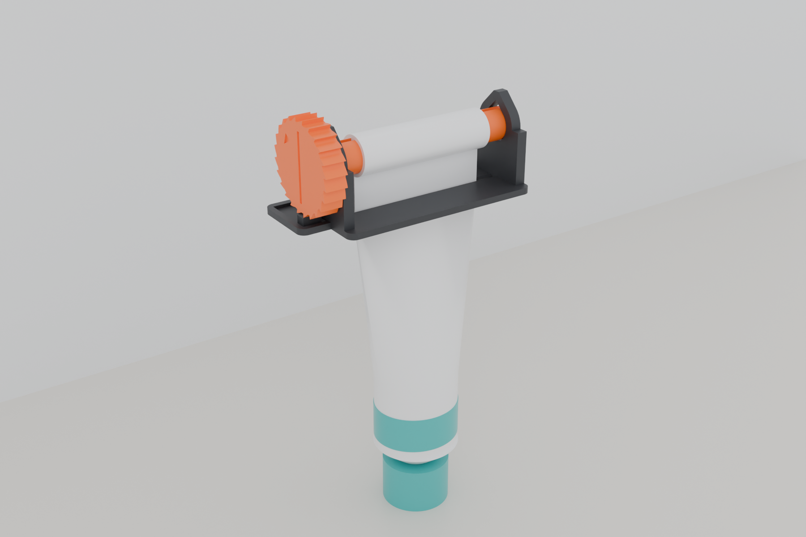
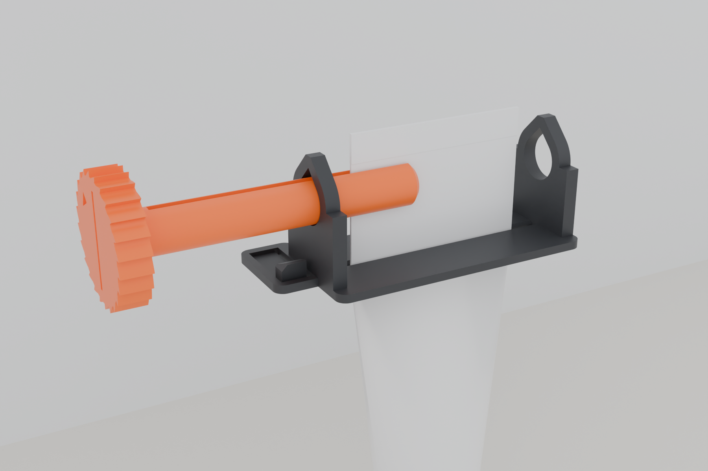
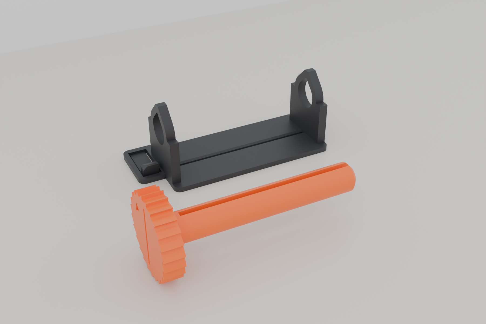
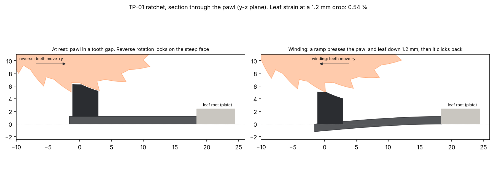
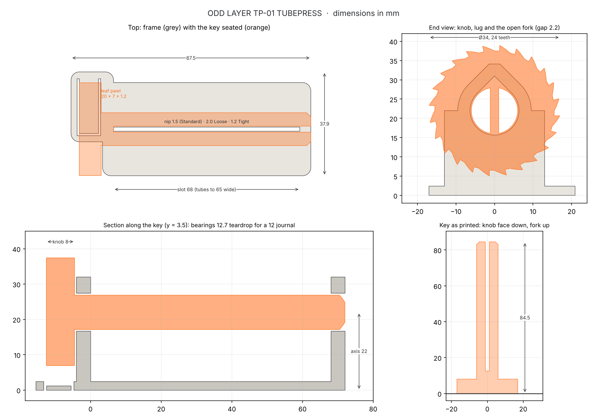
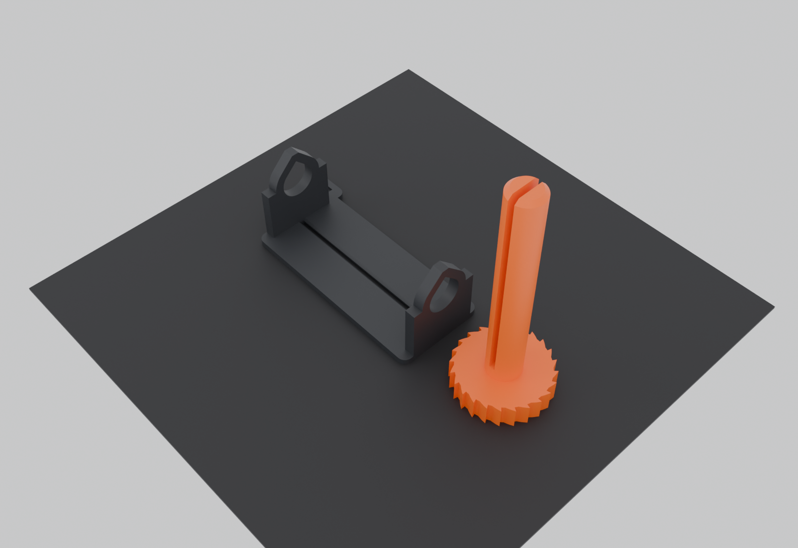

# ODD LAYER TP-01 · TUBEPRESS



**A two-part ratchet toothpaste squeezer that loads from the side and takes any tube from 32 to
65 mm wide.**

Pull the end of the tube up through the slot in the frame, push the key in, and turn the knob.
The key is an open fork, so it slides in around the crimp. A 1.5 mm slot in the frame wipes the
tube flat as the key winds it up, and a ratchet stops the roll from unwinding. To take the tube
out, pull the key straight out.

> **Status: designed and checked in CAD only. Nothing has been printed or physically tested.**
> All 12 automated checks pass. Grams and minutes come from an in-repo slice-based estimator,
> not a slicer. What a prototype must show before publishing: [`PHYSICAL_TESTING.md`](PHYSICAL_TESTING.md).

| | |
|---|---|
| Tubes | 32–65 mm flat width (travel to family size), crimps up to about 1.6 mm |
| Parts | 2: frame + key. No hardware, no supports, no print-in-place. Frame variants: Standard (1.5 mm slot), Loose (2.0 mm), Tight (1.2 mm) |
| Size | Frame 87.5 × 37.9 × 34.1 mm · key Ø 34 × 84.5 mm |
| Plastic (estimate) | **≈ 17 g** for both parts (PLA or PETG) |
| Print time (estimate, A1 mini, 0.20 mm) | **≈ 55 min PLA / ≈ 65 min PETG** for both parts (range about 45–80 min) |
| Printers | Both parts fit one A1 mini plate (129 × 38 mm footprint) |



*Loading: the tube end comes up through the slot, and the key slides in with its mark vertical,
so the fork straddles the crimp.*

## Why this one (vs. what's on MakerWorld)

Full research with links: [`RESEARCH.md`](RESEARCH.md). The category's most-commented failures are
fused print-in-place parts, keys that unwind, slots that don't fit the tube, and snapped
handles. TubePress answers each:

- **Nothing to fuse.** Two separately printed parts with 0.35 mm radial bearing clearance and a
  0.5 mm knob gap. The CAD check slides the key in from fully out to seated and finds no contact
  anywhere along the way.
- **A real one-way lock.** 24 sawtooth teeth on the knob and a pawl on a leaf spring printed flat
  in the frame, so it bends along the layers, not across them. Reverse backlash is under 1°.
  The pawl is pushed toward the leaf's root, which pulls it deeper into the tooth under load.
- **One size, three slot fits.** The 68 mm slot takes travel to family-size tubes. Only the wiper
  slot width depends on your printer and tube, so the frame comes with three slot widths.
- **No handle to snap.** The Ø34 toothed knob is both the grip and the ratchet wheel.
- **Side loading.** No threading the crimp through a key slot, and no unwinding to remove a tube.
- **Quick and light.** About 17 g and about an hour for both parts.



## How the ratchet works



- The pawl is a 20 × 7 × 1.2 mm leaf spring, cut free from the frame's base plate and printed on
  the bed.
- **Winding (counter-clockwise looking at the knob, arrow on the knob):** each tooth's ramp
  presses the pawl down 1.2 mm, and it clicks back into the next gap.
  - Strain at the leaf root is **0.54 %**, against fatigue-level limits of 0.8 % (PLA) and
    1.2 % (PETG).
- **Reverse:** a steep, 4°-undercut tooth face meets the pawl's upright face. That pushes the pawl
  toward the leaf's root, and because the push acts above the leaf, it bends the leaf up into
  the tooth.
  - The conservative hold torque (leaf buckling, fixed-free) is **0.20 N·m in PETG and 0.32 N·m in
    PLA**.
  - An elastic upper-bound estimate of a 65 mm tube's springback is 0.12 N·m.
- The pawl has a 45° lead-in on the side the knob arrives from, so a key pushed in at the wrong
  angle presses the pawl down instead of jamming. Pushed in with the mark vertical, the pawl
  slides along a tooth gap.

## Dimensions



| Feature | Value |
|---|---|
| Slot (clear span between the lugs) | 68 mm long; wiper width 1.5 (Standard) / 2.0 (Loose) / 1.2 (Tight), with 0.8 mm 45° lead-ins top and bottom |
| Key axis | 22 mm above the bottom of the frame |
| Bearings | Teardrop bores (45° tops, print without support), Ø 12.7 for a Ø 12 journal: 0.35 mm radial clearance |
| Fork | Ø 12, gap 2.2 mm, 72 mm long, 1.5 mm tip chamfer |
| Knob | Ø 34, 8 mm thick, 24 teeth 1.5 mm deep; slot-mark and winding arrow debossed in the face |
| Wound-roll room | A full tube winds to about Ø 19; there's 9.9 mm to spare under the roll |
| Frame plate | 2.4 mm thick; lugs 4 mm |

## Printing

| | Frame | Key |
|---|---|---|
| Orientation | As exported: base plate down | As exported: knob face down, fork pointing up |
| Supports | Off | Off |
| Notes | The leaf prints on the bed; check the cut round it is clear | 84.5 mm tall on a 34 mm knob. Place it so the tines' 12 mm width runs along the bed's motion (it does in the supplied 3MF). |

- Process: Bambu Studio "0.20 mm Standard", 0.4 mm nozzle, 2 walls, 15 % infill, PLA or PETG.
- PETG gives the leaf spring more fatigue margin.
- `models/3mf/TP01_set_A1mini_plate.3mf` has both parts laid out on one A1 mini plate.



## Using it

1. Squeeze the tube's end flat and push it up through the frame's slot from underneath until
   the crimp is about 25 mm above the frame.
2. Turn the key so the mark on the knob face is vertical (in line with the tube), and push it
   through the round bore, across the slot and into the far bore. The fork slides over the crimp.
3. Wind **counter-clockwise** (the arrow on the knob). The frame rides down the tube, wiping it
   flat.
4. When the tube is empty, pull the key straight out. The rolled tube drops off.

If winding is stiff, print the **Loose** frame. If paste is left in the flattened part, print
the **Tight** frame.

## Files

| Path | What |
|---|---|
| `models/stl/TP01_A_Frame_Standard.stl` | Frame, 1.5 mm wiper slot (print as exported) |
| `models/stl/TP01_A_Frame_Loose_nip2.0_alt.stl` · `TP01_A_Frame_Tight_nip1.2_alt.stl` | Alternatives: 2.0 mm and 1.2 mm slots |
| `models/stl/TP01_B_Key.stl` | Key, in print orientation |
| `models/3mf/TP01_set_A1mini_plate.3mf` | Frame + key on one A1 mini plate (geometry only, any slicer) |
| `models/TP01_TubePress.blend` | Blender project with the generator scripts embedded |
| `models/TP01_validation_report.md` · `TP01_validation.json` | Validation report and data |
| `docs/TP01_drawing.png` · `docs/TP01_ratchet.png` | Dimensioned drawing; ratchet diagram |
| `renders/` | 01 hero · 02 parts · 03 loading · 04 print plate |
| `tubepress.py`, `tp/` | The generator: `params.py`, `geom.py`, `validate.py`, `printest.py`, `report.py`, `scene.py`, `export.py` |

## Regenerating

```bash
pip install manifold3d shapely trimesh rtree numpy scipy matplotlib
pip install bpy                       # only for --render
python tubepress.py                   # build, export, 12 checks, report, drawings
python tubepress.py --render          # ...plus renders and the .blend
```

### The 12 checks

1. Both parts fit one A1 mini plate.
2. Every part (and both frame variants) is one manifold body.
3. The exported files re-read from disk as watertight with the same size and volume.
4. No overhang over 45° in print orientation.
5. No feature thinner than 1.2 mm on any layer.
6. Assembled with no interference and every running gap at least 0.1 mm.
7. The key slides in from fully out to seated without touching the frame.
8. 2D ratchet sweep: the pawl drops 1.2 mm in the winding direction, and the reverse direction locks within 0.8°.
9. Leaf strain and hold torque.
10. Tube range, fork gap and wound-roll clearance.
11. Budget in PLA.
12. Budget in PETG.

Results: [`models/TP01_validation_report.md`](models/TP01_validation_report.md).
