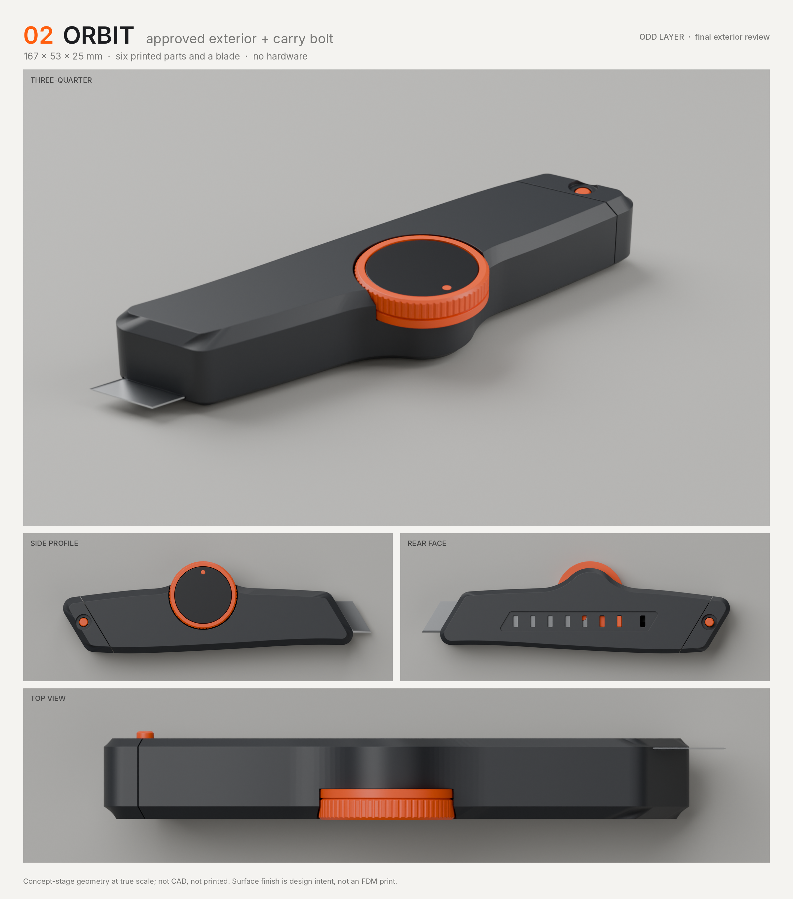
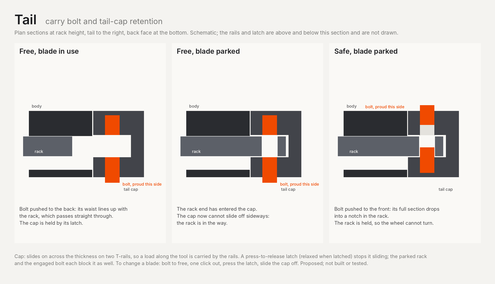
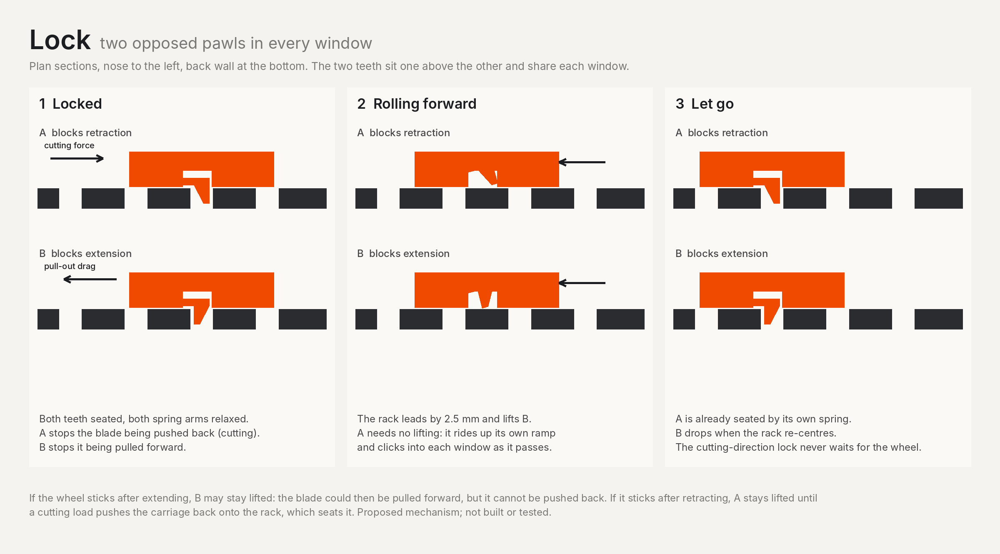
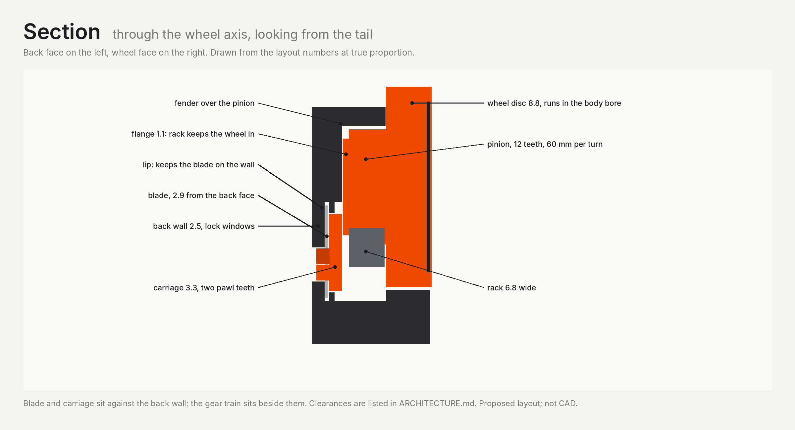

# ORBIT: mechanical architecture for approval

The detailed architecture behind the approved exterior, the risks that remain, and the test
plan. For approval before final CAD.

**Status: proposal. No final CAD, nothing printed, nothing tested.** Every strength figure
here is a hand estimate from handbook material values. Nothing in this document shows that
the lock, the carry bolt or the blade retention is safe. That can only come from the tests
in the last section.

Recorded decisions: 167 mm body with seven usable tips; add a carry lock; exterior approved
(dial with dark face and orange ring, blended fender, framed window track, raked tail, 45°
chamfers).

## Summary of what changed

| | Before | Now | Why |
|---|---|---|---|
| Printed parts | 5 | **6** | The carry lock is a separate bolt. |
| Lock | One square pawl | **Two opposed pawls** sharing each window | The cutting-direction lock no longer depends on the wheel springing back. |
| Pawl return | Spring arm alone | Spring arm **plus a detent on the rack** | Adds centring force without loading the wheel. |
| Blade support | Nose slit only | Nose slit **plus lips along the channel** | The slit alone supports only 5 mm of the blade's back edge. |
| Carry lock | None | **Cross-bolt in the tail cap** | Holds the rack when parked, so the wheel cannot turn. |
| Tail cap | "Slides on sideways" | **Two T-rails, a latch, and two positive blocks** | Resolved; see below. |
| Exterior | Approved | Unchanged except a 5 mm bolt end on each face of the tail cap | |

Three corrections to earlier material:

- **The earlier lock diagram was wrong.** It drew the solid backstop on the side of the
  tooth that does not take the cutting load. The tooth now sits in a cage with a stop on
  both sides.
- **The channel was too short.** At the last tip the carriage would have run into the end of
  the channel. The channel now starts 4.5 mm further forward, leaving 1.5 mm.
- **It is six parts, not five.**

The numbers quoted below come from [`uc/arch.py`](uc/arch.py); its full output is in
[`docs/arch_numbers.md`](docs/arch_numbers.md).

## 1. Carry lock

### Options considered

| Option | How it works | Verdict |
|---|---|---|
| **A. Cross-bolt in the tail cap** | A push-through bolt drops into a notch in the rack's rear end, which is only in the cap when the blade is parked. | **Chosen.** Can only engage a parked blade. Independent of the main lock. One small part. |
| B. Slider on the spine that locks the dial | A tooth enters a notch in the wheel. | Rejected. It locks the wheel at any blade position, so it is not a parked lock. Tying it to the parked wheel angle fails: the wheel turns 1.23 times over the travel, and with the rack's free play the parked angle is only a few degrees from the tip 6 angle. |
| C. Slider in the window track that blocks the pawl | A tongue goes behind the tooth so it cannot lift. | Rejected. The tongue sits in the path the carriage takes out of the tail, and forcing the wheel would load the pawl's spring arm, which damages the main lock. |
| D. Two-position tail cap | The cap itself shifts sideways to hook the rack. | Rejected. No extra part, but the tail is visibly out of line in one of the two states. |

### The chosen design

- A 5 mm round bolt crosses the tail cap. It has a waist as wide as the rack.
- **Free:** pushed toward the back face. The waist lines up with the rack, which passes
  through.
- **Safe:** pushed toward the wheel face, 3.5 mm. The bolt's full section sits in a notch on
  the rack's lower edge. The rack cannot move, so the wheel cannot turn and neither pawl can
  be lifted.
- Whichever way it was last pushed, that end stands 2 mm proud and the other sits in a
  shallow dish. You can feel the state without looking.
- The bolt snaps into the cap once and is kept there by its own detent finger, which is
  relaxed in both positions.

It does not touch the main lock. The pawls, their springs and the windows are the same with
or without it.

What the estimates say: forcing the wheel hard against the bolt puts about 60 N on the rack,
which is roughly 1.5 MPa of shear in the bolt and 1.8 MPa of bearing in the notch. Both are
far below what PETG should carry. If the main pawl had already failed and only the bolt were
holding, the carriage could still move 2.5 mm, leaving the parked tip about 0.7 mm inside
the mouth. That margin is thin and is one reason the bolt is a second lock, not a
replacement for the first.

**Known weakness.** The bolt can be pushed to safe while the blade is out. It then holds
nothing, and the rack cannot return to park because the bolt is in its way. The intent is a
lead-in on the rack end so that it pushes past the bolt and latches. That is unproven; if it
does not work in the latch coupon, the fallback is that a mis-set bolt simply stops the
blade from parking, which the user will notice.

## 2. Reliable pawl engagement

The single-pawl lock had one bad failure: after extending, the pawl could only re-seat if a
weak spring pushed the rack back and turned the wheel. The estimate for the drag that
spring could overcome was about 1.5 N at the rack. That is not enough margin to rely on.

**The change: two pawls, one for each direction, in the same windows.**

- **Pawl A** blocks the blade being pushed back, which is the cutting load. Its front is
  ramped, so when the blade is driven forward it rides up over each window edge and drops
  into the next one by its own spring. It is never lifted by the wheel on the way out.
- **Pawl B** blocks the blade being pulled forward. It is ramped the other way and is the
  one the rack lifts when extending.

What this buys:

- After extending, the cutting-direction lock is already seated. It does not wait for the
  rack or the wheel.
- After retracting, A is the pawl that was lifted. If the wheel sticks and A stays up, the
  first cutting load pushes the carriage back onto the rack, which seats it.
- Each window passed gives a real click from pawl A.

What it does not fix: if the wheel sticks after extending, **B can stay lifted, and the
blade could then be pulled forward**. Pull-out forces are small compared with cutting
forces, but an unexpectedly extending blade is a hazard. This remains a risk to test.

Supporting measures:

- **Caged teeth.** Each tooth sits between two stops on the carriage with about 0.15 mm
  clearance. Load goes carriage, stop, tooth, window edge. The spring arm only positions the
  tooth.
- **Lift at the tooth.** The rack's ramp acts on the tooth itself, not part-way along the
  arm, so forcing the wheel cannot bend the arm.
- **Rack detent.** A small spring finger on the rack clicks into notches in the channel at
  each seated position. It adds about 3 N of centring force, acts on the rack and not on the
  wheel, and is relaxed when seated.
- **Back-raked faces.** The load faces of the teeth and windows lean about 5° so that load
  pulls a tooth in.
- **Visible engagement.** The orange teeth can be seen in the window.

Estimates:

| | 100 N | 200 N |
|---|---|---|
| Tooth bearing on the window edge | 17 MPa | 33 MPa |
| Tooth shear | 14 MPa | 28 MPa |

Each tooth is 3 mm tall and carries its direction alone. PETG yields at about 45 MPa in the
layer plane, so 200 N is close to the limit. The 100 N figure is my assumption for a hard
cut and has not been measured.

Spring arm: a PETG arm 22 mm long and 1.4 mm thick gives about 0.9 N at full lift at just
under 1% peak strain. That strain is at the upper end of what I would accept for a part
flexed thousands of times, and needs a cycling test.

## 3. Tail-cap retention

- **Along the tool** (the direction a failed lock would push it): two T-rails, 4 × 18 mm
  necks, running across the thickness. The cap prints on its back face so the rails are
  loaded in the layer plane. Estimated 1.4 MPa at 200 N.
- **Sideways** (the direction it slides on and off), three things:
  1. a press-to-release latch finger, relaxed when latched;
  2. the rack, whose rear end sits in the cap whenever the blade is parked;
  3. the carry bolt, when set to safe.
- So in carry (parked and safe) the cap is blocked twice by solid parts. In use it relies on
  the latch alone, with the palm over it.

Blade change: bolt to free, roll one click out so the rack leaves the cap, press the latch,
slide the cap off, roll back and draw the cartridge out of the tail.

The latch is the least developed feature here. If it creeps or wears, the cap can slide off
in use. That would not release the blade forward, but it would let a failed lock push the
carriage out of the back.

## 4. Blade dimensions: not verified

I could not verify blade dimensions. The manufacturer and datasheet sites I tried are
outside this session's network allow-list, and what retailer listings show is inconsistent.

| Dimension | What I assumed | What listings say |
|---|---|---|
| Length | 100 mm | 100 mm for one Olfa LB listing, 110 mm for a Facom blade and for a published 3D model, about 114 mm in one parts listing |
| Thickness | 0.5 mm | 0.5 mm (Milwaukee), 0.53 mm (Facom), 0.79 mm in one Olfa parts listing |
| Segments | 8 | 8 (Olfa, Milwaukee), 7 (Facom) |
| Tail hole | about 4 mm, 7 mm from the tail | Never stated anywhere I could find |
| Segment pitch | 10 mm | Never stated |
| Score angle | 59° | Never stated |

Sources: [Olfa LB product page](https://olfa.com/products/18-mm-lb-silver_snap-blades),
[Olfa LB-10 retailer listing](https://www.gmcrafts.co.uk/product/18mm-silver-snap-blade-for-heavy-duty-knives-pack-of-10/),
[Olfa LB-10B parts listing](https://partssource.com/parts/olfa/LB10B),
[Milwaukee 48-22-9118](https://www.zoro.com/milwaukee-18mm-precision-snap-blades-10-pk-48-22-9118/i/G5304512),
[Facom 844.S18L](https://kramp.com/shop-us/en/vp/844.s18l-18-mm-snap-off-blades--ticItemGroup-47649527),
[18 mm blade 3D model](https://cults3d.com/en/3d-model/tool/18mm-snap-off-blade-accurate-3d-model-for-accessories-custom-designs).

**This has to be settled with calipers on real blades before CAD.** I suggest three brands,
five blades each, measuring: overall length, width, thickness, hole diameter, hole centre to
tail and to back edge, pitch of every score line, score angle, and tail corner shape.

How the design copes with the spread:

- **Length 100 to 110 mm** does not change the body. The pawls sit 14 mm behind a 100 mm
  blade's tail, so a 110 mm blade still clears them. It needs a second carriage variant with
  the seat moved back. The carriage is already the wear part, so it becomes the
  blade-specific part too.
- **Thickness** sets the mouth slit and the lug gap. A 0.8 mm blade will not fit a slit made
  for 0.5 mm, and a 0.5 mm blade in a 0.8 mm slit is loose. One thickness has to be chosen.
- **Pitch** sets the window spacing in the body. If real pitch is not 10.0 mm, the body
  changes. This is the measurement that matters most.

## 5. Seven-tip travel and blade support

Assuming a 100 mm blade with 10 mm segments:

| Position | Travel | Tip exposed | Blade left | Carriage to channel start |
|---|---|---|---|---|
| Parked | 0 | 0 | 100 | 75.0 |
| Tip 1 | 13.5 | 10 | 100 | 61.5 |
| Tip 2 | 23.5 | 10 | 90 | 51.5 |
| Tip 3 | 33.5 | 10 | 80 | 41.5 |
| Tip 4 | 43.5 | 10 | 70 | 31.5 |
| Tip 5 | 53.5 | 10 | 60 | 21.5 |
| Tip 6 | 63.5 | 10 | 50 | 11.5 |
| Tip 7 | 73.5 | 10 | 40 | 1.5 |

- **Travel** is 73.5 mm, 1.23 turns of the wheel. With a 12-tooth pinion at 60.0 mm per
  turn, each segment is exactly 60° of wheel.
- **Parked** tip is 3.5 mm inside the mouth.
- **Stub** left after tip 7 is 30 mm.
- **Every working position** exposes 10 mm, with the score line at the mouth.

**Support is weaker than I had assumed.** Because the nose is raked, the slit guides 16 mm
of the blade at its cutting edge but only 5.2 mm at its back edge. Against 10 mm exposed
that is 1.6:1 at the edge and about 0.5:1 at the back. So the channel now has a lip above
and below the blade that keeps it against the back wall along its whole length, the way the
steel sleeve does in a conventional cutter. The carriage runs between the lips.

At tip 7 only 30 mm of blade is inside the body, held by the carriage at one end and 16 mm
of slit at the other. This is the least supported working position and should be tested
separately.

## 6. Layout and critical clearances

All values are starting points to be set by the fit coupon. "Critical" means a wrong value
defeats a lock or the blade retention.

| # | Feature | Nominal | Critical | Why it matters |
|---|---|---|---|---|
| 1 | Tooth depth in window | 2.0 mm (min 1.5) | Yes | Less depth and a tooth can cam out. |
| 2 | Tooth to cage stops | 0.15 mm each side | Yes | Too loose and the spring arm takes the cutting load. |
| 3 | Pawl lift vs tooth depth | 2.2 vs 2.0 mm | Yes | Lift must exceed depth or the blade will not move. |
| 4 | Rack free travel | 2.5 ± 0.2 mm | Yes | Sets lift, and how far the blade can move with only the bolt holding. |
| 5 | Lug tip to back wall | 0.2 mm max | Yes | Must stay under blade thickness or the blade can leave the lug. |
| 6 | Mouth slit width | Blade + 0.2 mm | Yes | Loose: blade rocks. Tight: blade jams. Depends on blade brand. |
| 7 | Parked tip cover | 3.5 mm | Yes | Only 0.7 mm remains if the pawl fails and the bolt alone holds. |
| 8 | Window spacing | Segment pitch | Yes | Unverified. Wrong pitch puts score lines off the mouth. |
| 9 | Back-face first layer | Compensate 0.15 mm | Yes | Elephant's foot narrows the windows on the bed face. |
| 10 | Bolt depth in rack notch | 2.5 mm, 2.5 mm land behind | Yes | The land is what the bolt holds. |
| 11 | Tail rail fit | 0.2 mm each side | Yes | Loose rails let the cap rock under load. |
| 12 | Wheel flange overlap on rack | 1.4 mm | Yes | This is all that keeps the wheel in. |
| 13 | Carriage in channel | 0.25 mm each side | No | Drag and rattle. |
| 14 | Rack in channel | 0.25 mm each side | No | Drag; adds to gear backlash. |
| 15 | Gear backlash | 0.2 to 0.3 mm | No | Felt at the wheel; gears carry no cutting load. |
| 16 | Wheel in bore | 0.5 mm on diameter | No | Drag on the wheel works against pawl B's return. |
| 17 | Carriage to channel start at tip 7 | 1.5 mm | No | Hard stop for forward travel. |
| 18 | Rack front to nose face, fully forward | 3.0 mm | No | The rack must never show at the nose. |

Layer stack across the 23 mm thickness: back wall 2.5, blade against it, carriage 3.3,
wheel flange 1.1, rack and pinion 7.0, wheel disc 8.8.

Print orientation: body and tail cap on their back faces; wheel face down; carriage on its
edge so both spring arms bend in the layer plane; rack on its side; bolt upright.

Material: PETG for body, carriage, rack, tail cap and bolt. The wheel can be PLA or PETG.

## 7. Test plan

Pass levels are my proposals and are open to change. Loads are multiples of the assumed
100 N hard cut and 30 N pull-out, which the first test should replace with measured values.

| # | Component | Test | Proposed pass level |
|---|---|---|---|
| 0 | Loads | Measure real cutting and pull-out force on double-wall board with an instrumented blade or a luggage scale. | Replaces the 100 N and 30 N assumptions. |
| 1 | Pawl A and window | Static push on the blade to failure, 5 samples each in PETG and PLA. | Holds 3× the measured cutting load. |
| 2 | Pawl B and window | Static pull to failure, 5 samples. | Holds 3× the measured pull-out load. |
| 3 | Pawl seating | 1,000 extend-and-release and 1,000 retract-and-release cycles, clean, then with cardboard dust, then with added wheel drag. | Zero unseated A after extending. Every unseated B recorded; target zero. |
| 4 | Spring arms | 10,000 lift cycles; separately, hold fully lifted for 72 hours. | No crack; return force within 20% of new; no visible set. |
| 5 | Wear | After test 3, repeat tests 1 and 2 on the same parts. | Still holds 2× load; tooth depth still 1.5 mm or more. |
| 6 | Heat | Lock coupon at 60 °C for 4 hours unloaded, then tests 1 to 3. | Same pass levels. |
| 7 | Blade shoulder and lug | Push to failure; pull to failure; 500 load cycles then inspect for cut-in. | 3× each load; cut-in under 0.3 mm. |
| 8 | Mouth | Side load on the tip at tip 1 and at tip 7, to failure. | No split at 3× a measured side load. |
| 9 | Channel lips | Side load with the blade at tip 7. | Blade stays against the wall. |
| 10 | Gears | 5,000 cycles at normal thumb force; then force the wheel against a locked rack. | No tooth damage at 3× thumb force. |
| 11 | Wheel retention | Pull and pry on the wheel, rack in. | Stays in at 50 N. |
| 12 | Carry bolt | Force the wheel with the bolt set; 500 set and release cycles; shake test; set it with the blade out, then try to park. | Holds 3× thumb force; does not drift; mis-set behaviour is as designed. |
| 13 | Tail cap | Push the carriage against it to failure; 200 on-off cycles; pull sideways on the latch. | Holds 3× cutting load; latch holds 20 N after cycling. |
| 14 | Drop | 1.5 m onto concrete, six orientations, in three states: parked and safe, parked and free, tip 1 out. | Parked and safe: blade never moves. Other states: record every movement. |
| 15 | Accidental rotation | Tumble in a tool bag with loose tools for 30 minutes, parked and free, then parked and safe. | Parked and safe: blade never moves. |
| 16 | Print variation | Repeat tests 1 to 3 on parts from at least two other printers and two filament brands. | Same pass levels, or the fit coupon rejects the print. |
| 17 | Fit coupon | A ten-minute go/no-go print for the tooth, the cage and the lug gap. | A printer that fails it must not be used for this tool. |

Tests 1 to 9 and 12 to 13 need only small coupons, not a whole tool.

## 8. Remaining risks

Most serious first.

1. **A drop can unlock it when the carry bolt is not set.** The rack is free to move 2.5 mm
   and its detent holds it only to about 67 g of deceleration. A drop onto a hard floor is
   several hundred g. A nose-first drop with the blade out could lift pawl B and let the
   blade travel forward. The carry bolt removes this when parked. Nothing removes it in use.
2. **Pawl B can stay lifted if the wheel sticks**, leaving the blade free to be pulled
   forward.
3. **Blade dimensions are unverified.** Pitch, thickness and hole geometry all feed
   critical clearances.
4. **The mouth is loaded across its layers** with no hardware behind it.
5. **Tooth stress at 200 N is near the PETG limit**, and the load itself is a guess.
6. **Print variation.** The critical clearances are 0.15 to 0.2 mm. Not every printer holds
   that.
7. **The carry bolt can be set with the blade out.**
8. **The tail-cap latch** is the only thing holding the cap sideways during use.
9. **Debris.** The windows and the wheel bay are open.
10. **Only 0.7 mm of tip cover** if the main pawl fails while the bolt holds.

## 9. Decisions needed

1. **Approve the six-part architecture**: two opposed pawls, rack detent, channel lips,
   carry bolt in the tail cap, tail cap on rails with a latch.
2. **Blades.** Which brands should be the reference? I recommend buying three and measuring
   them before any CAD, because pitch and thickness change the body.
3. **Order of work.** I recommend designing and printing the coupons (fit, lock, tail) before
   final CAD of the whole tool. The lock coupon answers risks 2, 5 and 6 for a fraction of
   the effort, and its results will change dimensions in the final CAD.
4. **Risk 1.** Accept it as a stated limitation for now, or ask me to look for a way to make
   the lock immune to shock in use. I do not have one yet.
