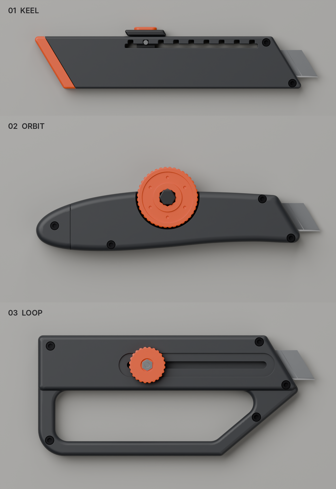
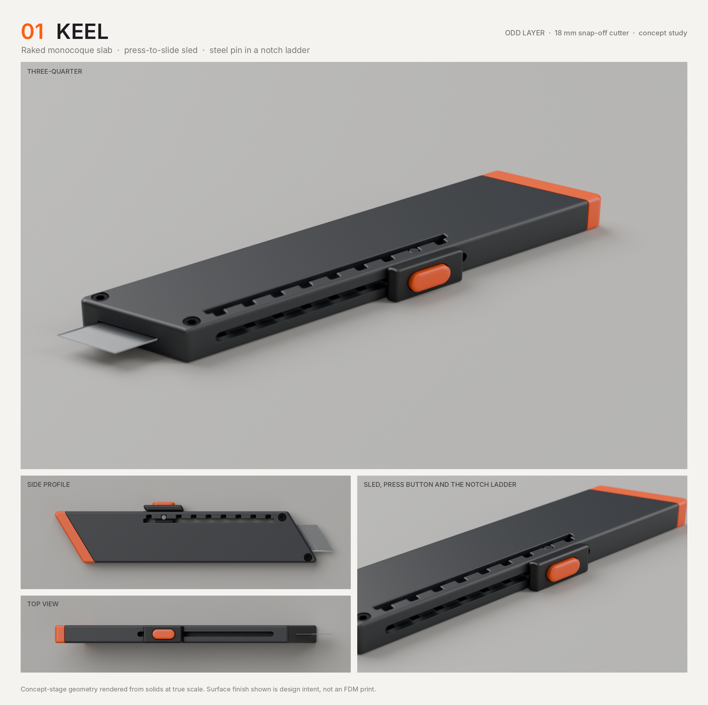
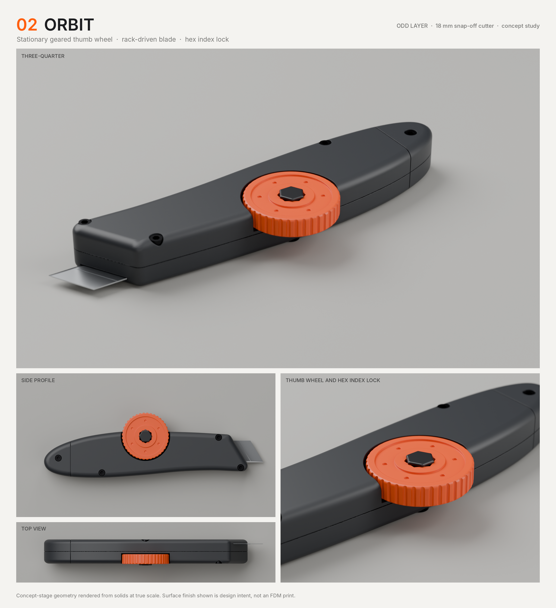
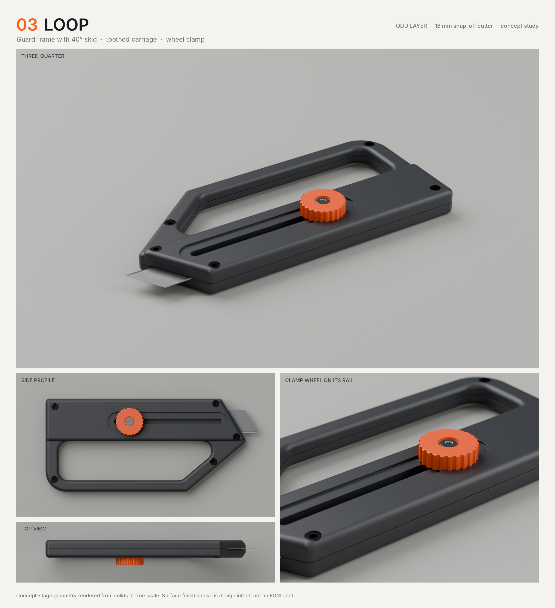

# Odd Layer utility cutter: concept study

Three architectures for an 18 mm snap-off cutter, and a recommendation.

**Status: concept stage.** The renders come from real solids at true scale, so the four views
of each concept agree with each other, but only the form and the visible mechanism are
modelled. Nothing here is print-ready CAD and nothing has been printed or load-tested. The
surface finish in the renders is design intent, not an FDM print.

## What all three share

**The blade.** A standard 18 mm snap-off blade: 100 × 18 × 0.5 mm, segments scored at about
59°. Two numbers need measuring on the blade brand you plan to ship with before CAD: the
segment pitch (taken as 10 mm here) and the tail-hole diameter and position.

**The 59° angle is the design language.** Every nose, and KEEL's tail and sled, is raked at
the blade's own snap angle. It is the one feature that says "snap-off cutter" before you see
the blade.

**Orange means "touch here".** Graphite everywhere else. Orange is only on the part you
operate.

**Safety rules applied to every concept**

1. The blade hangs on a **steel pin** through its tail hole. It cannot lift off the pin while
   it is inside the channel, and it lifts off freely once the carriage is out. Blade changes
   need no tools.
2. The lock is never a printed flexure. Each concept locks with a steel pin in shear, a steel
   bolt in tension, or a solid printed spline in shear.
3. The nose is clamped by **two steel M3 bolts**, one above and one below the blade. The blade
   pries the mouth open sideways, which loads a flat-printed body across its layers, the weak
   direction. The bolts take that load instead.
4. Each concept fails toward *retracted*. Cutting force pushes the blade back into the body.
   If a lock gives way the blade goes in, not out.

Printing is the same idea for all three: every part is a flat 2.5D shape that prints on its
inner or side face with no supports, in PETG or PA-CF rather than PLA (PLA creeps under a
sustained clamp load and softens in a hot car).

---

## 01 KEEL

A raked slab that looks like one giant blade segment. The most pocketable and the least new.

| | |
|---|---|
| Size | 177 × 34.5 × 12 mm |
| Body | A parallelogram, both ends at 59°. One-piece monocoque printed flat; the 18 mm blade channel is a bridge. No seam, no shell screws. |
| Grip | Flat slab held like a carpenter's pencil or in a forward pinch. Fine for opening boxes, tiring for an hour of cutting. |
| Blade housing | Blade runs in a slit on the centreline. Two steel nose bolts. |
| Deployment | Thumb sled on the spine. Press the orange button, slide, let go. |
| Lock | A ø3 mm steel cross-pin on the sled sits in a ladder of nine notches cut through **both** side walls, so the pin is in double shear. A compression spring lifts it into the notch; pressing the button drops it into the free channel below. Locks itself on release. |
| Blade change | The orange tail cap slides out **sideways** on a dovetail, so no cutting load can pull it off. The sled and blade come out of the back. The cap carries the snapper slit. |
| Identity | The parallelogram, and the notch ladder that works as a visible scale: you can read which segment you are on from the pin. |
| Printed parts | 4 (body, tail cap, sled, button) |
| Hardware | 2 × M3 bolt + nut, ø3 dowel pin, blade pin, 1 spring |

**For:** fewest parts, simplest print, automatic positive lock, slimmest, the mechanism is
ordinary and well understood.

**Against:** the sled moves 80 mm over the life of a blade, so with a fresh blade the control
sits two-thirds of the way back, under the palm. The slab is the weakest grip of the three.
The monocoque makes the internal channel impossible to clean up after printing, so the print
has to come out right. The architecture is a refined version of a known cutter, not a new one.

---

## 02 ORBIT

A stationary thumb wheel drives the blade through a rack. One click of the wheel is one blade
segment.

| | |
|---|---|
| Size | 172 × 54 × 20 mm |
| Body | Long tapered nose, a waist under the wheel, a palm swell at the rear. Two shells, each printed inner-face down. Soft 4.2 × 3.4 mm elliptical edge. |
| Grip | Full-hand grip with the palm on the swell and the thumb resting on the wheel. The 20 mm thickness is set by the gear train and happens to be a good handle thickness. |
| Blade housing | The blade plane is offset 6.3 mm to one side. The rack and pinion sit beside it and the wheel beside that. Two nose bolts, two more along the shells. |
| Deployment | A ø39 mm fluted wheel carries a 12-tooth, module 1.6 pinion that drives a rack on the blade carriage. One turn moves the blade 60 mm. The thumb moves about twice as far as the blade, so it has 2:1 leverage. |
| Lock | A hexagonal plunger on the axle keys the wheel to the body. Press the hex to free the wheel, roll, release; a spring pushes it back into the next of six positions. Six positions per 60 mm turn is 10 mm each: **one click, one segment**. The hex is a solid printed spline in shear, not a spring tab. |
| Blade change | Tail cap off, hold the hex in, roll the wheel back until the rack runs out of the rear. |
| Identity | The exposed orange wheel with the dark hex at its centre. Six dots on the wheel face mark the six stops. |
| Printed parts | 6 (two shells, tail cap, wheel with pinion, rack carriage, hex plunger) |
| Hardware | M4 axle bolt + nut, 4 × M3, blade pin, 1 spring |

**For:** the control never moves. On a conventional cutter the slider creeps 80 mm toward the
nose as the blade is used up; here the wheel is under the thumb for every segment. Indexing
to whole segments means the blade is always supported right behind a score line, which is
where it should be. The best grip of the three. The mechanism is satisfying to use and easy
to understand from a photo.

**Against:** the most parts and the tightest tolerances. Gear backlash shows up as blade play
along its axis (a few tenths of a millimetre; the hex lock holds the wheel, not the rack).
The pinion tooth is the weakest link in the load path: roughly 130 N per tooth in PETG by a
Lewis estimate, which covers cardboard and needs testing before anyone leans on it. The rack
has to stay on the pinion over 82 mm of travel without leaving the nose, which fixes the wheel
88 mm back and makes this the longest body. The hex is on one side, so left-handers need a
mirrored print. The amount of orange is at the upper limit of "restrained".

---

## 03 LOOP

A closed guard frame under the blade track. The simplest and strongest lock, the largest tool.

| | |
|---|---|
| Size | 158 × 73 × 14 mm (frame 10 mm) |
| Body | A straight spine carrying the blade, and a frame below it that the fingers pass through. Two shells printed flat. |
| Grip | Fingers wrap the spine inside the frame, like a hand-saw handle. The lower bar sits between the knuckles and the box. Opening is about 120 × 30 mm, sized for gloves. |
| Blade housing | Blade on the centreline of the spine. Two nose bolts, three more around the frame. |
| Deployment | Back the orange wheel off about three-quarters of a turn, slide it along its rail, tighten. |
| Lock | The wheel is a nut on a steel stud in the carriage. Tightening pulls the carriage's toothed face into matching teeth inside the wall. The teeth carry the cutting load; the steel stud only holds them together. No springs anywhere. |
| Skid | The front strut runs at 40° from the nose. Laid on the work it sets the cutting angle and limits depth: about 1 mm with one segment out (tape, film), about 7.5 mm with two (double-wall board). |
| Blade change | Not resolved in this geometry. It needs a tail port and plug, or the wheel removed and the carriage drawn out. |
| Identity | The frame. It also hangs on a hook or a carabiner with no extra feature. |
| Printed parts | 4 (two shells, carriage, wheel) |
| Hardware | M4 stud + nut, 5 × M3, blade pin |

**For:** the strongest lock and the fewest things that can go wrong. Knuckle guard and depth
control are real warehouse features. The most distinctive silhouette.

**Against:** locking takes two deliberate actions and is slower than either alternative. Like
KEEL, the wheel migrates along the body as the blade is used and starts out under the hand.
It does not fit a pocket. The skid only helps on flat work; in a corner or a tight cut the
frame is in the way. The teeth need a clean print to seat fully.

---

## Comparison

| | 01 KEEL | 02 ORBIT | 03 LOOP |
|---|---|---|---|
| Visual identity | Clean, quiet | Strong, and explains itself | Strongest silhouette |
| Ergonomics | Weakest (thin slab) | Best | Good on flat work only |
| One-handed speed | Fast, self-locking | Fast, self-locking | Slow, two actions |
| Control stays put | No | **Yes** | No |
| Lock strength | High (steel pin, double shear) | Medium (printed gear tooth) | Highest (teeth + steel stud) |
| Mechanical risk | Low | Medium | Low |
| Printed parts | 4 | 6 | 4 |
| Pocketable | Yes | Jacket pocket | No |
| MakerWorld appeal | Moderate | **High** | Moderate to high |

## Recommendation: 02 ORBIT

ORBIT is the only one of the three that changes how a snap-off cutter works, not just how it
looks. The stationary control fixes a real annoyance of every slider cutter, the "one click,
one segment" rule is a reason to exist that fits in a sentence, and the wheel is the kind of
mechanism people print because they want to turn it. It also has the best grip.

It carries the most engineering risk, and the risk is specific: the pinion tooth and the hex
lock. Both can be settled with a small test print before any body is modelled.

Two things worth carrying over from the others:

- **KEEL's steel pin.** If the printed hex wears or the gear proves marginal, a steel pin
  through the wheel into the shell is a drop-in upgrade for the lock.
- **LOOP's skid.** A 40° flat on the underside of ORBIT's nose would give the same
  depth-limited cut without the frame.

KEEL is the fallback if ORBIT's gear train does not survive testing. LOOP is better treated
as a separate product for warehouse use than as a rival.

## Before CAD

1. Measure three blade brands: segment pitch, tail-hole size and position, thickness.
2. Print a gear coupon: pinion, a short rack and the hex lock in a plain block. Load the rack
   to failure. This decides module, face width and material.
3. Print a hand mock-up of the ORBIT body with a free-spinning wheel to check wheel position,
   wheel diameter and the palm swell, right- and left-handed.
4. Decide whether the blade offset of 6.3 mm is acceptable in use, or whether the body should
   grow to put the blade back on the centreline.

## Files

- `cutter_concepts.py`, `uc/`: parametric geometry (manifold3d), studio scene and renders
  (Blender/Cycles), and the concept boards.
- `renders/`: four views per concept, one board per concept, and the side-profile line-up.
