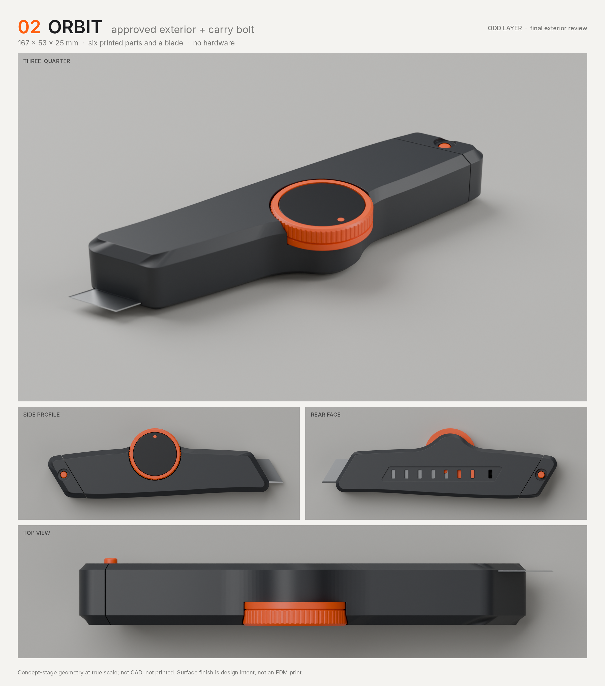
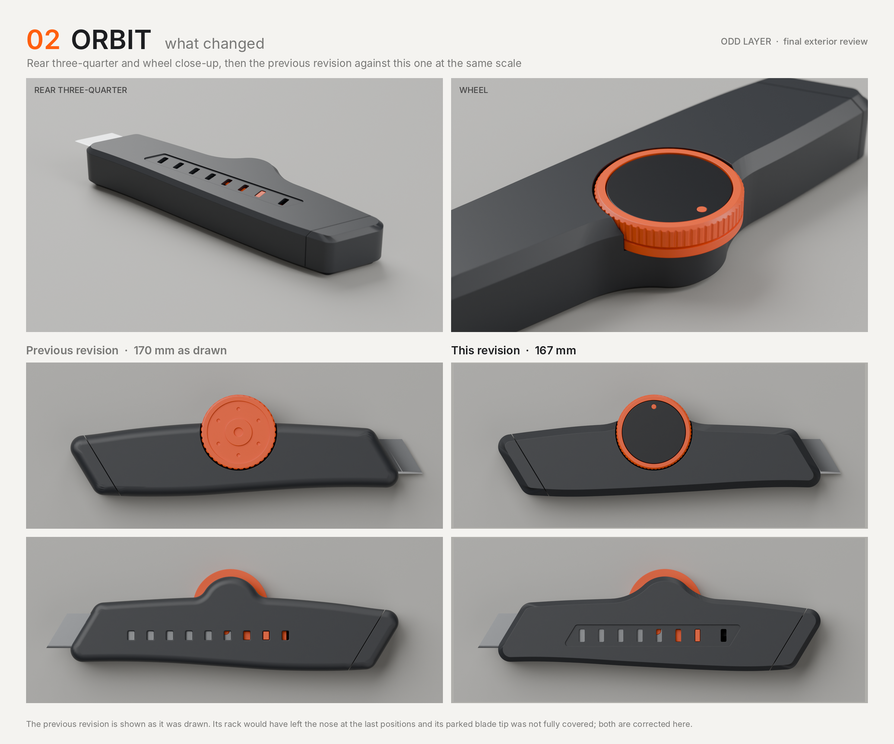
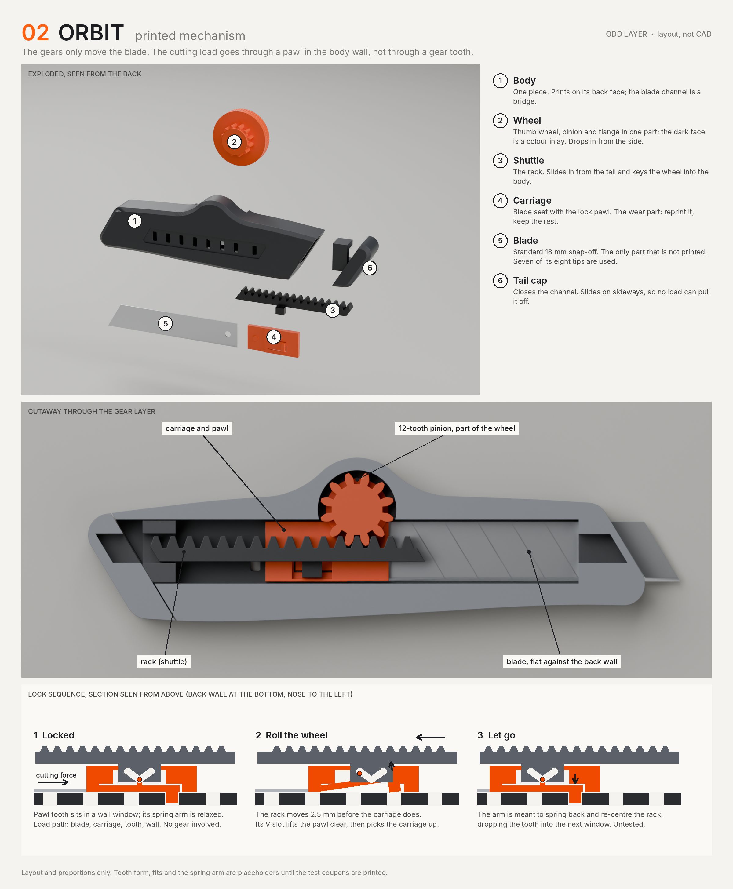

# ORBIT: final exterior review

Updated boards for the all-printed ORBIT, answers to the five review questions, and the
safety-critical assumptions in the lock and blade retention.

**Status: concept stage. No CAD has been started and nothing has been printed.** The lock
and the blade retention described here are proposals. Neither is proven, and neither should
be described as safe until the physical tests listed in
[ORBIT_V2_PRINTED.md](ORBIT_V2_PRINTED.md) have been run.

## Two corrections to the previous revision

Checking the layout for this review turned up two errors in what I sent last time.

1. **The length figure was wrong.** I quoted 180 mm. That was the construction length before
   the corners were rounded; the envelope as drawn was 170 mm.
2. **That 170 mm layout did not work.** At the last blade positions the rack would have
   pushed out through the nose face, and with the blade "retracted" the tip sat about 2 mm
   proud of the mouth. Fixing both properly, with all eight blade tips, makes the body about
   186 mm, not 170.

Both are corrected in this revision. The comparison board shows the previous revision as it
was drawn.

## 1. Can the body be more compact?

Yes, to **167 mm**, by one deliberate trade.

The length is not a styling choice. A rigid rack driven by one fixed pinion has to stay on
the pinion over the whole blade travel and stay inside the body at both ends, so the body is
roughly twice the travel plus the nose and tail walls. The only way to shorten it without
adding gears is to shorten the travel.

| Blade tips used | Travel | Body length |
|---|---|---|
| 8 (all) | 83.5 mm | about 186 mm |
| **7 (this revision)** | **73.5 mm** | **167 mm** |
| 6 | 63.5 mm | about 147 mm |

This revision uses seven of the blade's eight tips. The one given up is the tail stub, the
piece with the mounting hole, which is the least supported tip on any snap-off cutter.

Ergonomically 167 mm is comfortable: the wheel sits 92 mm from the nose, which leaves a full
hand's width of grip behind it and a short tail past the little finger. Going to six tips
would put the body at about 147 mm, but that wastes a quarter of every blade and I would not
recommend it.

The travel includes a 13.5 mm first step instead of 10 mm, so that the parked tip sits
3.5 mm inside the mouth. After that every step is one segment, with the score line at the
mouth where the blade is best supported.

## 2. Does the wheel look premium and distinctive?

The plain orange disc did not. It read as a bottle cap. It is now a dial:

- a **dark face cap** inside a **thin orange ring**, which is also the product's name made
  visible;
- a **fine straight knurl** (64 flutes instead of 40), closer to a camera dial than a knob;
- **one index pip** in place of six dots, so rotation is visible at a glance.

This also brings the orange back to "restrained": a ring, a pip and the lock tooth.

The dark face is a colour inlay in the wheel's first few layers, which is cheap on the H2C
because the wheel prints face down. Printed in one colour the wheel still works; it just
loses the ring. The face takes its texture from the build plate, which is the best surface
an FDM part has.

## 3. Does the fender integrate naturally?

Before, it was a half-round bump sitting on the spine. Now the spine rises into it and falls
away on long blends, so the pinion cover is the crest of one continuous swell. From the
wheel side the body rises to meet the wheel on both sides of it.

It has two practical effects: the thumb rides up a ramp onto the wheel, and the wheel is
partly shrouded, which makes it harder to roll by accident. The wheel stands about 4 mm
above the crest.

## 4. Do the rear lock windows look intentional?

They are now framed. The windows sit in a shallow recessed track with 59° ends, so they read
as one gauge instead of a row of holes. There are eight, not nine: one **parked** window set
apart at the tail end, then seven working windows at one-segment pitch. The windows are
taller and narrower than before.

The track is 0.6 mm deep and is on the face that prints against the bed, so it costs nothing
to print.

The load-bearing edges of the windows are kept square to the blade on purpose. Raking the
windows themselves at 59° would look more unified but would turn part of the cutting load
into a sideways force on the tooth, so only the frame is raked.

## 5. Does the raked tail complement the silhouette?

Yes, and I would keep it. With the nose and tail parallel the side view is a leaning
parallelogram, the same shape as a blade segment, and it gives the tool a clear direction.
The rack's ends are now raked to match, which is what lets the tail lean without adding
length.

One thing to check in the hand mock-up: the upper rear corner points back toward the palm.
It is radiused, and the belly swell ahead of it is what the little finger actually bears on,
but this is a feel question that a render cannot answer.

## Other exterior changes

- **Chamfered edges, not rounds.** A 45° chamfer on both faces: 2.4 mm on the back, 3.6 mm
  on the palm side. The back face prints on the bed, where a round would overhang badly, and
  on the top face a chamfer avoids the stepped contour lines a shallow round leaves. It also
  reads as a made object, not a soft blob.
- **Envelope:** 167 × 53 × 23 mm.

## Safety-critical assumptions

Everything below is assumed, not demonstrated. Each needs a physical test before this is
described as a working lock or a secure blade.

### Lock

1. **The pawl re-seats every time.** After extending, the spring arm must overcome wheel
   drag, rack friction and any debris to drop the tooth into the window. If it does not, the
   blade is not locked.
2. **A failed lock retracts the blade.** I have described this as the safer direction. It
   is, for cutting loads. It has not been shown that nothing can drive the blade forward
   with the pawl lifted.
3. **Rolling the wheel cannot release the lock while cutting.** The thumb has 2:1 leverage
   on the rack. The assumption is that the back-raked tooth cannot be lifted under load. If
   it can, thumb pressure during a cut unlocks the blade.
4. **The wheel will not turn by accident.** There is no secondary lock. Any wheel rotation,
   in a pocket, a tool bag or a drawer, unlocks and moves the blade. The shrouded wheel
   reduces this; it does not prevent it. This is the assumption I am least comfortable with,
   and a parked-position latch may be needed.
5. **The printed tooth and window edges carry the load.** Roughly 100 N is my estimate of a
   hard cut, not a measurement. Capacity of a PETG tooth in a 2.5 mm wall has not been
   tested, and the wall is weakened by eight windows in a row.
6. **The load goes through the backstop, not the spring arm.** That depends on a clearance
   of a few tenths of a millimetre. If the print is loose, the thin arm takes the load.
7. **The spring arm is always relaxed in storage.** Only true if the tooth is seated. If
   the blade is left between windows, the arm stays bent and PETG or PLA will take a set.
8. **Wear is gradual and noticed.** There is no wear indicator. The assumption is that the
   user sees or feels a worn tooth before it cams out.
9. **Debris does not hold the tooth out.** The windows are open to cardboard dust.
10. **Heat does not soften the lock.** PLA softens at around 55–60 °C. PETG is better, not
    immune.
11. **The print matches the design.** Every user's printer, filament and settings differ.
    The lock's safety depends on dimensions and layer bonding that the design cannot
    control once the files are public.

### Blade retention

1. **The printed lug holds the blade against pull-out.** A 0.5 mm steel edge bears on
   plastic and will cut into it over time.
2. **The blade cannot ride over the lug.** That relies on the gap between the back wall and
   the carriage plate staying smaller than the lug height.
3. **The mouth does not split.** Sideways prying loads the body across its layers, the weak
   direction. No bolts back it up any more.
4. **Blades are all alike.** Hole position, hole size and thickness (0.5 mm standard, thicker
   for heavy-duty) vary by brand. None has been measured.
5. **The tail cap stays on.** If the lock fails, the carriage is pushed back against the
   cap. Its latch is not yet designed.
6. **Forward travel is stopped by the end of the channel.** If the lock fails forward, that
   is the only stop, and it leaves most of the blade exposed.
7. **The exposed segment does not snap in use.** Score-line support at the mouth is by
   layout only; over-extending by more than one segment removes it.

### What I would add because of this list

- A **parked-position latch** or wheel lock for carrying (assumption 4).
- A **go/no-go fit coupon** that every user prints first, with a clear statement that the
  tool must not be used if it fails (assumption 11).
- A **published wear limit** for the carriage, since it is the consumable (assumption 8).

## Decision needed

Approve this exterior, or tell me what to change. The choices in it:

- 167 mm with seven usable tips (or about 186 mm with all eight),
- the dial with a dark face and orange ring,
- the swell that carries the fender,
- the framed window track on the back,
- the raked tail,
- chamfered edges.
