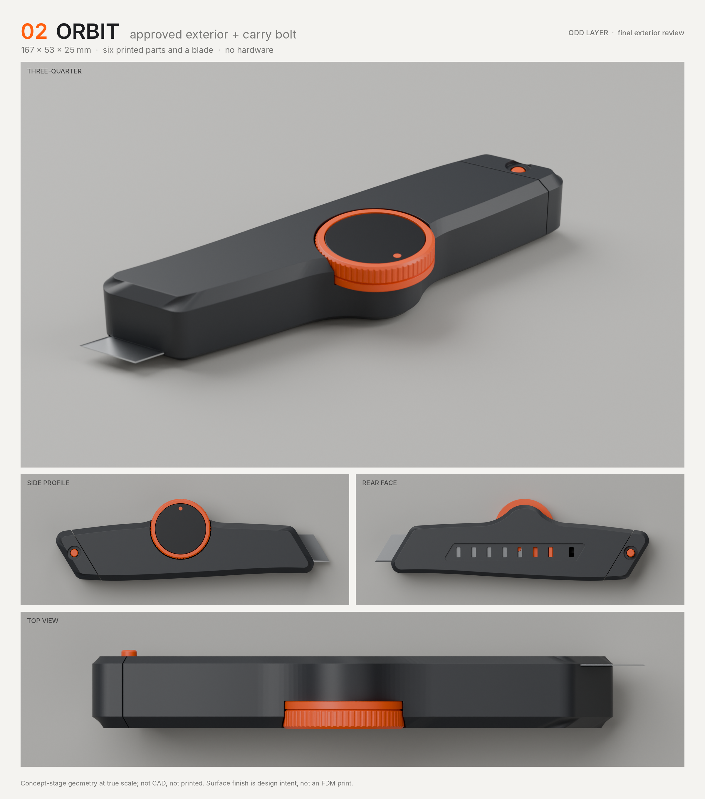
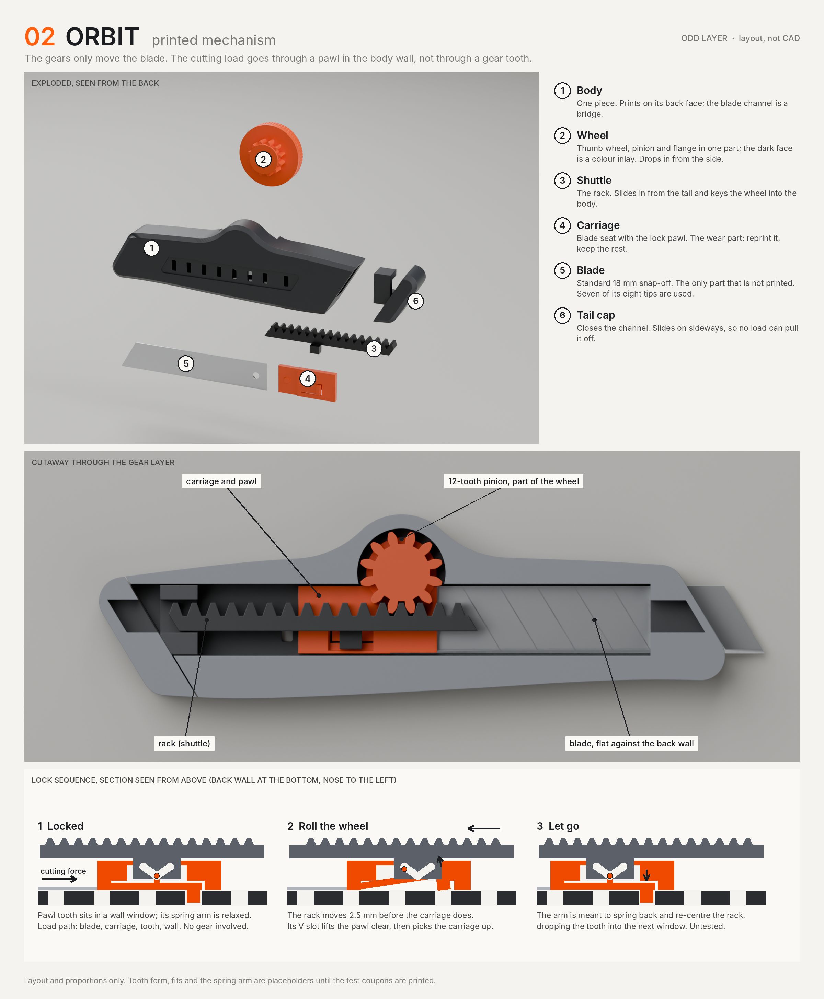

# ORBIT, all-printed revision

Revised direction for approval. No CAD has been started.

**Status: concept stage.** The geometry behind the renders is a layout study at true scale:
it shows that the parts fit and how they go together. Tooth form, fits and the spring arm
are placeholders. Nothing has been printed, and no printed lock should be trusted until the
tests at the end of this document have been run.

## The constraint and what it rules out

Everything is printed in PLA or PETG except the 18 mm blade. No screws, springs, pins,
bearings or magnets.

That removes four things the first ORBIT depended on:

| First ORBIT | Why it cannot simply be printed |
|---|---|
| Steel nose bolts and shell screws | A two-shell body has nothing to hold it shut. |
| Steel axle bolt | A printed axle of the same size is loaded across its layers. |
| Compression spring on the hex lock | A printed spring held compressed creeps and loses force. |
| Cutting load carried by a pinion tooth | A printed tooth is the weakest feature in the tool. |

Swapping each of those for a printed copy would give four weak points. The revision changes
the architecture so that none of them is needed.

## The revised architecture

Five printed parts and the blade. Tool-free assembly.

| # | Part | What it does |
|---|---|---|
| 1 | Body | One-piece monocoque. Nothing to fasten, no parting line. |
| 2 | Wheel | Thumb wheel, 12-tooth pinion and a retaining flange, printed as one part. |
| 3 | Shuttle | The rack. Also the part that keeps the wheel in the body. |
| 4 | Carriage | Blade seat with an integral lock pawl. The wear part. |
| 5 | Tail cap | Closes the channel. |

Four ideas carry the design.

**1. The body is one piece.** With no second shell there is nothing to hold together. The
blade mouth is closed above and below the blade by continuous material instead of bolts.

**2. The rack is the axle pin.** The wheel has no axle. Its disc runs directly in a 39 mm
bore in the body, which spreads the load over a large surface. The wheel drops in from the
side, then the rack slides in from the tail and passes between the wheel's disc and its
flange. While the rack is in, the wheel cannot come out.

**3. The gears never carry the cutting load.** The lock moved from the wheel to the
carriage. A pawl tooth on the carriage drops into a row of windows in the body's back wall,
one window per blade segment. Cutting force goes blade, carriage, tooth, wall. The pinion
and rack only ever see the thumb.

**4. Roll to unlock, let go to lock.** There is no button. The rack has 2.5 mm of free
travel relative to the carriage. Rolling the wheel moves the rack first; a V slot in the
rack lifts the pawl out of its window, then the rack picks the carriage up and the blade
moves. Let go and the pawl's spring arm pushes it into the next window. The blade is only
ever free while the thumb is driving it.

The spring arm is the one flexing feature, and it is arranged to avoid the usual printed
spring failure: it is **relaxed whenever the tool is locked**, so it has nothing to creep
against in storage. It is also not in the load path. Under cutting load the tooth is trapped
between a solid backstop on the carriage and the edge of the window.

## What changed on the outside

- **No fasteners and no parting line.** The body reads as a single clean form.
- **No hex button.** The wheel face is plain: a dish, six index dots, a centre dimple.
- **A fender** behind the wheel covers the pinion. It is concentric with the wheel, so the
  back view shows two arcs.
- **Lock windows on the back face.** Nine windows, one per position. They are the lock, and
  they also let you see it: the orange tooth is visible in the engaged window, steel shows
  ahead of it and empty windows behind. It doubles as a blade-remaining gauge.
- **Raked tail.** The tail cap now splits on a 59° plane parallel to the nose.
- **Size:** 180 × 53 × 23 mm, up from 172 × 54 × 20. The extra length is the rack: it has
  to stay on the pinion over the full 80 mm of blade travel. The extra thickness is the
  retaining flange.
- **Edges:** fuller radius on the palm side, tighter on the back, because the blade runs
  2.9 mm inside the back wall.

## Evaluation

### Printed gear durability

The gears now carry thumb force only. A firm thumb push of 15 N at the rim is about 30 N at
the rack (the wheel gives 2:1 leverage). A hand estimate for a module 1.6 PETG tooth 7 mm
wide is roughly 130 N, so the margin is about four times. The risk is no longer strength.
It is whether a 12-tooth pinion prints cleanly: 12 teeth undercut at the root, so the tooth
form needs profile shift or a higher pressure angle, and that is worth one test print.

### Friction between moving parts

Three sliding pairs, all lightly loaded while moving:

- **Wheel in its bore.** Large diameter, so low pressure, but the friction acts at the same
  radius as the thumb. Drag should be noticeable and slightly useful (it stops rattle).
  Too much drag is the main threat to the lock; see below.
- **Shuttle and carriage in the channel.** These should ride on narrow raised rails, not on
  full faces, to cut friction and leave room for cardboard dust.
- **Pawl on the V slot.** Short travel, light spring force.

PETG sliding on PETG tends to grab. Printing the wheel in PLA against a PETG body and rack
is a commonly recommended pairing, but I would treat that as something to confirm in the
wear test, not as a given.

### Wear over repeated operation

Twenty adjustments a day is about 7,000 a year. The parts that will show it first:

- the pawl tooth and the edges of the windows,
- the V slot and its follower,
- the pinion flanks.

The carriage holds the tooth and the follower, so it is designed as the consumable: a
ten-minute reprint that restores the lock. The window edges are in the body and are
permanent, so they are made large (about 4 × 2.5 mm of bearing face) and there are nine of
them sharing the wear.

### Blade retention

- **Backward (cutting load):** the blade's tail edge butts on a full-height shoulder on the
  carriage. About 100 N over 18 × 0.5 mm is roughly 11 MPa, acceptable for PETG.
- **Forward (pull-out):** a printed lug sits in the blade's tail hole. It only has to resist
  the drag of pulling the blade out of a cut. The blade is trapped between the back wall and
  the carriage plate, so it cannot lift off the lug while it is inside the body.
- **Sideways (prying at the mouth):** resisted by the monocoque. The body prints flat, so
  this load crosses the layers, which is the weak direction. The bonded area around the
  mouth is large and I expect it to hold, but it must be tested, not assumed.

The blade's steel edge bearing on plastic will indent the lug and shoulder over time. That
is another reason the carriage is the replaceable part.

### Lock reliability

What is good: the lock is solid geometry in shear, visible from outside, spring-relaxed when
locked, and the window and tooth faces are intended to be raked back about 5° so that load
pulls the tooth in.

What is not proven:

- **A sticky wheel can leave the lock open.** After extending, the spring arm has to push
  the rack back 2.5 mm and turn the wheel a few degrees to re-seat the tooth. If wheel drag
  exceeds the spring force, the tooth stays lifted and the blade will retract under load.
  That is the safe direction, but it is still a failed lock. This is the single most
  important thing to test.
- **Spring-arm fatigue.** If the arm cracks, the tooth may not return. Same symptom.
- **Tooth and window wear** rounding the edges until the tooth can cam out.
- **Heat.** PLA softens at around 55–60 °C, which a car dashboard reaches. The body,
  carriage and shuttle should be PETG.

If the roll-to-unlock action fails testing, the fallback keeps everything else and adds a
manual lock key: one more part, one more action.

### Print orientation and tolerances

| Part | Orientation | Notes |
|---|---|---|
| Body | Back face down | Blade channel is an 18 mm bridge. Wheel bay opens upward. No supports. |
| Wheel | Disc face down | Pinion and flange build upward. The flange bridges the tooth gaps. |
| Shuttle | On its side | Rack teeth lie in the layer plane, the strong direction. |
| Carriage | On its edge | Spring arm bends in the layer plane; the blade lug prints as a horizontal peg, across its layers' strong direction. |
| Tail cap | On its split face | Flat, no supports. |

Starting clearances: 0.25–0.30 mm per side on sliding fits, 0.4–0.5 mm on the wheel bore.
These are guesses until a fit coupon is printed.

On the H2C: all five parts fit one plate with room to spare, and graphite and orange can go
in one job. Reported build volume is roughly 305–330 × 320 × 325 mm depending on mode, with
0.4 mm nozzles as standard and up to seven materials per job.
([Tom's Hardware](https://tomshardware.com/3d-printing/bambu-lab-h2c-review),
[3D Printing Industry](https://3dprintingindustry.com/news/bambu-lab-launches-the-new-h2c-multi-material-3d-printer-technical-specifications-and-pricing-246509),
[Bambu Lab](https://blog.bambulab.com/bambu-lab-h2c-where-multi-material-vortek-system-meets-engineering-precision))

### Assembly and maintenance

Assembly, no tools:

1. Drop the wheel into its bay from the side.
2. Hook the blade onto the carriage, clip the carriage to the shuttle.
3. Slide that cartridge in from the tail. The rack meshes and captures the wheel.
4. Fit the tail cap.

Blade change is steps 4 to 2 in reverse: cap off, roll the wheel back, the cartridge comes
out of the tail. With the cartridge out the wheel lifts out for cleaning.

## Not yet resolved

- The tail-cap latch. It slides on sideways so that no axial load can remove it, but its
  detent is not designed.
- Guide rails for the shuttle and carriage.
- A blade snapper.
- Left-handed use. The wheel is offset to one side, so a mirrored print is needed.

## Tests before CAD is finalised

Small coupons, each a short print:

1. **Fit coupon.** Sliding fits and the wheel bore at three clearances.
2. **Gear coupon.** Pinion and a short rack: print quality, backlash, feel.
3. **Lock coupon.** A carriage with pawl in a strip of wall with three windows. Load it to
   failure in PLA and PETG, then cycle it a few thousand times and load it again.
4. **Return test.** Lock coupon plus wheel: does the tooth re-seat every time, clean and
   with cardboard dust in it?
5. **Mouth test.** A nose section with a blade in it, pried sideways to failure.
6. **Heat soak.** The lock coupon at 60 °C under no load, then re-tested.

## Decision needed

Approve this exterior direction, or tell me what to change. The main choices in it are the
plain wheel face, the fender, the lock windows on the back, the raked tail and the 180 mm
length.
