# Build guide: the V8 motion test (plates M1-M6)

This is the first time the engine's moving parts go together: the crank, 8 rods,
4 pistons, the crankcase and one cylinder bank. When it turns smoothly by hand, the
design is proven and the rest of the engine can be printed.

**Nothing here is proven yet.** No one has built this engine. If a step does not
work the way it says, stop and tell me what happened. That is a test result, not a
mistake.

How to read the pictures: **blue** parts are the ones the step adds, **grey** parts
are already there, and the metal-coloured parts are bought hardware (steel bearings,
screws and rails, bronze bushings, brass inserts). Every picture is drawn from the
real part files (`tools/build_guide.py`).

Words used here:

- **Front** = the end with the long shaft. Cylinder 1 is at the front.
- **Bank A** = the left side when you look at the front. It holds cylinders 2, 4, 6, 8.
  This test builds bank A only.
- **Bank B** = the right side, cylinders 1, 3, 5, 7. It gets no cylinder bank yet.
- **Valley** = the middle of the V, between the two banks.

---

## 1. What you need

### Printed parts


| Plate | Parts | Notes for printing |
|---|---|---|
| M1 | 2 end webs (05), segments 06-90, 07-180, 08-270, shafts P2 and P2F, **3 shaft plugs (P2P)**, **hand knob (T12)** | Shafts and plugs 100 % infill. **No supports needed** (the shafts were redesigned on 2026-11-17). You need 2 plugs; 1 is a spare |
| M2 | 8 rods (09), 4 crankpins (P1), **12 spacer rings (P1R)** | Print this plate at **0.12 mm layers**. Pins and rings 100 % infill. No brim on the rings. You need 8 rings; 4 are spares |
| M3 | 8 pistons (10) | No brim |
| M4 | 1 cylinder bank (03), head A (30) | |
| M5 | crankcase (01) | |
| M6 | valley beam (02), 2 end plates (04) | |
| M7 (later) | second cylinder bank (03), head B (30B) | Only for the all-8-cylinder test in step 13 |

The plate files are in `stl/plates/`. PLA is fine for this test.

The spacer rings are new (2026-11-17). The motion-test plates did not include them
before, and the crank cannot be built without them. Plate M2 now has them.

### Bought hardware

| Part | How many for this test | Where it goes |
|---|---|---|
| 608ZZ bearing (8 x 22 x 7) | 2 | end plates |
| 686ZZ bearing (6 x 13 x 5) | 8 | rods, big end |
| Bronze bushing 3 x 5 x 4 | 16 | 8 rods (small end) + 2 in each of 4 pistons |
| Wrist pin 3 x 20 mm | 4 | pistons 2, 4, 6, 8 |
| 3 mm rod, pre-cut **60 mm** (uxcell HSS 3 x 60) | 4 | guide rails, no cutting |
| M3 heat-set insert | 35 | see step 2 |
| M3 x 8 socket head screw | 38 | see each step |
| Light oil | a few drops | rails |

When bank B is built later you need 8 more bushings, 4 more wrist pins and 4 more rails.

### Tools

- Soldering iron with the M3 insert tip, set to **220 C** for PLA parts
- 2.5 mm hex key with a long arm (some screws sit 26 mm down a hole)
- A clamp or a small vise, and two flat pieces of wood to protect the parts
- Calipers
- A small file or 400 grit sandpaper (only to smooth a rail end or a tight shaft; nothing needs cutting: rails are pre-cut 60 mm, wrist pins are pre-cut 3 x 20 mm dowel pins)
- Flush cutters or a hobby knife (brims, stray plastic)
- A marker

### Before you start

These coupon tests must pass first, because they can change the hole sizes on
these parts:

- **T2** heat inserts (changes every part with inserts)
- **T4** bushings (changes rods and pistons)
- **T4d** wrist pins (changes pistons)

Plate M1 (the crank) only depends on T2. If you print M2 or M3 before T4 and T4d are
done, you may have to print them again.

---

## 2. Heat-set inserts (35)

Iron at 220 C. Put the insert on the tip, hold it straight over the hole, and push
gently. Let the heat do the work. Stop when the insert is level with the surface.
Press something flat and metal on it for 3 seconds while it cools.

**Crankcase and valley beam: 22 inserts.**


| Where | How many |
|---|---|
| Crankcase, front end face | 4 |
| Crankcase, rear end face | 4 |
| Valley beam, front end face | 2 |
| Valley beam, rear end face | 2 |
| Crankcase, the two sloped top faces (one near each end of each face) | 2 + 2 |
| Valley beam, the two sloped sides | 3 + 3 |

Do the two parts separately, before they go together. The picture shows them
together only so you can see every hole. Both sloped faces get their inserts now,
so it does not matter which way round the parts go in later. Leave the 4 holes
under the crankcase floor empty.

To find the **rear** of the crankcase: turn it over. The small rectangular pocket in
the floor is at the rear.

**Cylinder bank: 6 inserts** in the flat top face (the deck), between the bores.

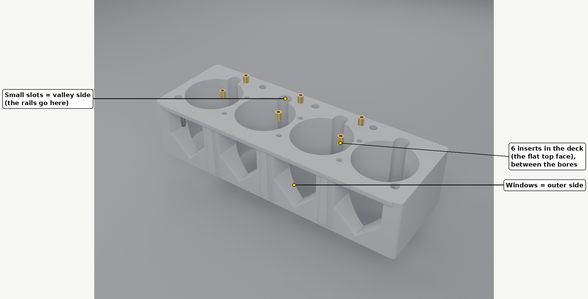

**End webs: 3 inserts each (6 total)** in the three small holes of the flat face.


**Hand knob (T12): 1 insert** in the hole in the side of its hub.

Check:
- [ ] 35 inserts in, all level with the surface or just below
- [ ] None are crooked. A screw goes into each one by hand

---

## 3. Bearings and bushings

Press these in with the clamp or vise, with wood on both sides. Push slowly and
keep the part square. Never hammer.

**Rods (all 8).**

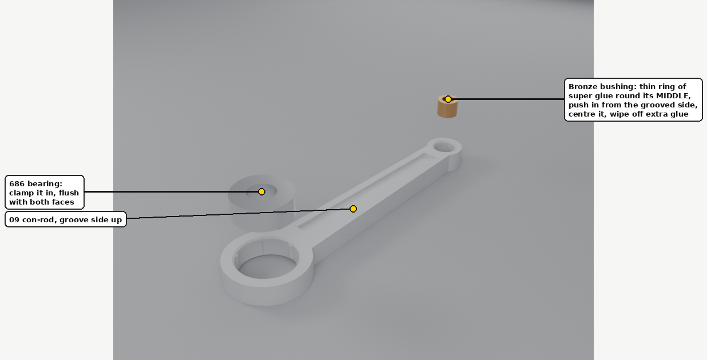

1. Press a 686 bearing into the big hole until it is level with both faces.
2. Press a bronze bushing into the small hole until it is in the middle. The rod is
   5 mm thick and the bushing is 4 mm long, so it sits 0.5 mm in from each face.

**Pistons (4 for now).**

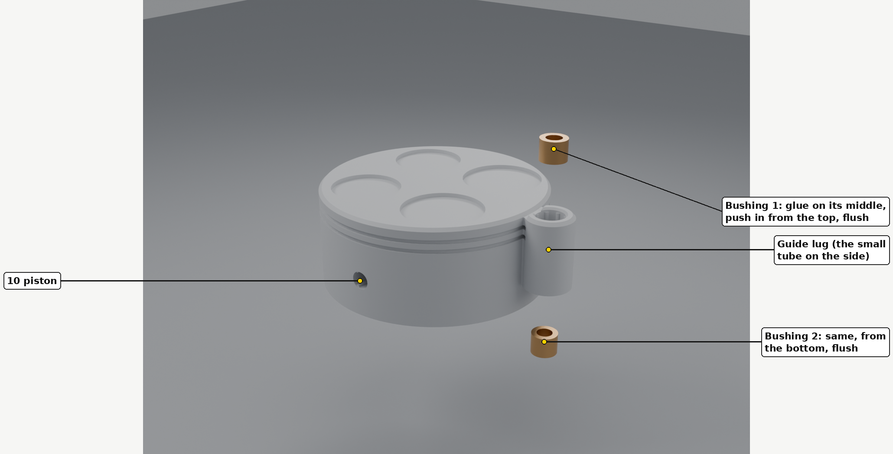

3. Press one bushing into the top of the guide lug and one into the bottom, each
   until it is level with the end of the lug.
4. Slide a piece of 3 mm rod through both bushings. It must slide freely by hand.

**End plates (both).**

5. Press a 608 bearing into each end plate **from the inside face** (the side with the
   raised half-ring) until it stops against the lip. Picture in step 8.

Check:
- [ ] Every bearing still spins smoothly after pressing. No gritty feel
- [ ] No cracks in the plastic around any bearing or bushing
- [ ] The 3 mm rod slides through both bushings of each piston

---

## 4. Pistons onto rods (4)

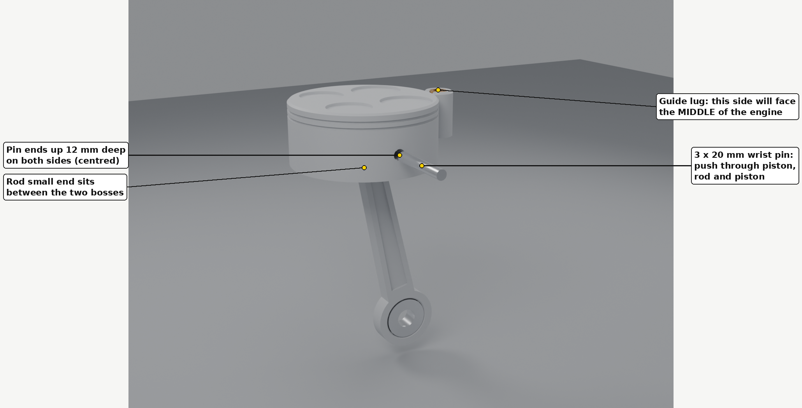

Do this for 4 rods. These become cylinders 2, 4, 6 and 8.

1. Hold the rod with its **grooved side facing you** and the small end up.
2. Put the piston over the small end with the guide lug on the **right**.
3. Push a 3 x 20 mm wrist pin through the piston, through the rod's bushing, and
   into the other side of the piston. Use the end of the 3 mm rod to push it.
4. Stop when the pin is the same depth on both sides: about 12 mm in from the
   outside of the piston.

Write the cylinder number inside each piston skirt with the marker: 2, 4, 6, 8.

Check:
- [ ] The rod swings freely on the pin
- [ ] The rod can slide about 1 mm side to side between the piston bosses
- [ ] With the groove facing you, the lug is on the right, on all 4

The other 4 rods stay bare. Mark them 1, 3, 5, 7.

---

## 5. Load the crankpins

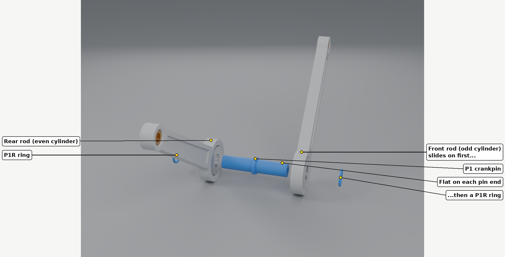

Each of the 4 crankpins carries two rods, with a thin ring outside each one. The
thick collar in the middle of the pin keeps the two rods apart.

For each pin, slide on from one end: a rod, then a ring. Then from the other end: a
rod, then a ring.

| Pin | Front end | Rear end |
|---|---|---|
| 1 | rod 1 (bare) | rod 2 (with piston) |
| 2 | rod 3 (bare) | rod 4 (with piston) |
| 3 | rod 5 (bare) | rod 6 (with piston) |
| 4 | rod 7 (bare) | rod 8 (with piston) |

The **grooved side of every rod faces the front.** That puts each piston's lug on
the correct side.

Before you start, check the rings with the calipers. Each one should be about
**0.75 mm thick** (0.70 to 0.80 is fine) and should slide onto a pin by hand. If a
ring is tight, turn a 6 mm drill bit through it by hand. Use the 8 best ones.

The rings fall off easily, so load one pin and build it into the crank (step 6)
before loading the next.

Check:
- [ ] Both rods spin freely on the pin
- [ ] Both ends of the pin stick out about 8 mm past the rings

---

## 6. Build the crank

The crank goes together in this order, front to rear:


The three segments are different. Each has its number engraved on its **rear** face:
`06-90`, `07-180`, `08-270`. They go in that order from the front.

**How every joint works:**


- Each face of a segment has two holes near the edge: one **D-shaped** hole with
  small ribs inside (for a pin), and one plain **round** hole (for a screw).
- The pin end has a flat. Turn the pin until its flat lines up with the flat of
  the D-hole. It only goes in one way.
- Press the pin in with the clamp until the ring touches the face of the segment.
- The screw goes down the round hole on the **opposite** face and into the end of
  the pin. The plastic pin has no thread. The screw cuts its own the first time, so
  turn it slowly and **stop as soon as the head touches.** It only holds the pin in.
  The press fit does the real work.

**Steps:**

1. **Front end web + pin 1.** Lay an end web with its insert face down. Press the
   front end of pin 1 (the rod 1 end) into the D-hole. Put a screw in from the
   insert face.
2. **06-90 + pin 2.** Lay segment 06-90 with the engraved face up. Press the front
   end of pin 2 (the rod 3 end) into the D-hole of the engraved face. Screw from the
   other face.
3. **07-180 + pin 3.** Same: front end of pin 3 (rod 5 end) into the engraved face
   of 07-180. Screw.
4. **08-270 + pin 4.** Same: front end of pin 4 (rod 7 end) into the engraved face
   of 08-270. Screw.
5. **Join them, front to rear.** Press the plain face of 06-90 onto the rear end of
   pin 1. Screw from the engraved face, down the round hole. Swing the rods out of
   the way to reach it.
6. Press the plain face of 07-180 onto the rear end of pin 2. Screw.
7. Press the plain face of 08-270 onto the rear end of pin 3. Screw.
8. **Rear end web.** Press the last end web onto the rear end of pin 4. Screw from
   its insert face.
9. **Shafts.** The long shaft (P2F) goes on the front end web, the short one (P2)
   on the rear. First push a P2P plug into the hole in the flat end of each shaft.
   It is a snug fit: press it in until it stops. If it will not go, sand the plug
   lightly. Half of the plug now sticks out. That half goes into the centre hole of
   the end web and keeps the shaft centred. Turn the shaft until all 3 holes line up. They only line up
   one way. 3 screws each. The head of the pin screw sits in the notch in the
   shaft's flange.

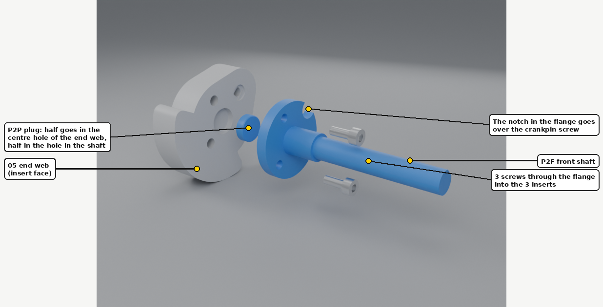

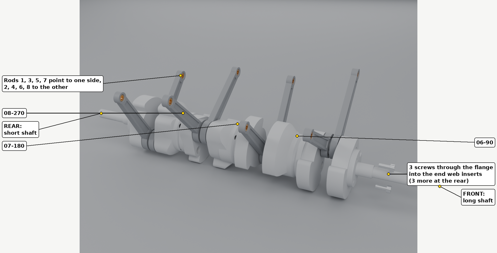

Screws used: 8 in the pin ends, 6 in the shaft flanges.

Check:
- [ ] Segment order from the front: 06-90, 07-180, 08-270
- [ ] All 8 rods still spin freely on their pins. None feels pinched
- [ ] Every rod has a small gap to the segment beside it. No rod rubs
- [ ] Rest both shafts in the two V-blocks (coupon T7) on a flat table and turn the
      crank slowly. Watch the segments. They should not wobble more than about
      0.2 mm (two sheets of paper)

If a rod feels pinched after a joint is pressed, the ring next to it is probably
too thick. Tell me which pin.

---

## 7. Crank into the crankcase

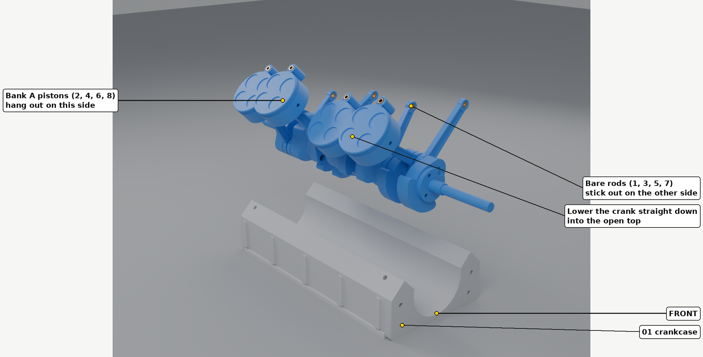

1. Set the crankcase on the table. Find its rear (the small pocket underneath).
2. Lower the crank straight down into the open top, long shaft to the front.
3. The 4 pistons hang out on the bank A side (left, seen from the front). The 4
   bare rods lie out on the other side.

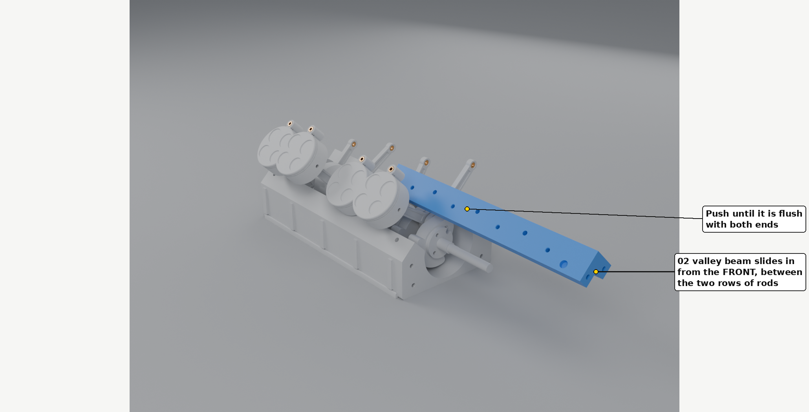

4. Slide the valley beam in from the front, between the two rows of rods. Push
   until it is level with both ends of the crankcase.
   It cannot go in from above because the pistons are in the way.

---

## 8. End plates


1. Slide an end plate over each shaft, bearing first, until it sits against the end
   of the crankcase. The printed shaft should push into the bearing by hand. If it
   is tight, sand the shaft lightly. Do not force it.
2. 6 screws per plate: 4 into the crankcase, 2 into the valley beam. Tighten them
   a little at a time, in a criss-cross order.

Screws used: 12.

Check:
- [ ] The crank turns by hand with no tight spot
- [ ] The crank can slide front to rear about 0.6 mm. That is correct for now. The
      pulley takes it out later

If the crank is tight here, loosen the end plate screws one plate at a time and
tell me which plate frees it.

---

## 9. Cylinder bank A

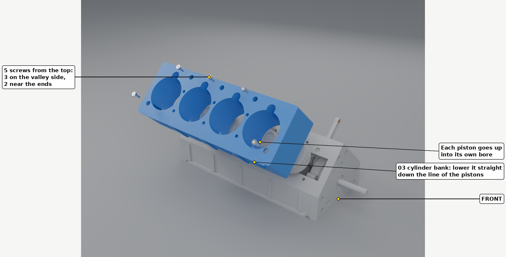

1. Turn the crank until no piston is at the very top or the very bottom. Two will
   sit higher than the other two. That is normal for a V8 crank.
2. Hold the bank with the windows facing out and the small slots toward the valley.
3. Lower it over the pistons, along the line the pistons point (it leans 45 degrees).
   Guide each piston into its bore and each lug into its slot, the two higher
   pistons first. The two pegs under
   the bank drop into the valley beam. It fits one way only.
4. 5 screws from the top: 3 on the valley side, 2 near the ends on the outer side.

It helps to tip the whole engine so bank A points straight up, or to have a second
person hold the pistons.

Screws used: 5.

---

## 10. Guide rails

The rails are pre-cut 3 x 60 mm rods. No cutting. Wipe each one clean and feel
the ends: if one has a sharp edge, round it off with a file, or it will scratch the
bushings.

If your valley beam was printed before 2026-11-18, its rail holes are 3 mm too
shallow for 60 mm rods. Deepen each of the 8 holes (4 per side) with a 3 mm drill
bit, by hand or at low speed, to **9 mm** deep. Mark 9 mm on the bit with tape.


1. Drop a rail into the small slot beside each bore.
2. It goes through the two bushings in the piston's lug, then down into a hole in
   the valley beam. Turn the crank a little if it does not find the bushings.
3. Push it down until it stops. It should stand about **3 mm** above the deck.
4. One drop of light oil on each rail.

Check:
- [ ] Turn the crank 2 full turns. All 4 pistons move smoothly
- [ ] Look through the windows. No piston touches the wall of its bore

---

## 11. Head A

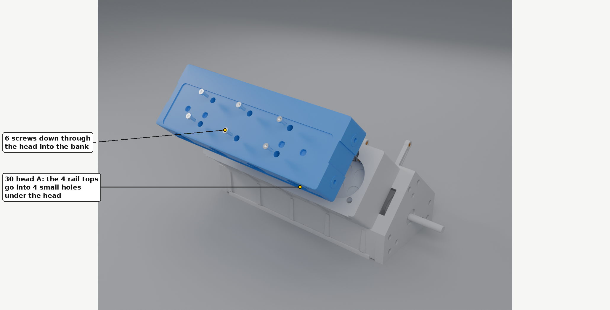

1. Lower head A onto the bank. The 4 rail tops go into 4 small holes under the
   head. It fits one way only.
2. 6 screws down through the head into the deck inserts.

Screws used: 6.

---

## 12. The test


Push the T12 hand knob onto the front shaft. Put an M3 x 8 screw into the insert in
its hub and turn the shaft until the screw sits over the flat on the shaft. Tighten
it gently.

Turn the crank with the knob, slowly, at least 5 full turns each way.

The 4 bare rods lean on the edge of the empty slot and may make a light tap as
they flip over. That is expected and does not count. Step 13 adds the second bank
so all 8 cylinders run.

| Check | Pass | If not, tell me |
|---|---|---|
| Crank turns, no bank A piston touches a bore | 2 full turns smooth, no click | the cylinder number, and where in the turn it happens |
| Each piston slides on its rail | free over the whole stroke | which piston, and whether it sticks at the top, middle or bottom |
| Head on | sits flat, all 4 rails went in | which rail would not go in |
| Crank wobble (step 6) | under 0.2 mm | which segment wobbles most |
| Nothing cracked | no cracks at any bearing, bushing, pin or insert | which part, with a photo |

## 13. Later: bank B, all 8 cylinders

Do this after the bank A test passes. It needs plate M7 (a second 03 bank and
head B), 8 more bushings, 4 more wrist pins, 4 more rails, 6 inserts in the second
bank's deck, and 11 more screws.

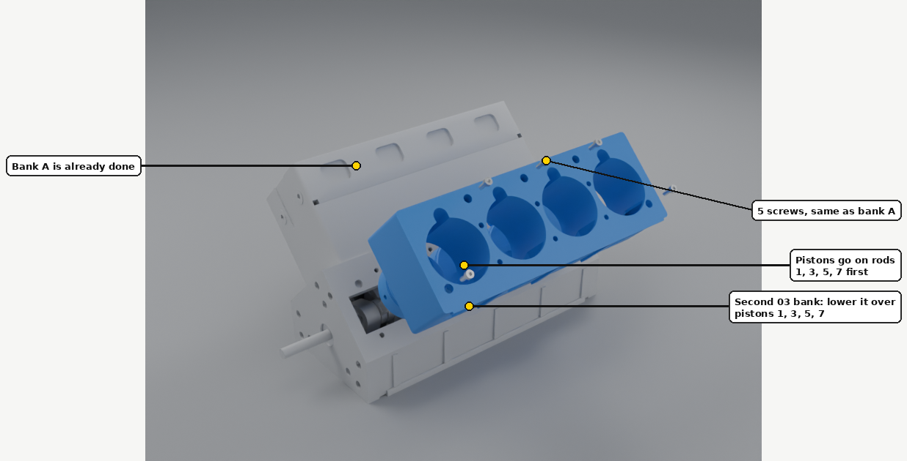

1. Leave bank A as it is.
2. Press 2 bushings into each of the other 4 pistons (step 3).
3. Fit them to rods 1, 3, 5, 7 with wrist pins (step 4). The rods are already on
   the crank and stick out of the open slot. On bank B the lug goes on the **left**
   when the rod's groove faces you.
4. Lower the second bank over the 4 pistons (step 9). 5 screws.
5. Drop in 4 rails with a drop of oil each (step 10).
6. Fit head B (step 11). 6 screws.


Run the same test again. Now any click counts, on either side.

## What to send me

Copy this and fill it in:

```
Inserts (step 2):        ok / problem:
Bearings, bushings (3):  ok / problem:
Wrist pins (4):          ok / problem:
Rings (5): thickness measured ____ mm, slide on by hand yes / no
Crank joints (6):        ok / problem:
Crank wobble:            about ____ mm
Crank in case (8):       turns freely yes / no
Bank on (9):             ok / problem:
Rails (10):              slide yes / no, stand ____ mm above the deck
Head on (11):            ok / problem:
Shaft plugs (6):         shafts sit flat and centred yes / no
Hand knob (12):          holds on the shaft yes / no
Turning (12):            smooth / tight spot at cylinder ____ / click at ____
Anything cracked:        no / yes:
```

Photos help most for anything that did not fit.
