# Motion test build guide (V8, engine #1)

This builds the moving heart of the engine: the crankshaft, 8 con-rods, 4 pistons,
the crankcase and cylinder bank A. At the end you turn it by hand and feel whether
everything runs smoothly. If it does, the hardest part of the design is proven.

**About 4 to 5 hours** the first time, spread over two sessions:

| Session | Parts of this guide | Time | Needs |
|---|---|---|---|
| 1 | A (prepare parts), B (rods and pistons), C (crank, up to the shafts) | 2 h | clamp, super glue |
| 2 | D (heat inserts), C step C6 (shafts), E (put it together), F (the test) | 2-3 h | soldering iron + insert tip |

Each step has a **checkpoint**. Do not start the next step until the checkpoint
passes. If something does not work the way the guide says, **stop and tell me what
happened**. That is a test result, not a mistake. Nobody has built this engine before.

**How to read the pictures:** **blue** = the parts this step is about, **grey** =
parts already done, metal colours = bought hardware (steel, bronze bushings, brass
inserts). Every picture is drawn from the real part files, so sizes and positions
are exact (`tools/build_guide.py`).

---

## Words used in this guide

- **Front** = the end with the **long shaft**. Cylinder 1 is at the front.
- **Bank A** = the left side, seen from the front. Cylinders **2, 4, 6, 8**. This test
  builds bank A.
- **Bank B** = the right side, cylinders **1, 3, 5, 7**. Its rods go on the crank now,
  but its cylinder bank comes later (part G).
- **Valley** = the middle of the V, between the two banks.
- **Flush** = level with the surface, not sticking out and not sunk in.
- **Snug** = tightened until it stops, then no more. Plastic threads strip easily.

## Safety

- The soldering iron tip is about 220 C. It burns instantly. Always put it back in
  its stand. Never leave it on when you walk away.
- Super glue sticks skin in seconds. Keep acetone nail-polish remover nearby: it
  dissolves the glue.
- Safety glasses while pressing parts and using the iron.
- PLA gives off almost no fumes. An open window or a fan is plenty.

---

# PART A: Know your parts

## A1. Printed parts

Lay every printed part out on a towel and tick them off.

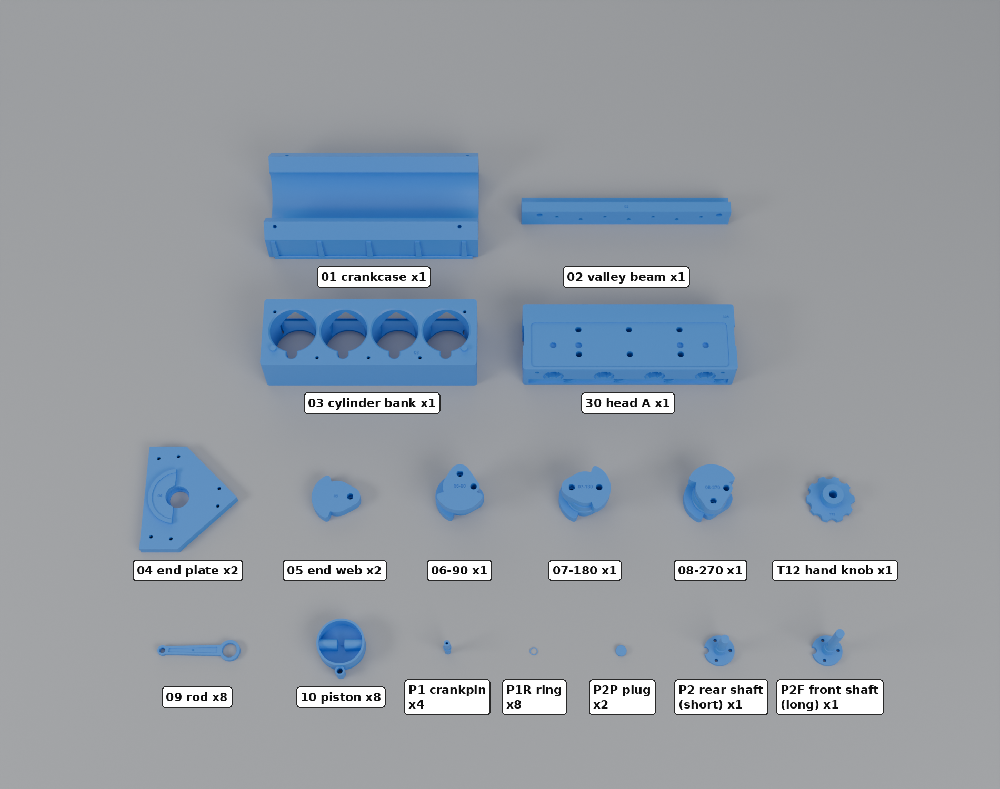

| Part | Qty | Plate | What it does |
|---|---|---|---|
| 01 crankcase | 1 | M5 | the main body; the crank turns inside it |
| 02 valley beam | 1 | reprint (60 mm rails) | the ridge between the two rows of rods; holds the rails |
| 03 cylinder bank | 1 | M4 | the block with 4 bores, for bank A |
| 30 head A | 1 | M4 | caps the bank and holds the rail tops |
| 04 end plate | 2 | M6 | close the crankcase ends; each holds a big 608 bearing |
| 05 end web | 2 | M1 | the two ends of the crank |
| 06-90, 07-180, 08-270 | 1 each | M1 | the three middle pieces of the crank |
| 09 con-rod | 8 | M2b | connect the crank to the pistons |
| 10 piston | 4 (8 printed) | M3 | slide up and down in the bores |
| P1 crankpin | 4 | M2 | the short pins the rods turn on |
| P1R spacer ring | 8 | M2 | thin rings, one beside each rod |
| P2F front shaft (long) | 1 | M1 | the crank's front shaft |
| P2 rear shaft (short) | 1 | M1 | the crank's rear shaft |
| P2P plug | 2 | M1 | centres each shaft on its end web |
| T12 hand knob | 1 | M1 | for turning the crank by hand |

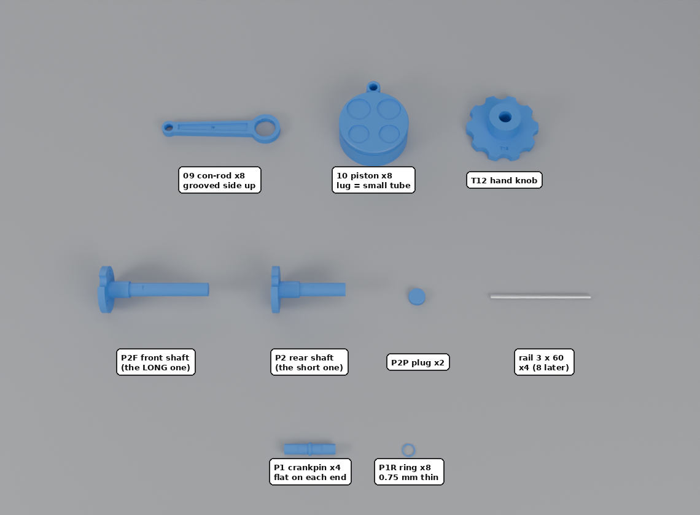

## A2. Bought hardware

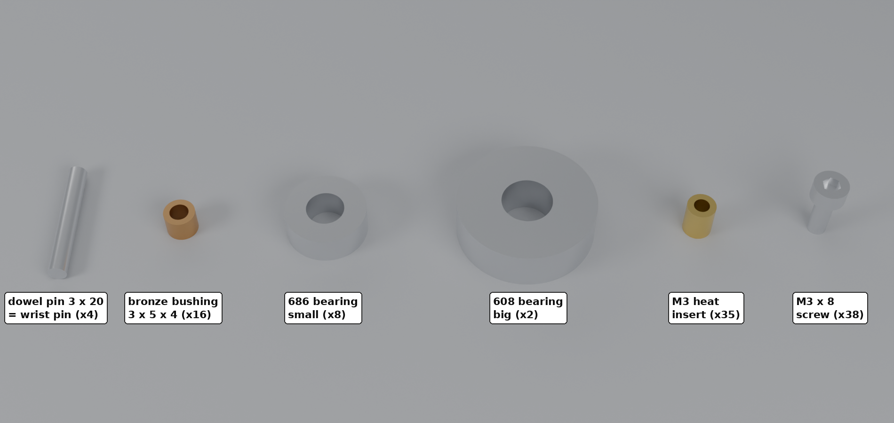

| Part | How many | Where |
|---|---|---|
| 686 bearing (small, 6 x 13 x 5) | 8 | big end of each rod |
| 608 bearing (big, 8 x 22 x 7) | 2 | one in each end plate |
| Bronze bushing 3 x 5 x 4 | 16 | 8 in the rods (small end) + 2 in each of 4 pistons |
| Dowel pin 3 x 20 (= wrist pin) | 4 | through each piston and its rod |
| Rail, 3 x 60 mm rod | 4 | one per bank A cylinder |
| M3 heat-set insert | 35 | see part D |
| M3 x 8 socket screw | 38 | crank (14), end plates (12), bank (5), head (6), knob (1) |
| Super glue | 1 tube | bushings |
| Light oil (3-in-One) | a few drops | rails |

## A3. Tools

- Clamp or small vise, and two scraps of wood (to press bearings without marking the plastic)
- 2.5 mm hex key with a long arm (some screws sit deep in a hole)
- Soldering iron with the M3 insert tip
- Calipers
- Flush cutters or a hobby knife (brims, strings)
- 400 grit sandpaper
- Paper towels, cotton swabs, a marker

## A4. Learn which side is which

Most mistakes in a build like this are a part turned the wrong way round. These
pictures show how to tell.

**The crankcase.** Turn it upside down. The small rectangular pocket in the bottom
face is at the **rear**.

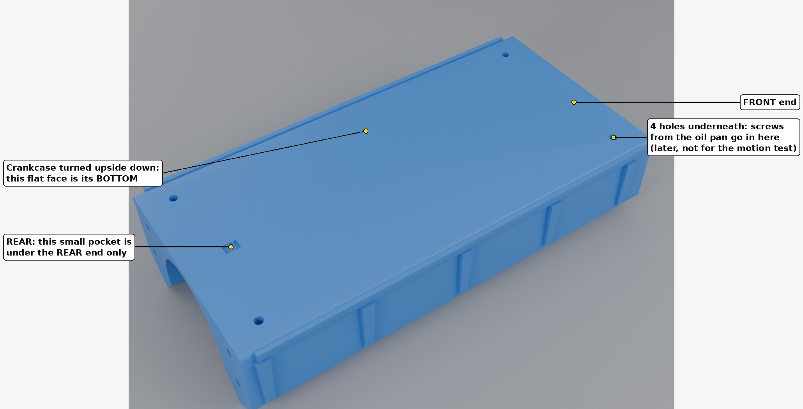

**The valley beam.** It has two long sloped faces with the same holes on each.
The 4 **smallest** holes on each face are for the rails.

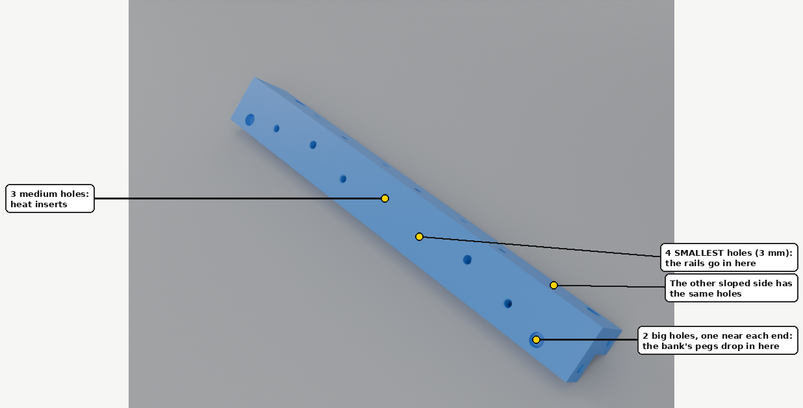

**The cylinder bank.** The face with the **2 pegs** is the bottom. The windows face
outwards. The small slots beside the bores face the valley.

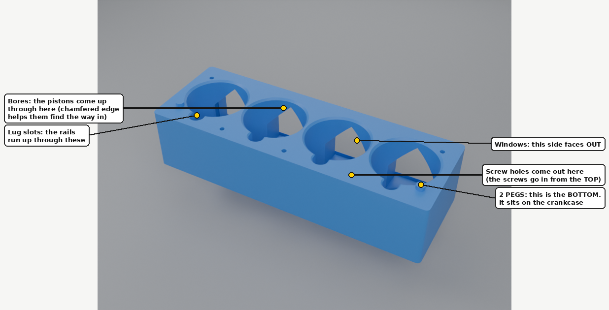

**The head.** Its flat underside sits on the bank's top face (the face with no pegs).

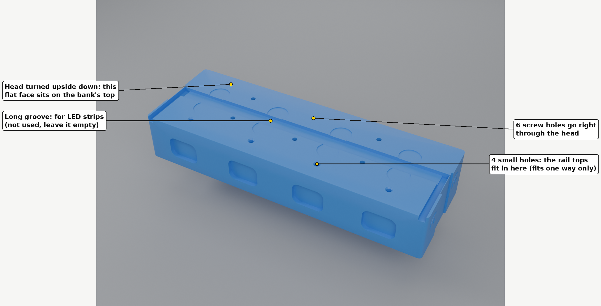

**The crank segments.** Each face has one **D-shaped hole** (a crankpin presses in)
and one **round hole** (a screw goes down it). The face with the engraved number
(06-90, 07-180 or 08-270) is the **rear** face.

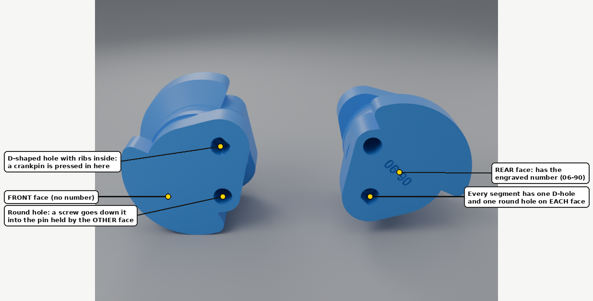

**The end webs.** One face has 3 small insert holes, a bigger hole and the big centre
hole. The other face has the D-hole for a crankpin.

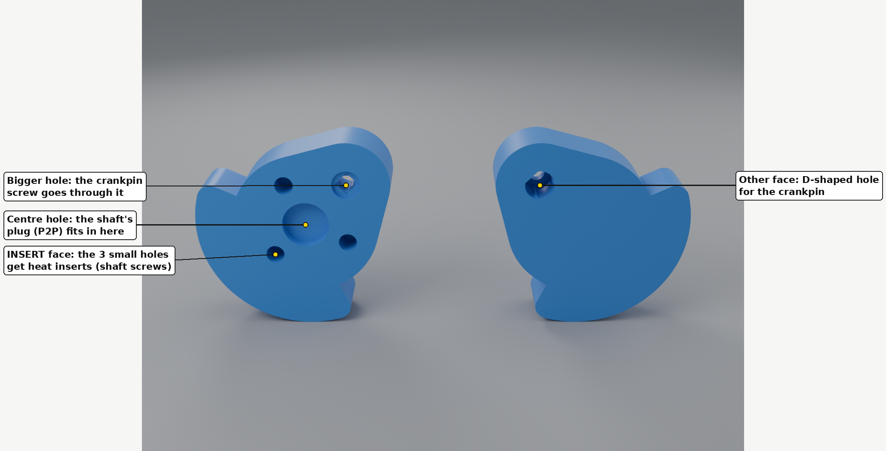

## A5. Clean the parts

- Peel off every brim. Hold the knife flat against the part and slice away from you.
- Look into every hole. Pick out strings or blobs with the knife tip.
- Set the crankcase, bank and end plates on a flat table. None should rock.

**Checkpoint A:** every part in the tables is there, clean, and you can find the
front of the crankcase, the bottom of the bank, and the rear face of each segment.

---

# PART B: Rods and pistons

## B1. Bearings and bushings into the rods (all 8)


**Bearing (big hole):**
1. Lay the rod flat on wood, grooved side up.
2. Set a 686 bearing over the big hole.
3. Clamp it in slowly, wood on top, until it is flush on **both** faces.
4. Spin it with a finger. Smooth = good.

**Bushing (small hole), glued:**

The bushing is glued, not pressed. A press fit this small can't be printed
reliably, and glue holds every time (decision D84).

1. Put a **tiny** drop of super glue on a paper towel. Roll the **middle** of the
   bushing's outside through it. Keep both ends clean.
2. Push the bushing into the small hole from the **grooved side**, and centre it.
   It should be about level on both faces.
3. **Right away**, wipe off anything that squeezed out, with a cotton swab.
4. **Look through the bushing.** If you see glue inside, push a dowel pin through
   once and pull it straight out, then wipe the pin. Do this within 10 seconds.
5. Leave it 10 minutes.

**Checkpoint B1:** on all 8 rods the bearing spins smoothly, the bushing doesn't
move when you push it with a finger, and a dowel pin slides through the bushing and
turns freely.

If glue got into a bushing and the pin sticks: soak the small end in acetone for
30-60 minutes, or print one new rod (`PRINT_THIS_FIRST/REPRINT_NOW_09_conrod_x1.stl`).

## B2. Bushings into the pistons (4)


1. Glue a bushing into the **top** end of the piston's lug (the small tube on its
   side), the same way as B1: glue on the middle only, push in flush, wipe, check
   the hole is clear.
2. Glue the second bushing into the **bottom** end of the lug.
3. Let it set 10 minutes, then slide a **rail** through both bushings. It must slide
   freely from end to end.

**Checkpoint B2:** the rail slides through all 4 pistons' lugs with no sticking.

## B3. Pistons onto rods (4)


1. Take a rod and hold it with its **grooved side facing you**, small end up.
2. Put a piston over the small end, with the **lug on the right**.
3. Push a dowel pin through: the piston, the rod's bushing, the other side of the
   piston. Push it with the end of a rail if it is stiff.
0. Before this step: ream both pin holes of the piston with a **3.0 mm drill bit twisted by
   hand** (not 1/8" = 3.17, too loose), holes empty, backing the bit out every few turns.
   The pin then slides through with no force.
4. Centre it: about 12 mm in from each side of the piston.
4b. Lock the pin in the piston: one tiny drop of super glue (toothpick) where the pin meets
    the **outer end of each piston boss**. No glue near the rod. Swing the rod while it sets;
    it must swing freely and the pin must not slide.
5. Write the cylinder number **inside the piston skirt** with the marker: **2, 4, 6, 8**.

Do this 4 times. Mark the 4 bare rods **1, 3, 5, 7** on their small ends.

**Checkpoint B3:** each piston rocks freely on its rod, the rod can slide about 1 mm
side to side between the piston's bosses, and with the groove facing you, all 4 lugs
are on the right.

---

# PART C: The crankshaft

The crank is built from short pieces held together by the 4 crankpins. Once a pin is
pressed into a segment it is very hard to get out, so **check the order and the
direction before every press.**

## C1. The order

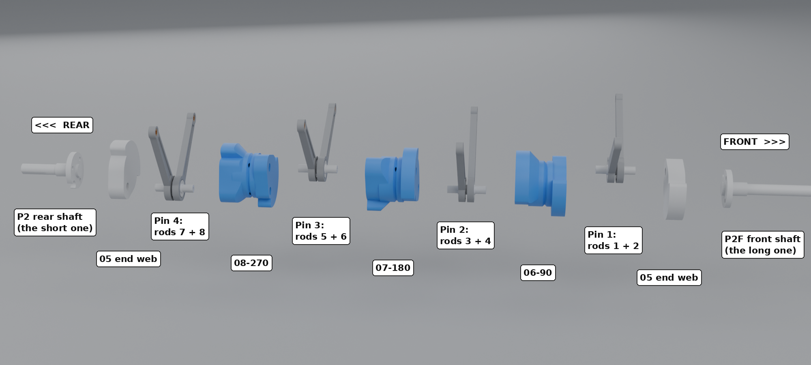

From the front: long shaft, end web, pin 1, **06-90**, pin 2, **07-180**, pin 3,
**08-270**, pin 4, end web, short shaft.

## C2. Load the crankpins


Check the 8 rings first: about **0.75 mm** thick (0.70 to 0.80 is fine), and each
slides onto a pin by hand. Put any thick or tight ones aside.

Each pin carries two rods, one on each side of its thick middle collar:

| Pin | Front end (slides on first) | Rear end |
|---|---|---|
| 1 | rod 1 (bare) | rod 2 (with piston) |
| 2 | rod 3 (bare) | rod 4 (with piston) |
| 3 | rod 5 (bare) | rod 6 (with piston) |
| 4 | rod 7 (bare) | rod 8 (with piston) |

For each pin: slide a rod onto the front end until it stops at the collar, then a
ring. Then the other rod onto the rear end, then a ring. **The grooved side of every
rod faces the front.**

The rings fall off easily. Load one pin, build it into the crank (C3-C5), then load
the next.

**Checkpoint C2:** both rods turn freely on the pin, and each pin end sticks out
about 8 mm past its ring.

## C3. How a joint works

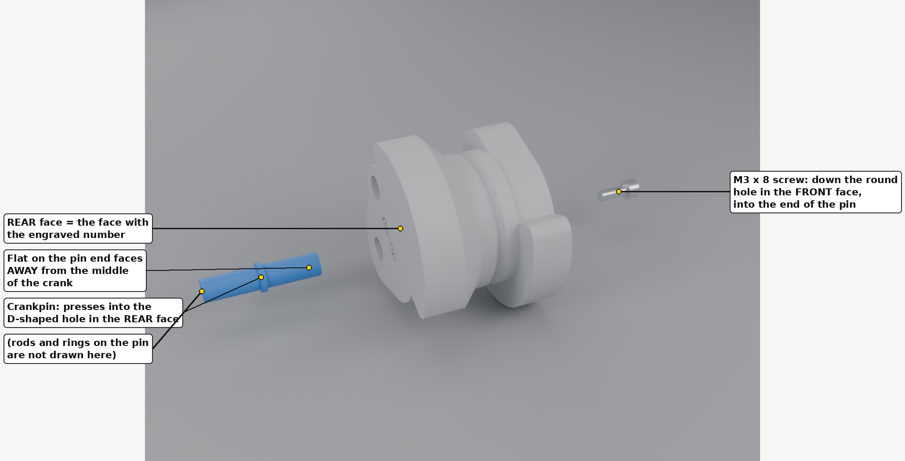

- Turn the pin until the **flat** on its end lines up with the flat side of the
  D-hole. It only goes in one way.
- Press it in with the clamp until the **ring touches the segment's face**. Use wood
  on both sides. Press slowly and keep it straight.
- A screw goes down the **round** hole on the **opposite** face, into the end of the
  pin. The pin has no thread, so the screw cuts its own. **Turn it slowly and stop
  as soon as the head touches.** It only keeps the pin from backing out; the press
  fit does the real work.

## C4. Build the four sub-assemblies

1. **Front end web + pin 1:** end web with its insert face down. Press pin 1's
   **front** end (the rod 1 end) into the D-hole. Screw from the insert face.
2. **06-90 + pin 2:** segment 06-90 with its **engraved face up**. Press pin 2's
   **front** end (rod 3 end) into the D-hole of the engraved face. Screw from the
   other face.
3. **07-180 + pin 3:** the same. Pin 3's front end (rod 5) into the engraved face.
4. **08-270 + pin 4:** the same. Pin 4's front end (rod 7) into the engraved face.

## C5. Join them

5. Press the **plain** face of 06-90 onto pin 1's rear end. Screw from the engraved
   face. Swing the rods out of the way to reach the screw.
6. Press the plain face of 07-180 onto pin 2's rear end. Screw.
7. Press the plain face of 08-270 onto pin 3's rear end. Screw.
8. Press the **rear end web** onto pin 4's rear end, D-hole side first. Screw from
   its insert face.

**Checkpoint C5:**
- segment order from the front is 06-90, 07-180, 08-270
- all 8 rods turn freely, and none feels pinched
- every rod has a small gap to the segment beside it

If a rod feels pinched, its ring is probably too thick. Tell me which pin.

## C6. Shafts (after the heat inserts, part D)


1. Push a P2P plug into the hole in the flat end of each shaft until it stops.
   Snug; sand the plug lightly if it won't go.
2. The **long** shaft goes on the **front** end web, the short one on the rear. The
   plug's free half goes into the end web's centre hole.
3. Turn the shaft until its 3 holes line up with the 3 inserts (one way only). The
   notch in the flange sits over the crankpin screw.
4. 3 screws each, snug.


**Checkpoint C6:** rest the two shafts on the two T7 V-blocks on a flat table and turn
the crank slowly. Watch the segments: they should not wobble more than about the
thickness of two sheets of paper (0.2 mm). It should turn with no tight spot.

---

# PART D: Heat-set inserts (35)

## D1. Practise on the T2 coupon first

Do the T2 coupon before any real part. It tells me if the insert holes need changing.

1. Insert tip on the iron (iron unplugged and cold), iron in its stand, sponge damp.
2. Set **220 C**, wait a minute.
3. Wipe the tip on the sponge.
4. Set an insert on the hole, **small end down**, standing straight.
5. Put the tip into the insert and press **gently** straight down. Let the heat do
   it; 5-10 seconds.
6. Stop when it is **flush**. Lift the iron straight up.
7. Press something flat and metal on it for 3 seconds while it cools.

Tell me which T2 hole works best: goes in straight, flush, no ring of melted plastic
pushed up around it.

## D2. Where they go

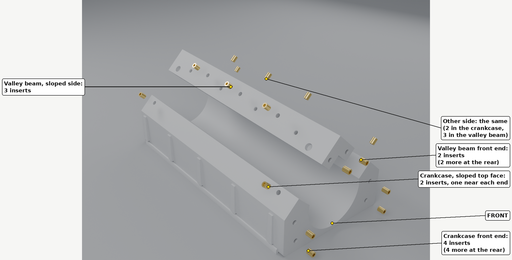

| Part | Where | How many |
|---|---|---|
| Crankcase | front end face | 4 |
| Crankcase | rear end face | 4 |
| Crankcase | the two sloped top faces, one near each end of each | 4 |
| Valley beam | each end face | 2 + 2 |
| Valley beam | the two sloped faces, 3 medium holes on each | 6 |
| Cylinder bank | the top face (no pegs), between the bores | 6 |
| End webs | the 3 small holes of the insert face, on each web | 6 |
| Hand knob | the hole in the side of its hub | 1 |
| **Total** | | **35** |

Do the crankcase and valley beam **separately**. They are drawn together only so
you can see every hole. Leave the 4 holes under the crankcase floor empty (they are
for the oil pan, later).


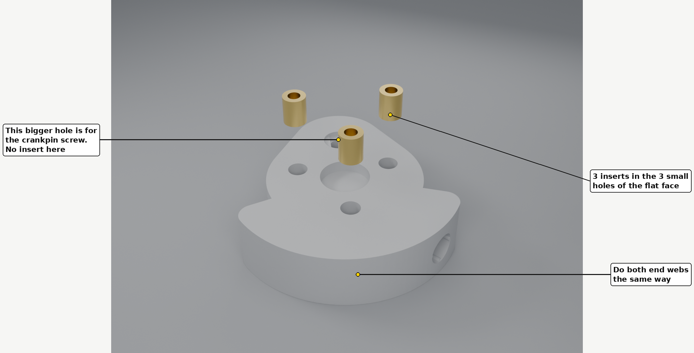

**Checkpoint D:** 35 inserts in, all flush or just below, none crooked. An M3 screw
goes into each one by hand.

---

# PART E: Put it together

## E1. Crank into the crankcase


1. Crankcase on the table, open side up. Find the rear (the pocket underneath).
2. Lower the crank straight down into the open top, **long shaft to the front**.
3. The 4 pistons hang out on the **bank A side** (left, seen from the front). The
   4 bare rods lie out on the other side.

## E2. Valley beam


Slide the valley beam in **from the front**, between the two rows of rods, until it
is flush with both ends. It can't go in from above because the pistons are in the way.

## E3. End plates

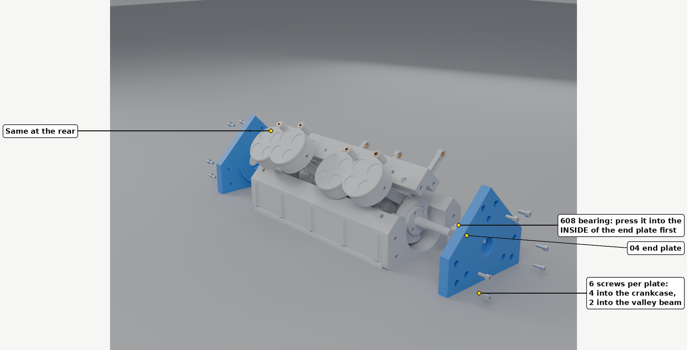

1. Press a 608 bearing into each end plate **from the inside face** (the side with
   the half-round lip) until it stops. Spin it: smooth.
2. Slide an end plate over each shaft, bearing first, until it sits against the
   crankcase end.
3. 6 screws per plate: 4 into the crankcase, 2 into the valley beam. Tighten them a
   little at a time, criss-cross, all snug.

**Checkpoint E3:** the crank turns by hand with no tight spot, and it can slide front
to rear about 0.6 mm (that is correct for now; the belt pulley takes it out later).

If it is tight here, loosen one plate's screws. If it frees up, that plate is the
problem: tell me which.

## E4. Cylinder bank A


1. Turn the crank so no piston is at the very top or bottom. Two will be higher
   than the other two; that is normal.
2. Tip the whole crankcase so bank A's pistons point straight up. It is much easier
   than lowering the bank at 45 degrees.
3. Hold the bank windows-out, pegs down, slots toward the valley.
4. Lower it over the pistons, the two higher ones first. Each piston goes into its
   bore and each lug into its slot. The pegs drop into the valley beam.
5. 5 screws from the top: 3 on the valley side, 2 near the ends. Snug.

## E5. Rails

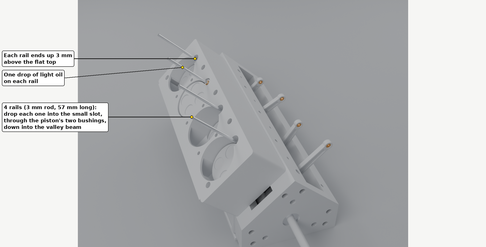

1. Wipe each rail clean. Feel the ends: file any sharp edge.
2. Drop a rail into each small slot beside a bore. It goes through the piston's two
   bushings and down into the valley beam. Turn the crank a little if it won't find
   the bushings.
3. Push it down until it stops. It stands about **3 mm** above the top face.
4. One drop of oil on each rail.

**Checkpoint E5:** turn the crank 2 full turns. All 4 pistons move smoothly, and none
touches the wall of its bore (look through the windows).

## E6. Head A


1. Lower head A onto the bank. The 4 rail tops go into 4 small holes under the head.
   It fits one way only.
2. 6 screws down through the head, snug.

---

# PART F: The test

> **Before the motor drives it:** see `docs/ENGINE1_TODO.md` (crankpin screws were left out for the hand test).

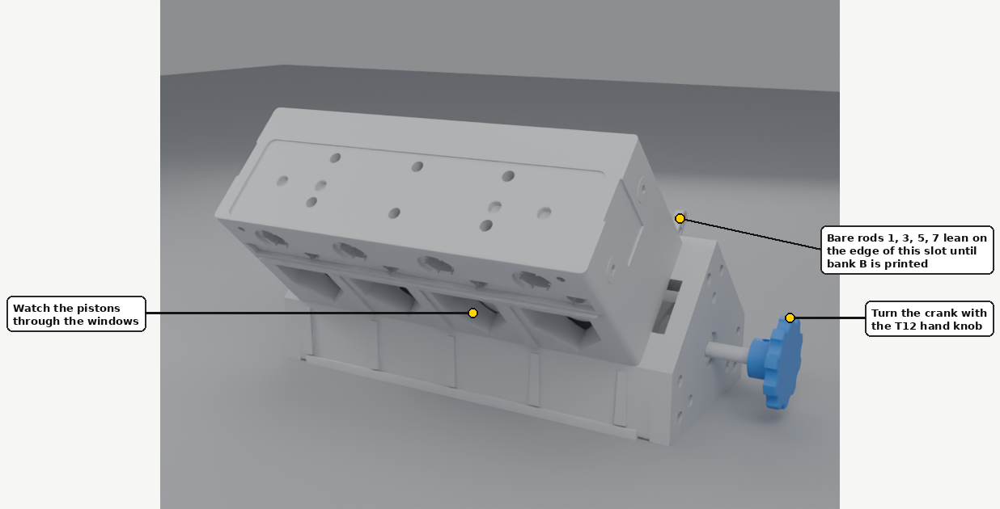

1. Push the hand knob onto the front shaft. Screw an M3 x 8 into its insert until
   it touches the flat on the shaft. Snug.
2. Turn the crank **slowly**, 5 full turns forwards and 5 back.
3. Then turn it a bit faster.

The 4 bare rods lean on the edge of the empty slot and may tap as they flip over.
That is expected and doesn't count.

| Check | Pass | If not, tell me |
|---|---|---|
| Turning | smooth, no tight spot, no click from bank A | the cylinder number and where in the turn |
| Pistons on rails | free over the whole stroke | which piston, top / middle / bottom |
| Pistons in bores | never touch the wall | which one, and where |
| Crank wobble (C6) | under 0.2 mm | which segment |
| Cracks | none at any bearing, bushing, pin or insert | which part, with a photo |

---

# PART G: Later, bank B (all 8 cylinders)

Do this after part F passes. It needs plate M7 (second bank + head B), 8 more
bushings, 4 more dowel pins, 4 more rails, 6 more inserts and 11 more screws.


1. Leave bank A as it is.
2. Glue bushings into the other 4 pistons' lugs (B2).
3. Put them on rods 1, 3, 5, 7 with dowel pins (B3). The rods are already on the
   crank, sticking out of the open side. On bank B, **the lug goes on the left**
   when the rod's groove faces you.
4. Lower the second bank over them (E4). 5 screws.
5. Rails with oil (E5). Head B (E6), 6 screws.

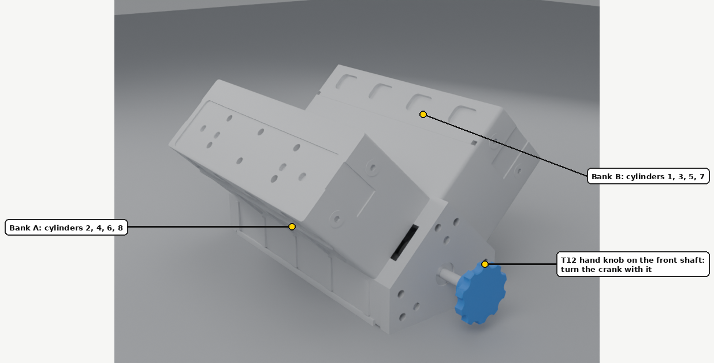

Run part F again. Now every click counts.

---

# Troubleshooting

| Problem | Most likely cause | What to do |
|---|---|---|
| A bearing won't press in | brim lip or blob at the hole edge | scrape the edge with the knife, press again from the other side |
| A bushing is loose | normal; that's why it's glued | glue it (B1) |
| Glue got into a bushing | too much glue | acetone soak, or reprint that rod |
| A pin won't go into a D-hole | turned wrong, or a blob in the hole | line up the flat; clean the hole with the knife tip |
| A rod is pinched after a joint | ring too thick | tell me which pin; use a thinner ring |
| A screw spins and won't tighten | stripped plastic | stop; one size longer screw or a drop of glue in the hole |
| An insert went in crooked | pushed too hard | reheat it and straighten it with the iron while warm |
| Crank tight in the crankcase | end plate not square, or crank wobble | loosen one plate at a time (E3) |
| A piston clicks | piston touching the bore, or rail dry | look through the window while turning slowly; oil the rail |
| The bank won't go on | a piston or lug not lined up | lift it off, turn the crank a little, try again with the bank pointing straight up |

---

# What to send me

Copy this, fill it in, and send photos of anything that didn't fit:

```
T2 inserts (D1):           best hole: ____
Rods (B1):                 bearings ok / bushings ok / problem:
Piston lugs (B2):          rail slides yes / no
Pistons on rods (B3):      ok / problem:
Rings (C2):                thickness ____ mm, slide on yes / no
Crank joints (C3-C5):      ok / problem:
Crank wobble (C6):         about ____ mm
Crank in case (E3):        turns freely yes / no
Bank on (E4):              ok / problem:
Rails (E5):                slide yes / no
Head on (E6):              ok / problem:
The test (F):              smooth / tight at cylinder ____ / click at ____
Anything cracked:          no / yes:
```
