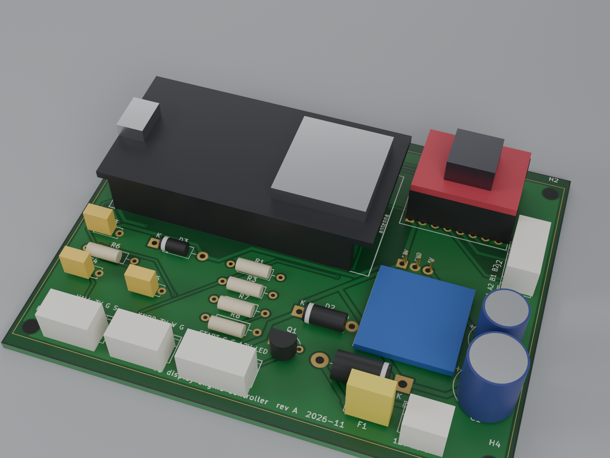
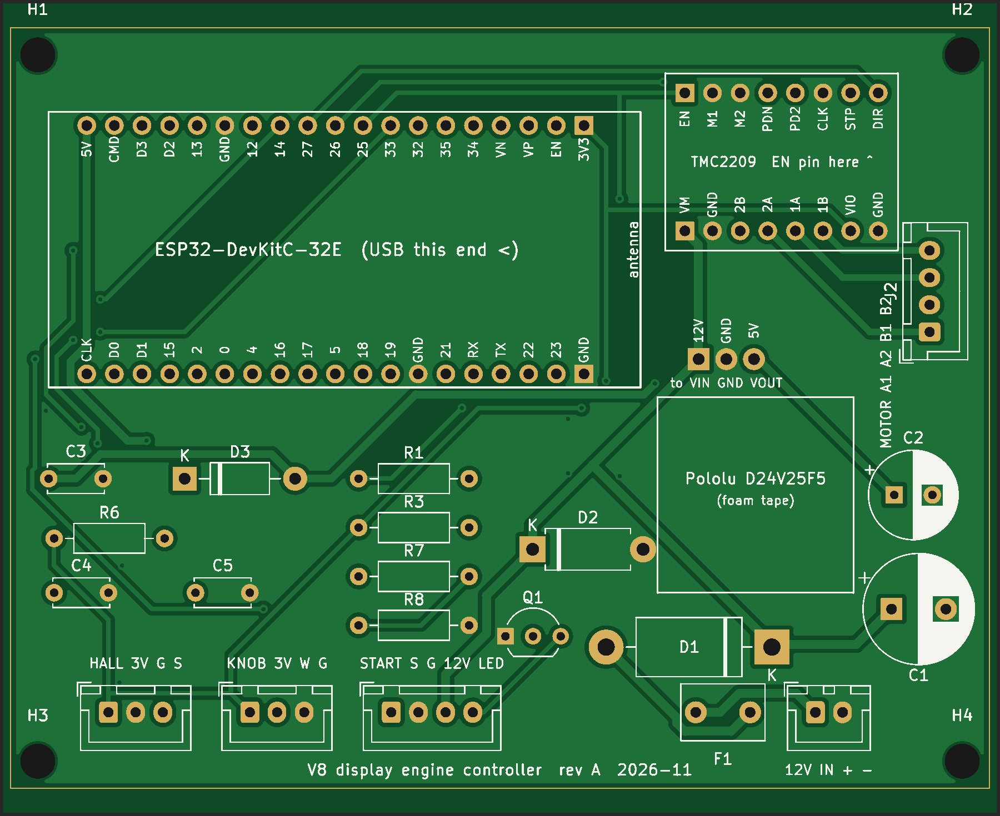
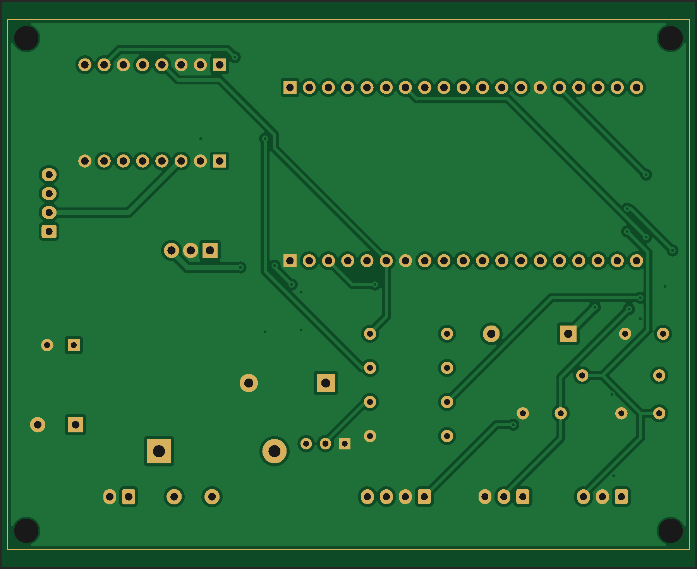
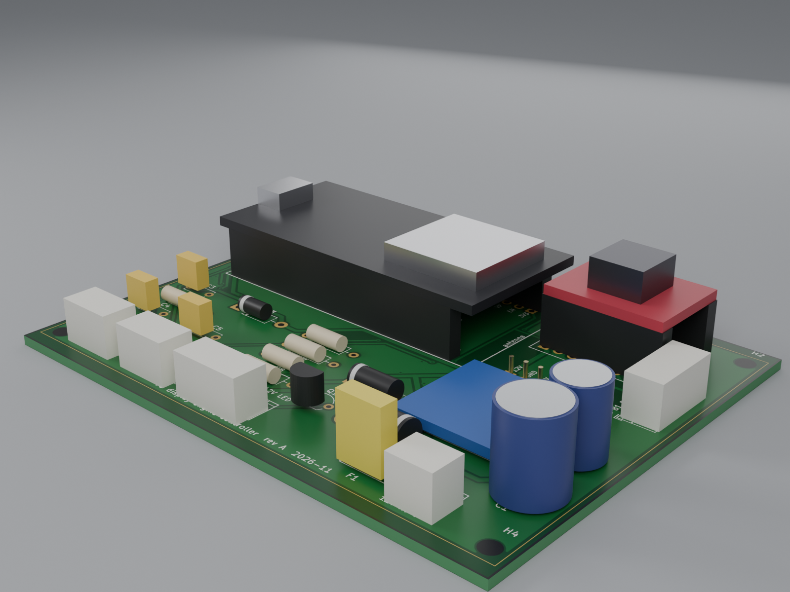

# Controller PCB (rev A): what it is, how to order it, how to build it

**Status: draft. Do not order yet.** Order only after the hand-wired proto board has run
engine #1 and any circuit fixes have been carried over here (decision D85).

*3D preview. The parts are simple stand-in shapes of the right size and position (KiCad's
3D part models are not installed in the build environment).*

## What it is

| | |
|---|---|
| Size | 90 x 70 mm, 2 layers, 1.6 mm, ground pour on both sides |
| Mounting | 4 x M3 holes, 85 x 65 mm pattern, onto the 4 standoffs of the pan floor panel (41) |
| Parts | all through-hole (wire legs), hand-solderable |
| Modules | ESP32-DevKitC-32E and TMC2209 plug into sockets; Pololu D24V25F5 is taped down and linked with 3 wires |
| Wires | every off-board wire plugs into a JST XH connector |
| Circuit | `docs/ELECTRONICS_NETLIST.csv` minus the LED outputs and level shifter (D77). Cross-checked: every other connection matches the netlist |
| Checks | DRC: 0 errors, 0 unconnected pads (`pcb/drc_report.txt`; the 29 remaining lines are "library table not loaded" notes from the headless build) |

| Top | Bottom |
|---|---|
|  |  |

## Files

| File | What |
|---|---|
| `pcb/v8_controller_gerbers_JLCPCB.zip` | **the file to upload to JLCPCB** (Gerbers + drill) |
| `pcb/v8_controller.kicad_pcb` | the board, open it in KiCad 7 or newer |
| `pcb/v8_controller.step` | board outline for CAD |
| `pcb/drc_report.txt` | design-rule check |
| `tools/pcb/build_pcb.sh` | rebuilds everything: place, route, pour, DRC, Gerbers, pictures |

The tracks are drawn by `tools/pcb/route.py`, a two-layer grid router written for this
board (0.25 mm grid, 0.25 mm clearance, 0.8 mm power / 0.6 mm motor / 0.4 mm signal tracks).
It gives the same result every run.

## Before ordering: three checks on the real parts

1. **ESP32 row spacing: done.** Measured on the real board 2026-11-24: 24.1 mm outside
   edges, 21.4 mm inside edges = **22.86 mm** (0.9 in) centre to centre. The board was
   redrawn to 22.86 (it had assumed 25.4). Its pin labels also match the board.
2. **TMC2209 row spacing: done.** The user's BTT TMC2209 V1.3 has the standard StepStick layout
   (rows 12.7 mm apart; pin labels VM, GND, A2, A1, B1, B2, VIO, GND / EN, MS1, MS2, RX, TX, CLK,
   STEP, DIR match the footprint). A caliper read over its big solder joints (13.5 / 9.4) is not
   precise enough to say more, and nothing needed changing.
3. **The proto board has run engine #1**, and every fix made on it is in this design.

## Ordering at JLCPCB (when the checks pass)

Upload `pcb/v8_controller_gerbers_JLCPCB.zip`. JLCPCB reads the size and layers from it.

| Setting | Value |
|---|---|
| Layers | 2 |
| Dimensions | 90 x 70 mm (filled in from the file) |
| Quantity | **5** for the first order (check one, then order 50) |
| Thickness | 1.6 mm |
| Colour | your choice. Black looks most premium; green is cheapest and fastest |
| Surface finish | HASL lead-free (or ENIG for a gold look) |
| Everything else | default |

Expect about $2 to $5 for 5 boards plus shipping.

## Parts for one board

| Ref | Part | Notes |
|---|---|---|
| U1 | ESP32-DevKitC-32E | on 2 x 19-pin female headers |
| U3 | BTT TMC2209 V1.3 | on 2 x 8-pin female headers, **EN pin at the square pad** |
| U2 | Pololu D24V25F5 | foam tape + 3 wire links |
| J1 | JST XH 2-pin | 12 V in |
| J2 | JST XH 4-pin | motor |
| J3, J6 | JST XH 3-pin | hall sensor, speed knob |
| J7 | JST XH 4-pin | START button and its ring light |
| F1 | 2 A resettable fuse | 5 mm leg spacing |
| D1 | 1N5822 | band = cathode, at the square pad marked K |
| D2 | P6KE18A | band at K |
| D3 | 1N5817 | band at K |
| C1 | 220 uF 50 V electrolytic | **+ leg in the square pad** |
| C2 | 470 uF 25 V electrolytic | **+ leg in the square pad** |
| C3, C5 | 100 nF ceramic | either way round |
| C4 | 10 nF ceramic | either way round |
| R1, R7 | 1 k | either way round |
| R3, R6 | 10 k | |
| R8 | 100 k | |
| Q1 | 2N3904 | flat face as printed on the board |
| H1-H4 | 4 x M3 x 8 screws | into the panel standoffs |

## Soldering order

Lowest parts first, so each one is held flat by the table when you flip the board:

1. Resistors R1, R3, R6, R7, R8
2. Diodes D3, D2, D1 (**band towards the K mark**)
3. Ceramic capacitors C3, C4, C5
4. Q1 (flat face as printed)
5. F1
6. Female headers for U1 and U3. Tip: plug the ESP32 / TMC2209 into the headers first, so
   they solder perfectly straight, then remove the modules.
7. JST connectors J1, J2, J3, J6, J7 (latch side as printed)
8. Electrolytics C1, C2 (**+ leg in the square pad**, stripe away from it)
9. U2: stick the regulator to its outlined area with foam tape, then 3 short wires from its
   **VIN, GND, VOUT** pins (read the labels printed on the regulator) to the board pads
   **12V, GND, 5V**. Its other pins (EN / SHDN / PG) stay empty.

## Wiring the connectors

| Connector | Pin 1 (square pad) | Pin 2 | Pin 3 | Pin 4 |
|---|---|---|---|---|
| J1 12V IN | +12 V from the rocker switch | GND (jack sleeve) | | |
| J2 MOTOR | coil A + | coil A - | coil B + | coil B - |
| J3 HALL | DRV5033 pin 1 (VCC) | pin 2 (GND) | pin 3 (OUT) | |
| J6 KNOB | pot outer leg (3.3 V) | pot middle leg (wiper) | pot other outer leg (GND) | |
| J7 START | button contact | button contact (GND) | ring light + | ring light - |

Power path: DC jack centre (+) -> rocker switch (2-pin, unlit) -> J1 pin 1. Jack sleeve
(-) -> J1 pin 2. The rocker has no lamp wire.

Motor coils: measure with the multimeter. The two wires with about 1 to 2 ohm between them
are one coil (A); the other two are coil B. If the motor turns the wrong way, the firmware
flips it (hold START at power-on, long press; `docs/ELECTRONICS.md`).

## First power-up (modules out)

1. Modules unplugged. 12 V on J1.
2. Measure: **12 V** between the 12V and GND pads at U2; **5 V** between 5V and GND.
3. Power off. Plug in the ESP32 and the TMC2209 (EN pin at the square pad).
4. Power on. The ESP32's red light comes on and the console (USB) shows the start-up banner.
5. Then follow `docs/ELECTRONICS.md` section 8 (homing, rotation direction, speed range).
